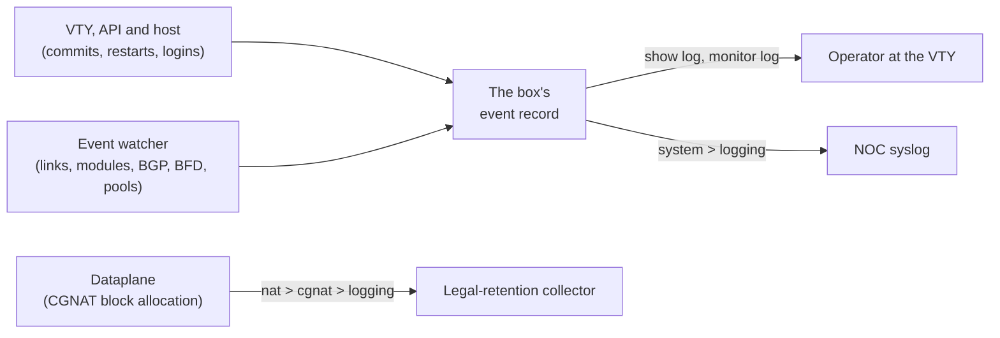

# Sending the box's event log to the NOC's syslog

For whoever wants to see in the NOC's syslog what happens on the box — commits, restarts and their cause, links, modules, BGP and BFD sessions, pools out of blocks, logins — without having to log in to it. This page says what that record is, how to read it on the box itself, how to send it to one or more syslog collectors and how to check that it is arriving.


:::warning
**This is not the export of the CGNAT records.** Who used which public IP and port, to answer a court order, leaves through `nat` > `cgnat` > `logging` (IPFIX or syslog) and is in [IPFIX logging and audit trail](/s/wiki-en/doc/ipfix-logging-and-audit-trail-mrQPyuvc8g) and [Where the records go: collector, transport and retention](/s/wiki-en/doc/where-the-records-go-collector-transport-and-retention-oXaUx9z75V). The event log on this page carries **no** connection record: configuring only `system` > `logging` leaves the box without the retention the law requires.

:::

# Two records, two configurations

The box has two log streams that do not mix: one configuration never touches the other, and neither carries the other's lines. They should go to different collectors — the NOC's and the legal-retention one.



|     | Event log (this page) | CGNAT records |
|-----|-----------------------|---------------|
| What it says | what happened to the box | who held which public IP and port |
| What it is for | operations, NOC, internal audit | answering a court order, one year of retention |
| Where it is configured | `system` > `logging`  | `nat` > `cgnat` > `logging` |
| On the box itself | `show log`, `monitor log`, `show system logging` | `show cgnat logging`, `monitor cgnat logging` |
| In syslog | APP-NAME `prisma-routing`, facility `daemon` (3) | APP-NAME `prisma-cgnat`, facility `local0` (16) unless set |

The different APP-NAME and facility let a collector that receives both separate them with one filter.

# What goes into the record

The record is written by whoever acts — the VTY, the API, the host's scripts — and by a watcher on the host that reads the box's state every few seconds and records what changed since the previous reading. Nothing is copied from the journal or from FRR's logs, so the routine that fills the journal does not show up here. It lives on the box's log volume, survives reboots and upgrades, and is bounded in size: two files of 256 KiB, about 3000 events; the oldest goes.

Each event has the time, a **severity**, a **source**, a **kind** and a sentence, with who did it and from where when that is known.

| Severity | When |
|----------|------|
| `error`  | a module alarm, the box giving up on the dataplane |
| `warning` | something that needs attention: a link down, a BGP session leaving Established, a start nobody asked for, a login with a wrong password |
| `notice` | a normal change: a commit, a link back up, a session up, a login |
| `info`   | routine: a logout, the head of the PPPoE session trail |

| Source (`source`) | Who saw it |
|-----------------|------------|
| `vty`           | a VTY session |
| `api`           | the management API |
| `host`          | the host: the boot, logins, the cards Linux holds, the box giving up on the dataplane, the PPPoE control plane |
| `dataplane`     | the dataplane's ports, their modules, the pools, the CGNAT log export |
| `routing`       | FRR: BGP and BFD sessions |

| Kind (`kind`) | What it is |
|-------------|------------|
| `commit`, `rollback`, `confirm`, `confirm-expired` | the configuration changed, went back, was confirmed, or a `commit confirmed` expired and was undone |
| `asked`     | a restart, upgrade, reboot or shutdown asked for, and by whom |
| `start`, `boot`, `upgraded` | the dataplane, routing or the PPPoE control plane started, **with the cause**; the box came up; an upgrade finished |
| `settings`  | the SNMP, API or `system` > `logging` settings applied or refused by a commit |
| `link`      | a port's link went down or came back, administrative or not; went down and came back between two readings, with how many times |
| `transceiver` | a module inserted, removed, swapped; RX or temperature past a warning or an alarm, and back |
| `bgp`, `bfd` | a session up, or down with FRR's reason or bfdd's diagnostic |
| `pool`      | a CGNAT pool with no free block, and with a free block again |
| `collector` | the CGNAT records export lost or reached its collector |
| `login`     | a login, a logout, a login with a wrong password |
| `gave-up`   | the box gave up on the dataplane, or a `system dataplane restart` did not finish |
| `exit`, `radius`, `trail` | with PPPoE: the control plane stopped, a RADIUS server failed or came back, the head of the session trail |

Two rules keep the record from turning into noise. Something that keeps going down and coming back is said four times in 5 minutes and, from then on, one line per 5-minute window with the count. And what was **already** wrong when the watcher started — a port enabled with no link, a module past its warning, a configured session that did not come up — is said once per boot, in the present tense, starting with `standing at start:`.

# 1. Read the record on the box itself

Any account can read it. With no filter, the last 50 events, newest last:

```
prisma> show log
prisma> show log last 20
prisma> show log since 2h
prisma> show log severity warning
prisma> show log source routing
prisma> show log kind bgp since 1d
prisma> show log since 1d source vty | match rollback
```

`since` takes `45s`, `30m`, `1h`, `2d`, `1w` or an ISO date (`2026-10-05`, `2026-10-05T14:00`); the time is printed in the box's time zone. `severity` shows that level and the more severe ones. Filters combine. A line wider than the console folds, with the continuation indented; the first line carries the time, the severity, the source and the start of the sentence.

To follow it live, `monitor log`, with the same filters, until Ctrl-C:

```
prisma> monitor log
prisma> monitor log severity warning
prisma> monitor log kind link last 5
prisma> monitor log source routing seconds 300
```

`severity`, `source` and `kind` select what is followed; `last` and `since`, what is shown first. With neither, it starts now. `seconds <n>` stops on its own.

`show logging`, without `log`, is something else: the logging configuration of each FRR daemon.

# 2. Configure the syslog destinations

It takes an account with `role administrator`. In configuration mode:

```
configure
 system
  logging
   host 192.0.2.10
   host 192.0.2.11 protocol tcp severity warning
   exit
  exit
 commit
```

`host <address> [port <n>] [protocol udp|tcp] [severity <level>] [source-address <address>] [vrf <name>]`:

| Option | If nothing is said | What it does for you |
|--------|--------------------|----------------------|
| `<address>` | —                  | the collector, IPv4 or IPv6. **An address, never a name**: the box whose DNS failed is precisely the one that most needs to send its events |
| `protocol udp\|tcp` | `udp`              | UDP: one datagram per event. TCP: a stream with octet-counting framing (RFC 6587), and nothing is lost while the collector is away (below) |
| `port <n>` | 514 over UDP, 601 over TCP | the collector's port |
| `severity error\|warning\|notice\|info` | `info` (everything) | the minimum level sent: that one and the more severe |
| `source-address <address>` | whatever the route picks | the source address the collector sees; of the same family as the collector |
| `vrf <name>` | the routes of the box's Linux | the VRF the event leaves through; it must be a `vrf <name> table <n>` of the configuration, or `commit check` refuses |

Up to four destinations, one per address: a second `host` for the same address replaces the first, and `no host <address>` stops sending there. `show this`, inside `logging`, shows what is configured.

**It takes effect at** `**commit**`**, with nothing restarted.** The commit says how many destinations there are (`logging: 2 remote syslog destination(s)`), the record gets a `settings` event, and the watcher starts sending within a second. Remember `save` so the configuration survives a boot.


:::info
**A new destination starts from now.** What was already in the record before the commit is not sent; for the past, use `show log`. From then on, each destination keeps track of how far it has received.

:::

# 3. Choose UDP or TCP

The sender is the event watcher itself, and its queue is the record itself: each destination keeps its position, which only advances after a send that succeeded, and that position survives a restart of the watcher and a reboot.

* **Over TCP, nothing is lost and nothing is repeated** while the collector is away: the box tries again every 30 s and, when it comes back, sends what waited, in order. The limit is the size of the record — a collector away for longer than the roughly 3000 events cover loses what has already left the record. A connection that breaks in the middle of a send may make the collector see a repeated event, never a gap.
* **Over UDP, the box only knows a send failed if the system says so** (an unreachable port answered, a route that does not exist). A collector that simply disappears is not noticed, and what was sent meanwhile is lost.

For a NOC that needs the whole timeline, TCP.


:::info
**With PPPoE, the head of the session trail leaves through here, at** `**info**`**.** It is the off-box copy that `show pppoe history verify` compares the trail with. A destination with `severity notice` or more severe does not receive it: keep at least one collector at `info`.

:::

# 4. Management in a VRF: which way the event leaves

A destination without `vrf` leaves through the routes of the box's Linux. With management in a VRF of its own (`system` > `management` > `vrf <name>`), what the box itself originates — and that includes these events — leaves through management's routes, **unless** the main table has a specific route to the collector. A destination with `vrf <name>` always leaves through that VRF, whatever route the main table has:

```
configure
 system
  logging
   host 2001:db8:100::10 protocol tcp source-address 2001:db8:100::2 vrf mgmt
   exit
  exit
 commit
```

Use `vrf` when you want the path not to depend on what the main table learns, and `source-address` when the collector or its firewall filters by source. Management in a VRF is in [Routing, SSH, users and SNMP](/s/wiki-en/doc/routing-ssh-users-and-snmp-jjxcPssV72).

# 5. What reaches the collector

RFC 5424, one message per event: facility `daemon`, the event's severity as the syslog severity (`error` 3, `warning` 4, `notice` 5, `info` 6), the box's name as HOSTNAME, APP-NAME `prisma-routing`, the event's kind in upper case as MSGID, and the event's fields as structured data under the product's enterprise number, `event@67033`. The time is in UTC. A commit made from the VTY and a login with a wrong password, on a box named `edge-1`, arrive like this (one message per line):

```
<29>1 2026-10-07T14:02:11.250Z edge-1 prisma-routing - COMMIT [event@67033 source="vty" kind="commit" account="ana" origin="ssh 192.0.2.50"] configuration committed: NOC syslog (by ana, from ssh 192.0.2.50)
<28>1 2026-10-07T14:02:51.250Z edge-1 prisma-routing - LOGIN [event@67033 source="host" kind="login" subject="noc" reason="authentication failed" origin="ssh 203.0.113.9"] failed login as noc (from ssh 203.0.113.9)
```

The possible parameters are `source`, `kind`, `subject` (the interface, the neighbour, the pool, the account), `reason`, `account`, `origin`, `cause` and `component`; an empty parameter is left out. Filtering on the collector by MSGID (`LINK`, `BGP`, `LOGIN`, `COMMIT`...) or by the `kind` parameter gives the same as `show log kind` on the box.

The same events also leave through the management API (`ListEvents` and the `WatchEvents` stream). Those with an object in the MIB — link, BGP and BFD session, pool out of blocks, module — also become SNMP notifications; logins, commits and restarts do not: those leave only through here. See [Monitoring and SNMP](/s/wiki-en/doc/monitoring-and-snmp-GxrrkTSEJT).

# How to check

**1. The box says whether it is delivering.** Any account can run:

```
prisma> show system logging
```

One line per destination, with the address, the port, the protocol and the minimum level, and below it what the watcher said of it:

```
192.0.2.10:514 udp  info and above
  sending
  sent 12 event(s) since the watcher started, the last at 2026-10-07 14:02:11
[2001:db8:100::10]:601 tcp  warning and above  from 2001:db8:100::2  vrf mgmt
  ready
  sent 0 event(s) since the watcher started
```

| What appears | What it means |
|--------------|---------------|
| `ready`      | the destination was read and there has been no event of its level to send yet |
| `sending`    | the last send succeeded |
| `not reached: <reason>; tried again every 30 s` | the collector was not reached, with the reason the system gave (`connection refused`, for example); over TCP nothing that was waiting is lost |
| `not forwarding yet: the watcher (prisma-routing-events-watch) has not said` | the watcher has not made a pass since the commit, or has been stopped for more than a minute |
| `no remote syslog destination: the record stays on the box ('show log')` | nothing configured in `system` > `logging` |

**2. Cause an event and look at both ends.** Open a new SSH session to the box: within 10 s the record gets a `login` at `notice`. For a destination with `severity warning`, an attempt with a wrong password produces a `login` at `warning`. On the box:

```
prisma> show log kind login last 5
```

On the collector, the same line, with APP-NAME `prisma-routing` and MSGID `LOGIN`. On the box, `show system logging` moves to `sending` and the counter goes up.


:::success
`sending` in `show system logging`, the same event in `show log` and on the collector: the box's event log is reaching the NOC.

:::
