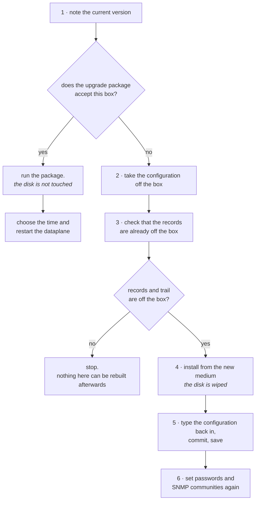

# Taking the box to a new version

How to put a new version of Prisma Routing on a box that is already in production. There are two paths and they cost very different things: the **upgrade package**, which replaces the product files and does not touch the disk, and the **reinstallation from the medium**, which wipes the entire disk. This page says which of the two is yours, what each one costs and in what order to do it.

# Which of the two is yours

|     | The upgrade package | Reinstallation from the medium |
|-----|---------------------|--------------------------------|
| When | Whenever the package accepts the box | When the package refuses, or when the machine is new |
| The disk | Untouched           | **Wiped**                      |
| Configuration, accounts, SNMP communities | Kept                | Gone                           |
| Configuration trail and exporter spill | Kept                | Gone                           |
| Downtime | Only the dataplane restart, at the time you choose | The whole window, booting from the medium |
| Published for | Every version, from 0.79.0 | Only the latest full version (those that change the first or second number) |
| Download size | About 120 MB, with the container images | Hundreds of megabytes          |

**The package is the normal path.** Reinstallation exists for the new machine and for the case where the new version changes the platform underneath the product. You do not need to guess which it is: the package checks this on its own and **refuses before writing anything**, saying what the box has and what the new version needs.

# The upgrade package

**The short path is through the VTY itself**, with the box reaching the internet (and resolving names: `dns server`, if the management network has no DNS):

```
prisma> system upgrade
prisma> system upgrade <version>
```

Without a version, it says which version the box runs and which is the newest published, and changes nothing. With the version, it downloads the package and the `sha256` from the public releases directory (the same one as in step 2), refuses the package before opening anything if the checksum does not match, and runs the same `upgrade` as the steps below, showing everything it says. A version equal to or older than the box's is refused: going back a version is the manual path.

Three things to know about it:

* **Only** `**root**` **or an account with** `**operator**` **can run it** (the `prisma-operator` group, since 0.149.26), like `system reboot`. The query, without a version, any account can do.
* **Ctrl-C does not interrupt** while `upgrade` runs: a half-upgraded box is worse than a slow upgrade.
* **If** `**upgrade**` **stops midway**, the VTY says with what status it exited and in which directory the package was kept, for whoever reads what happened.

**The download shows progress and does not get stuck on a bad connection.** Every few seconds the VTY says how much has arrived, out of how much, at what rate and how much is left (`downloaded 45.2 of 189.0 MB at 9.7 MB/s, about 15 s left`). A connection that goes 30 s without receiving anything, that stays below 125 KB/s (1 Mbit/s) for 30 s, or that drops midway is abandoned, and the rest is requested on a new connection, from where it stopped, with the name resolved again and the previous address tried last; the VTY reports each one (`resuming at 14.1 MB on a new connection, 2 of 6`). There are up to six connections, and the sixth is not abandoned for being slow: a box with a slow link finishes anyway. If the downloaded package does not match the `sha256`, it is downloaded once more from scratch, and the VTY says so; if the second one does not match either, it is refused and nothing has been changed.

At the end it says `upgraded to <version>` and reminds you of `save`. What applies to the manual path applies here: `save` before restarting, and the dataplane stays the old one until you choose the time for step 4.

From version 0.148.0, the VTY itself moves to the new version right afterwards, without a reboot: a few seconds after `upgraded to`, the management container is recreated with the new image, the session that did the upgrade drops and the next login is already on the new version. The dataplane and the routing daemons are **not** touched in this step and stay on the previous images until the reboot. Before 0.148.0, the VTY stayed on the previous version until the reboot, even with the box reporting the new version.

**Images from old versions are deleted.** Each upgrade brings four new images, and before this fix none was deleted: a test box reached 96% of the root filesystem after a series of patches. Now, right after the upgrade and at every boot, the box deletes the `prisma-*` images that no container uses and that are neither from the installed version nor from the version before it — that one stays, as a way back. The boot log (and that of `refresh-the-vty`) says what was deleted and how much space was recovered. Images from other repositories are never touched, and if the box cannot say for certain which version it is, it deletes nothing and says why.

The steps below are the same process by hand, for a box that does not reach the internet.


:::info
**Since 0.125.0 the package carries the container images**, which is why it is about 120 MB and not a few megabytes. A box that was upgraded instead of installed, and still runs the dataplane and routing as systemd services, **moves to the containers at the next boot**, just like a box installed from the medium. A box that already runs in the containers starts using the new version's images, and no longer those of the previous version.

:::

## 1. Note the running version

```
prisma> show version
```

Keep the whole output in the change ticket. It is what says where the box came from, and it is what you compare against at the end.

## 2. Download the new version's package

Each version has its own folder at <https://prismarouting.com.br/releases/>, with the package and its `sha256` side by side. The `latest/` folder always offers the newest upgrade package and, next to it, the newest ISO, each with its `sha256`. The installation medium exists only for full versions: a version that changes only the third number publishes only the upgrade package, and then the ISO in `latest/` is that of the latest full version. On the box itself, replacing `<version>` with the number:

```
curl -fO https://prismarouting.com.br/releases/<version>/prisma-routing-<version>-upgrade.tar.gz
curl -fO https://prismarouting.com.br/releases/<version>/prisma-routing-<version>-upgrade.tar.gz.sha256
sha256sum -c prisma-routing-<version>-upgrade.tar.gz.sha256
```

Only continue if the last line ends in `OK`. Any other answer means the file that arrived is not the one that was published. Download it again and do not run the package.

The folder has every version that still knows how to upgrade a box, from 0.79.0, which was the first with the current name. For versions 0.79.0 to 0.82.0 the `sha256` was computed when the file was copied there, because those versions were published without it.


:::warning
**Run** `**save**` **after upgrading and before restarting.** Two changes of form make an upgraded box refuse its own saved file at boot and come up **with no configuration at all**:

* from 0.125.2, CGNAT lives at the `nat` > `cgnat` levels, and the one-line form (`nat cgnat pool ...`, `nat cgnat interface ...`) is no longer accepted. **This applies to every box that has CGNAT configured**;
* from 0.122.10, the form `route <prefix> <next-hop>` inside `router static` is no longer accepted.

The configuration remains in effect after the package, because it restarts nothing, and `save` writes what is in effect already in the new form. That is all: `save`, and only then restart. To check beforehand, `show running-config` already shows the `nat` > `cgnat` block that `save` will write.

Rollback revisions from before the upgrade remain in the old form, and `save` does not reach them. Going back to one of them after upgrading is refused: `commit check` points to the line in the old form and nothing is applied. If you need to go back to the configuration from before, first take the box back to the previous version.

:::

## 3. Extract and run

```
tar xzf prisma-routing-<version>-upgrade.tar.gz
cd prisma-routing-<version>-upgrade
sudo sh upgrade
```

The package checks the box's platform, replaces the product files and says, file by file, what it wrote. If the platform does not match, it stops right there and **nothing was written**: the box remains exactly what it was before the command.


:::info
**The configuration is not touched.** `/etc/prisma-routing/prisma-routing.conf`, the rollback revisions and the tuning settings you edited stay where they were. The package rewrites the product's files, not yours.

**With one exception, done once, so that nothing changes on its own: the MTU, when moving to 0.152.1 from an earlier version.** Up to 0.152.1 an interface without `mtu` came up at 9000; from then on it comes up at 1500. For the box to stay as it was, the package writes `mtu 9000` on every interface in the saved configuration that had no `mtu` (and in the rollback revisions, keeping their dates), says which ones in the output — the `==> interface MTUs` block — and records in `show log` the line "interfaces with no mtu pinned at 9000, the default before 0.152.1: ..." with the list. It also leaves `/etc/prisma-routing/mtu-9000-kept`: with this file, the card keeps accepting frames of up to 9000, as before. A `no mtu` of yours after that is respected and does not come back: the interface goes to 1500.

:::

## 4. Choose when to restart the dataplane

This is the step that costs something, and it is yours.

The package replaces the dataplane **on disk** and restarts nothing. Until the next dataplane restart, the box keeps translating with the old dataplane, which was already loaded in memory.

What tells this story is the `plugin` line of `show version`, and **not** the `dataplane` line. The screen has, in this order: the version of the installed Prisma Routing, on the first line; `dataplane:`, the version of VPP itself; `plugin:`, the build the dataplane was loaded with; `routing:`, that of FRR; and `daemons:`, the routing daemons that are running.

The `dataplane` line is VPP's and does not move on a Prisma Routing version change. The one that lags behind is `plugin`: it is the build the dataplane was loaded with at the last boot. Compare it with the number on the **first** line - and when the two disagree the box says so out loud, with a paragraph under the `plugin` line explaining that only a dataplane restart makes them match. When they agree it says nothing, which is the normal state.

The `plugin` line answers in four ways, and three of them are not a divergence: that the build is such-and-such, that the dataplane is not responding, that the dataplane responded and reports no build, or that there is nothing to compare against.

When it is time, the restart is done from the VTY itself:

```
prisma> save
prisma> system dataplane restart
```

It says what it costs before acting and then acts, without asking. It runs the tuning adjustment again, brings the dataplane up on the new version's images and plugin, and reapplies the **saved** configuration when it comes back — hence the `save` first. When it finishes, `show interface` says when the box resumed forwarding. The end of `upgrade` itself lists the same options, with the cost of each.


:::warning
**Restarting the dataplane drops all sessions and all port blocks.** Every subscriber behind the box is translated again from scratch. It is fast, but it is not free, and that is why the package does not do it on its own.

A reboot of the box does the same thing. In both cases the shutdown is orderly: before exiting, the dataplane closes in the log every block it was holding.

:::

While the `plugin` line is behind the first, the box is running a new product with an old dataplane. It is a valid and expected state, but it is not where the box should spend the week.

# When the package refuses

The refusal comes with both platform versions written out, the one the box has and the one the new version needs. It happens when the new version also brings a new platform underneath, and the package carries only the product files: it installs no system package and does not access the network.

In that case the path is the medium, and it wipes the disk. **Read the whole section below before starting.**

# Reinstallation from the medium


:::warning
**Reinstalling wipes the entire disk, including the log volume.**

That volume holds the configuration trail - what lets you say which pool definition was in effect at a past instant, and without it the answer to a court order about last month is no longer defensible - and the exporter spill, which are records the collector has not yet received. The records themselves are not kept here: the box exports them.

Both die in the reinstallation and **no command in this product brings them back**. A reinstalled box is still answerable for the year of retention that was already running.

:::

## From HexaRouting to Prisma Routing: the package refuses, and why

The product changed its name. **No box running HexaRouting accepts the Prisma Routing upgrade package** — it refuses before writing anything, saying this:

```
This box runs HexaRouting, and this artifact installs Prisma Routing.

  The product was renamed and NOTHING MIGRATES.
```

The refusal is the point. Everything an installed box carries changed its name along with the product:

| Before | Now |
|--------|-----|
| `/etc/hexarouting/hexarouting.conf` | `/etc/prisma-routing/prisma-routing.conf` |
| `/etc/hexarouting/rollback/` | `/etc/prisma-routing/rollback/` |
| `hexarouting.service` and the other units | `prisma-routing.service` and the others |
| `hexash`, the accounts' login shell | `prismash` |
| groups `hexa-admin` and `hexa-cgnat` | `prisma-admin` and `prisma-cgnat` |
| `HEXA_*` variables in `tune.env` | `PRISMA_*` |
| `hexarouting.*` command-line keys | `prisma-routing.*` |
| `/var/log/hexarouting` | `/var/log/prisma-routing` |

**None of this is migrated by any program.** If the new files were installed alongside the old ones, the box would come back from the next boot with the old configuration on disk, new units that do not see it, interfaces no one brought up and operators whose login shell no longer exists.

**The path is reinstallation from the medium**, with the steps already on this page. Two extra things, both before typing `yes`:

### The product accounts need to be created again

An account created by the old version has `/usr/bin/hexash` recorded as its shell in `/etc/passwd`, and that file does not exist on the new box. Reinstallation already wipes the accounts — what matters is the list: **note who has an account and in which role before wiping the disk**, because it cannot be recovered from anywhere afterwards.

### The records volume: how to keep the year of retention

`/var/log/hexarouting` is a separate filesystem, with the configuration trail and the exporter spill. Reinstallation **does not wipe it**, as long as its disk is left out of the installation — but the new box looks in `/var/log/prisma-routing`, and will not look in the old path.

The procedure is this, and it is the operator's: a program that renamed mount points under a retention obligation would be a data migration done by someone who is not watching.

**1. Before reinstalling, note which disk holds the records and how it is mounted:**

```
# findmnt -no SOURCE /var/log/hexarouting
/dev/sdb1
# blkid /dev/sdb1
/dev/sdb1: UUID="...." TYPE="ext4"
```

Note the **UUID**, not `/dev/sdb1`: disk names change from boot to boot, and the UUID does not.

**2. Install the new version pointing the installation only at the system disk.** The installer asks which disk to install on; the records disk is not that one. If the machine has a records mirror, both mirror disks are left out.

**3. On the new box, mount the old volume at the new path.** The new box has already created `/var/log/prisma-routing` on the system disk; mount the old volume over it:

```
prisma> start shell
# mkdir -p /var/log/prisma-routing
# mount UUID=<the noted uuid> /var/log/prisma-routing
# ls /var/log/prisma-routing
```

The `ls` must show the files from the old volume: `config-history.log`, which is the configuration trail, and, if the exporter still owed records to a collector, its spill files.

**4. Make this permanent, or the next boot comes back without the records:**

```
# echo "UUID=<the noted uuid>  /var/log/prisma-routing  ext4  defaults  0 2" >> /etc/fstab
# systemctl daemon-reload
# mount -a
```

**5. Check in the next boot's self-test.** The records line must say the volume is a separate filesystem. If it says the records are on the system disk, the `mount` did not take, and what is being written there goes away with the next reinstallation.

The record files themselves do not change format: what was written remains readable, and the year of retention that was already running keeps running.

## What does not survive

| What | Survives reinstallation? |
|------|--------------------------|
| The configuration in effect | **No.** You need to take it off the box and type it back in |
| Account passwords and SNMP communities | **No**, and you cannot copy them from the screen: the box masks them when printing the configuration |
| Rollback revisions | **No**                   |
| The configuration trail and the exporter spill | **No**                   |
| What has already been exported to an IPFIX collector | **Yes** - it is off the box, and the reinstallation does not reach it |
| What has already been copied to a remote syslog | **Yes**, for the same reason |

The last two lines are the reason for the order of the steps below: what survives is exactly what was already off the box before anyone typed `yes`.



## 2. Take the configuration off the box

```
prisma> show running-config
```

It is what is in effect at this instant. Copy the whole output out of the session: it is written to be typed back at the prompt, one line at a time, and it is the only export format there is.


:::warning
**Passwords and SNMP communities come out masked.** The box does not print password hashes or SNMP communities on screen, on purpose: a hash that shows up on a shared screen during an incident is a hash that has left the company.

The consequence is that the copy you took **restores no access at all**. After reinstallation, accounts and communities are set again, by hand. Decide what they will be **before** the window.

:::

## 3. Check that the records are already off the box

**Dynamic mode.** Allocation events go to the IPFIX collector while the box works, and what has already reached the collector is not affected. What dies is what exists only on the box's volume. If export is stopped or lagging, the gap between the collector and the box is what you will lose.

**Deterministic mode.** There is no allocation to export: the evidence is the algorithm plus the configuration that was in effect, and it is the trail that says which one it was. Check the trail and compare the summary at the top with the copy in your remote syslog:

```
show cgnat history verify
  7 entries checked, chain intact
  head  seq 7 sha256 4e98de83…81f4
```

If there is no remote copy of the trail, **stop here**. It cannot be rebuilt afterwards.

## 4. Install from the new medium

The procedure is that of [Appliance installation](/s/wiki-en/doc/appliance-installation-gliHrNahhB) and does not change. Three points that are different when the machine is not new:

* **The target disk is the same as before**, with everything on it, and confirming with the word `yes` wipes the entire disk.
* **The question about how many gigabytes go to the log volume is asked again.** Answer at least the same number as before: answering less shrinks how long the box can keep exporting to an unreachable collector, without anything warning you.
* **If the box had a records mirror on two disks**, the second disk is asked about again and wiped by the same `yes`.

## 5. Type the configuration back in

Log in with the password set during installation and type, in configuration mode, the configuration you took in step 2.

`commit` makes it take effect now; `save` makes it survive the next boot. They are different things and both are necessary: a box that received the configuration and did not save comes back empty at the first reboot.


:::warning
**Remote changes go with** `**commit confirmed**`**.** A freshly installed box is a box on which no one has yet checked which interface is which, and it is exactly where an address in the wrong place cuts off the access of whoever is typing.

:::

## 6. Set again what came out masked

The accounts and their passwords, and the SNMP communities. None of this came in the copy from step 2, and a box that routes without your NMS seeing it is a box no one will notice getting sick.

# How to check

**After the upgrade package:**

* `show version` shows the new version on the first line, that of the installed Prisma Routing. The `plugin` line only follows after the dataplane is restarted (`system dataplane restart` or a reboot), and until then it stays on the old build on purpose.
* After the dataplane restart the `plugin` line matches the first, and the divergence paragraph disappears.
* The configuration is still there: `show running-config` brings back what was already in effect, without anyone typing anything.
* A real subscriber browses, and `show cgnat subscriber` with their IP answers with the public address and the port range.

**After reinstallation:**

* The first boot's self-test comes out **without any** `**[FAIL]**` **line**.
* `show version` answers with the new version, and the `plugin` line matches it from the first boot: the whole box came up new, so there is no old build loaded.
* `show running-config` brings back what you typed, comparable line by line with the copy from step 2, except for the masked values.
* A real subscriber browses, and `show cgnat subscriber` with their IP answers with the public address and the port range.


:::success
Self-test without `**[FAIL]**`, `show version` on the new version and a subscriber translating: the change is complete.

If the path was reinstallation, what does **not** come back is what did not leave the box beforehand. That is why steps 2 and 3 come before 4, and not after.

:::

# See also

* [Appliance installation](/s/wiki-en/doc/appliance-installation-gliHrNahhB) - the installer in detail, the records volume and the two-disk mirror
* [IPFIX logging and audit trail](/s/wiki-en/doc/ipfix-logging-and-audit-trail-mrQPyuvc8g) - what the trail keeps and how to check it was not tampered with
* [Expanding capacity without dropping subscribers](/s/wiki-en/doc/expanding-capacity-without-dropping-subscribers-R1zYvsfLCT) - the other change that costs downtime, and how to measure it beforehand
* [Access, login and roles](/s/wiki-en/doc/access-login-and-roles-uVm2WUy5xB) - the accounts and roles that step 6 recreates
