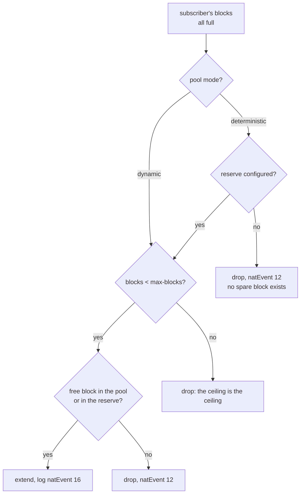

# When a subscriber's block fills up

A subscriber who fills their own block stops browsing while the box is healthy and the neighbors feel nothing. This page shows how to find out whether that is the case, what to do, and how to stop an infected host from consuming the whole pool.

# The symptom

By default, a subscriber who fills the block **is dropped**, and the log records `natEvent 12`. It is correct and it is terrible: the customer is left without internet, the equipment reports nothing abnormal, and the operator has nothing to point at when they call.

What makes this common is that the culprit is usually not the customer: an infected host opens thousands of sessions and exhausts its **own** block. The neighbors sharing the same public address are not affected — that is exactly why one block per subscriber is allocated — and that is also why the CGNAT gets blamed for an infection on the other side of the access network.

# Finding out whether that is it

```
show cgnat subscriber 100.64.3.19
```

The response includes a refusals line:

```
sessions 4   refusals: ports 0, session cap 6, rate cap 0
```

Above that line come the blocks they hold, each with the public address, the port range and how many are in use — an extension block is marked as such. And each refusal counter that is not zero gets, below, a line saying what it means.

There are **three separate counters, and each leads to a different action**:

| Counter | What it means | What to do |
|---------|---------------|------------|
| `ports` | the subscriber's block is full | sell more ports, or raise `max-blocks` (on a deterministic pool, this requires `reserve`) |
| `session cap` | they are at the configured limit | the limit is working, or it is too low for this customer |
| `rate cap` | they open sessions faster than allowed | usually it is an infection, not the customer |


:::info
A single counter for all three would answer none of them. It is the difference between knowing that "something was refused" and knowing whether you sell more ports, adjust a limit or call the customer to warn of an infection.

:::

To find who is closest to the limit before anyone calls:

```
show cgnat top
```

It lists the most loaded subscribers with the ports each one holds, for example `3/512`.

# How many are near the limit, and the alarm that warns on its own

`show cgnat top` answers **who**. It does not answer **how many**, and that is the question that decides whether you have an infected customer or a badly sized pool.

```
show cgnat pool
```

Along with the pool capacity, it prints the distribution of how much each subscriber is using of their own block:

```
utilisation  2 subscriber(s) holding a block
   75-89%  1
      100%  1
alarm at     75% of a subscriber's block
```

The shape matters more than the average. With 200 thousand subscribers, a pool reads as half empty while a thousand customers are pinned at the limit — and the average tells you neither. What settles it is the **shape**: how many are near the end of the block, and whether that number is moving.


:::info
This histogram is computed at the moment you run the command, walking the port maps the allocator already keeps anyway. Nothing is counted per packet and the session table is not touched — running it on a loaded box costs no traffic.

:::

## The alarm, once per crossing

The histogram answers when you ask. The alarm warns without being asked, and it ships off:

```
configure
 nat
  cgnat
   pool residencial
    utilisation-alarm 75
    exit
   exit
  exit
 commit
```

When a subscriber crosses the threshold, **one** line goes to the log, naming who it is, how much they are using and what it is ahead of:

```
subscriber 5 of pool residencial is 75% through its 512 ports on 200.150.10.7:
past the 75% alarm. RFC 8158 natEvent 12 would only report this once the
customer had already started losing traffic.
```

That last sentence is why the alarm exists. The `natEvent 12` that opens this page is correct and arrives late: it reports exhaustion, which is to say it reports the instant the customer **started losing traffic** — when the support call is already in the queue. The alarm reports the path to it.

The threshold goes from 1 to 100, per pool, and `no utilisation-alarm` turns the alarm off again. The line goes to the dataplane log, at warning level. It is a setting **applied in place**: turning it on, changing it or turning it off drops no one.

And it speaks **once per crossing**, not once per allocation. After the line, the subscriber can keep filling up and nothing more is said.


:::info
This is design, not thrift. One line per allocation above the threshold is a log nobody can keep — and the subscriber who triggers the alarm is, by definition, the one allocating fastest, that is, the one who would produce the most lines. Ten points of hysteresis clear the mark, so that a subscriber sitting exactly on the threshold does not generate a line every time a port is released and taken again.

:::

The alarm is evaluated **where a port is taken**, and nowhere else — utilization only goes up there. The practical consequence: a subscriber who emptied the block and never allocated anything again keeps the mark raised. It is not a wrong answer, it is stale state: the alarm speaks about a subscriber **filling up**, and someone who stopped asking for ports is not filling up.

# Extended blocks

With `max-blocks` above 1 (the maximum is 255), a subscriber whose blocks are all full gets **another** one. Where that block comes from depends on the pool mode:

* on a **dynamic** (BPA) pool, from a list of free blocks — handing out the second is the same operation as handing out the first;
* on a **deterministic** pool, only from a **reserve** set aside for this with `reserve`. Without a reserve, there is no spare block, and the subscriber who fills up is dropped as before.

```
configure
 nat
  cgnat
   pool residencial
    max-blocks 2
    exit
   exit
  exit
 commit
```



The ceiling matters as much as the extension: without it, an infected host consumes the pool every other subscriber needs, and the operator trades a customer complaint for an outage.

Every extension is logged as `natEvent 16` and its release as `natEvent 17`. An extension cannot be derived from anything — neither from the formula nor from the first block — so a block the log does not record cannot be attributed to anyone.

## The reserve of a deterministic pool

On a deterministic pool the formula assigns **all** blocks to someone. A block handed out as an extension without a reserve would be a block the formula gives to someone else — and handing it out would break that person's mapping with no error anywhere. `reserve <n>` solves this by taking `n` blocks from **each** public address of the formula and keeping them for extensions:

```
configure
 nat
  cgnat
   pool residencial
    reserve 1
    max-blocks 2
    exit
   exit
  exit
 commit remap
```

`show cgnat pool` shows the math: how many blocks per address the formula still uses and how many were set aside.


:::warning
**Turning on or changing the reserve is a capacity change.** The formula ends up with fewer blocks per address, the pool is rebuilt, and all its sessions drop. That is why a plain `commit` refuses, and you must ask for it by name with `commit remap`. How many subscribers lose their block or move depends on the pool policy: run `commit check` first, and it tells you the exact count. Do it in a window.

:::


:::info
**The reserve block does not come from the formula, so it has to go to the log.** On a deterministic pool with a reserve, each extension block is exported as `natEvent 16` and released as `natEvent 17`, exactly as on a dynamic pool — it is the only thing a deterministic pool logs per subscriber. A pool with a reserve and no export configured gets a warning on `commit check` and on `commit`: without the record, nobody can say whose a port from that reserve was.

:::

A reserve smaller than the number of dataplane workers is accepted, with a warning: the workers left without a reserved block cannot extend their subscribers. And an exhausted reserve is counted separately in `show cgnat blocks`, apart from the subscriber who hit `max-blocks` — one calls for a bigger reserve, the other for a higher ceiling.

# Start small and grow only those who need it

`block-size` and `max-blocks` together already make a **port range per subscriber**, and that is how a dynamic pool serves a smart meter and a heavy household at the same time:

```
configure
 nat
  cgnat
   pool residencial
    block-size 64
    max-blocks 8
    exit
   exit
  exit
 commit
```

The meter gets **64 ports** and never asks for the second block. The heavy household reaches 512 on its own, one block at a time, as it fills each one - without anyone configuring anything for it. With a single 512-port block, the meter would cost the pool the same 512.

`show cgnat pool` shows the range in ports:

```
  per sub      64-512 ports (1-8 blocks, grown one at a time as each fills)
```

If every new subscriber needs more than one block from the start, `initial-allocation <ports>` hands out a larger first allocation at once, and growth continues one block at a time from there. "First 512, then 256 at a time" is `block-size 256`, `max-blocks 10` and `initial-allocation 512`. The value must be a whole number of blocks and cannot exceed `max-blocks`; it only applies to a dynamic pool, is applied in place and changes what the **next** new subscriber receives, without touching anyone who already has a block. Each block of that first allocation is its own `natEvent 16`. `show cgnat pool` then shows the range starting from it.

The price of a small block is **logging volume**: each block handed out becomes its own record in the log. The household that reaches eight blocks generates eight records where one large block would generate one. Choose the smallest block that still keeps most subscribers within **one**, and use `max-blocks` for the minority.


:::warning
`block-size` **rebuilds the pool** and drops all its sessions. `max-blocks` does not. Changing both at once is a mapping change, and `commit` refuses until it is asked for by name.

:::

# Where the extra blocks land

The extra block lands, whenever possible, **on the same public address** as the subscriber. This is the address pairing that RFC 4787 REQ-2 describes and that RFC 6888 REQ-2 requires as a CGNAT default: a customer going out through two addresses at the same time appears as two computers to whoever is on the other side, and it is what makes a SIP call connect and have no audio - the media is announced on one address and the signaling came from another.

It is a **preference, not a rule**. If there is no free block on that address, the box hands out any other instead of leaving the customer without traffic. How much of that held on your pool is in `show cgnat blocks`:

```
  RFC 4787 REQ-2 paired: 412 of 419 extension(s) on the holder's own address
```

`block-stride` is a different question, and decides the distance between the blocks of the same subscriber **within** that address:

```
configure
 nat
  cgnat
   pool residencial
    block-stride 1
    exit
   exit
  exit
 commit
```

| Value | What happens |
|-------|--------------|
| `0` (default) | the nearest free block on the subscriber's address |
| `1`   | adjacent: the second block starts where the first ends |
| `n`   | `n × block-size` ports apart, on the same public address |

**Adjacent** leaves the subscriber with a contiguous port range, and is the option for whoever handles court orders and investigations: one range instead of several. **Spread** scatters the subscriber across the range of their own public address, and is the option for whoever does not want observing a range from outside to say much about a customer.

`block-stride` only applies to a **dynamic** pool, and is refused on a deterministic one: the extension there comes from the reserve, which has its own placement rule, and the distance would never be read.

Changing the distance is applied **in place**: nobody drops, and no block already handed out moves - it applies from the next block onward.

The setting never costs a customer traffic: if the targeted block is already held by another subscriber, the box hands out any other. `show cgnat blocks` counts both cases, and is where you check whether the distance is taking effect:

```
  stride 1: 412 extensions placed where it says, 7 fell back to the free list
```

Only zeros in the first column means the chosen distance does not fit this box - the box warns at the moment the pool is created and says which one works.

# Per-subscriber limits

Two limits, per pool. **Zero means unlimited**, so that a configuration written before these limits existed does not start refusing anything that worked yesterday when the box runs a new version.

```
configure
 nat
  cgnat
   pool residencial
    max-sessions 512
    max-session-rate 50
    exit
   exit
  exit
 commit
```

| Limit | What it prevents |
|-------|------------------|
| `max-sessions` | a subscriber holding more mappings than were sold to them |
| `max-session-rate` | a scan — which stays below any concurrent-session ceiling while consuming the block at the speed the timers release it |

`max-sessions` counts a subscriber's concurrent sessions; `max-session-rate` counts new sessions per second. Both are applied **in place**, dropping no one, and `no max-sessions` or `no max-session-rate` goes back to unlimited. The check happens before a port is taken from the block, so a packet refused by a limit consumes no port at all.

The rate is a **token bucket**, not a one-second window. A window lets a scanner spend two windows' budget right at the rollover, which is exactly the burst the limit exists to prevent. The bucket holds one second's worth, so the allowed burst is a number you agreed on, not an artifact of when the clock rolled over.

## What the limits do not refuse

A mapping opened by an **ALG** on behalf of a control connection — FTP data, an announced media port, a PPTP call — is never refused by either limit. An announced port that does not work is precisely the failure the ALG exists to avoid.

They still **count** toward the concurrent total, because they take up a port like anything else: exempt from being refused, not from being counted.

A limit also **never closes a session that already exists**. It limits what can be created; dropping mappings that predate it would make configuring a limit an outage of its own.

# How to verify

```
show cgnat subscriber <subscriber ip>
show cgnat top
```


:::success
All three refusals at zero and the subscriber far from the block total: the problem is not here. If `rate cap` climbs on its own, you found an infection before the customer called.

:::

# See also

* [Pool configuration](/s/wiki-en/doc/pool-configuration-wkJ1DcmG2Y) - `max-blocks`, `reserve`, `initial-allocation`, `block-stride`, `max-sessions` and `max-session-rate`
* [Monitoring and SNMP](/s/wiki-en/doc/monitoring-and-snmp-GxrrkTSEJT) — the subscribers near the limit and the refusals, seen from the NMS
* [Sizing and requirements](/s/wiki-en/doc/sizing-and-requirements-IHPnUSMSom) — choosing `block-size` so this is rare
* [Expanding capacity without dropping subscribers](/s/wiki-en/doc/expanding-capacity-without-dropping-subscribers-R1zYvsfLCT) — when the whole pool, not one subscriber, is at the limit
