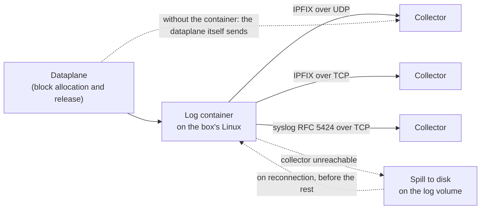
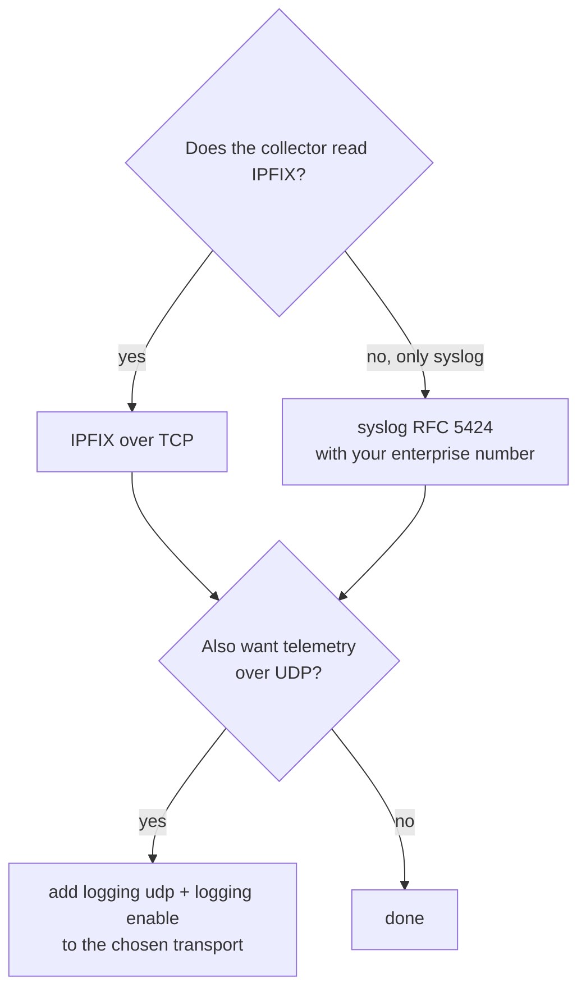
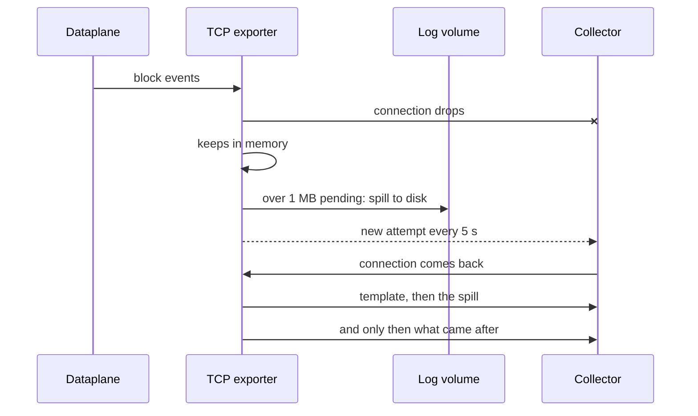

# Where the records go: collector, transport and retention

For those who run CGNAT and need to answer a court order: where the records of who was using each public IP and port live, how they leave the box and what happens when the collector goes down. The commands in detail are in [IPFIX logging and audit trail](/s/wiki-en/doc/ipfix-logging-and-audit-trail-mrQPyuvc8g); here is the why behind each choice.

# The problem

The Marco Civil da Internet (Brazil's Law 12.965/2014; retention requirements differ by country) requires the ISP to keep connection records for one year. With CGNAT, identifying a subscriber from *(public IP, port, instant)* requires the mapping that was in effect at that instant.

In deterministic mode that mapping is a formula: the configuration in effect answers, and what needs to be kept is the configuration trail. In BPA mode, and in the blocks a deterministic pool hands out from the `reserve`, the block is chosen at the moment the subscriber asks, and **the exported record is the only evidence** of who held a public port.

That record needs to exist somewhere for a year, needs to survive a collector outage and needs to be readable without help from whoever wrote it.

# The idea: the box exports, the collector keeps


:::info
**The box does not keep connection records.** It exports them as they happen, and whoever keeps the year the law asks for is your collector. The box's log volume holds only the configuration trail and the exporter spill, the records that a collector that is down has not yet received.

:::



The record is per **block**, not per flow (RFC 8158): one on allocation, one on release, one when the ports run out. The order of magnitude, in BPA mode, is about 80 MB per day for 200 thousand subscribers, against about 1.6 GB per day for a NAT that logged every flow. A year of retention is in the tens of gigabytes, and it is **on the collector's disk**, not the box's.

## Three transports, and what each one requires

All three can be on at the same time, and all are configured under `nat` > `cgnat`:

| Transport | Command | Where it goes out | What needs to be right | Good for |
|-----------|---------|-------------------|------------------------|----------|
| IPFIX over UDP | `logging udp <collector> src <source> [port <n>]` and `logging enable` | through the log container, from a socket bound to the `src` address; through the dataplane itself when the exporter is in a VRF, when the container cannot use the `src` or when it is not running | the collector reachable from the `src`; `src` mandatory, an address the collector recognizes as this box; port 4739 if nothing is specified | telemetry: under congestion it loses records without warning, and it does not carry the subscriber identity |
| IPFIX over TCP | `logging tcp <collector> [port <n>]` | through the box's Linux, from the log container (from the dataplane itself if the container is not running) | the collector reachable via the Linux routes; port 4739 if nothing is specified | **legal retention**: spill to disk, resend in order, subscriber identity in the record |
| syslog RFC 5424 over TCP | `logging syslog <collector> enterprise <n> [port <n>] [facility <0-23>] [severity <0-7>]` | through the box's Linux, along the same path as IPFIX over TCP | the collector reachable via the Linux routes; port 601 if nothing is specified; an IANA enterprise number (PEN), mandatory | the collector that only reads syslog, which is most of them; same guarantee as IPFIX over TCP |

Both TCP transports open the connection **from the box**: what needs to be open is the collector's port, on its firewall and on any firewall along the path. A failed attempt is retried every 5 seconds.

`logging tcp` does not count as a destination for `logging enable`: the two are separate paths, and `enable` turns on the UDP one.




:::warning
**Legal retention over UDP alone is retention with holes.** A lost datagram is a lost record, with nothing on the box or the collector to give it away, and losing a `natEvent 17` (the release) makes the natural query point to the wrong subscriber. Use TCP or syslog for retention; UDP, if you want, alongside.

:::

# What the collector needs to keep

Keeping the lines is not enough. For a record to answer a court order eleven months from now, the collector also needs to keep what gives them meaning:

| What | Why |
|------|-----|
| **The IPFIX template** of each exporter | without it the records are bytes. The box sends the template at the start of each TCP connection and repeats it every minute; the block record over TCP uses template **258**. A collector with 256 from an old version cached simply waits for the new one |
| **The restart marker**, `systemInitTimeMilliseconds` (IE 160) | the last value per exporter and observation domain. While it does not change, an allocation without a release is still in effect; when it changes, every allocation open from before ended at that restart. It is what distinguishes a box that went down from one that is still holding the block. In syslog it arrives as the `BOOT-MARKER` line. Over UDP the box resends it every 30 seconds; over TCP and syslog it goes once per boot, at the start of the stream |
| **The enterprise number** of each syslog exporter | each line carries the structured data as `cgnat@<number>`, and that is how the collector recognizes whose format it is. The number is yours, there is no default, and the box refuses `logging syslog` without it |
| **The subscriber identity** | `subscriberId` in syslog, element 371 `userName` in IPFIX over TCP. It always comes, with the name from the identity table or `unknown`. It is personal data, and it is the reason the log needs protection. UDP does not carry it |
| **The instant of each record, in UTC** | it is the instant of the event with millisecond precision, the same in both formats, which lets you put IPFIX and syslog side by side |

The release repeats the identity the allocation stated, so either of a block's two records answers on its own. Even so, keep both: the release is what closes the interval, and without it the question *"who held this port at 2 p.m.?"* has two answers.

# What happens when the collector disappears

On the TCP transports, a collector that is down costs no records as long as there is somewhere to write:



* **Queue.** The dataplane puts each event in a queue per worker core, capped at 8192 events, and the log container reads them from a queue of its own, capped at 65536. If the exporter falls behind beyond that, the excess is discarded and counted, never accumulated without limit.
* **Spill.** With the collector down, what the socket did not accept stays in memory until it exceeds 1 MB; from then on it goes to a file on the log volume, one per transport: `/var/log/prisma-routing/ipfix-spill.bin` and `/var/log/prisma-routing/syslog-spill.bin`. A connected, slow collector does not lose its connection: what waits goes to the file when it has accepted nothing for 10 seconds, or past 8 MB. **Each file stops at 256 MB.**
* **Resend.** On reconnection the file goes back **before** any new record, one piece at a time, because an allocation has to reach the collector before its release. Each record keeps the timestamp of the instant the event happened, not that of delivery.
* **Discard.** It only happens when there is nowhere to write (the file at its 256 MB ceiling, the volume full, or the file impossible to open), and it is counted. When the box stops, and the counter dies with the process, the loss is written to the system log.

The honest limit of TCP: bytes the socket accepted count as sent, and the few records written at the instant the connection drops can be lost. IPFIX over TCP has no receipt acknowledgment. It is much better than UDP, but it is not absolute, and that is why the counters are kept in view.

## Sizing the log volume

The installer asks how many gigabytes to give the trail and spill volume; the default is 30 GB. In an unattended installation, the answer goes in `prisma-routing.log-gb=<n>` or `log-gb` in the answer file.

**The size of the volume does not change how long the box can hold out against an unreachable collector.** Each transport's spill stops at 256 MB, whatever the volume, and what goes past that is discarded and counted. The volume holds those files, the configuration trail and, on a box that is the BNG, the PPPoE session history; nothing there is the connection history.

What the ceiling holds, starting from the estimate of about 80 MB per day for 200 thousand subscribers in BPA mode:

| Subscribers in BPA mode | Spill per day, approximate | What 256 MB holds |
|-------------------------|---------------------------:|-------------------|
| 50 thousand             | 20 MB                      | about 12 days     |
| 200 thousand            | 80 MB                      | about 3 days      |
| 1 million               | 400 MB                     | less than a day   |

It is an order-of-magnitude estimate, with a block renegotiated about five times a day per active subscriber; your block churn changes the number. A syslog line is text and takes several times what an IPFIX record takes: over syslog, the same ceiling holds out for much less time. In deterministic mode without `reserve` almost nothing is exported, and the volume serves practically only the trail.


:::warning
**A collector down for longer than the ceiling holds is record loss**, and so is a full volume. The spill starts being discarded (counted, but discarded), and those records never reach the collector. Monitor the collector, not just the box: the spill is there to cover a short outage, not to replace the collector.

:::

If the box has a second disk, the installer offers to mirror this volume onto it. What is there are records the collector has not yet received, and a disk that takes them with it opens a hole in the year of retention that nothing on the box can rebuild.

# The practical consequence: check

```
show cgnat logging
```

The screen has one part for UDP and one for each TCP transport. What to read in each:

| Line | What it answers |
|------|-----------------|
| `state` | whether UDP export is on |
| `exporter` | where UDP goes. `none: nothing is sent over UDP` means nothing goes out over UDP, **even with** `**state enabled**` |
| `sender` | who sends UDP: the log container, or the dataplane and why |
| `exhaustion` | how many port-exhaustion repeats did not become a record: one goes per subscriber every 10 seconds |
| `queue`, `export` | events discarded with a queue full, a dataplane core's or the log container's |
| `boot marker` | the marker template, how many were sent and the start instant of this incarnation of the dataplane |
| `TCP streams carried by` | who carries the two TCP transports: `the log container` or `the dataplane` |
| `TCP transport` and `syslog transport` | each with the collector and the connection state: `connected`, `connecting` or `disconnected`; a transport that is off shows as `disabled` |
| `enterprise` | in syslog: the enterprise number, the facility and the severity in use |
| `spill` | per transport: bytes that went to disk, how many have already gone back to the collector and how many were discarded, since the start |
| `file` | per transport: the bytes in the spill file now, the 256 MB ceiling and how much the ceiling has already refused |

What to look for:

* `**disconnected**` **for more than a few seconds**: the collector is down or unreachable via the Linux routes. The bytes on disk in the `spill` line rise for as long as that lasts.
* **Discarded in the** `**spill**` **line above zero**: records were lost. Check the log volume space and the collector.
* **The** `**file**` **line nearing 256 MB**: the collector has been down too long, and what comes after the ceiling will be lost.
* **Bytes on disk and resent equal, with the connection** `**connected**`: the collector came back and received everything that was left behind.

For UDP export, the boot self-test compares what the configuration asks for with what the dataplane has and fails when the two do not match. And `commit check` warns, naming the pool, when a BPA pool (or deterministic with `reserve`) sits on a box where nothing exports.

The box itself also records when a collector goes away and when it comes back: `show log kind collector`. That record goes to the syslog collectors of `system` > `logging`, and over SNMP the `recordsTransportChange` and `recordsLost` notifications tell the NMS the same.

Before considering retention set up, run the test that matters: with subscriber traffic passing, take the collector down for a few minutes, bring it back, and check on the **collector** that the allocations and releases from the interval arrived.

# See also

* [IPFIX logging and audit trail](/s/wiki-en/doc/ipfix-logging-and-audit-trail-mrQPyuvc8g) — the commands, the record format, the subscriber identity and the configuration trail
* [Deterministic and BPA — concepts and mapping](/s/wiki-en/doc/deterministic-and-bpa-concepts-and-mapping-NMOHVImQiU) — why one mode needs export and the other almost does not
* [Appliance installation](/s/wiki-en/doc/appliance-installation-gliHrNahhB) — the log volume size and the two-disk mirror
* [Sizing and requirements](/s/wiki-en/doc/sizing-and-requirements-IHPnUSMSom) — the box's disk and the log volume
* [Monitoring and SNMP](/s/wiki-en/doc/monitoring-and-snmp-GxrrkTSEJT) — following the box from the NMS
