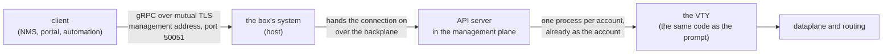

# Management API (gRPC) — for integrators

What the box's management API offers an external system — an NMS, a portal, an automation —, how it is turned on, who may call what, and how it behaves during an upgrade. For whoever writes the client; the step-by-step configuration on the box's side is in [Routing, SSH, users and SNMP](/s/wiki-en/doc/routing-ssh-users-and-snmp-jjxcPssV72).

# What it is

A gRPC API, package `prisma.v1`, served by the box itself over **mutual TLS**, on the management network only, **off by default**.

It is **not a second configuration system**. Every configuration call is the VTY at work: `configure`, the lines an operator would type, `commit check`, `commit`, `commit confirmed`, `rollback` and `save`, run by the VTY's code and as the account the client certificate names. Therefore:

* a refusal through the API is the VTY's refusal, in the same words;
* a change made through the API shows in `show running-config` at the prompt, and in the revision history under the account's name;
* what the VTY does not let an account do, the API does not let it do either.

| Typical use | What the API gives |
|-------------|--------------------|
| NMS, NOC dashboard | typed reads (interfaces, pools, subscribers, BGP, OSPF, IS-IS, BFD, VRRP, transceivers), a stream of counters and events, 24 hours of history and the standard gRPC health check |
| Portal, web interface | the whole configuration read as fields and written as VTY lines into a candidate, with the same `commit` as the prompt |
| Automation | candidate, validation, `commit confirmed` and confirmation; the system actions (reboot, upgrade) for an authorized account |



The host listens on the management address and hands each connection, unopened, to the server running in the management container. TLS ends at the server; the host does not see the content.

# Turning it on in the VTY

Three things: the certificates on the box's disk, the account the client will be, and the `api` block in the configuration.

## The `api` block

| Command | Default | What it does |
|---------|---------|--------------|
| `api enabled yes` | `no` | serves the API. Without `listen-address`, the commit refuses |
| `api listen-address <address> [<address> ...]` | none | the management address to listen on; takes a list, IPv4 and IPv6 together, since 0.151.8 |
| `api port <1-65535>` | `50051` | the TCP port |
| `no api enabled` | — | turns it off |
| `no api listen-address` | — | removes the address |
| `no api port` | — | back to 50051 |

```
configure
api enabled yes
api listen-address 192.0.2.10 2001:db8:6::10
commit
```

Enabling it without an address is refused at the commit:

```
error: api enabled yes needs 'api listen-address <management address>'
```

`listen-address` completes with `?` to the box's own addresses; use the management ones, because the API belongs to the management network. With management in a VRF of its own (since 0.152.4), the API stays reachable through the management gateway.

## The certificates

There is no token or password in the API: **the identity is the client certificate**.

| File on the box, in `/etc/prisma-routing/api/` | What it is |
|------------------------------------------------|------------|
| `server.key`, `server.crt` | the box's certificate. The name the client checks must be in it (the `subjectAltName` with the address dialled, or the name the client passes as authority) |
| `clients-ca.crt` | the CA that signs the client certificates. Only a client presenting a certificate it signed is served |

The server does not start without the three files, and refuses the handshake of a client with no certificate — the health check included. The CA's key stays **off** the box. The `openssl` commands to create the CA, the box's certificate and a client one are in [Routing, SSH, users and SNMP](/s/wiki-en/doc/routing-ssh-users-and-snmp-jjxcPssV72).

## The account

The client certificate's **Common Name (CN)** is the name of an account on the box, and each call runs **as that account**: in a process of its own that has already taken the account's uid and groups before opening the VTY. Create a dedicated account for each integrating system (`user <name>` in the VTY), with the role it needs and nothing more.

| Situation | What happens |
|-----------|--------------|
| a CN that is not a valid account name, or more than one CN | the call is refused with `UNAUTHENTICATED` |
| a role or `operator` given to or taken from the account | it holds from the next call; a candidate opened before the change reads as expired, so no commit runs with rights the account no longer has |
| a system that must lose access | the box consults no revocation list: the certificate holds as long as the CA signed it and it has not expired. To cut it off, remove the account from the box, or take its role away to leave it read-only |

# Roles: who may call what

The roles are the VTY's, untranslated. The API never gives an account anything its VTY session would not have.

| Account | System group | What it may do through the API |
|---------|--------------|--------------------------------|
| `role administrator` | `prisma-admin` | everything that is configured: routing, CGNAT, interfaces, accounts, system, PPPoE; the interface and routing `clear`s; ending PPPoE sessions |
| `role cgnat-operator` | `prisma-cgnat` | CGNAT configuration only; ending a CGNAT subscriber's sessions |
| no role | — | **read-only**: every read, `Show`, telemetry, the routing table, the history, `WhoAmI`. Opens no candidate: `configure` is refused, as at the prompt |
| `operator` (beside any role) | `prisma-operator` | on top of the role: `Reboot`, `Shutdown`, `RestartDataplane` and `Upgrade`. Nothing else of root's |

* An `administrator` does **not** reboot or upgrade the box just for being an administrator: it needs `operator`. A NOC's read-only account **may** have `operator`.
* Asking which is the newest published version (`Upgrade` with an empty version) changes nothing, and any account may.
* A call without the role returns `PERMISSION_DENIED`, with the same reason the VTY would give.
* `SessionService.WhoAmI` answers, without opening anything, which account the certificate is, its role (`administrator`, `cgnat-operator` or `read-only`) and whether it configures, configures the CGNAT and operates (`can_operate`). It is a new client's first useful call.

# The services

| Service | What it reaches |
|---------|-----------------|
| `ConfigService` | the configuration: candidate, editing, comparison, validation, commit, confirmation, rollback, save; the configuration read and written as fields; the VTY's whole grammar |
| `OperationalService` | the typed reads behind the `show`s, any `show` as text, the `clear`s, the box's event record, `ping`, `traceroute` and `mtr` as a stream |
| `TelemetryService` | the stream of counters and events, 24 hours of history, and the CGNAT records live |
| `RouteService` | the routing table, as fields and paged, and the summary per VRF and protocol |
| `SessionService` | who the client is to the box |
| `SystemService` | reboot, shut down, restart the dataplane, upgrade |
| `grpc.health.v1.Health` | gRPC's standard health check |

## Configuration, with the commit's semantics

The configuration **travels as the VTY's text**: a candidate is edited with the lines an operator types, at a path in the hierarchy (for example `nat` > `cgnat` > `pool P` and the line `block-size 256`), and read back as the text `show running-config` prints. The operations and the reads are what is typed.

| Call | What the VTY does |
|------|-------------------|
| `OpenCandidate` | `configure` (or from a revision) |
| `Edit` | the lines, typed at the given path |
| `ShowCandidate`, `Compare` | the candidate's text; `show configuration compare` |
| `Check` | `commit check`. Finding a problem is not an error: answering that is its job |
| `Commit` | `commit`, with optional `confirmed <minutes>` and `comment <text>`, and the acknowledgement of the warnings the VTY requires confirming |
| `Confirm` | the `commit` inside the `commit confirmed` window |
| `GetPendingConfirm` | the confirmation window the box holds: deadline, who and why |
| `Rollback`, `ListRevisions`, `GetRunning` | `rollback <n>` into the candidate; the revisions; the configuration in effect |
| `Save` | `save`: what the box loads at the next boot |
| `GetConfig`, `SetConfig`, `DeleteConfig` | the configuration as fields (interfaces, pools, record export, static routes, BGP, OSPF, IS-IS, BFD, system, accounts, PPPoE...). A write becomes the VTY's lines in the candidate and returns which they were |
| `GetSchema` | the whole grammar, as the prompt's `?` knows it, versioned by the box's release and a digest |
| `ValidateLines` | lines checked by the VTY in a throwaway candidate: each accepted or refused with the reason. Nothing is applied |
| `ListCandidates`, `CloseCandidate` | the account's open candidates, with their expiry; closing one |

The rules a client must respect:

* **A candidate is a session.** It lives in a process of the account, like a `configure` in the VTY, until it is closed or goes **30 minutes** unused. After that the call returns `NOT_FOUND` with the reason "expired", and the client opens another. The deadline comes in the replies (`idle_seconds`, `expires_at`); read it, do not assume it.
* **The commit overrides nobody.** If the running configuration changed after the candidate was opened — another client, an operator at the prompt —, the commit is refused with the difference and the current revision. The client opens a new candidate and applies its lines again.
* **`commit` applies; `save` writes for the boot.** As at the prompt. `Reboot` and `Shutdown` are refused while something is unsaved or inside a `commit confirmed` window, unless the client forces them.
* **A partial write names its fields.** In a `SetConfig`, `fields` says what to change; empty means **all**, so an object sent half-filled erases what was not sent. Name the fields.
* **Secrets are never read.** Passwords, keys, SNMP communities and RADIUS secrets come back only as "set or not"; the lines returned mask the value, as `show running-config` does.

A refusal is a gRPC status — `INVALID_ARGUMENT` for a line the VTY refuses, `FAILED_PRECONDITION` for a refused commit or a base that moved, `PERMISSION_DENIED` for an account without the role, `NOT_FOUND` for a candidate that does not exist, `UNAVAILABLE` when the box cannot answer — and carries, in the trailing metadata `prisma-diagnostics-bin`, the VTY's explanation and a **reason code** the client can act on (stale base, permission, candidate expired, size limit, one of the warnings that need acknowledging, grammar, validation, apply failed). The VTY's sentence stays the message for the person.

## Operational reads

Each typed read uses the same reader as the matching `show`, and most also carry, in a `text` field, the screen exactly as the terminal shows it — it is the same reading, so the fields and the screen do not disagree.

| What is read | Example calls |
|--------------|---------------|
| the box | `GetVersion`, `GetSystem` (memory, each worker's load, CPUs, why the dataplane and the routing last started), `GetHardware`, `GetTuningAdvice` |
| interfaces | `ListInterfaces`, `ListBundles`, `ListTransceivers` (temperature, optical power and the module's thresholds) |
| CGNAT | `ListPools`, `GetSubscriber`, `LookupTranslation` (who was behind a public address and port), `ListTop`, `GetDrops`, `ListBlocks`, `GetCgnatMemory`, `GetLogging` |
| routing | `ListBgpNeighbors`, `ListOspfNeighbors`, `ListIsisAdjacencies`, `ListBfdSessions`, `ListVrrp`, `ListPolicies`, `TestPolicy` |
| PPPoE | `ListPppoeSessions`, `GetPppoeSession`, `GetPppoeSummary`, `ListPppoeHistory` |
| the event record | `ListEvents` (`show log`, with the same filters) and `WatchEvents`, live |
| actions | `Clear` (counters, a subscriber's sessions, BGP, OSPF, IS-IS, PPPoE); `Ping`, `Traceroute`, `Mtr`, line by line while they run |

**`Show`, the passthrough.** Any `show`, `ping`, `traceroute` or `mtr`, with the `| include`, `| exclude` and `| count` filters, comes back as text. Read only: a command that does not start with one of those words is refused with `INVALID_ARGUMENT`. `monitor` does not pass (it redraws a terminal, and a call has no terminal); the API's live view is the telemetry. For an NMS, prefer the typed call where there is one: a screen's text may change from one release to the next, the fields do not.

## Telemetry

| Call | What it delivers |
|------|------------------|
| `Subscribe` | a stream, until the client cancels: the interfaces' counters at the interval asked, the CGNAT totals and an event at each commit, with the revision it left and the comment — so the client knows which commits were its own |
| `GetHistory` | the counters the server sampled, one a minute, over the last 24 hours: interfaces (up to 256), CGNAT totals, worker load, memory and, when asked, each CPU |
| `WatchLogging` | `monitor cgnat logging`: each block allocation and release the box exports, as it exports it, and every 10 seconds what each destination delivered |

The counters are the dataplane's totals, as `show` shows them: the client takes the differences, and a total smaller than the one before is a dataplane that restarted.

## The routing table

`RouteService.ListRoutes` is built for a full table: it reads FRR's RIB in pages (1000 by default, up to 5000), filtered by VRF, family, prefix and protocol, from **a single snapshot** — the table changing in the middle of the paging produces no repeated or missing route. The first page arrives while the rest is still being read. A snapshot nobody pages for 10 minutes is dropped, and the client starts again. If routing stops answering part-way, the routes read are handed out and the next call says `UNAVAILABLE`: an incomplete table is never passed off as the whole one.

# Limits a client meets

| Limit | Value | What to do |
|-------|-------|------------|
| a call with no answer | 300 seconds | returns `UNAVAILABLE`; the next call is served |
| an idle candidate | 30 minutes | open another |
| one call at a time in each of the account's processes | each candidate, the reads, `Show` and the routes have separate processes | a long `ping` does not delay a status read; two `Show`s of one account run one after the other |
| `commit confirmed` | 1 to 60 minutes | outside that, the call is refused |
| the revision in an event | read as the account subscribed to the stream | an account that sees less of the configuration (a read-only one does not see the pools) reads a different identifier for the same configuration |

The contract only grows within `prisma.v1`: fields, calls and values are **only added**, with numbers never used before; nothing is renumbered or reused. A client built for an older release keeps working against a newer box and simply does not see what it does not know. An incompatible change would be a `prisma.v2` package, served beside `v1`.

:::info
The contract — the `.proto` file of the `prisma.v1` package, plus the standard `grpc.health.v1` — is not published on this wiki: ask for it together with the release your boxes run. The server offers no gRPC reflection, so tools such as `grpcurl` need the file. The configuration's grammar, on the other hand, the box itself answers through `GetSchema`.

:::

# During an upgrade and a restart

| Event | What the client sees |
|-------|----------------------|
| `system upgrade` (through the VTY or the API) | the management container is recreated: the API is away for **about a minute**, and every stream, every open candidate and every account process ends. Reconnect and open again |
| `Upgrade` through the API | a stream of phases (download with progress, verification, installation) that ends **before** the API restarts, with how many seconds it will be away. Afterwards, reconnect and read `GetVersion`; `GetUpgradeStatus` reads the last run back, whatever connection asked for it |
| the 24-hour history | survives a restart of the API and of the container (an upgrade does both): the graphs go on. A reboot empties it, as it zeroes the dataplane's counters |
| `RestartDataplane` | the reply comes when the restart has finished. While the dataplane is down, the reads that depend on it answer `UNAVAILABLE` and the health check marks `OperationalService` and `TelemetryService` as `NOT_SERVING` |
| `Reboot`, `Shutdown` | the reply comes before the box goes down |

:::warning
`RestartDataplane` stops forwarding and drops the port block and the sessions of **every** subscriber, as `system dataplane restart` does at the prompt. An automation that calls it needs the same window an operator would ask for.

:::

# Health check

It is the standard `grpc.health.v1`, so `grpc_health_probe`, any gRPC library's health client or a load balancer work with nothing specific. It needs a client certificate signed by the CA, even one that names no account.

| Service name | `SERVING` when | `NOT_SERVING` when |
|--------------|----------------|--------------------|
| `""` (the server), `prisma.v1.ConfigService`, `prisma.v1.RouteService`, `prisma.v1.SessionService`, `prisma.v1.SystemService` | the server is up | — |
| `prisma.v1.OperationalService`, `prisma.v1.TelemetryService` | the dataplane answers the statistics reads | the dataplane does not answer (stopped, restarting) |
| `prisma.v1.LogExport` | every configured record destination is delivering | a configured destination has delivered nothing for 60 seconds while having something to send |
| `prisma.v1.Configuration` | the saved configuration was applied whole at boot | part of it waits for a card the box did not have at boot (`GetPendingConfiguration` says which) |

A service the box does not serve returns `NOT_FOUND`. The stalled record destination has a name of its own on purpose: a collector that is down is not a box that does not answer, and a client that stopped calling `OperationalService` would stop reading precisely the state that says what is wrong.

```
grpc_health_probe -tls -tls-ca-cert ca.crt -tls-client-cert nms.crt \
  -tls-client-key nms.key -tls-server-name prisma-api \
  -addr 192.0.2.10:50051 -service prisma.v1.LogExport
```

# The trail of what the API did

* Each commit is in the revision history under the certificate's account, and in the audit trail with `via api`.
* The box's event record separates who acted: `show log source api` lists what came through the API.
* A commit made through the API shows in the prompt's `show running-config` at once, and in every connected client's `Subscribe`.

# See also

* [Routing, SSH, users and SNMP](/s/wiki-en/doc/routing-ssh-users-and-snmp-jjxcPssV72) — turning the API on step by step, with the certificates
* [Access, login and roles](/s/wiki-en/doc/access-login-and-roles-uVm2WUy5xB) — the roles and `operator`, which the API inherits
* [Commit, rollback and save](/s/wiki-en/doc/commit-rollback-and-save-HVsz5GElE1) — the configuration cycle the API goes through
* [Show commands](/s/wiki-en/doc/show-commands-3WvebaLZkm) — the screens `Show` passes through, and `show log`
* [Monitoring and SNMP](/s/wiki-en/doc/monitoring-and-snmp-GxrrkTSEJT) — an NMS's other door, read only
* [Taking the box to a new version](/s/wiki-en/doc/taking-the-box-to-a-new-version-spJOdnrvOD) — what an upgrade does to the box
* [What runs on the box](/s/wiki-en/doc/what-runs-on-the-box-8brQyqcFen) — the management container and the backplane the API goes through
