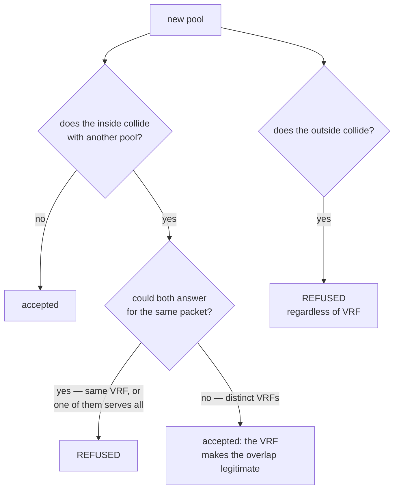

# Multi-tenant with VRF

How to serve two customers that use the **same private address range** on the same box. For those who do wholesale, resale or run CGNAT for more than one customer.

# The problem

An ISP does not choose which private addresses its customers' CPE hands out. Two customers on the same box are going to use `100.64.0.0/22`.

Before a pool could name a VRF, there was nothing to say which of the two a packet belonged to: the lookup returned the **first** pool that claimed the address. One customer was translated by the other's pool, and the second pool translated nothing.

# How to solve it

Each customer arrives through an interface of its own, and that interface sits in the customer's VRF and on the inside of the CGNAT:

```
configure
 interface enp5s0
  vrf 1
  cgnat inside
  exit
 interface enp6s0
  vrf 2
  cgnat inside
  exit
 commit
```

Then, one pool per customer, each naming the VRF it serves:

```
configure
 nat
  cgnat
   pool cliente-a
    prefix-inside 100.64.0.0/22
    prefix-outside 200.150.0.16/30
    vrf 1
    exit
   pool cliente-b
    prefix-inside 100.64.0.0/22
    prefix-outside 200.150.0.32/30
    vrf 2
    exit
   exit
  exit
 commit
```

| Field | What it defines |
|-------|-----------------|
| `vrf <n>` | the VRF whose subscribers this pool serves |
| `outside-vrf <n>` | the VRF through which translated traffic leaves, when it differs from the subscriber's |


:::info
**The VRF must exist before the pool that names it.** The dataplane refuses a pool with `vrf` or `outside-vrf` for a table it does not have yet. A VRF comes into existence when an interface is placed in it — that is why the interface comes first, in a `commit` of its own.

:::


:::warning
`vrf` is a **mapping** field: changing it rebuilds the pool and drops all its sessions. Set it at creation, not later.

:::


:::info
**When absent, the pool serves all VRFs** — which is what every configuration written before this existed means, and it is a different answer from `vrf 0`.

:::

# Where the reply comes back

The session carries the VRF the subscriber's traffic arrived in, and the reply is forwarded in it.

Without that, the reply would be looked up in the FIB of the interface it arrived on — the outside one — and on a box where inside and outside are different VRFs it would be dropped for lack of a route. The symptom reads as "CGNAT did not translate", when in fact it was a lookup in the wrong table.

The `outside-vrf` is kept **in the session**, it is not read from the pool on every packet: the reply cannot change during the life of a session.

# Overlap is refused, not resolved

Two pools claiming the same inside address is not something the data path can resolve, so it is **refused when the pool is created**, naming the pool it collides with.



**The VRF is what makes an overlap legitimate**, so the refusal only applies when both pools could answer for the same packet: when at least one serves all VRFs, or when both name the same one.

**Public** addresses are compared regardless of VRF. The return path finds the pool by the public address and has no VRF to separate two replies — so two pools sharing a public address are refused outright.

# How to check

```
show cgnat pool
```

Each pool appears with the `vrf` line that separates it from the other. Then, with traffic from both customers, take a public address and a port from each pool and ask who was behind it:

```
show cgnat translation 200.150.0.16 1024
show cgnat translation 200.150.0.32 1024
```

Since public addresses are never shared between pools, each answer comes from the right pool.


:::info
`show cgnat subscriber <address>` takes only the inside address, without a VRF. With the same address in two VRFs, it answers for **one** of the pools, not both — do not use this screen to check the separation.

:::


:::success
Two pools listed, each with its VRF, and the lookups by each pool's public address reaching the right customer's subscriber: the customers are truly separated.

:::

# See also

* [Pool configuration](/s/wiki-en/doc/pool-configuration-wkJ1DcmG2Y) — `vrf` and `outside-vrf` among the mapping fields
* [Expanding capacity without dropping subscribers](/s/wiki-en/doc/expanding-capacity-without-dropping-subscribers-R1zYvsfLCT) — VRF solves tenancy, not capacity
* [Deterministic and BPA — concepts and mapping](/s/wiki-en/doc/deterministic-and-bpa-concepts-and-mapping-NMOHVImQiU) — why the subscriber index is per pool
