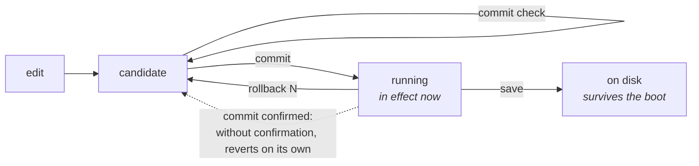

# commit, rollback and save

The model is Juniper's: you edit a **candidate configuration**, review it, and only then apply it. Nothing you type reaches the equipment before `commit`.



## `commit` and its variants

| Command | Argument | What it does |
|---------|----------|--------------|
| `commit` |          | applies the candidate |
| `commit check` |          | validates without applying |
| `commit remap` |          | applies a change that moves existing subscribers to new public addresses and blocks |
| `commit cutoff` |          | applies a change that stops advertising the prefix this session arrived through |
| `commit diverge` |          | applies a change that maps subscribers differently from the peer this box shares a service address with |
| `commit confirmed [<1-60>]` | minutes; with no number, 10 | applies, and undoes itself unless it is confirmed |
| `commit comment <text>` | free text; surrounding quotes are removed | records a note with this commit, which `show rollback` shows beside the revision |

`commit` works at any level of configuration mode — inside `nat`, `cgnat`, a pool, an account, a routing block — and after it you stay at the level you were at. In operational mode it is refused: enter with `configure` first.

**How the words combine.** `remap`, `cutoff` and `diverge` combine with each other, in any order, and come **before** `confirmed` or `comment`: `commit remap comment "ampliação do pool residencial"` and `commit cutoff remap confirmed 5` work. Each one acknowledges only the consequence it names — `diverge` does not let through a cutoff that called for `cutoff`. `confirmed` and `comment` go together, in that order:

| Typed | What the box does |
|-------|-------------------|
| `commit confirmed 5 comment "teste"` | 5-minute window, and the comment `teste` recorded with the revision |
| `commit comment teste confirmed 5` | refuses: `'confirmed' comes first` — nothing is applied |
| `commit comment "teste confirmed 5"` | records the comment `teste confirmed 5`, with no window: inside quotes it is text |

The refusal on the second line exists because whoever types that expects an automatic undo; it used to record everything as a comment and open no window at all.

`commit check` stands alone: it is a question, it applies nothing, and whatever comes after `check` does not change the answer.

### `commit check` before anything else

It is the command that answers *"does this pass validation?"* before applying. It checks the whole candidate without touching the equipment — only read commands go to the dataplane.

**It says who would be re-mapped**, which is the whole reason for asking first:

```
configuration check succeeds
  this change RE-MAPS subscribers that already have mappings
    194 of 256 subscribers move
    100.64.0.1 -> 200.150.0.9 port 1536-2047
    100.64.0.2 -> 200.150.0.10 port 1024-1535
  'commit' refuses this until it is asked for by name, with 'commit remap'
```

The count is not an estimate: the dataplane makes it, with both definitions and the same arithmetic it would run afterwards. It is not a refusal — `check` applied nothing, so there is nothing to refuse; it is the warning the command exists to give. The one that refuses is the plain `commit`, described in `*commit remap*`, just below.

A change that moves nobody prints none of this. A warning that always appears is a warning nobody reads.

### `commit diverge`, when the box forms a pair with another

On a box that **holds a service address with a peer** — meaning it has `vrrp` on an interface — `commit` checks the candidate against the peer's configuration, the one you copied to `/etc/prisma-routing/peer.conf`, and **refuses** a change that would make the two map subscribers differently:

```
error: this change maps subscribers differently from the peer
    this box stands for a service address with another one, so a takeover would
    translate them there
error: pool 'business' is on this box and not on the peer, so after a failover
    its subscribers are translated by nothing at all
    nat / cgnat / pool business
    a takeover would put subscribers on blocks the other box never used, and
    neither box would log anything unusual, because nothing unusual happened to
    either of them
    if that is what you mean, type: commit diverge
```

**Why this is a refusal and not a warning.** In deterministic mode the mapping is a function of the configuration: two boxes with the same pool agree without exchanging a byte, and two boxes with different pools **fail silently** — the failover starts mapping subscribers to blocks the other box never used, and both record a perfectly normal day. There is no symptom to notice afterwards.

**Why the overriding word exists.** Two boxes are not committed at the same instant. Every correct capacity expansion diverges the pair between the first commit and the second, so a refusal with no way out would fire on every correct procedure — and the way out would become "stop copying the peer's configuration", which removes the check instead of the divergence. `commit diverge` is you saying you know, and the commit goes ahead.

**On a box that does not form a pair, none of this happens.** Without `vrrp` on any interface, a `peer.conf` there is comparison material and nothing more: the box **warns** about the difference and applies, as it always did. No file in `/etc` creates a relationship the configuration does not declare.

It also says **what it did not verify**:

```
configuration check succeeds for CGNAT and the box's own configuration
  2 routing statement(s) have no grammar in this VTY and were not read at all
    'show configuration' marks them; they go to FRR exactly as typed
  routing statements are checked for structure only; FRR validates them at
  commit, and can still refuse one
```

The count is of the statements the box passed to routing without reading. `show configuration` and `show this` show **which** they are, marked with `<- not checked`. The plain `commit` says nothing about this, on purpose: passing statements through is the normal case here, and a warning on every commit becomes a warning nobody reads - including the warning that matters, the one that routing did not keep what was applied.


:::warning
Each routing statement — prefix-list, route-map, BGP neighbors — is checked by routing's own grammar **at the moment it is typed**, inside the block you are in: a statement routing does not accept is refused right there, in its words, and nothing enters the candidate. What this check does not see is what only makes sense against the whole configuration — and that routing only decides at `commit`.

That means an approved `commit check` **does not guarantee** that the following `commit` will pass.

And the refusals are not all the same. Most are decided **before** anything is applied — the SSH lockout, a route-map that does not exist, a pool the dataplane would refuse — and in those nothing is applied: the box stays whole as it was and so does the candidate.

The read-back refusal is the exception, and it is the one that matters here. It can only be decided **after** routing has already received the configuration, because it is precisely the discovery that it received it and did not keep it. In that one **the rest of the commit is in effect** — CGNAT and the box's own configuration — and the way back is `rollback 1`. The message itself says so.

A **route-map** or **list** line (prefix-list, community-list, as-path) is different, and there the commit **rolls back on its own**. A line the daemon refused after the syntax check accepted it stays in the text of the routing configuration, word for word, but the clause runs without it — without the `set`, or matching more than was written — on real routes. That is why `commit` reads what each daemon applying the route-map is actually running and, if none of them runs the line, refuses, names the line and puts the previous state back. This applies to the route-map you type and to the one the policy compiles:

```
error: FRR refused 1 line(s) of your route-maps and lists
      route-map OP permit 10: set extcommunity rt 65000:100 additive
error: commit failed; rolling back to the previous state
```

A route-map used at the same time by a BGP neighbor and by an OSPF redistribution can have `set community`: OSPF does not run that line, BGP does, and the commit passes.

:::

This command used to say only *"configuration check succeeds"*, which promised more than it had checked — and in a maintenance window that is the sentence that decides whether the person goes ahead.

### `commit remap` — the lock against the silent disaster

A plain `commit` **refuses** changes that alter the mapping of existing subscribers. They must be asked for by name, with `commit remap`.

The reason is that this is the worst possible kind of failure on this equipment: adding a public prefix drops the **entire** subscriber base at the same time, and the machine reports nothing abnormal — because, from its point of view, nothing abnormal happened. The refusal turns a silent accident into an explicit decision.

**It is in this refusal that the numbers appear.** The dataplane holds both definitions and runs the same arithmetic it would run afterwards, so the count is exact and not an estimate — and it comes with two example subscribers, from where to where:

```
error: this change re-maps subscribers that already have mappings
    1024 of 1024 subscribers change public address or port block; 512 hold live
    state right now
    100.64.0.5 moves from 200.150.0.17:1536-2047 to 200.150.0.33:2048-2559
    100.64.0.9 moves from 200.150.0.17:2048-2559 to 200.150.0.34:1536-2047
    every session on this pool ends when it is applied. Past answers stay
    resolvable - the configuration trail records which definition was in force
    - but the subscribers do not.
    if that is what you mean, type: commit remap
```

Record that first number in the change ticket: it is how many customers are going to call.

### `commit cutoff` — the same lock for the prefix that carries your session

The other change the equipment does not apply without hearing the word: the one that stops advertising the prefix through which **your own session** arrived. Withdrawing a prefix on purpose is routine — a maintenance drain, a customer who left —, and the box cannot tell that apart from a policy mistake. So it does not refuse forever: it asks for the name.

Two forms, depending on what the change does:

```
error: 200.150.0.0/24: this change stops originating it, and it covers 200.150.0.7 - the address this session arrived on
    nothing here would advertise a route back to this box's end of your own session
    if that is what you mean, type: commit cutoff
```

```
error: 200.150.0.0/24: no neighbour would be sent it after this change, and it covers 200.150.0.7 - the address this session arrived on
    the outbound policy denies it to every neighbour that has one, so nothing would advertise a route back to this box's end of your own session
    if that is what you mean, type: commit cutoff
```

It **stays silent** when it cannot be sure: when this box does not originate today a prefix covering the address, when nothing would advertise it anyway, when some neighbor's outbound policy cannot be read through to the end, or when there is `redistribute` and `aggregate-address` in the middle. On a serial console session there is no address to check against, and the box says so instead of letting you believe the check ran.

And `commit cutoff` is **not** a license to lock yourself out: it is applied as `commit confirmed 10` — see just below.

### `commit confirmed` — the safety net for remote changes

```
prisma# [edit] commit confirmed 5
```

It applies now, and undoes automatically in 5 minutes unless you confirm. It is what lets you touch routing on a remote machine: if the change cuts your own access, the machine recovers on its own.

Without a number, the window is 10 minutes. The deadline goes from 1 to 60; outside that the commit is refused and nothing is applied:

```
error: commit confirmed 0: expected 1-60 minutes
    the window has to outlast a reconnection and end while somebody is still at
    the console
```

Zero is refused on purpose: it would be a window that never arms, under a `commit complete` that looks like it worked.

The box answers by saying where the undo is armed:

```
rollback at 2026-02-11T14:32:07Z, in 5 minute(s)
    unless you type 'commit' to confirm
    the revert is armed on the box, not in this session: logging out, losing
    this session or rebooting does not cancel it, and confirming does
```

**The machine undoes it, not your session.** The deadline is stored on the equipment. Leaving the VTY, losing SSH, closing the serial console or restarting the machine does **not** cancel anything — only `commit` cancels. That is what makes the command useful: the failure it protects against is exactly the one that drops the session you are typing in.

#### Confirming

Any `commit` confirms the open window — the bare `commit`, and also one that already carries the next change:

```
prisma# [edit] commit
confirmed: the box will not roll this change back
```

The exception is another `commit confirmed`: it does not confirm the previous window, it opens a new one, with the new deadline.

While the window is open, anyone who logs in to the VTY is warned right in the banner:

```
A 'commit confirmed' is waiting: this box rolls the last change back at 2026-02-11T14:32:07Z
unless you type 'commit' to confirm it.
```

#### Reboot within the window

* Restarted **after** confirming: nothing is undone. The confirmation is recorded at the moment you give it, not at the end of the window.
* Restarted **before** the deadline: the deadline still holds, and it is a time of day — not a countdown that starts over. A box that stayed off past its own deadline comes back and undoes immediately, because nobody confirmed.


:::warning
The machine does not distinguish "I restarted because the change went wrong" from "I restarted in the middle of maintenance". In both cases it undoes. That is the safe side: confirming costs a word, and recovering an unreachable box does not cost a word — it costs a trip.

:::

#### The changes that become `commit confirmed` on their own

Three cases become `commit confirmed 10` **even if you do not ask**: any change in `ssh`, any change in `user`, and the `commit cutoff` you just typed. All three can cut the session you are typing in, and the box says why:

```
this commit can cut off the session you are using
    it changes SSH or accounts, or stops advertising the prefix this session
    runs over
    applying it as 'commit confirmed 10' rather than as a plain commit
```

There are **three**, not four. Handing the card the box is reached through to the dataplane used to be the fourth case, with a thirty-minute window and a confirming `commit` after the restart. It no longer is: the box claims its own card when it starts, and the state that undo produced — the empty setting, on a single-card box — is exactly the state that claims that card. Those who confirmed and those who did nothing ended up in the same place, and the second paid a restart to get there.


:::warning
**If you have a written procedure saying "restart, log back in and type** `**commit**` **to keep the card", delete that step.** There is no window to confirm. The `commit` is harmless and does nothing, and no undo restarts the box. `commit confirmed <minutes>` stays the same for any change where you want a window.

:::

#### When the promise cannot be made

If the equipment cannot store the deadline — full disk, permission denied on `/etc/prisma-routing` —, it does **not** pretend:

```
warning: the revert could NOT be armed on the box
    /etc/prisma-routing: Permission denied
    it will run in 10 minute(s) IF THIS SESSION LASTS THAT LONG, and not
    otherwise
    which is not the case it exists for: keep a second session open, and use
    'rollback 1' there if this one stops answering
```

In that state the undo only holds as long as the session lasts. Open a second session before making changes.

## What `commit` refuses, and what to do

Refusing is the strongest thing this equipment does: it knows the box's state and the change at the same time, and there are cases where applying means losing the box.

In the refusals in this section **nothing is applied** - the candidate stays as it is and you remain in the session. All of them are decided before the box touches anything.

There are **two** messages that do not work like that, and they are further below: the routing read-back one and the one about routing that changed nothing. Both are discovered after routing has already received the configuration, and in them the rest of the commit is applied. Before leaving an error believing the box is untouched, read the message: it says which of the cases you have on screen.

The messages appear in English, because that is what the box prints. They are here so you can find yours.

### `this change locks everybody out`

After this change no account would get in over SSH: either none has an authorized key, or password authentication would be turned off for all those that have a password. Give some account a key, or allow password again for one that has one.

### `this change leaves nobody able to configure the box`

Someone still gets in, but nobody who gets in has the administrator role. A CGNAT operator does not grant roles, so the way back would be through a root shell that perhaps nobody has. Give `role administrator` to another account first, or allow root over SSH.

### `cgnat logging enable: UDP export has no collector`

Logging is on and there is nowhere to send it. A box in that state looks like it records everything and delivers nothing - and the record is precisely what needs to exist a year later. Add `logging udp <collector> src <source>` inside `nat` > `cgnat`, or export over TCP with `logging tcp <collector>`, at the same level.

It is worth noting where this is refused: **here**, and not in the dataplane. Refused there, the rest of the change would already have been applied.

### `routing is configured and FRR is not answering`

There is routing configuration in the candidate and routing does not answer. Applying now would mean silently losing everything that is routing. The refusal comes in three lines, and the second and third say where **not** to look:

```
error: routing is configured and FRR is not answering
    'systemctl status frr' and its journal say why; blaming the configuration
    for a daemon that is not running sends somebody to debug the wrong thing
```

The configuration is not the problem. A daemon that is not up refuses nothing, answers nothing and leaves no log in the candidate - whoever goes looking for the error in the configuration will look for a long time.

### `pool '<name>': no prefix-inside` / `no prefix-outside`

A pool missing one of the two sides translates nothing. It is not a setting completed later: a pool accepted like that would be a pool that exists and is useless. The refusal says which of the two is missing and shows the statement that completes it:

```
error: pool 'RFC6598': no prefix-inside and no prefix-outside
    e.g. 'prefix-inside 100.64.0.0/10', 'prefix-outside 203.0.113.0/28'
```

These are the **pool's prefixes** - who arrives (`prefix-inside`) and what it is translated to (`prefix-outside`) -, not the interface role (`interface <name> inside|outside`), which is something else. Up to version 0.148.2 the message said `inside and outside required`.

### `pool '<name>' would be refused`

The dataplane looked at the whole definition - block size, prefix overlap, capacity, and whether the public range collides with a local address - and said no. The next line carries its reason, in its words.

### `block-stride applies to bpa pools only, not to pool <name>`

`block-stride` says how far away the **second** block of a subscriber that filled the first one is, counted along the **mapped** blocks of its public address. In a `deterministic` pool the extra block does not come from there: it comes from the **reserve**, which is a separate set with its own selection rule - a free reserve block on the subscriber's own address, if that worker's slice has one; otherwise, any free block that worker's slice has in the reserve, on any address, as described on the [Pool configuration](/s/wiki-en/doc/pool-configuration-wkJ1DcmG2Y) page. That path never goes through the mapped blocks, and that is why `block-stride` is never read there - at no size, and on no machine.

The refusal shows the two conflicting lines, `mode` and `block-stride`, because either one resolves it and which one to change is your decision: remove `block-stride`, or put the pool in `mode bpa`.

It is the same symmetry as `reserve`, which only exists in a deterministic pool: each of the two settings belongs to one mode only, and the equipment prefers to say so rather than store a setting that would never take effect. A pool that **was** dynamic, had `block-stride` and becomes `deterministic` lands exactly here - and this is the time to find out what it is losing, not months later, looking at a screen that promises a distribution the box does not do.

**A file saved by an earlier version** can have both in the same pool, because the combination used to be accepted and `block-stride` simply never applied there. At boot the box **does not refuse** that file: it brings the pool up without `block-stride`, exactly as it was already running, and leaves in the boot log the line `note: block-stride <n> dropped from pool <name>`. The next `save` writes the file without the line. A `rollback` to a revision that still has both loads the revision into the candidate and applies nothing, like any `rollback`; it is the following `commit` that hits the refusal above. On a box that came up this way the pool is already running **without** `block-stride`, so what that `commit` refuses is the line added to a pool that stays where it is - not a new pool. The difference between boot and prompt is deliberate: at boot nobody is watching, and a box that comes up with no pool at all because of a setting that never took effect is a price nobody asked to pay.

### `this box has no interface <name>` and `interface <name>: this box has no such interface`

A statement names an interface that does not exist here. The first form comes from a routing or CGNAT line that points to it; the second, from entering an `interface` block the box does not have. `show interface` lists the names it has, and that is where the name should come from - inventing one is how the problem starts.

**At boot it is different: a card that disappeared does not bring down the rest.** If the saved file cites a card the dataplane does not have when the box comes up - an SFP module the driver refused, a card removed from the server -, the box applies everything that does not depend on it and leaves out only what does: the card's own block, its sub-interfaces, a bundle left with no member, a VRRP `track` on it, the FRR block and any routing line that cites it. Management, routes and the other pools come up normally. The console and the journal warn with `warning: this box does not have: <card>`, and what was left out appears in:

```
show configuration pending
```

While something is pending, `save` is refused (`save: refused, nothing was written`): the configuration in use is missing the card's lines, and writing would be how the file loses them. When the card appears, the box applies on its own what was waiting for it - the same as a boot with the card would do. If someone ran `commit` after the boot, it does not write the file over it: it warns once and leaves the decision to you. To give up what is pending and be able to save again:

```
clear configuration pending
```

Through the API, the `prisma.v1.Configuration` health service stays `NOT_SERVING` while something is pending.

### `a bundle member this box does not have`, `a port in two bundles` and `a bundle member with config of its own`

The three refusals of an LACP bundle (`interface ae<n>`), each with the port name at the end:

```
error: a bundle member this box does not have: ens29
error: a port in two bundles: ens19
error: a bundle member with config of its own: ens19
```

The first is a `member` with a port the dataplane does not have, almost always a typo. The second is the same port in two bundles: a port can belong to only one. The third is a member with its own address or CGNAT side. A member stops forwarding on its own, so that configuration goes on the `ae<n>`, not on the port. Remove the configuration from the port and put it on the bundle.

### `this next hop is on no connected network: <next hop>`

A static route whose next hop is not on any connected network of this box. It would be accepted and would never forward anything, because there is no interface to reach that address through. Check the address, or configure the interface that should carry it.

### `cannot reach the dataplane: <reason>`

The VTY could not talk to the dataplane, so it can neither apply nor check. It is not a refusal about your change: it is the box saying half of it is not answering. `show version` says which services are up.

### `FRR accepted <n> statement(s) of this commit and did not keep them`

**This is the different refusal.** It is not decided before applying: the box handed the configuration to routing, read back what it kept, and found that part of it is not there. The discovery only exists after applying.

```
error: FRR accepted 1 statement(s) of this commit and did not keep them
    router static / 203.0.113.0/24 next-hop blackhole
    this commit is NOT in effect as written, and nothing was rolled back: the
    rest of it is applied. 'rollback 1' puts the box back
    the configuration this box holds and the one FRR is running are not the
    same; 'show configuration' is this box's, 'start shell' then 'vtysh -c
    "show running-config"' is FRR's
```

Read the second sentence carefully, because it contradicts what holds for all the other refusals: **nothing was undone, and the rest of the commit is in effect**. CGNAT and the box's own configuration are applied. Whoever leaves here thinking the box is as it was will diagnose the wrong box.

`rollback 1` is the way back: it loads the previous revision into the candidate, and you apply it with `commit` like any other.

The refused statements appear one per line, with the block they belong to. Those marked `<- not checked` are the ones this box passed through without reading: they have no grammar here, they went to routing word for word, and they are the ones routing is most likely to have discarded.

The last sentence is what to do next. The two configurations diverged, and there is a command to read each one: `show configuration` shows this box's.

### `the routing half of this commit reached FRR and changed nothing`

The sibling of the previous one, and also discovered **after** applying: CGNAT and the box's own configuration are in effect, and none of the new routing statements took. The box lists up to five of them and gives the two likely causes:

```
error: the routing half of this commit reached FRR and changed nothing
    all 2 new statement(s) are still outstanding
```

The common cause is a stopped routing daemon — `show version` says which are up. The other is harmless: statements that repeat routing's own default value, which it does not store. In both cases the box does not write `commit complete`, because that is the sentence every following diagnosis is built on.

### And the two that are not refusals, but explicit requests

`commit remap` and `commit cutoff` exist because re-mapping subscribers and withdrawing the prefix that carries your session are the two worst things done here by accident. They are described above, and the difference is that these changes **can** be made: they just cannot be made by accident.

They are different words on purpose: one moves the subscribers, the other costs the session you are typing in, and whoever acknowledged one was not warned about the other.

## `rollback`

```
rollback <0-19>
```

Loads a committed revision into the candidate. **It is not applied** — it becomes your candidate, which you review and apply with `commit`, like any other edit.

| Command | What it does |
|---------|--------------|
| `rollback 0`, or `rollback` with no number | discards what you edited and resets the candidate to what is in effect now (`candidate reset to the running configuration`) |
| `rollback 1` | the revision of the commit before the last one — it is the way back from a commit that went wrong |
| `rollback <2-19>` | older revisions, one per commit |
| `show rollback` | the stored revisions: number, date and time of the commit in UTC, how many commits ago, and the `comment` when there was one |

After loading a revision the box answers `load complete (revision <n>)` and suggests the next step: `show configuration compare` to review, `commit` to apply. A number that has no revision is refused with `revision <n> does not exist`.

The **20 most recent revisions** are kept, in `/etc/prisma-routing/rollback/`; each `commit` that applies something records one and pushes the others back one position.

It works in operational mode — and there it already **enters configuration mode**, with the revision as the candidate — and at any level of configuration mode, except inside a pool, an account (`user`) or an SNMP user (`snmp-user`): in those three, `exit` first.

## `save` — the second step people forget

`commit` makes the configuration take effect. `save` writes it to `/etc/prisma-routing/prisma-routing.conf` so that it survives the reboot, and answers `configuration saved to /etc/prisma-routing/prisma-routing.conf`.

`save` is an **operational mode** command. It writes the **running** configuration, not the candidate, and that is why it does not exist inside configuration mode: leave with `exit` (from any level, `top` and then `exit`) and type `save` at the `prisma>` prompt.

**They are different things and neither implies the other.** A configuration that was committed and not saved disappears at the next boot. A configuration that was saved but with the candidate still modified is not what is in effect.

The separation is intentional: *"take effect now"* and *"keep taking effect after restarting"* are two decisions, and `commit confirmed` only makes sense if the second is not automatic.


:::warning
`save` within a `commit confirmed` window writes to disk a change that has not yet been confirmed. The undo restores what is **in effect** and does not rewrite the file — so the box would undo now and bring the change back at the next boot. That is why `save` warns:

```
warning: what you just saved has NOT been confirmed
    this box rolls the running configuration back at 2026-02-11T14:32:07Z, and
    does not touch the file you just wrote - so a reboot after that would bring
    the unconfirmed change back. Type 'commit' to confirm, then 'save' again
```

Confirm first, save afterwards.

:::

## Inspecting before applying

```
show configuration            the whole candidate
show configuration compare    only what changes relative to what is in effect
commit check                  validates without touching the equipment
```

`show configuration compare` answers `no differences` when the candidate is the same as what is in effect — it is the way to know, before leaving, whether there is anything left to apply.

Who would be re-mapped comes out of `commit check` and, with the same numbers, out of the refusal of the plain `commit` that asks for `commit remap`.

A change across many lines can be seen before it enters the candidate: `replace pattern <regex> with <replacement> | compare` shows the difference and says whether the result would pass, without storing anything. `replace pattern` and `rename` change only the candidate, so everything on this page — `show configuration compare`, `commit check`, `commit confirmed`, `rollback 0` — applies to the result as it does to typed lines. Both are in [prismash VTY — user guide](/s/wiki-en/doc/prismash-vty-user-guide-9xi8OdzKV3).

## Leaving without applying

`exit` at the top of configuration mode returns to operational mode and **discards** the candidate. If it had anything that was not applied, the box warns on the way out — and what was discarded does not come back:

```
warning: uncommitted changes were discarded (use 'commit' to apply them)
```

After a `commit` that applied everything, this warning does not appear.

## At boot

`prisma-routing.service` runs `prismash --load /etc/prisma-routing/prisma-routing.conf` after VPP accepts commands.

`--load` **refuses the whole file** if there is a line the VTY cannot interpret, instead of applying the rest. That is deliberate: running with nobody watching, applying a file *minus one line* would leave the configuration on disk and the running one different, and someone would discover it by reading both much later.

There is one line, and only one, that `--load` leaves out instead of refusing the file: the `block-stride` of a `deterministic` pool, which never took effect there. The pool comes up as it was already running, the boot log says `note: block-stride <n> dropped from pool <name>`, and until the next `save` the file on disk and the running configuration differ by that line. The `block-stride applies to bpa pools only` refusal, above, explains why.

The refusal is read at boot, on an 80-column console, so it is broken into parts that fit: the file path and the refused line come out **whole**, each on its own line, so you can copy and search for them; the reason comes as running text below.

```
error: refusing to load this file, these lines are not understood:
    /etc/prisma-routing/prisma-routing.conf
    line 2: password 6$Xq7kPz2r$4Pv3cJ9sQm2WdT1hRfLb8XkY6nAeUoZgC5iMt...
        (password: expected a crypt hash such as $y$... or $6$... (openssl
        passwd -6), not a plaintext password)
```

The same applies when the automatic undo of a `commit confirmed` finds a line like that in what it was going to restore, and when `rollback` cannot read a revision: the path and the line stay whole, the reason is wrapped.

# See also

* [Pool configuration](/s/wiki-en/doc/pool-configuration-wkJ1DcmG2Y) — which changes require `commit remap`
* [Operations and troubleshooting](/s/wiki-en/doc/operations-and-troubleshooting-kql3GmIqmX) — the boot order that applies what was saved
