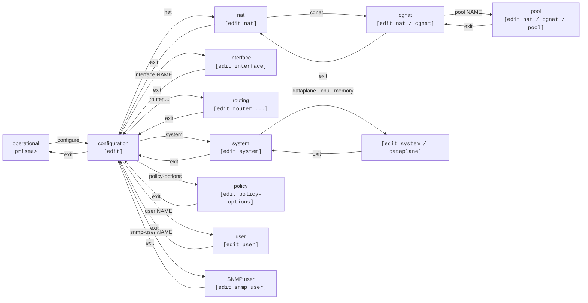

# prismash VTY — user guide

`prismash` is the single VTY of Prisma Routing: it configures CGNAT **and** routing through the same interface, with a Juniper-style candidate configuration model — you edit, review and only then apply with `commit`.



## Modes and prompts

| Mode | Prompt | How to enter | How to leave |
|------|--------|--------------|--------------|
| Operational | `prisma> ` | it is where the session starts | `exit` ends the session |
| Configuration | `prisma# [edit] ` | `configure`  | `exit`       |
| NAT  | `prisma# [edit nat] ` | `nat`        | `exit`, `up` or `top` |
| CGNAT | `prisma# [edit nat / cgnat] ` | `cgnat`, inside `nat` | `exit`, `up` or `top` |
| Pool | `prisma# [edit nat / cgnat / pool residencial] ` | `pool <name>`, inside `cgnat` | `exit` goes back to `cgnat`; `top` goes to the top |
| Interface | `prisma# [edit interface ens18] ` | `interface <name>` | `exit`, `up` or `top` |
| User | `prisma# [edit user joao] ` | `user <name>` | `exit`, `up` or `top` |
| SNMP user | `prisma# [edit snmp user nms] ` | `snmp-user <name>` | `exit`, `up` or `top` |
| Static routes | `prisma# [edit router static] ` | `router static` | `exit`, `up` or `top` |
| FRR block | `prisma# [edit router bgp 65000] ` | `router bgp <AS>`, `router ospf`, `router ospf6`, `router isis <name>`, `route-map ...`, `rpki` | `exit`, `up` or `top` |
| System | `prisma# [edit system] ` | `system`     | `exit`, `up` or `top` |
| Card, cores and memory | `prisma# [edit system / dataplane] ` | `dataplane`, `cpu` or `memory`, inside `system` | `exit` goes back to `system` |
| Routing policy | `prisma# [edit policy-options] ` | `policy-options` | `exit`, `up` or `top` |
| PPPoE | `prisma# [edit pppoe] ` | `pppoe`      | `exit`, `up` or `top` |
| AAA  | `prisma# [edit aaa] ` | `aaa`        | `exit`, `up` or `top` |
| RADIUS | `prisma# [edit aaa / radius] ` | `radius`, inside `aaa` | `exit` goes back to `aaa`; `top` goes to the top |

**The prompt names the subject, not just the block type.** `[edit nat / cgnat / pool]` would be the same prompt on a box with twenty pools: it would say you are *in a* pool without saying which, which is exactly the question you have.

Nested blocks appear with the innermost last, separated by `/`, so you can see what contains what. A prompt that is too long is truncated from the beginning — the end is where the next line will land, and it is the half worth the space.

**Ctrl-C never ends the session.** At the prompt, it discards the line being typed and shows a new prompt. During a command, it interrupts the command and returns the prompt. The exception is while a `commit`, a `rollback` or a configuration load is being applied: there Ctrl-C is ignored. The screen shows `^C`, and the commit finishes and says what it did, because a half-applied configuration is worse than a slow one. To leave, `exit` or Ctrl-D.

`**commit**` **works at any level**, including inside a pool, an account and an SNMP user. After it you stay in the same block; if the applied candidate no longer has that block, the box takes you back to `[edit]` and says so.

## Where am I, and what have I typed here

```
show this
```

Shows the configuration of the hierarchy you are in, in the **candidate** — inside a pool, the pool; inside an interface, its entire block (addresses, MTU, VLAN, CGNAT side, VRRP and the routing lines); inside `system` or `dataplane`, that level; at the top of configuration mode, the entire candidate.

## Moving through the hierarchy: `top` and `up`

Two words move you **within** configuration mode, without leaving it and without touching the candidate:

| Word | What it does |
|------|--------------|
| `top` | goes to the root of configuration mode, from any depth |
| `up` | goes up one level |
| `up <n>` | goes up `n` levels |

```
prisma# [edit] nat
prisma# [edit nat] cgnat
prisma# [edit nat / cgnat] pool residencial
prisma# [edit nat / cgnat / pool residencial] prefix-inside 100.64.0.0/10
prisma# [edit nat / cgnat / pool residencial] top
prisma# [edit] router bgp 65000
prisma# [edit router bgp 65000] address-family ipv4 unicast
prisma# [edit ...r bgp 65000 / address-family ipv4 unicast] up
prisma# [edit router bgp 65000] top
prisma# [edit]
```

**Neither of them leaves configuration mode.** The candidate remains, configuration mode remains, and you stay where you said. A pool, an interface, an account and an FRR block count as **one level each** — and that is why `up` works for all of them.

**Going up more levels than exist is refused, not trimmed.** Leaving more levels than you asked for leaves you in a place you did not type, and the next statement lands there:

```
prisma# [edit router bgp 65000] up 2
error: up 2: there are only 1 level(s) below the top here
    'top' goes all the way up in one word
```

## Discovering commands

Two tools, always available:

* **TAB** completes the command or lists the possible options at the point you are at.
* `**?**` shows the valid options at that point, each with its description.

And where the tree expects a **name**, both complete with what the box actually has:

```
prisma# [edit] interface ?
  ens18  interface (up)
  ens19  interface (up)
  <interface>, or a name that creates one
```

Below the hint comes a note saying which names **create** an interface: `<parent>.<tag>` creates a VLAN sub-interface, `loop<n>` a loopback and `ae<n>` a LACP bundle. Any other name the box does not have is refused at `commit`.

Interfaces come from the dataplane, with their state. `local0` and the TAP of each Linux pair are left out of the list: they are not interfaces you configure. Pools, accounts and SNMP users come from the **candidate** — so they complete what you are editing, not just what has already been committed.

A source that cannot answer simply offers nothing and leaves the hint in place: a VTY that becomes useless when the dataplane goes down is a VTY that cannot be used to fix it.

Both are contextual: inside a pool, `?` lists the pool's fields, not the global commands.

### Removing what is configured: `no` + TAB

After `no`, TAB completes **what is configured there**, word by word, and the value comes in full — removing means typing exactly what exists, and that is where completion helps most:

* inside an interface, `no ipv4 address <TAB>` inserts the address it has;
* in `router bgp`, `no neighbor <TAB>` offers the configured session; `no neighbor X` removes the neighbor and all its lines, including those in the address-families (a peer-group that still has members is refused, with the members named);
* in a pool, `no prefix-outside <TAB>` offers its prefix;
* `no user <TAB>` lists the accounts.

What the box refuses to remove is not offered: a physical port, the `root` account, the backplane VRF, and `no hostname` never takes the name.

### Optional words and the end of the command: `<Enter>`

After a positional argument, the optional words complete one by one. In a static route, once the next-hop is typed, `distance`, `tag` and `description` appear (`d<TAB>` completes); the one already on the line disappears from the list; after the keyword comes the hint for its value (`<1-255>`). The same goes for BGP (`network`, `aggregate-address`, `maximum-prefix`), OSPF, IS-IS, route-map and the CGNAT `logging`.

When the command is already complete, `?` and double TAB show a `<Enter>` line — together with the optionals, if any:

```
prisma# [edit router static] 10.77.0.0/16 next-hop 10.9.9.2 ?
  bfd          optional
  description  optional
  distance     optional
  tag          optional
  <Enter>      the command is complete: Enter runs it
```

The message "(no known options here; the command is passed to FRR)" is reserved for what the VTY really does not know.

### Addresses

The next-hop of a static route completes with the neighbors the dataplane has resolved, the BGP neighbors and the next-hops other routes already use — only those on a network of some interface — plus `blackhole`, `reject` and `Null0`. The `listen-address` of `ssh`, `snmp` and `api` completes with the box's own addresses. Where there is nothing to offer, the hint shows the format: `<A.B.C.D/M>`, `<X:X::X:X/M>`, `<A.B.C.D|X:X::X:X>`.

## Abbreviations

You do not need to type the whole word. **Any abbreviation that fits a single statement counts as the whole statement** — the box completes it for you before reading the line:

```
prisma# [edit] interf ens18
prisma# [edit interface ens18] no shut
prisma# [edit interface ens18] descr uplink da transito
prisma# [edit interface ens18] mt 9000
```

is exactly the same as `interface ens18`, `no shutdown`, `description uplink da transito` and `mtu 9000`. The words that count are the same ones `?` and TAB offer at that point, so what the box accepts and what it offers never disagree.

**What is stored is always the full spelling.** `show this`, `show configuration` and the file `save` writes never show `no shut`: `mt 9000` appears as `mtu 9000`, and an interface brought up with `no shut` simply no longer has the `shutdown` line - the box only writes `shutdown` when the interface is down. Abbreviation exists for your fingers, not for the file.

### An ambiguous abbreviation is refused, with the candidates

```
prisma# [edit interface ens18] i 1
error: an ambiguous abbreviation
    'i' begins 4 statements here: ip, ipv4, ipv6, isis
    type enough of one to tell them apart, or '?' to read what each does
```

The box does not choose for you. `ipv address 10.0.0.1/24` is also refused: there are two address families, and guessing would put the address in the wrong one.

### What is **not** abbreviated

* **Names that are yours**, not the box's: the name of an interface, a pool, an account. `show interface Te` looks for an interface called `Te`; it does not become `show interface terse`.
* **FRR statements** inside a routing block (`router bgp`, `route-map`, `router ospf`). There the full FRR syntax applies, and this VTY models only part of it — abbreviating against a partial model would swap a statement routing was going to execute for another. Inside `interface`, on the contrary, abbreviation works: `no shut` is `no shutdown`, and `bandwidth`, `link-detect` and the other FRR words pass through to it intact.
* **Statements inside a pool, an account (**`**user**`**) and an SNMP user (**`**snmp-user**`**).** In these three blocks the word goes in full.
* **A configuration file** edited by hand. The file is read at every boot, with nobody watching, and an abbreviation there is refused with the list of what the interface understands. Always write the full word — which is what `save` does.

## The work cycle

```
configure                    enters configuration
  ... edits ...              change the candidate, not the machine
show configuration compare   what would change
commit check                 validates without applying
commit                       applies
exit                         returns to operational
save                         writes to disk to survive the boot
```

**Nothing you edit reaches the equipment before** `**commit**`**.** Editing is safe; applying is the deliberate step.

And `commit` does **not** write to disk — `save` does that. A configuration committed but not saved disappears on the next boot. They are two steps because they are two different decisions: *"take effect now"* and *"keep taking effect after a restart"*.

## Operational mode commands

| Command | What it does |
|---------|--------------|
| `configure` | enters configuration mode |
| `show ...` | displays information (see the `show` commands page) |
| `start shell` | opens a shell as a child process; `exit` returns to the VTY. **Administrators only** — a shell on this box is all the capability at once |
| `ping <host>` | sends echo requests and shows what came back. Accepts `count <n>` and `source <address>` |
| `traceroute <host>` | the path to a host, one line per hop. Accepts `count <n>` (hop ceiling) and `source <address>` |
| `mtr <host>` | pings every hop of the path and prints a report. Accepts `count <n>` (cycles) and `source <address>` |
| `test policy <policy> <prefix>` | passes a route for that prefix through the terms of a `policy-options` policy and says which term decides it, before the policy is applied anywhere |
| `clear bgp <neighbor> [soft [in\|out]]` | restarts a BGP session; `soft` reapplies the policy without dropping the session. Administrators only |
| `clear ospf process` / `clear ospf neighbor <A.B.C.D>` | redoes the whole OSPF process (every adjacency drops with it) or one adjacency |
| `clear isis adjacency [<system-id>]` | redoes the IS-IS adjacencies, all or one |
| `clear interface counters [<interface>]` | zeroes the counters of one interface, or all, in the dataplane. Administrators only |
| `clear cgnat subscriber <A.B.C.D>` | ends all sessions of a subscriber. Their port block does not come back immediately: it is held by the hold-down and released afterwards, with the release record in the log, as on an expiry. CGNAT operators can also do it |
| `rollback <0-19>` | loads a committed revision into the candidate |
| `save`  | writes the running configuration to disk |
| `system upgrade [<version>]` | without a version, says which version the box runs and which is the newest published, without changing anything; with a version, downloads the package, refuses if the `sha256` does not match and runs the upgrade showing what it says. The version in use and earlier ones are refused. Only `root` or an account with `operator`, like `system reboot` |
| `system dataplane restart` | stops and starts the dataplane again: **stops forwarding and discards every subscriber's port block**. It is what brings to DPDK a card added while the box was running. Says what it costs before acting |
| `system reboot` | restarts the box. **Only** `**root**` **or an account with** `**operator**` (the `prisma-operator` group, since 0.149.26). Being `administrator` is not enough: whoever lacks `operator` is refused before anything happens. Before acting, it warns what it costs: every session on this box ends; the dataplane stops; **if something is in effect that the boot does not restore and was not saved, it is lost on boot** (`save` keeps it; accounts, SSH and SNMP stay on the box and do not count, so a freshly installed appliance, with nothing saved, is not warned); **if there is an unconfirmed** `**commit confirmed**`**, the box comes back reverted** (`commit` confirms). The last two are measured on the spot and only appear when they are true. Afterwards, the box comes back on its own taking its card — nothing needs to be typed on its console |
| `system shutdown` | powers the box off. **Only** `**root**` **or an account with** `**operator**`, like `system reboot`, and with the same warnings — sessions, dataplane, what was not saved, what was not confirmed. One difference: it stays off until someone powers it on again, and only then comes back taking its card on its own |
| `install` | installs Prisma Routing on a disk of this machine — **only exists when running from the ISO** |
| `exit`  | ends the session |

### Reachability: `ping`, `traceroute` and `mtr`

The first question anyone asks a router is whether it reaches something. These three answer that **from within the VTY**, and **any account can run them**, including a read-only account: they change nothing on the box, and whoever is called to say whether the box reaches a destination is not always someone who can configure it. Before this version the only path was `start shell`, which is administrator-only and hands over all the capability at once to answer a question about a packet.

```
prisma> ping 8.8.8.8
PING 8.8.8.8 (8.8.8.8) 56(84) bytes of data.
64 bytes from 8.8.8.8: icmp_seq=1 ttl=117 time=8.44 ms
...
--- 8.8.8.8 ping statistics ---
5 packets transmitted, 5 received, 0% packet loss, time 4006ms

prisma> traceroute 8.8.8.8 source 200.0.113.10
prisma> mtr 8.8.8.8 count 10
```

**Every probe ends on its own.** The default is 5 packets, the maximum `count` accepts is 100, and there is a 300-second deadline that interrupts a tool that hangs. This is deliberate: a probe that only stops when someone interrupts it, typed on the serial console of a box in the rack by someone who then left, leaves that console unusable until someone comes back. Ctrl-C also returns to the prompt, without ending the session.

`mtr` runs in **report mode**, not full screen: a curses screen on a serial console at 115200 is unreadable.

**What is refused at the prompt:**

| You typed | The box says |
|-----------|--------------|
| `ping`    | `ping: no host`, with the usage form |
| `ping 1.1.1.1 count` | `not an option of this statement` — the option came without a value |
| `ping x;rm` | `not a host` — a name is letters, digits and hyphens in labels separated by dots |
| `ping 1.1.1.1 count 0` | `count out of range` — it is an integer from 1 to 100 |
| `traceroute 1.1.1.1 source nome` | `not a source address` — the source is an address, not a name |
| `mtr ...` on a box without `mtr` | `this box has no mtr`, naming the package that provides it |

Nothing you type reaches a shell: the box builds the argument list and executes the program directly, with no shell at all in the path.

## Configuration mode commands

| Command | What it does |
|---------|--------------|
| `nat`   | enters the NAT hierarchy; inside it, `cgnat` holds the pools, logging, timeouts and CGNAT memory |
| `interface <name>` | enters the configuration of an interface, or creates a sub-interface, a loopback or a LACP bundle |
| `router static` | enters the static routes block |
| `router bgp <AS>` / `router ospf [vrf <name>]` / `router ospf6` / `router isis <name>` | routing protocols (FRR) |
| `rpki`  | origin validation: the caches this box queries |
| `policy-options` | routing policy in Junos format: prefix lists, communities, AS-path and `policy-statement` |
| `ip prefix-list <name> ...` / `ipv6 prefix-list <name> ...` | a prefix list, in FRR syntax, to match in a route-map |
| `bgp as-path access-list` / `bgp community-list` / `bgp large-community-list` | the lists a route-map consults |
| `system` | the machine: `dataplane` (the card handed to the dataplane), `cpu` (cores per role) and `memory` (memory per role) |
| `hostname <name>` / `no hostname` | the box's name: the Linux one and the SNMP `sysName` |
| `dns server <address>` / `no dns server <address>` | the resolvers the box queries, up to three |
| `ssh ...` | SSH daemon   |
| `user <name>` | an account that can log in |
| `snmp ...` | SNMP agent, read-only by construction |
| `snmp-user <name>` | an SNMPv3 user |
| `commit ...` | applies the candidate; works at any level |
| `rollback <0-19>` | loads a committed revision into the candidate |
| `show ...` | displays information |
| `ping` / `traceroute` / `mtr <host>` | the same probes as in operational mode, at any level |
| `top` / `up [<n>]` | moves through the hierarchy without leaving configuration mode |
| `replace pattern <regex> with <replacement> [upto <n>] [\| compare]` | replaces a regular expression across the whole candidate, or only at the level you are at; see below |
| `rename <path> <name> to <new-name>` | renames a pool, a prefix-list, a route-map, a peer-group or an interface created by the configuration, and everything that points to it |
| `exit`  | leaves the current level; at the top, leaves configuration mode |


:::info
**Some statements moved.** CGNAT became the `nat` > `cgnat` levels, which you enter (`nat`, `cgnat`, `pool residencial`); static routes became a block under `router` (`router static`, with `<prefix> next-hop <next-hop>` inside); the dataplane card went to `system` > `dataplane`; and an interface's CGNAT side is written in its block (`cgnat inside` or `cgnat outside`). That is where the operator looks for them.

The single-line CGNAT form (`nat cgnat pool ...`, `cgnat ...`) is refused, whether typed or read from a saved file: after upgrading, run `save` before restarting. `dataplane interface` at the top is refused at the prompt, saying where it went; a saved file with it is still read, and the next `save` rewrites it. `interface <name> inside` inside `cgnat` is still accepted, with a note saying it will appear in the interface block. `ip route ...` at the top still goes to routing. Inside `router static`, the only form is `<prefix> next-hop ...`: the `route ...` form inside the block was removed, and a saved file that still has it is refused in full.

:::

## Changing many lines at once: `replace pattern` and `rename`

The two Junos words for the change that touches many lines — a /30 that changes, a renumbered VLAN, a pool or a list that changes name —, which otherwise means deleting and retyping every line that mentions it. Both change **only the candidate**: nothing reaches the equipment before `commit`, so `show configuration compare`, `commit check`, `commit confirmed` and `rollback` work on the result as on typed lines.

### `replace pattern`

```
replace pattern <regex> with <replacement> [upto <n>] [| compare]
```

At the top, it applies to the whole candidate; inside a level — `nat` > `cgnat`, a pool, `router bgp 65000`, an interface — it applies only to the statements **inside** it, never to the header of the level itself. `upto <n>` replaces only the first `n` occurrences, in the order `show configuration` shows them. The box says how many replacements it made.

`| compare` at the end is the dry run: it shows the difference and the verdict and **stores nothing**:

```
prisma# [edit] replace pattern "200\.150\.0\.16/30" with 200.150.0.20/30 | compare
--- candidate
+++ after replace
@@ -31,3 +31,3 @@
 ip prefix-list CGN-IN seq 10 permit 100.64.0.0/22 le 32
-ip prefix-list CGN-OUT seq 10 permit 200.150.0.16/30
+ip prefix-list CGN-OUT seq 10 permit 200.150.0.20/30
 !
1 substitution(s) in 1 statement(s)
it passes the checks; nothing staged ('| compare' is a dry run)
```

Without `| compare`, the result goes to the candidate:

```
prisma# [edit nat / cgnat / pool lab] replace pattern 4096 with 2048
1 substitution(s) in 1 statement(s)
staged in the candidate; 'show configuration compare' reviews it
```

The expression is Python's, with `\1` in the replacement. A pattern with a space, or with a `|` that is not the pipe, goes in quotes. Three decisions, taken on the conservative side:

* **A pattern never crosses a statement.** Each statement is compared on its own, without the indentation that positions it — `^` is the start of the statement. A pattern that matches the empty string (`a*`) and a replacement that breaks the statement in two are refused.
* `**!**` **does not go into the pattern:** in this VTY it starts a comment.
* **The level does not rename itself.** Inside `pool lab`, `replace` does not change the name `lab`; renaming is done by `rename`, which follows the references.

### `rename`

```
rename <path> <name> to <new-name>
```

Renames the name where it is declared **and everywhere that points to it**. The path is relative to the level you are at, as in Junos: at the top, `rename nat cgnat pool lab to lab-a`; inside `nat` > `cgnat`, `rename pool lab to lab-a`.

| At the top | What follows |
|------------|--------------|
| `rename nat cgnat pool <name> to <new>` / `rename nat nat64 pool ...` | the pool; one name shared between `cgnat` and `nat64`, as in the dataplane |
| `rename ip prefix-list <name> to <new>` / `rename ipv6 prefix-list ...` | the entries (with each one's description), a pool's `prefix-list-inside`/`-outside`, a route-map's `match ip address prefix-list`, BGP's `neighbor ... prefix-list`, OSPF's `area ... filter-list prefix` |
| `rename route-map <name> to <new>` | the entries and each `route-map <name>` that uses it: BGP, `redistribute`, `ip protocol`, `call` |
| `rename router bgp <AS> peer-group <name> to <new>` | the declaration and each `neighbor` of that instance that names it; from inside `router bgp`, `rename peer-group <name> to <new>` |
| `rename interface <name> to <new>` | a sub-interface (the parent stays the same), a loopback or a bundle: the block, the FRR stanza, the static route, the `passive-interface`, the VRRP `track` |

```
prisma# [edit] rename ip prefix-list CGN-IN to CGN-INSIDE
renamed in 4 place(s)
staged in the candidate; 'show configuration compare' reviews it
```

What is left out, for now: `policy-options` names (the compiler derives the `PO-` route-maps from them), VRFs and accounts. A physical port too — its name is the card's, not the configuration's. Renaming a pool **recreates** it in the dataplane with the new name: the mapping is the same, and the sessions in progress on it drop, as with any change that recreates a pool.

### What is refused, and how

The result goes through the same checks as a typed line: each changed statement is checked at its level by the prompt itself (FRR included, for the routing lines) and then comes `commit check`. If something is refused, **nothing** stays in the candidate, and the refusal gives the first line that fails and why:

```
error: line 34 of the result is refused; nothing staged
    route-map UPSTREAM-OUT allow 10
    not a statement FRR accepts here; nothing staged
    FRR answered: % Unknown command: route-map UPSTREAM-OUT allow 10
    '?' lists what this level takes
```

A replacement that leaves a dangling reference — a pool's list renamed by hand with `replace`, for example — is refused by `commit check`, which says what was left dangling:

```
error: the result fails the commit check; nothing staged
error: pool 'lab-a': prefix-list-outside CGN-OUT does not exist
    the pool's addresses come from an 'ip prefix-list' with at least one
    permit; write it, or name another
```

`commit check` only refuses for what **this** replacement caused: if the candidate already failed before — a stopped daemon, a half-done pool —, it is `commit` that says so.

`rename` also refuses a name that already exists, and a routing line that mentions the old name in a place the VTY cannot read — instead of renaming the rest and leaving that one pointing at nothing:

```
error: rename: that name is taken; nothing renamed
    'CGN-OUT' is already a prefix-list here, or a name it would collide with
error: rename: a reference this VTY cannot follow; nothing renamed
    distribute-list prefix CGN-INSIDE out
    change that statement by hand first, or take the reference out
```

Through the API nothing changes: `ConfigService.Edit` accepts both lines as the prompt does, and `SetConfig` already receives the whole candidate.

## Blocks with their own page

The blocks with many statements are documented separately, each with the complete table of what it accepts:

| Block | Page |
|-------|------|
| `interface <name>` — addresses, VLAN, VRF, MTU, MAC, CGNAT side, VRRP, OSPF and IS-IS on the interface, loopbacks, bundles | [Interface configuration](/s/wiki-en/doc/interface-configuration-1Pq7NRieCn) |
| `pool <name>`, inside `nat` > `cgnat` | [Pool configuration](/s/wiki-en/doc/pool-configuration-wkJ1DcmG2Y) |
| the `cgnat` level — logging, global timeouts, memory | [CGNAT configuration](/s/wiki-en/doc/cgnat-configuration-MXpSfxcJsb) |
| `router bgp`, `rpki` | [BGP configuration](/s/wiki-en/doc/bgp-configuration-ykey7SaE44) |
| `policy-options` — lists, `policy-statement` and terms, applied in BGP, in OSPF and IS-IS and in what goes to the forwarding table | [Routing policy (policy-options)](/s/wiki-en/doc/routing-policy-policy-options-WXZOz2enzp) |
| `router static`, OSPF, IS-IS, route-maps, `ssh`, `user`, `snmp`, `dns` | [Routing, SSH, users and SNMP](/s/wiki-en/doc/routing-ssh-users-and-snmp-jjxcPssV72) |
| `pppoe` — access interfaces, addresses, limits, sessions | [PPPoE configuration](/s/wiki-en/doc/pppoe-configuration-XpY0C0K81I) |
| `aaa` > `radius` — RADIUS servers, failover, Disconnect and CoA | [PPPoE configuration](/s/wiki-en/doc/pppoe-configuration-XpY0C0K81I) |

## An interface name that does not exist is refused

```
error: interface ens9: this box has no such interface
    it has: ens18, ens19
    (a linux_cp pair answers to both its dataplane name and its Linux one)
    the statement would commit and do nothing
```

`interface ens9` — a typo for `ens19` — would commit cleanly, appear in the running configuration and do nothing. The refusal comes at `commit` and at `commit check`, and **lists what the box has**, because it already knows: it is the same source completion comes from, and whoever gets only a "no" has to go looking.

It applies to **any** `interface` block with any statement inside — address, MTU, description, CGNAT side, VRRP, an OSPF line — and to the `interface <name> inside|outside` that the `cgnat` level still accepts.

A card that Linux has and the dataplane has not yet taken gets a different refusal, because the reason is different: `the dataplane does not hold this card`. The card appears in `show hardware`, and the dataplane only takes cards when it starts — `system reboot` is what hands it over.

The exceptions are the names that **create** an interface: `interface loop<n>`, `interface ae<n>` and `interface <parent>.<tag>`, whose parent must exist. They are on the interface configuration page.


:::info
A `linux_cp` interface answers to **more than one name** when the `linux-name` is different — the dataplane one (`ens18`) and the Linux one (`vppwan0`). Both are accepted, because both are real and FRR uses the second. A card without `linux-name` is called `ens18` on both sides.

:::


:::warning
A configuration file loaded whole — the one the box rereads at every boot — is refused **whole**, not statement by statement: applying half a file leaves the box holding half of it.

With the dataplane unreachable the name check is **skipped, not failed**: a VTY that cannot commit while the dataplane is down is a VTY that cannot be used to fix it.

:::

## An FRR line is checked the moment it is typed

Inside a routing block, and at the top for the lines that go to FRR, the line is handed to FRR itself for checking **before** it goes to the candidate. A line it does not accept is refused at the prompt, with its answer, and nothing is stored:

```
prisma# [edit router bgp 65000] netwrk 10.0.0.0/8
error: not a statement FRR accepts here; nothing staged
    FRR answered: % Unknown command: netwrk 10.0.0.0/8
    '?' lists what this level takes
```

It is FRR's entire grammar, and it works even with the protocol daemon stopped. A block FRR refuses is not opened. If FRR could not be consulted, the line is stored and the prompt says it was not checked; `commit` checks again.

## What `?` offers

Inside a block, only what applies there:

```
prisma# [edit interface ens18] ?
  cgnat        this interface's side of the CGNAT
  description  what this interface is for
  exit         leave the interface
  ip           routing-protocol settings FRR owns on this interface
  ipv4         IPv4 addressing
  ipv6         IPv6 addressing
  isis         IS-IS settings on this interface
  linux-name   another name for FRR and 'ip' to see this interface by; without one it is its own
  mac-address  the MAC this interface answers to
  mtr          ping every hop of the path, as a report
  mtu          MTU, on both the dataplane interface and its TAP; unset is 1500
  no           remove a statement from this interface
  ping         send echo requests and say what came back
  replace      a regular expression substituted across this level
  show         display information
  shutdown     take the interface administratively down
  top          go to the top of the configuration
  traceroute   the path to a host, one row per hop
  up           go up one level, or <n> levels
  urpf         drop packets whose source does not route back this way
  vlan         VLAN tag, on a sub-interface
  vrf          the routing table this interface's addresses live in; 0 takes the interface back out of one
  vrrp         stand for a service address together with the peer (RFC 5798), on the dataplane interface where the packets are
```

Six of those lines are not statements: `top`, `up`, `ping`, `traceroute`, `mtr` and `replace` are **words every level of configuration mode has**, and they appear in all of them. `rename` appears only where there is something to rename from there — at the top, in `nat`, in `cgnat` and `nat64`, inside `router bgp`. At the top of configuration mode, `top` and `up` are left out of the list — there is no level above, and the box refuses both there.

On a port, `member`, `lacp` and `load-balance` do not appear: they are statements of an `ae<n>` bundle, and only there does `?` offer them.

The routing blocks this VTY models — `router bgp` and its address family, `router ospf`, `router ospf6`, `router isis`, `route-map`, `rpki` and `router static` — offer the modeled statements, with their arguments. An FRR block it does not model (`vrf`, `key chain` and others) offers `exit` and the every-level words; there FRR syntax applies, checked by FRR the moment you type.

Where the tree expects a **name**, the box answers: interfaces come from the dataplane with their state, and pools, accounts, SNMP users, prefix-lists, route-maps, neighbors and peer groups come from the **candidate** — they complete what is being edited, not just what has already been committed.

Completion **ignores upper and lower case** and always inserts the machine's spelling: `ENS19` and `Ens19` complete to `ens19`.


:::info
A source that does not answer — the dataplane down, for example — offers nothing and leaves the `<interface>` hint in place. A VTY that becomes unusable when the dataplane goes down is a VTY that cannot be used to fix it.

:::

The prompt names where you are, including which pool or which interface: `[edit interface ens19]`. Without that, a statement typed one block after the intended one lands on the wrong interface, without warning.

# See also

* [Getting started](/s/wiki-en/doc/getting-started-WksYlCtcGd) — the VTY applied from start to finish
* [Interface configuration](/s/wiki-en/doc/interface-configuration-1Pq7NRieCn) — addresses, VLAN, VRF and the rest of the interface block
* [Pool configuration](/s/wiki-en/doc/pool-configuration-wkJ1DcmG2Y) — field by field, and which ones drop sessions
* [BGP configuration](/s/wiki-en/doc/bgp-configuration-ykey7SaE44) — neighbors, peer groups, address families, policy and RPKI
* [Routing, SSH, users and SNMP](/s/wiki-en/doc/routing-ssh-users-and-snmp-jjxcPssV72) — static routes, IGPs, accounts and the SNMP agent
* [commit, rollback and save](/s/wiki-en/doc/commit-rollback-and-save-HVsz5GElE1) — apply, undo and write
* [show commands](/s/wiki-en/doc/show-commands-3WvebaLZkm) — everything the box shows
* [Day-to-day recipes](/s/wiki-en/doc/day-to-day-recipes-KCc5cOuBip) — ready-made tasks, without building from scratch
