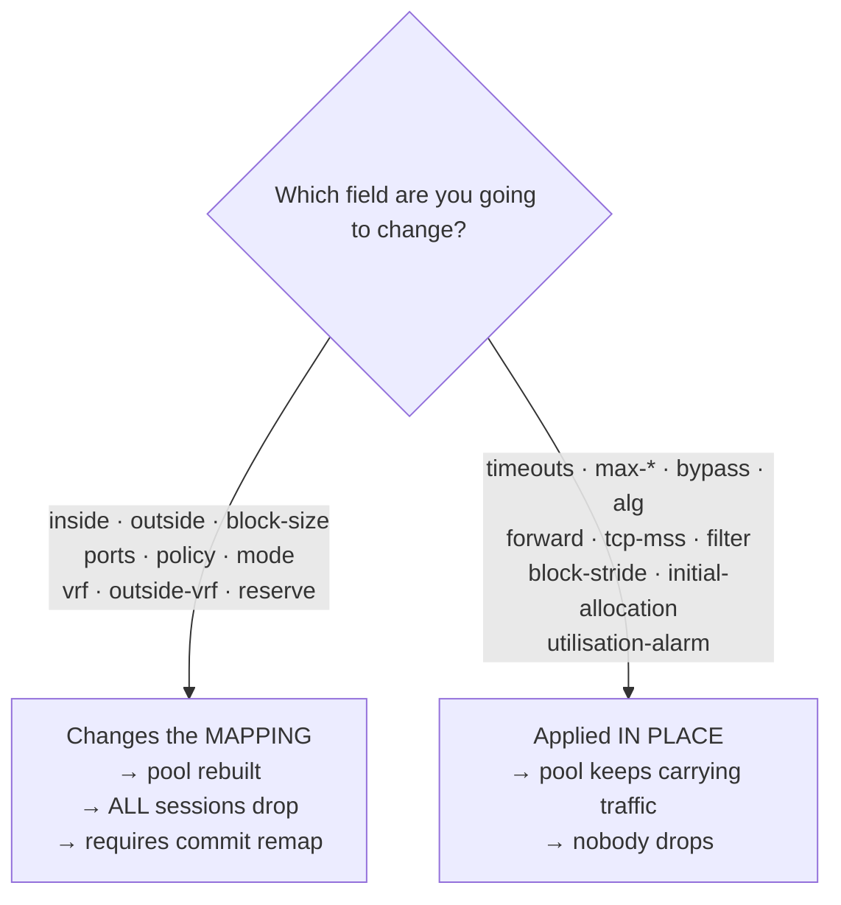

# Pool configuration

Every field a CGNAT pool accepts, with its argument, range, default, and whether changing it drops sessions. For anyone creating a pool or touching one that carries subscribers.

You enter `nat`, then `cgnat`, and there `pool <name>` — the name is up to 63 characters. The prompt becomes `prisma# [edit nat / cgnat / pool residencial] ` — it names the pool and the levels it sits in. `exit` goes back to `cgnat`; `top` goes straight to the top. The [CGNAT configuration](/s/wiki-en/doc/cgnat-configuration-MXpSfxcJsb) page explains the levels. `commit` works from inside the pool, and after it you remain in the pool.

Changing a pool requires the CGNAT capability: a `cgnat-operator` or administrator account.


:::info
Looking for **how to do a task** (open a port, limit a host, enlarge the pool)? Start with the **Everyday recipes**. This page is the field-by-field reference.

:::

# The split that matters before anything else

Some fields **rebuild the pool**, and every session in it dies the instant the change is applied. Others are **applied in place**, on a pool that is carrying traffic.

| Rebuild the pool — drop all sessions | Applied in place — no impact on sessions |
|--------------------------------------|------------------------------------------|
| `inside`                             | `timeout ...`                            |
| `outside`                            | `max-blocks`                             |
| `reserve`                            | `block-stride`                           |
| `block-size`                         | `bypass ...`                             |
| `ports`                              | `utilisation-alarm`                      |
| `policy`                             | `max-sessions`                           |
| `mode`                               | `max-session-rate`                       |
| `vrf`                                | `tcp-mss`                                |
| `outside-vrf`                        | `filter`                                 |
|                                      | `alg ...`                                |
|                                      | `forward ...`                            |
|                                      | `initial-allocation`                     |



The rule behind it: the ones on the left change the **mapping** — which public address and which port block each subscriber gets. Once the mapping changes, every existing session is invalid.

Getting this classification wrong hurts both ways: a mapping field treated as in-place never reaches the dataplane; an in-place field treated as mapping **disconnects the entire subscriber base to turn off an ALG**.


:::warning
**Careful with** `**inside**` **and** `**outside**`**.** Changing either of them rebuilds the pool and ends all of its sessions, in both modes. In a `mode deterministic` pool the cost is higher: the mapping is **arithmetic, not a table** — a subscriber's public address and port block are *calculated* from the pool definition —, so **changing the definition changes the function**. Adding a public prefix moves **every** subscriber at that instant. Nothing is corrupted, past answers remain resolvable from the configuration that was in effect, but all customers drop at once and the machine reports nothing abnormal — because nothing abnormal happened. That is why `commit` **refuses** a change that remaps subscribers until it is requested by name, with `commit remap`.

:::

# Mapping fields

| Command | Argument | What it defines |
|---------|----------|-----------------|
| `prefix-inside <prefix>` | `<A.B.C.D/M\|X:X::X:X/M>` | inside prefix (the subscribers); may repeat. Mandatory: `commit` refuses a pool without `prefix-inside` or without `prefix-outside` (or that side's `prefix-list-inside`/`prefix-list-outside`, below). IPv6 makes the pool a NAT64 pool (see below) |
| `prefix-outside <prefix>` | `<A.B.C.D/M>` | public prefix; may repeat |
| `subscriber-length <n>` | `<32-128>` | NAT64 only: the size of the IPv6 prefix of **one** subscriber — the delegated prefix, for example `56` |
| `nat64-prefix <prefix>` | `<X:X::X:X/M>` | NAT64 only: where the IPv4 destinations live (RFC 6052); if absent, `64:ff9b::/96` applies |
| `block-size <n>` | `<64-32768>` | ports per block, a power of two; default `512`. A number that is not a power of two is refused with the two nearest powers |
| `ports <min> <max>` | `<1-65535> <1-65535>` | usable port range; if absent, the box's own range applies |
| `policy interleaved` |          | neighbors on distinct public addresses; this is the default |
| `policy blocked` |          | neighbors on the same public address |
| `mode deterministic` |          | by formula, with no allocation log: the subscriber is found from the configuration in effect. This is the default. Only the block handed out from the reserve is logged |
| `mode bpa` |          | BPA: blocks allocated on demand, each allocation logged. In this mode the record is the only proof of who used a port: configure the export (`logging` under `cgnat`). `commit` does not warn when it is missing; `show cgnat logging` is what says whether the box exports |
| `vrf <n>` | `<0-4294967295>` | the VRF whose subscribers this pool serves; absent = all |
| `outside-vrf <n>` | `<0-4294967295>` | the VRF through which translated traffic leaves; absent = leaves it where it was |
| `reserve <n>` | `<0-65535>` | blocks of **each** public address kept out of the formula, to give to whoever fills up theirs; `0` = none |

Up to 0.148.2 these two statements were called `inside` and `outside`. The old names are still read - from a saved configuration, from a rollback revision or typed -, but the box only writes the new ones, and `?` only offers the new ones. The role of an interface in CGNAT (`interface <name> inside|outside`) did not change.

**The prefixes.** `prefix-outside` and `bypass` are IPv4; `prefix-inside` is IPv4 or, in a NAT64 pool, IPv6 — never both in the same pool. A prefix with host bits (`100.64.0.1/10`) is refused, stating which network it names (`100.64.0.0/10`), and a `/0` is refused: every address is neither a pool nor a bypass.

`**policy interleaved**` **vs** `**blocked**` — `interleaved` spreads neighbors across distinct public addresses, which dilutes the impact of a reputation block on one IP. `blocked` keeps neighbors on the same public address.

# Sides given by prefix-list

A side of the pool can come from an `ip prefix-list` instead of typed prefixes: the same list used by routing, with `seq`, `permit`/`deny`, `ge`/`le` and a description per entry.

| Command | Argument | What it defines |
|---------|----------|-----------------|
| `prefix-list-inside <list>` | `<prefix-list>` | the subscribers: a source that matches a `permit` is translated; a source that matches a `deny` **leaves without NAT**, with its own address; a source that matches nothing does not belong to this pool |
| `prefix-list-outside <list>` | `<prefix-list>` | the public addresses: the `permit` entries **minus** the `deny` entries |

Each side is **one or the other**: `prefix-inside` or `prefix-list-inside`, `prefix-outside` or `prefix-list-outside`. `commit` refuses a pool with both on the same side and says which pool and which side.

```
prisma# [edit] ip prefix-list CGN-IN seq 5 deny 100.64.1.0/24 description "faixa de gerência"
prisma# [edit] ip prefix-list CGN-IN seq 10 permit 100.64.0.0/22 le 32
prisma# [edit] ip prefix-list CGN-OUT seq 5 deny 203.0.113.129/32
prisma# [edit] ip prefix-list CGN-OUT seq 10 permit 203.0.113.128/28
prisma# [edit] nat
prisma# [edit nat] cgnat
prisma# [edit nat / cgnat] pool residencial
prisma# [edit nat / cgnat / pool residencial] prefix-list-inside CGN-IN
prisma# [edit nat / cgnat / pool residencial] prefix-list-outside CGN-OUT
```

With this the pool translates `100.64.0.0/24` and `100.64.2.0/23`, lets `100.64.1.0/24` through untranslated, and uses the fifteen addresses of `203.0.113.128/28` that remain after removing `.129`.

**How a list becomes a set of addresses.** In routing, an entry matches a **route** by its length: `permit 203.0.113.128/28` matches only the `/28` route. A pool reads the same list as **addresses**, and so the rule here is different:

* an entry with neither `ge` nor `le` covers **all** addresses of the prefix;
* with `ge` or `le`, each address counts as a `/32`, and the entry covers the prefix when 32 is inside the window - `le 32` or a `ge` alone cover everything;
* an entry whose window leaves `/32` out (`le 24`, for example) matches no address at all, and `commit` refuses the pool that uses the list, naming the entry.

The first matching entry wins, in `seq` order, as in routing. Where the same list is used by a BGP neighbor or by a route-map, it still applies by the route rule: only the pool reads it as addresses.

**What** `**commit**` **refuses:** a list that does not exist or has no entries; an entry that matches no address; a `prefix-list-inside` that translates nobody; a `deny` in the `prefix-list-outside` that leaves the pool **with no public address**; a source `deny` that another pool translates (a source belongs to a pool or leaves untranslated, not both); and a list that expands to more than 255 prefixes, the maximum the dataplane receives in one message. A NAT64 pool does not accept a prefix-list.

**Changing the list reapplies the pool.** The set the list yields is the mapping: if it changes, the pool is rebuilt at `commit`, as if the prefix had been typed again - and, in a deterministic pool, that remaps subscribers. `show configuration compare` shows the list line that changed and, under the pool, what it now translates, in `!` lines:

```
prisma# [edit] ip prefix-list CGN-OUT seq 10 permit 203.0.113.128/27
prisma# [edit] show configuration compare
```

Only the list name and what it leaves out (the untranslated sources, the excluded public addresses) change **in place**; swapping the list for another that yields the same addresses drops nobody.

**Moving entries, as in Junos.** `ip prefix-list <list> insert seq <n> before|after seq <m>` moves entry `n` before or after `m`; if there is no free number between the two, the whole list is renumbered in steps of 10 in the new order, and the box warns. `ip prefix-list <list> resequence` renumbers in steps of 10. Each entry's description goes along.

```
prisma# [edit] ip prefix-list CGN-IN insert seq 10 before seq 5
prisma# [edit] ip prefix-list CGN-IN resequence
```

**The per-entry description** is kept by the box itself - routing only has a description for the whole list - and appears in `show configuration` at the end of the entry's line. An entry with a description needs a `seq`; typed without one, the box gives it the `seq` routing would give.

**What the pool actually uses:** `show cgnat pool <name>` shows the dataplane lines for the pool and, below, each side with its origin (`prefix-list CGN-IN` or `typed`), what it translates (`translated`, `public`) and what the lists left out (`untranslated`, `excluded`). The dated trail (`show cgnat history`) records the same sets and the list names, so that a deterministic mapping can be recalculated knowing which addresses were left out.

```
prisma> show cgnat pool <name>
```

## Both ends of `ports` are checked as you type, and the range at `commit`

A port is a 16-bit number on both sides: if `ports 70000 80000` were accepted, what would reach the dataplane would be `4464-14464`, and from there on no refusal could name the 70000 - the number would no longer exist. So each end is refused where you type it, and the refusal says **which of the two**:

```
error: invalid argument: ports min 70000: expected 1-65535
```

```
error: invalid argument: ports max 70000: expected 1-65535
```

Something that is not a number gets a spelled-out answer, because the action is different - it is not choosing another value, it is writing a number:

```
error: invalid argument: ports min 'x': expected a number 1-65535
```

Two legitimate ports in the wrong order are a different refusal, on purpose: the range is not what is wrong there.

```
error: invalid argument: ports 9000 100: the max is below the min
```

The third thing that can be wrong only shows up at `commit`, not on the line: a range too narrow to fit **one block**. It depends on `block-size`, which you may type after `ports` - checking it on the line would refuse a legitimate editing order. So the question is asked once, of the finished pool:

```
error: pool 'residencial': block-size 512 exceeds the 177 usable ports
    ports 1024 1200
    block-size 512
    a pool whose port range is smaller than its block has no block to give
    anyone: widen the range, or make the block smaller
```

Both statements come out whole, each on its own line, for the usual reason: it is one of them you will edit, and both carry numbers you will compare.

# Pool timeouts

`timeout <type> <seconds>`, from `1` to `4294967295`. If absent, it inherits the global one. Zero is not a timeout: it is the value the box reads as "don't touch this one", and so it is refused the moment you type it, rather than silently ignored.

| Type | What expires |
|------|--------------|
| `udp` | UDP sessions |
| `icmp` | ICMP sessions |
| `tcp-syn` | half-open TCP |
| `tcp-transitory` | TCP in transition |
| `tcp-established` | established TCP |
| `gre` | the GRE mapping of a PPTP call |
| `port-holddown` | how long a released port waits before being reused |
| `alg-expect` | how long an announced media port waits |

`port-holddown` is not a detail: reusing a port immediately makes the record of who was using it overlap with the next owner.

# Per-subscriber limits

| Command | Argument | What it limits |
|---------|----------|----------------|
| `max-blocks <n>` | `<1-255>` | how many blocks a subscriber can hold |
| `initial-allocation <ports>` | a whole number of blocks | how many ports a new subscriber of a dynamic pool receives at once |
| `block-stride <n>` | `<0-65535>` | distance between the blocks of the same subscriber; `0` lets the pool choose |
| `max-sessions <n>` | `<0-4294967295>` | maximum simultaneous sessions per subscriber; `0` = unlimited |
| `max-session-rate <n>` | `<0-4294967295>` | maximum new sessions per second, per subscriber; `0` = unlimited |
| `utilisation-alarm <pct>` | `<1-100>` | logs once when a subscriber's block reaches this percentage |

`max-sessions` and `max-session-rate` are the defense against an infected machine consuming the entire pool. `utilisation-alarm` warns **before** exhaustion, not after.

# The port range a subscriber can reach

`block-size` and `max-blocks` together **are already a range**, and that is how a pool serves a smart meter and a heavy household at the same time:

```
block-size 64
max-blocks 8
```

A subscriber **starts with 64 ports**. It only receives a second block when it fills the first, and only then a third - up to 8 blocks, 512 ports. The meter never asks for the second and costs the pool 64 ports; the heavy household reaches 512 on its own, without anyone configuring anything for it.

`show cgnat pool` shows the range in ports, which is the unit it is sold in:

```
  per sub      64-512 ports (1-8 blocks, grown one at a time as each fills)
```

## A first allocation larger than the step

In a `mode bpa` pool, the first allocation can be larger than the step by which the subscriber grows. To start with 512 ports and grow 256 at a time, up to 2560:

```
block-size 256
max-blocks 10
initial-allocation 512
```

The block is 256 ports, and that is the step. `initial-allocation 512` makes the new subscriber receive **two** blocks on the very first packet. From then on it gains a 256 block every time it fills the ones it has, up to the 10 blocks of `max-blocks`. `show cgnat pool` shows the range starting from the first allocation:

```
  per sub      512-2560 ports (starts at 2 blocks, grown one at a time to 10 as each fills)
```

`commit` refuses three things, because in none of them would the number do what it says:

* **ports that do not make a whole number of blocks** (`initial-allocation 300` with `block-size 256`);
* **more than** `**max-blocks**` **allows** (`initial-allocation 4096` with 10 blocks of 256);
* **a** `**mode deterministic**` **pool**, in which the subscriber's first block is the formula's.

Each block of the first allocation becomes its own record in the block log, exactly as if they had been handed out one at a time. Changing `initial-allocation` applies to the **next** new subscribers and does not touch anyone who already has blocks, so it is applied in place, without dropping sessions.

A subscriber that ends up with no sessions at all and comes back before its block is released gets the same first block back, and grows from there by the normal steps. The full first allocation is for whoever arrives with no block at all.

The price of a small block is **logging volume**: each block handed to a subscriber becomes its own record in the block log. A household that reaches 8 blocks generates 8 records; with `block-size 512` and a single block, it generates 1. Choose the smallest block that still keeps most subscribers within **one** block, and use `max-blocks` for the minority that needs more.

# The reserve block of a deterministic pool

In a `mode deterministic` pool **there is no spare block**: the formula hands every block to some subscriber. Whoever fills their block is dropped - the customer's internet stops while the box is healthy - because any block handed out as an extra would be someone else's block, and their mapping would break silently.

`reserve <n>` keeps **n blocks of each public address** out of the formula. Those, and only those, are the blocks a deterministic pool has to give.

```
reserve 1
```

The math changes too, and that is the price:

```
blocks per address       = ports per address / block-size
blocks the formula uses  = blocks per address - reserve
capacity                 = public addresses x blocks the formula uses
```

`show cgnat pool` shows both calculations side by side, and the capacity already comes discounted:

```
  reserve      1 block(s) per public IP -> 3 mapped, 1 held for extensions
  capacity     3 subscribers (usable 3)
```

Each block handed out from the reserve becomes **its own record** in the block log, and so does its return. It is the only thing deterministic mode records per subscriber, and it has to be: it is the only block the formula does not produce, so the dated configuration cannot answer for it on its own.

`show cgnat blocks` shows the reserve and counts the refusals:

```
  reserve exhausted 3 time(s): a subscriber filled its block, was under
  max-blocks 2, and the reserve had nothing left
```

This count is **separate** from a subscriber hitting `max-blocks`, because the action is different: against one, enlarge the reserve or add public addresses; against the other, raise the per-subscriber limit.

Three things worth knowing before choosing the number:

* **A reserve smaller than the number of workers leaves workers with nothing.** The box warns when the pool is created and creates the pool anyway - refusing would make a pool accepted today fail to come up after the machine gains workers, which drops everyone.
* **The box prefers a block from the subscriber's own public address**, so that whoever is on the other side keeps seeing a single host. It is a preference, not a guarantee: if there is no free one in that worker's slice, it hands out another instead of refusing.
* `**reserve**` **does not apply in** `**mode bpa**` and is refused there. A dynamic pool already has spare blocks - the free list is exactly where the extra block comes from - so a reserve would take blocks out of the very list they come from.

# Where a subscriber's extra blocks go

`block-stride <n>` decides the distance between the blocks a single subscriber holds. It applies only in `mode bpa`: in a deterministic pool the extra block comes from the reserve, which is a separate set, and the distance does not apply to it - and `commit` refuses the combination, instead of keeping a setting that would never take effect; the message is in [commit, rollback and save](/s/wiki-en/doc/commit-rollback-and-save-HVsz5GElE1).

| Value | What happens |
|-------|--------------|
| `0` (default) | the extra block goes wherever the pool has a free one - the usual behavior |
| `1`   | the blocks are **adjacent**: the second starts where the first ends |
| `n`   | the blocks are `n × block-size` ports apart, on the same public address |

**Adjacent (**`**1**`**)** leaves the subscriber with a contiguous port range. It is the option for those who handle court orders and investigations: one range instead of several, and the technician looking at a timestamp does not need to cross-check three separate intervals.

**Spread out (larger** `**n**`**)** spreads the subscriber across the port range of its own public address. It is the option for those who want observing a port interval from outside to reveal as little as possible about a customer.

Neither is obviously right - that is why it is a setting, and why the default is the old behavior: a configuration written before `stride` existed behaves the same when the box starts running a new version.


:::info
`**stride**` **never costs a customer traffic.** If the block the distance points to is already held by another subscriber, or if the subscriber is at the end of its public address's port range, the box hands out **any other block** instead of refusing. The customer keeps working; the only thing that changes is where the block landed.

:::

`show cgnat blocks` counts both cases, and it is where you check whether the setting is actually taking effect:

```
  stride 1: 412 extensions placed where it says, 7 fell back to the free list
```

Only zeros in the first column with numbers in the second means the chosen distance **does not fit** this box. That happens when the machine runs with several workers: the blocks are split among them, and a subscriber can only receive blocks from its own worker's slice. The box warns at the moment the pool is created and says which distance works:

```
warning: block-stride 1 on pool residencial cannot be honoured: blocks are sharded 4 ways and a stride step moves by 2, so every block the stride names belongs to another worker
         the nearest stride that can be: 2
         the setting is applied and extensions fall back to the free list; this is a warning, not a refusal
```

These are **three** lines, and the dataplane writes them whole: the first exceeds 170 columns and the last 100, so on an 80-column console it is the terminal that wraps them. Anyone searching the screen for the whole sentence should look for its beginning, not for a line that ends where their window ends.

It is a warning and not a refusal on purpose: the number of workers is a startup setting, and a configuration refused because of it would leave the pool **failing to come up** after a restart - which drops everyone, to satisfy a tidiness preference.

# Bypass — what is not translated

| Command | Argument | Effect |
|---------|----------|--------|
| `bypass source <prefix>` | `<A.B.C.D/M>` | source that needs to keep its own address |
| `bypass destination <prefix>` | `<A.B.C.D/M>` | destination that needs to see the real source |

Bypassed traffic leaves **untranslated and without allocating anything**.

# Port forward

```
forward tcp <public-port> to <private-ip> <private-port>
forward udp <public-port> to <private-ip> <private-port>
```

Pins an inbound port to a subscriber. **The public address is the subscriber's own** — not an arbitrary IP from the pool.

# NAT behavior

| Command | Effect |
|---------|--------|
| `filter endpoint-independent` | anyone can reach an open mapping (*full cone*) — **default** |
| `filter address-dependent` | only the remote the subscriber contacted (*restricted cone*) |

Corresponds to REQ-8 of RFC 4787.

# MSS clamping

```
tcp-mss <536-9000>
tcp-mss auto
```

Lowers the MSS of handshakes so that segments fit the path. `auto` derives the value from the MTUs of the interfaces with `cgnat inside` or `cgnat outside` (the smallest of them minus 40: with interfaces at the box default, 1500, that gives 1460); while no interface is in CGNAT, it has nothing to derive from and lowers nothing. Below 536 (the MSS every IPv4 host accepts) the value is useless, and above 9000 it describes no path at all: both are refused. `no tcp-mss` turns it off.

It is worth noting the failure mode this fixes: without clamping, the peer discards the segment and the connection hangs — silently, with a counter claiming everything was applied.

# ALGs

```
alg ftp  <on|off>
alg rtsp <on|off>
alg pptp <on|off>
alg esp  <on|off>
alg sip  <on|off>
```

| ALG | What it rewrites |
|-----|------------------|
| `ftp` | PORT/EPRT and the 227/229 replies |
| `rtsp` | the `client_port` of the Transport header |
| `pptp` | the control channel and the GRE data channel |
| `esp` | nothing in the payload: binds the IPsec tunnel to the remote gateway |
| `sip` | `Via`, `Contact` and the SDP of SIP over UDP, and opens the RTP/RTCP pair |

These are the protocols that carry an address inside the payload — or, in the case of `esp`, that have no port at all for CGNAT to use. Without the corresponding ALG, they announce the private address to the other side and the data connection is never established.

All five come **on**. `alg <name> off` is the exception written into the pool, and `no alg <name>` returns the ALG to the box default instead of pinning it to a value.

# Removing a setting: `no`

Inside the block, `no <setting>` removes the setting. `no ?` lists what can be removed, and `?` after the word keeps offering the argument:

```
prisma# [edit nat / cgnat / pool residencial] no ?
  alg                  stop choosing for one ALG; the pool takes the device default again
  block-stride         let the pool place a subscriber's extra blocks wherever it has one free
  bypass               stop excluding a prefix from translation
  filter               go back to endpoint-independent filtering
  forward              remove one inbound port forward
  initial-allocation   a new subscriber starts with one block again
  max-blocks           go back to one block per subscriber
  max-session-rate     no per-subscriber session rate cap
  max-sessions         no per-subscriber session cap
  nat64-prefix         go back to the well-known 64:ff9b::/96
  outside-vrf          leave translated traffic where it was
  ports                go back to the device's own port range
  prefix-inside        remove one subscriber prefix
  prefix-list-inside   stop taking the subscribers from a prefix-list
  prefix-list-outside  stop taking the public addresses from a prefix-list
  prefix-outside       remove one public prefix
  reserve              give the reserved blocks back to the formula; this too re-maps subscribers
  subscriber-length    no subscriber length; an IPv6 inside needs one
  tcp-mss              stop clamping the MSS
  timeout              stop overriding one timeout; the pool inherits the global again
  utilisation-alarm    stop alarming on block utilisation
  vrf                  serve every VRF again
```

Removing a timeout, an ALG or a limit **is not the same as setting it to the default value**: the pool goes back to **inheriting** the global one, and the line disappears from the configuration instead of appearing in it with a number. A global `timeout udp 300` changed later applies to the pool again.

## NAT64 pool: IPv6-only subscribers leaving through public IPv4

A pool with an IPv6 `prefix-inside` is a NAT64 pool (RFC 6146): the subscriber that only has IPv6 reaches IPv4 servers through the same public pool, split into port blocks as in IPv4 CGNAT. The subscriber is the **delegated prefix**, not an address: a /128 inside a /64 changes with privacy extensions, and the prefix is what RADIUS assigns to a person.

```
nat
 nat64
  pool v6
   prefix-inside 2001:db8:1200::/40
   subscriber-length 56
   nat64-prefix 64:ff9b:1::/48
   prefix-outside 203.0.113.0/29
   block-size 2048
   exit
```

Each /56 of `2001:db8:1200::/40` gets a 2048-port block by the same formula as deterministic mode. The subscriber talks to `64:ff9b:1:c000:2:200::` and the server `192.0.2.2` sees the public address and a port from that subscriber's block. With the well-known prefix `64:ff9b::/96` (the default), non-global IPv4 addresses — private, documentation, lab — are not reachable, as RFC 6052 requires.

`subscriber-length` and `nat64-prefix` are **mapping** fields: changing either one rebuilds the pool.

**Attention:** the NAT64 pool lives under `nat` > `nat64`, not under `cgnat`. Written inside `cgnat`, as in versions 0.150.0 to 0.150.11, it is refused at `commit check` and when loading the saved file, with the new form in the message — rewrite the pool under `nat64` before upgrading the box. Under `nat64` there are only pools; interfaces, logging, timeouts and memory remain under `cgnat`, applying to both kinds of pool. A pool name is a single pool, across both levels. To see only NAT64 there are `show nat64 pool`, `show nat64 subscriber <IPv6>`, `show nat64 translation <public> <port>` and `clear nat64 subscriber <IPv6>`; `show cgnat` still shows the whole box, NAT44 and NAT64.

**Deterministic or BPA.** In `mode bpa`, with `max-blocks`, `initial-allocation` and `block-stride`, the NAT64 pool allocates blocks on demand like an IPv4 pool, and each allocation and release goes to the log naming the subscriber by the delegated prefix (see [IPFIX logging and audit trail](/s/wiki-en/doc/ipfix-logging-and-audit-trail-mrQPyuvc8g)). The other pool settings apply in a NAT64 pool as in an IPv4 pool — `reserve`, `tcp-mss`, `vrf` and `outside-vrf`, `max-sessions`, `max-session-rate`, `utilisation-alarm`, timeouts and `filter` —, with two differences. `tcp-mss auto` is 20 bytes lower than in an IPv4 pool, because the IPv6 header on the subscriber side is 20 bytes larger. And the `vrf` of a NAT64 pool is an IPv6 table: two customers can have the same inside prefix in different VRFs, each with its own pool.

**Port forward to an IPv6 host.** In a NAT64 pool `forward` points to a host in the subscriber's prefix, and whoever is on the IPv4 internet reaches that host through the public port:

```
forward tcp 12000 to 2001:db8:1200:ab00::10 8080
```

The public port must be in the subscriber's own block, as in an IPv4 pool. A second host of the same prefix with the same private port is refused.

**ALG in a NAT64 pool:** only `ftp`, which translates an IPv6 client's `EPSV` and `EPRT` into an IPv4 server's `PASV` and `PORT` (RFC 6384), and which in a NAT64 pool comes **off** until you write `alg ftp on` (see [Protocols and ALGs](/s/wiki-en/doc/protocols-and-algs-z0NTWXgdda)).

**Refused in a NAT64 pool:** `bypass`, permanently — an IPv6 packet to the NAT64 prefix only reaches IPv4 translated, so there is no untranslated path —, and the `rtsp`, `sip`, `pptp` and `esp` ALGs, also permanently, each by name: there is no translation of them between IPv6 and IPv4 to perform.

**IPv4 for the IPv6-only subscriber (464XLAT).** The subscriber's program that only speaks IPv4 goes through the NAT64 pool via a CLAT on its side, and the CLAT learns the `nat64-prefix` from the router advertisements on the subscriber interface: `ipv6 nd nat64 <prefix>` on that interface (see [Interface configuration](/s/wiki-en/doc/interface-configuration-1Pq7NRieCn)). `commit check` refuses to advertise a prefix that no NAT64 pool translates.

**Routes.** A NAT64 pool owes routing two prefixes: `prefix-outside`, like any pool, and `nat64-prefix`, on the IPv6 side — that is where subscribers send their traffic bound for IPv4. With BGP configured, `commit check` warns when nothing advertises the `nat64-prefix` in the IPv6 family, and the warning carries the two lines that fix it: `ipv6 route <prefix> blackhole` and `network <prefix>`.

**High-availability pair.** The pair's mapping comparison covers the NAT64 pool, and failover carries the IPv6 side: an IPv6 address in the `vrrp <vrid>` of the subscriber interface (the link-local and the global, see [Interface configuration](/s/wiki-en/doc/interface-configuration-1Pq7NRieCn)) makes the IPv6 gateway follow the master. In a lab pair, service came back within 2.8 to 4.0 seconds in the three failures measured (uplink cable, dataplane stopped, dataplane killed), on the same public address and the same block; connections in progress drop, as with IPv4. `commit check` only warns about the NAT64 pool when the pair has no IPv6 virtual router.

Who was behind a public port: `show cgnat translation 203.0.113.3 44100` answers with the subscriber's IPv6 prefix, by the formula. The reverse: `show cgnat subscriber 2001:db8:1200:ab00::10` gives the subscriber's block, and `show cgnat top` lists subscribers by prefix.

## Three settings cannot be removed, and the box says so

`block-size`, `policy` and `mode` **always have a value**. There is no pool without a block size, without a policy and without a mode - so `no block-size 512` would have nothing to mean: removing the line would not remove the setting, it would only make the configuration stop saying what the pool is doing, while the pool keeps doing it. The box refuses and says what to type instead:

Typing `no block-size 512` inside the pool is refused, and the refusal says what to do instead:

```
error: block-size cannot be removed
    every pool has one, so there is no state without it
    set the value you want instead: block-size <64-32768>
```

`policy` and `mode` answer the same way, swapping the field name and what to type instead: `policy interleaved|blocked` and `mode deterministic|bpa`.

To change any of the three, type the value you want. They are mapping fields: the change rebuilds the pool and requires `commit remap`.

## `ports`, `vrf` and `outside-vrf` have an "unstated" state

These three accept `no`, and the state they return to is not a value - it is its **absence**, which means something else:

| Command | What it returns to |
|---------|--------------------|
| `no ports` | the box's own port range |
| `no vrf` | serves **all** VRFs, which is not the same answer as `vrf 0` |
| `no outside-vrf` | leaves translated traffic where it already was |

All three are also mapping fields: removing them rebuilds the pool.

## Removing something that is not there is refused

`no prefix-inside 10.0.0.0/8` on a pool that does not have that prefix is refused, with the prefix written back. The pool keeps the prefix you wanted, and almost always what happened was a typo:

```
error: the pool has no prefix-inside 10.0.0.0/8
```

On the other hand, `no timeout udp` on a pool that does not override the UDP timeout is accepted silently: the resulting state is exactly the requested state - this pool overrides nothing.

# Complete example

```
configure
 nat
  cgnat
   pool residencial
    prefix-inside 100.64.0.0/10
    prefix-outside 203.0.113.0/24
    block-size 512
    ports 1024 65535
    policy interleaved
    mode deterministic
    timeout udp 300
    timeout tcp-established 7440
    max-sessions 2000
    max-session-rate 200
    utilisation-alarm 85
    tcp-mss auto
    alg ftp on
    alg pptp on
    bypass destination 198.51.100.0/24
    exit
   exit
  exit
 interface ens18
  cgnat inside
  exit
 interface ens19
  cgnat outside
  exit
 show configuration compare
 commit check
 commit comment "pool residencial inicial"
 exit
save
```

The fields inside the pool are the same as always. What changed is the path to it: the single-line form (`nat cgnat pool residencial`, or the older `cgnat pool residencial`) **is no longer accepted**, neither typed nor in a saved file. After upgrading a box, run `save` before restarting: it rewrites the file already in the `nat` > `cgnat` block, and the next boot reads the whole file.

# See also

* [Day-to-day recipes](/s/wiki-en/doc/day-to-day-recipes-KCc5cOuBip) — these fields applied to real tasks
* [Deterministic and BPA — concepts and mapping](/s/wiki-en/doc/deterministic-and-bpa-concepts-and-mapping-NMOHVImQiU) — why some fields drop sessions
