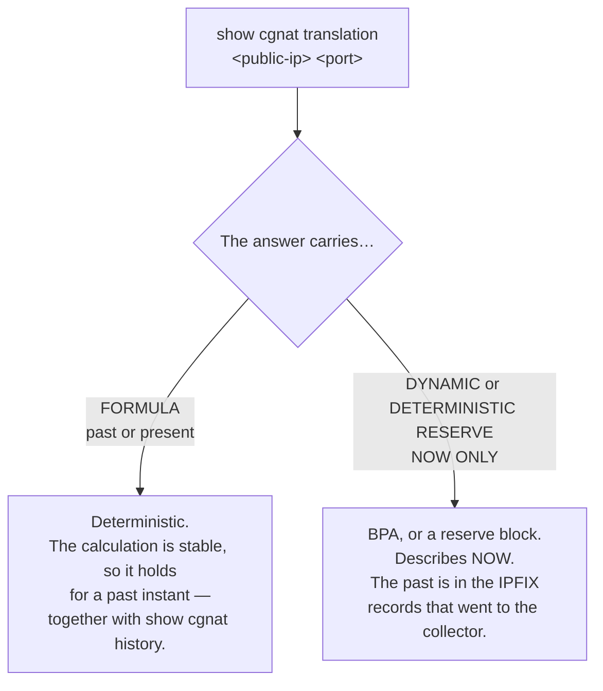

# show commands

What each `show` in `prismash` answers, how to filter the output and how to read the screens that matter most in an investigation. For those who operate the box and need to know which command answers the question they have in hand.

`show` commands work in operational **and** configuration modes, at any level.

## `show cgnat`

The first four answer an operator's question instead of reporting a counter. They all take the answer from the **dataplane**, and they are all answered here: an operator who had to go down to the dataplane's command line to diagnose would be an operator for whom this VTY is decoration.

| Command | Argument | Answers |
|---------|----------|---------|
| `show cgnat subscriber` | `<inside-address>` | everything about a subscriber |
| `show cgnat translation` | `<public-address> <port> [at <time>]` | who was behind a public address and port; with `at`, at a past instant |
| `show cgnat top` | `[<n>]`  | subscribers closest to exhausting their blocks |
| `show cgnat drops` |          | why packets did not get through |
| `show cgnat pool` | `[<pool>]` | configured pools, each one's capacity and the distribution of how much subscribers use of their own block; with the name, one pool only, plus what it translates and to what, and which prefix-list each side came from |
| `show cgnat session` |          | active sessions per thread |
| `show cgnat memory` |          | CGNAT memory: how much the heap has, how much is in use, how many more sessions fit and the value given |
| `show cgnat blocks` |          | blocks allocated in `mode bpa`, and how many a port forward pins |
| `show cgnat logging` |          | state of block event export: UDP, TCP and syslog |
| `show cgnat identity` |          | how many subscriber identities the box has and when it read them — never an identity itself |
| `show cgnat history` |          | dated configuration trail |
| `show cgnat history verify` |          | checks the trail's hash chain and names the first entry that does not match |
| `show cgnat alg` |          | which ALGs the dataplane has on, per pool |
| `show cgnat forward` | `[<pool>]` | the port forwards the dataplane has |
| `show cgnat ha` | `[peer <file>]` | whether this box and the peer map subscribers the same way; without `peer`, compares against the copy of the peer's configuration stored on the box |

`show cgnat translation` is the command that answers a court order: given a public IP, a port and an instant, who the subscriber was.

`at <time>` asks for the answer at a past instant, written as `show log`'s `since` (`2026-10-05T14:00`, or `2h` back from now). It only applies where the answer is the formula — a deterministic pool, outside the reserve —, because the formula holds for any instant; for a BPA block or a reserve block the box refuses `at` and says where the past is: the block log gives the inside address, and `show pppoe history address <a> at <time>` the session. On a box with PPPoE, the answer carries below it the PPPoE session that held that inside address, now or at the instant asked.

`show cgnat` answers for the whole dataplane, NAT44 and NAT64 together. For the NAT64-only questions there are `show nat64 pool`, `show nat64 subscriber <IPv6-address>` and `show nat64 translation <public-address> <port>`: each refuses what is not NAT64 and says which `show cgnat` answers it.

`show cgnat history` is the other side of that in deterministic mode — which configuration was in effect on that date, and who put it there. `show cgnat history verify` is what proves that this trail was not altered afterwards: it is the check to run before handing over an answer, and before wiping a box's disk.

### `show cgnat alg` and `show cgnat forward`: what the dataplane has, not what the file says

Both answer a different question from the one `show configuration` answers. The file says what was requested; these say what the box is doing, and the two drift apart silently.

```
prisma> show cgnat alg
provider-a
  ftp    on   FTP PORT/EPRT and the 227/229 replies
  rtsp   off  RTSP Transport client_port, and the media pair it needs
  pptp   on   PPTP control channel and its GRE data channel
  esp    on   IPsec ESP passthrough, bound to the peer gateway
  sip    on   SIP over UDP: Via, Contact, SDP, and the RTP pair it needs
```

These are the product's **five** ALGs, one per line, with the description the box prints in English. It is the screen for "this customer's FTP transfers hang": it says whether the ALG is on **in the dataplane**, which is not the same question as whether it is in the file.

```
prisma> show cgnat forward
pool provider-a
  tcp 200.150.0.17:8080 -> 100.64.0.5:80
```

And this is the first thing to establish when someone calls saying the port forward does not work: whether the box has the forward. It accepts a pool name to filter: `show cgnat forward provider-a`.

## `show route` — the table that forwards

| Command | Shows |
|---------|-------|
| `show route` | the VPP forwarding table: what this box actually does with a packet |
| `show route verbose` | the VPP FIB and the FRR RIB side by side, **marking where they disagree** |
| `show route <prefix>` | the same, for one destination |

```
prisma> show route
  Destination    Next hop    Interface Kind
  0.0.0.0/0      200.150.0.1 enp2s0    forward
  200.150.0.0/24 -           enp2s0    connected

  2 entries carrying traffic
```


:::warning
`show ip route` answers from the **FRR** table, not the one that forwards. On a box that is dropping traffic, the route shows up present and correct there.

When traffic does not pass and the route looks right, `show route verbose` is the command: it compares the two tables and says which prefix is in one and not in the other.

:::

## `show interface` — those of the dataplane

```
prisma> show interface
  Interface                  State  MTU    Address             Linux
  enp1s0                     up     9000   203.0.113.1/24      tap0 enp1s0
  enp2s0                     up     1500   -                   -

  2 interface(s) on the dataplane can forward
```

It answers from the **dataplane**, with state, MTU, addresses and the `linux_cp` pair. The latter because it is the name FRR and `ip` use, and whoever moves between the two tools needs both side by side.

**The card shows up with the name Linux gave it.** The box claims the cards on its own and names each one, in the dataplane, with the name it had in Linux: `enp1s0` remains `enp1s0`, and that is how it shows up here, at the prompt and in routing. A card with an `interface` block enters Linux with that same name, and that is what the **Linux** column shows, next to the internal `tap` the pair uses - `linux-name` is only needed to choose a different one. A port whose name has slashes is a card no one named; routing refuses names longer than 16 characters, and `commit` says so before trying.


:::warning
This command used to be passed to `vtysh`, which sees only what `linux_cp` mirrored. On a box with a `GigabitEthernet0/12/0` configured, the answer was `lo` — the list without the interfaces that carry the traffic.

It is the same trap as `show ip route`: the question answered from the wrong side.

:::

**The list is of what you configured**: cards, VLAN sub-interfaces and loopbacks. `local0` does not appear — it is VPP's null interface and configures nothing — and neither does the `linux_cp` pair's `tap`: it is created and destroyed by this product, and its name is already in the **Linux** column of the interface it belongs to.

Both appeared up to 0.103.0, on the argument that hiding what the dataplane reports would be the command deciding what you can see. The argument holds for interfaces the box has; it does not hold for a VPP artifact or for half of a pair — and the price of keeping them was a wrong count of the number of cards, each counted twice, once as itself and once as its `tap`. The half of the argument that was about diagnosis still stands: a `tap` **named explicitly** still answers, so `show interface tap4096` shows what exists on a box with a broken pair.

**The number at the end of the list** is that of interfaces that forward, which is the number to compare with the cards you installed.

FRR's view remains in `show ip interface`.

### `show interface terse` — administrative and link, separated

One line per interface, with **two** state columns:

```
prisma> show interface terse
  Interface                  Admin  Link   Proto  Local
  enp1s0                     up     up     inet   203.0.113.1/24
  enp2s0                     up     down   -      -

  2 interface(s) on the dataplane can forward
  enp2s0: configured up, link down - that is the wire or the far end, not this configuration
```

| `Admin` | `Link` | What it is |
|-------|------|------------|
| `up`  | `up` | normal     |
| `up`  | `down` | **it is the cable, the transceiver or the other side** — the configuration is up |
| `down` | `down` | someone typed `shutdown` |

There are two columns because there are two facts, and the difference between them is the fault. A single "state" column does not distinguish *someone applied* `shutdown` from *the fiber was cut* — and this is precisely the listing that gets opened when something is wrong. That is why the box also names, at the end, the interfaces configured up whose link is down: it is the table's conclusion, stated without needing to be looked for.

A sub-interface is not hardware and the dataplane reports no link for it. Its link is **the parent's**, and that is what the column shows — an ISP's subscriber ports are all sub-interfaces, and an empty column precisely on them would be useless.

One address per line: an interface with IPv4 and IPv6 appears on two lines, with `inet` and `inet6` in the `Proto` column and the name written only once.

### `show interface description` — what each port is for

```
prisma> show interface description
  Interface                  Admin  Link   Description
  enp1s0                     up     up     ASSINANTES PON-3
  enp2s0                     up     down   TRANSITO Vivo AS26599

  2 of 2 interface(s) described
```

The description is stored as the **interface's tag in the dataplane itself**, spaces and all: it survives a VTY restart and says the same thing to whoever queries the dataplane by another path. It is written with `description <text>` inside `interface <name>`.

The column comes next to `Admin` and `Link` on purpose: the question *"what is this port?"* almost never comes alone — it comes together with *"and is it working?"*.

### `show interface utilization` — how much is passing now

```
show interface utilization [<name>] [interval <seconds>] [count <n>]
```

`show interface` shows a **counter**, which is a total since boot. Nobody wants the total: they want to know whether the link is full **now**. That takes two readings and dividing by the time between them — so this command **takes time**, and says how long before starting:

```
prisma> show interface utilization
  sampling every 2s, 5 time(s) - 10s in total; Ctrl-C stops early

  Interface                             rx            tx  rx history tx history
  enp1s0                       8.40 Mbit/s   3.10 Mbit/s  ▁▁▁▂▁      ▁▁▁▁▁
  enp2s0                     675.56 Mbit/s   1.24 Gbit/s  ▃▄▄▅▄      ▆▇▇█▇

  bars are each interface's share of its own line rate
    enp1s0                     0.8% of 1.00 Gbit/s
    enp2s0                    12.4% of 10.00 Gbit/s
```

| Argument | Effect |
|----------|--------|
| `<name>` | only the interfaces whose name starts like this |
| `interval <seconds>` | time between samples; default 2, between 0.1 and 60 |
| `count <n>` | how many samples; default 5, between 1 and 120 |

What is worth knowing to read the chart:

* **The rate is in bit/s**, in the multiple an operator would say the number in.
* **Elapsed time is measured, not assumed.** On a loaded box — the only one where the question matters — two seconds of waiting are not two seconds, and a rate calculated from the nominal interval would be wrong exactly there.
* **When the dataplane reports the link speed**, the bar is that interface's share of its own line rate, and the percentage is real.
* **When it does not** — a virtual interface, for example — the bar is scaled to the largest sample of that run, and the box **says so** instead of presenting a percentage of a capacity it does not know.
* Traffic that would round to nothing is drawn at the lowest level, not on the baseline: *a trickle of traffic* and *silence* are different answers.
* `Ctrl-C` ends before the end and the chart comes out with what has already been sampled. Interrupted before the second reading, there is no rate to show, and the box says so instead of printing zeros.
* Packets dropped during sampling, and a counter that went backwards because someone cleared the interfaces in the middle, are reported at the end.

### `monitor interface` — the same, live

```
monitor interface [<name>...] [interval <seconds>]
```

`show interface utilization` answers for a few seconds and ends. `monitor interface` is the screen that **stays**: redrawn in place at each sample until `q` or `Ctrl-C`, with one chart per interface for each direction. This is the screen of a port receiving an 800 kbit/s flow:

```
monitor interface   every 1s   page 1/1   q quit  l scale  n/p page    07:17:26
pg0   scale 1.00 Mbit/s, auto
  1.00 Mbit/s┤                                      ▂ ▂▂ rx 822.98 kbit/s
             │                                      █▄██    1029 pps
             │                                      ████
            0┤                                      ████ errors 0
  1.00 Mbit/s┤                                           tx 0 bit/s
             │                                              0 pps
             │
            0┤                                      ···· drops 0
```

| Key | Effect |
|-----|--------|
| `q` or `Ctrl-C` | exits, and returns the terminal exactly as it was |
| `l` | switches the scale of all charts between their own and the line rate |
| `n`, space, right or down arrow, Page Down | next page |
| `p`, `b`, left or up arrow, Page Up | previous page |

| Argument | Effect |
|----------|--------|
| `<name>` | that interface; a word that is not the name of any interface applies to all that start like this. Without a name, all except `local0` |
| `interval <seconds>` | time between samples; default 1, between 0.5 and 60 |

What is worth knowing to read the screen:

* **The scale is always written.** By default each interface uses its own, rounded to 1, 2 or 5 times a power of ten — so a 10 Mbit/s trickle on a 10G port shows up. With `l` the chart becomes the share of the line rate, and the title says, for example, `line rate 10.00 Gbit/s: rx 12.4% tx 0.1%`. An interface whose speed the dataplane does not report says `no line rate known` and stays on its own scale.
* **Next to each chart**: the most recent rate in bit/s and in packets per second, and the errors and drops summed over the samples on screen. Before the second reading there is no rate, and the column says `--` — never 0.
* **The window moves**: as many samples as the terminal is wide, the newest on the right. Interfaces that do not fit in the height go to the following pages, they are never cut off. It fits on an 80-column serial console, and on a console that answers in ASCII the chart is drawn in ASCII.
* **Same sampling as** `**show interface utilization**`, so the two do not disagree on a rate. If the dataplane stops responding the screen does not close: the chart holds the last sample and the bottom line says since when.
* **It is not for scripts.** In `prismash -c`, in a pipe or in a file the command refuses and points to `show interface utilization`, without writing any control sequence.
* **The cost was measured before the 1-second default**: with 201 interfaces and traffic, each reading took 4 ms and occupied 2.2 ms of the VPP main thread — less than 1% of a core at one reading per second.

### `show interface transceiver` — each port's optical module

```
show interface transceiver
show interface <name> transceiver
```

The module that is in the port's cage (SFP, SFP+, QSFP): who made it, what it is, and — when it has diagnostics (DDM) — the temperature, voltage, laser bias current and TX and RX power, each next to the alarm and warning thresholds **that the module itself stores** and saying whether it has crossed any. It is the same reading that `display transceiver ... verbose` on the switch at the other end gives, and it is the one you compare it with:

```
prisma> show interface enp1s0 transceiver
  enp1s0: SFP/SFP+/SFP28, LC connector, 1310 nm
    vendor      Rei do SFP (OUI 00:90:65)
    part        RSMPP8510GL-03D  revision 2.1
    serial      FP23H150378  date 2023-08-15
    read from   the dataplane, through DPDK (0000:01:00.0)
    ddm         internally calibrated; rx power is an average

                     value  hi alarm   hi warn   lo warn  lo alarm  state
    temp (C)         36.50     75.00     70.00      0.00     -5.00  ok
    voltage (V)      3.300     3.600     3.500     3.100     3.000  ok
    bias (mA)        7.500    15.000    12.000     2.000     1.000  ok
    tx power (mW)   0.6166    1.5849    1.2589    0.1514    0.1202  ok
    tx power (dBm)   -2.10      2.00      1.00     -8.20     -9.20  ok
    rx power (mW)   0.0126    1.0000    0.7943    0.0158    0.0100  low warn
    rx power (dBm)  -19.00      0.00     -1.00    -18.01    -20.00  low warn
```

* **Power comes in mW and in dBm**, with the thresholds in both units. A receiver that reads 0 mW has no dBm: the line says `-inf` and the state `no light` — no light arriving, not a low level.
* **The state** is where the value stands against the module's thresholds: `ok`, `high warn`, `low warn`, `high alarm`, `low alarm`. Being **exactly** at the threshold is not crossing it, as the module itself marks it. A module that stores no thresholds (all zero) shows `-` in the columns and no state — not "everything in alarm".
* **A QSFP** shows the four lanes: `bias1` to `bias4`, `tx1` to `tx4`, `rx1` to `rx4`.
* **No DDM, copper cable, empty cage**: each says what it is, in one line, instead of a table of zeros.
* **External calibration** (SFF-8472) is applied: the module stores the converter's raw count and the constants, and the screen shows the already calibrated value.
* `read from` says **where** the bytes came from. On a dataplane card, through DPDK itself, without taking the card out of the dataplane and without stopping forwarding; on a Linux card — the management one, a *hot* card in AF_XDP, an af_packet port —, through the host, the way `ethtool -m` reads it.

**The cost of the reading.** The module is read over I2C, and on the 82599 (X520) each byte is a sub-millisecond transaction. The box reads the identity and thresholds once a minute and, the rest of the time, only the 24 bytes of the readings; two requests less than 2 seconds apart (the screen and SNMP, for example) cost a single reading. The reading runs on the main thread **without stopping the workers**: on a box with workers, forwarding does not feel it. On a box without workers, the main thread is the one that forwards, and each reading occupies it for a few milliseconds.

**When the reading does not happen.** `the card's driver cannot read a module` is a driver without access to the module (virtio, for example). `no module answered` is an empty cage — or a module that does not answer. A dataplane that is not the build the box was made for says `unavailable` and does not try.

**In** `**show interface**`, two notes appear below the list when they apply — notes, not errors: the port forwards, and the note says where to look.

```
  enp1s0: rx power -19.00 dBm, below its low warning (-18.01 dBm)
    'show interface enp1s0 transceiver' has the module's levels
  enp1s0: 0.58% of received frames failed their CRC (60,674 of 10,460,674)
    since the counters started: look at the fibre, the connectors and the
    modules at both ends; 'show interface enp1s0 transceiver' has this end's
```

The first, when a module's RX power has crossed one of its warnings. The second, when a port's CRC errors exceed **0.01%** of the frames received since the counters started (and are at least ten, so that a link that picked up half a dozen when coming up does not say so forever). Clean optics and fiber count no errors at all — the specified error rate of a 10G link is 1 bit in 10¹², a few frames a day —, so a rate of that size is fiber, connector or module. The port that prompted this was counting 0.58%: 58 times above.

## `show hardware` — the network cards the box has

`show interface` answers from the **dataplane**. On a freshly installed box the dataplane has received no card at all, so that screen comes up empty — precisely at the moment you need to see which cards exist to choose one. `show hardware` answers the other question: **which physical cards Linux sees on this box**, with what is enough to decide.

```
  Interface     PCI            Driver           Link           Speed
  eno1          0000:03:00.0   ixgbe            up             1000Mb/s
    3c:ec:ef:1a:2b:3c  ixgbe, a kernel driver
      DPDK cannot take the card through it as it is; when this card is given to
      the dataplane the box moves it to vfio-pci
    *** carries the DEFAULT ROUTE ***
  ens1f0        0000:5e:00.0   ixgbe            down           -
    b4:96:91:0d:1e:2f  ixgbe, a kernel driver
      DPDK cannot take the card through it as it is; when this card is given to
      the dataplane the box moves it to vfio-pci
```

Above the list comes a line about what the dataplane already has; below it, the card count and **what the box is going to do with each one** — both parts are described further below.

| Column | What it is |
|--------|------------|
| `Interface` | the name Linux gives the card |
| `PCI`  | the PCI address, which is how the dataplane claims the device |
| `Driver` | the driver that has the card **now** |
| `Link` | the link, as the kernel reports it |
| `Speed` | the speed, when the kernel reports it; `-` when the link is down and there is no speed to report |

The `Link` column is wide because the values the kernel writes there are not just `up` and `down`: when the state cannot be read it becomes `unknown`, and there are `lowerlayerdown`, `notpresent`, `dormant` and `testing`. For a while the column was exactly as wide as `up`, and with a longer state the state and the speed came out stuck together - `unknown-`, `unknown1000Mb/s` -, which is a screen the operator misreads without realizing it.

Below each card come the **MAC**, whole on a single line — it is what you compare with the port label or with the DHCP reservation —, the driver that has it, and what happens to that driver when the card is handed to the dataplane.

That last line matters more than it seems. Every freshly installed box has all its cards on a kernel driver: saying only *"DPDK does not take a card through this driver"* is true and reads as *"this card is no good"* — even more so in a single-card VM, where it is the only thing said about the only card. Saying **which driver the box moves the card to** turns a dead end into a step. The driver name there is not a guess: it is the same one the box will actually use, asked of whoever decides, and on a box without IOMMU it comes out `uio_pci_generic` instead of `vfio-pci`.

### The `*** carries the DEFAULT ROUTE ***` mark

It is the most important half of the screen. The card that carries the default route is how this box is reached, and it is the question to ask before deciding anything about cards.

The box does not wait for someone to name the dataplane card: it claims **every card it has, except one reserved for Linux** — the management network one recorded at installation — **and never the last one**. Below the list the screen says this about this box, with the names, and says what happens to the default route card if the dataplane takes it:

```
  2 NIC(s) on this box, as Linux has them
  The dataplane claims 1 of this box's 2 cards. It claims every card this box
  has except one reserved for Linux, and never the last one.
  Claimed by the dataplane:
    ens1f0
  Reserved for Linux:
    eno1
  It is the management network this box was installed with.
  'interface <name>' under 'system', 'dataplane' claims that card alone
  instead.
  'eno1' carries the default route: it is how this box is reached. If the
  dataplane takes it, named or claimed, its address moves onto the linux_cp
  pair the dataplane keeps for it, and this box is then reached through the
  dataplane rather than beside it.
```

The count is of the **box's** cards, not of the list above. A card the dataplane has already taken disappears from Linux, so on a box with one management card and two data cards already handed over the list shows only the management one — and the screen, up to 0.153.3, counted that list as the whole box: it said the management card was *"the only card this box has"*, that the dataplane would take it and that this would happen at the next boot. It did not happen; the reservation held. Now the screen adds to the Linux cards those the tuning claimed at this boot (the `dev` blocks of `/etc/vpp/startup.conf`) and says `claims 2 of this box's 3 cards`, with the two under `Claimed by the dataplane:` and the management one under `Reserved for Linux:`.

`interface <card>` under `system` > `dataplane` is an **explicit choice**: the box starts claiming that card and no other, and the screen says so in place of the rule. `no interface`, at the same level, hands the choice back to the box.

When the default route is on a card that is **not** the one reserved at installation, the screen warns that the box will claim it at the next dataplane start — this is where you find out that the reservation was not made.

On a box that has **only that** card, it goes to the dataplane anyway, because the reservation never keeps the last one, and the management address goes along to the pair the dataplane maintains: the box becomes reachable **through** the dataplane. The card keeps its MAC, so nothing outside needs to learn a new address. The screen says this and closes with:

```
  Nothing is armed and nothing has to be confirmed.
```

There is no `commit confirmed` or restart to confirm in this handover. The step by step is in [Getting started](/s/wiki-en/doc/getting-started-WksYlCtcGd).

On a box with no default route at all, the screen says so instead of simply marking nothing:

```
  no interface carries a default route on this box, so none of them is the
  management path by that test.
```

And when the default route is on something this list does not hold — a bridge, a *bond*, a VLAN, a card without a PCI address —, the box **names** that thing, instead of letting the absence of the mark speak:

```
  none of these carries the default route. It is on 'br0', which is not a PCI
  NIC, and that is still the path this box is reached over.
```

A list with no mark at all would be read as *"none of these is the management path"*, and that is exactly the reading that costs you the box.

A card that Linux sees and the dataplane does **not yet** have — a card installed with the box powered on, for example — is named below the list: the box says the dataplane does not have it yet and that `system reboot` solves it, saying first what the restart costs.

### The driver verdict, and what the box does with it

The dataplane cannot take a card that is bound to a kernel driver. There are three verdicts, and two of them come with the second line that says what the box will do:

| Verdict | What it means | Second line |
|---------|---------------|-------------|
| `<driver>, a kernel driver` | the card is on the kernel driver (`ixgbe`, `i40e`, `virtio-pci`, …) | `DPDK cannot take the card through it as it is; when this card is given to the dataplane the box moves it to <DPDK driver>` |
| `<driver> is a driver DPDK can use` | the card is already prepared for the dataplane — `vfio-pci`, `uio_pci_generic` or `igb_uio` | none: there is nothing to move |
| `no driver is bound to it at all` | no driver has the device | `DPDK needs a driver bound to the card; when this card is given to the dataplane the box moves it to <DPDK driver>` |

```
  Interface     PCI            Driver           Link           Speed
  eno1          0000:03:00.0   ixgbe            up             1000Mb/s
    3c:ec:ef:1a:2b:3c  ixgbe, a kernel driver
      DPDK cannot take the card through it as it is; when this card is given to
      the dataplane the box moves it to vfio-pci
    *** carries the DEFAULT ROUTE ***
  ens1f0        0000:5e:00.0   vfio-pci         up             10000Mb/s
    b4:96:91:0d:1e:2f  vfio-pci is a driver DPDK can use
  ens1f1        0000:5e:00.1   (none)           down           -
    b4:96:91:0d:1e:30  no driver is bound to it at all
      DPDK needs a driver bound to the card; when this card is given to the
      dataplane the box moves it to vfio-pci
```

The DPDK driver name on the second line **is this box's**, and not a generic name: on a box with IOMMU on it comes out `vfio-pci`, and on one without IOMMU it comes out `uio_pci_generic`. The screen does not recompute this choice — it asks whoever actually makes it at the time of handing over the card, so that a screen cannot promise one driver and the handover use another.

A card with no driver at all shows `(none)` in the `Driver` column. It is a normal state and not a defect: it happens with a card that was with the dataplane and was given back, and with one the kernel could not claim.

Mellanox's `mlx5` is the exception: it is a bifurcated driver and the dataplane works with it without changing drivers.

### The first line says what the dataplane already has

Always, and before the list. A card the **dataplane has already taken** disappears from the Linux listing — it is no longer there to be listed. Without this line, a card handed to the dataplane and a card that never existed in the box would look the same, and one of those two is a hardware fault.

```
prisma> show hardware
  the dataplane holds enp2s0. A NIC VPP owns is no longer listed by Linux, so
  it is not in the list below.
```

When the dataplane has no interface at all, the line is the **same diagnosis** that `show interface` and the boot self-test give, read from the same sources: two diagnoses of the same fact that disagree with each other are worse than one.

And a box where Linux sees no PCI card at all gets a sentence, not an empty table. The sentence separates the three cases, which look the same in a table: the dataplane already has all the cards (the line above says which), the dataplane could not be queried (and then `systemctl status vpp` says which of the two it is), or there is no card anywhere. A virtio card in a virtual machine has a PCI address and works: if it does not appear here, it is not in Linux either.

*"There is nothing to show"* and *"there is nothing wrong"* look the same on a screen, and this screen is read on a box that is forwarding nothing.

## `show this` — what is in the hierarchy I am in

Inside a configuration block, it shows what that block has and nothing above it:

```
prisma# [edit nat / cgnat / pool residential] show this
pool residential
 prefix-inside 100.64.0.0/22
 prefix-outside 200.150.0.16/30
 block-size 512
 policy interleaved
 mode deterministic
 tcp-mss 1400
 exit
```

It shows the **candidate**, not the configuration in effect: whoever is in the middle of an edit is asking about what they are building.

Note that `policy` and `mode` appear without you having typed them. It is not the screen adding anything: they are the three fields every pool has by construction — `block-size`, `policy` and `mode` —, and a pool without them does not exist. If the screen omitted them when they are at their default value, it would stop saying what the pool is doing while the pool keeps doing it. It is the same reason `no policy` is refused.

Inside a pool, the block comes out the way it is typed there: `pool residential` and the fields. Under `cgnat`, `show this` shows what the level has; under `nat`, the whole block; under `system` and the levels below it, what that level has. `show configuration` and `show running-config`, which show the whole box, carry CGNAT as the `nat` > `cgnat` block — pools and global settings, in the order they are typed —, the CGNAT side of each interface (`cgnat inside` or `cgnat outside`) inside the interface's own block, and static routes in a `router static` block. It is also how `save` writes it, so copying the screen to a file and loading it back works.

The prompt names where you are, including which pool or which interface — `[edit interface enp2s0]` — so that the next statement does not land in the wrong block.

## What the box checked, and what it merely passed on

`prismash` knows part of the routing statements and passes the rest to routing without reading it. The two used to look the same on screen. Not anymore:

```
prisma# [edit] show configuration
...
! routing
router bgp 65000
neighbor 10.0.0.2 remote-as 65001
coalesce-time 1000  <- not checked
neighbor 10.0.0.2 soft-reconfiguration inbound  <- not checked
exit
! prismash: 2 statement(s) above are marked '<- not checked': this VTY has no
! prismash: grammar for them and handed them to FRR word for word
```

The `<- not checked` mark means: **this box has no grammar for this line and handed it to routing exactly as typed.** It does not mean the line is wrong - a lot of correct FRR configuration goes through here. It means that what checked it was routing, at `commit`, and not `prismash`, at the prompt.

What decides the mark is the same list `?` offers in that block. That is why the **same** statement can come out marked in one place and not in another: `soft-reconfiguration inbound` is known inside `address-family` and is not known directly inside `router bgp`.

The marking appears in `show configuration`, `show running-config` and `show this`. The most useful is the one in `show this`, because it is the one that appears **while you are still typing**, and not afterwards.

In a block the box does not model at all, the mark comes right in the header - the news there is that nothing in that block was read:

```
prisma# [edit vrf red] show this
vrf red  <- not checked
 ip route 10.9.0.0/16 10.0.0.9  <- not checked
```

The mark is **screen only**. It does not go into the file `save` writes, does not go to routing at `commit` and does not appear in the rollback revisions: the file the box reads at boot needs to be a file routing accepts. Copying the marked screen to a file and loading it back works - the box strips the mark and the final line when reading.

The final line only appears when something is marked. A warning that always appears is a warning no one reads.

## `show bgp summary`, `show ospf` and `show isis` — the adjacency, and what of it made it to forwarding

There are five commands — `show bgp summary`, `show ospf neighbor`, `show ospf interface`, `show isis adjacency` and `show isis interface` — and what they add to what routing already answers is the **last line**: how many prefixes from that protocol are in the table that actually forwards. A route that routing has and the dataplane never received is invisible in any command that answers from routing, and the two halves look healthy when looked at separately.

`show bgp summary` has one line per session — neighbor, AS, state, prefixes received and how long it has been up —, then the count of established sessions and then the same last line about the table that forwards. The rest of `show bgp` is passed to routing unchanged.

```
prisma> show ospf neighbor
  Neighbour         Interface      State            Dead       Up
  10.0.0.2          vppwan0        Full/DR          38         00:12:41

  1 adjacency(ies), 1 full
  all 3 OSPF prefix(es) are in the forwarding table
```

When some did not make it, the line says **how many** and names up to five:

```
  2 of 7 OSPF prefix(es) are NOT in the forwarding table
    10.20.0.0/24
    10.20.1.0/24
    'show route verbose' compares the two tables in full
```

### The adjacency that stops at Exchange

`show ospf neighbor` is where the box says something routing does not: an adjacency that does not leave `Exchange` is almost always MTU. OSPF carries the interface MTU inside the database description packets, and the receiver discards those that announce an MTU larger than its own **without logging anything, on either side**. It is the failure that costs an afternoon instead of a minute.

The box has no way of knowing the other side's MTU, but it knows what **it** is announcing - and that is the number to compare. On this box what announces is the system-side interface, which starts at the MTU of the dataplane interface — 1500 since 0.152.1, 9000 on a box installed before —, so check both sides before anything else.

### `show ospf interface` and `show isis interface`

What each protocol believes about each interface, next to what the dataplane has. In IS-IS this screen answers a specific question: a circuit `Up` with **zero** neighbors, and why.

```
prisma> show isis interface
  Interface      Area       Circuit   State      Level   Metric   Neighbours
  vppwan0        CORE       0x1       Up         L2      10       0
```

Zero neighbors on a circuit that is `Up` is the symptom of IS-IS not being delivered to the system: IS-IS frames do not ride on IP, they ride directly on the link, and they need to be delivered explicitly. Without that the box boots, commits clean, the IS-IS process comes up, the configuration reads back correctly **and the adjacency never forms**. The screen says so instead of leaving the operator with a counter.

`show isis adjacency` is the same reading per neighbor, with the same last line about the table that forwards.

## `show version` — the box's versions and which daemons are up

When a `show bgp`, a `show ospf` or a `show isis` does not answer, and when a `commit` refuses a routing instance, the box sends you here. This screen answers: it names the running and the stopped daemons, one by one.

```
prisma> show version
Prisma Routing 0.67.0 (a1b2c3d)
  dataplane: 26.06
  plugin:    0.67.0 (a1b2c3d)
  api:       one connection (vpp_papi)
  routing:   FRRouting 10.7.1
  daemons:   running  bgpd mgmtd ospfd staticd zebra
             stopped  isisd ospf6d
             a stopped daemon takes the configuration that needs it and reaches
             nothing; enable it in /etc/frr/daemons and restart frr
```

The `api:` line says how this session talks to the dataplane: `one connection (vpp_papi)` is the normal case; `vat2, a process per message` works, is much slower per message, and comes with the reason below it. After the daemons comes the `uptime:` line, with how long the box and the dataplane have been up.

The daemons line says what to do: a stopped daemon receives the configuration that depends on it and goes nowhere. Enable it in `/etc/frr/daemons` and restart `frr`. If the one stopped is one of those FRR itself brings up on its own, the message is different — in that case FRR has not finished coming up, and editing `/etc/frr/daemons` changes nothing.

The stopped ones appear **by name**, and not as absence from the list of running ones. Whoever gets here came from a message that cited **one** daemon, and searching for a word that is not there is exactly how the wrong conclusion is drawn.

If FRR does not answer, the screen says so, and not "no daemon running":

```
  daemons:   FRR is not answering, so which daemons are running is not known
             this box's routing control plane is down rather than idle:
             'systemctl status frr' and its journal say why
```

These are different failures with different fixes: an FRR that does not answer is the control plane down, and the fix is to bring FRR up; an FRR that answers with nothing up is a box whose daemons were never enabled, and the fix is in `/etc/frr/daemons`. Reading the first as the second sends the operator to edit a file on a box that would not have read it.

### Which build is actually forwarding

The `plugin:` line is the version of the **dataplane that is loaded now**, read from the box itself. The first line, `Prisma Routing`, is the version of what is installed on disk. The vast majority of the time the two are the same and the box says nothing more about it.

They drift apart at a predictable moment: **between an upgrade and the next boot**. Upgrading replaces the dataplane on disk and **does not restart** the running dataplane — on purpose, because restarting it drops every session on the box. Until the reboot, therefore, the VTY, the self-test and the collector are already the new version and what translates packets is still the old one. The screen then says so:

```
prisma> show version
Prisma Routing 0.68.0 (9f8e7d6)
  dataplane: 26.06
  plugin:    0.67.0 (a1b2c3d)
             this is the build the dataplane was loaded with at the last boot,
             and it is not the Prisma Routing build above. An upgrade replaces
             bpa_plugin.so on disk and does not restart the dataplane, so until
             this box is rebooted, or 'system dataplane restart' is run, it
             goes on translating with the old one - and both of those end every
             session it is carrying.
```

It is not a defect, it is a state — and it is a state that **you choose when to end**. Restarting the dataplane, by reboot or by the command the message itself cites, loads the new version and drops all translated sessions at the moment the command is given. That is why the box informs and does not act on its own: this is a maintenance window, not a routine task.

The suffix in parentheses identifies the tree that build came from. If it ends in `-dirty`, that build is **not** a published version: it came from a tree with uncommitted changes, and that needs to show up before any investigation starts down the wrong path.

If the dataplane does not answer, the line says so — and not "no plugin":

```
  plugin:    the dataplane is not answering, so its build is not known
             this box is not forwarding at all rather than forwarding with an
             old build: 'systemctl status vpp' and its journal say why the
             dataplane is silent
```

And if it answers while up **without the CGNAT plugin loaded**, the message is different, because the fix is different: then the box forwards and translates nothing.

### What this screen does not check

The comparison above is between **two** files: the one on disk and the one the dataplane loaded. The `Prisma Routing` line is a statement about some thirty, and the other twenty-eight are not checked here, on purpose: `show version` is run all the time while working, and redoing the calculation each time would be expensive just to say everything is fine.

What checks all of them is the **boot self-test**, once per boot, against the list the installation left on the box. If any file is not from the version the box reports, that is where it shows up, with the file name. The **Operation and diagnostics** page describes that line and what to do with it.

## `show` — the rest

| Command | Shows |
|---------|-------|
| `show configuration` | the candidate configuration; in operational mode, where there is no candidate, the one in effect |
| `show configuration compare` | differences between the candidate and the configuration in effect, or `no differences` |
| `show configuration pending` | what the saved file holds for a card the box did not have at boot, left waiting for it (see *Commit, rollback and save*) |
| `show running-config` (or `show run`) | the configuration in effect, CGNAT and routing |
| `show this` | the configuration of the level you are at (above) |
| `show rollback` | available committed revisions, with date and comment |
| `show interface [<name>]` (or `show interfaces`) | the dataplane interfaces; with the name, one interface in detail, with the counters |
| `show interface terse`, `description`, `utilization` | the three interface readings described above |
| `show interface transceiver`, `show interface <name> transceiver` | each port's module: identity, temperature, voltage, bias, TX and RX power and the module's thresholds (above) |
| `show hardware` | the box's physical network cards, with PCI address, driver, link and **which of them carries the default route** |
| `show lacp` | the LACP bundles: each member and whether it is in the bundle |
| `show system cpu` | which cores do what: the configured and what is in effect |
| `show system cpu cores` | each logical CPU, one per line: socket, core, NUMA node, HT siblings, the plane it serves at this boot (control plane, main thread, worker N or none) and how busy it is, with steal separately, measured over one second. A CPU where a VPP thread polls is marked `polling` — it appears close to 100% busy no matter what it forwards — and, on a worker, VPP's own busy alongside, which is the real load |
| `show system memory` | RAM per role: the configured and what is in effect |
| `show system hardware` | the card drivers' settings (SFP+ modules `ixgbe` does not list): the configured, which applies from the next boot, and what this boot has |
| `show system management` | which VRF the box's management is in: the configured and what the host has in effect — the rules, the services that answer in that VRF and the interfaces in it; the step by step is in [Management in a VRF of its own](/s/wiki-en/doc/management-in-a-vrf-of-its-own-tTlK811qdt) |
| `show system tuning advice [seconds <1-60>] [host-topology]` | this box's tuning judged from what it has and measures over a window of a few seconds (5 by default): each finding with the measurement, the threshold and why, and what to change, on the box and — on a virtual machine — on the host. Changes nothing |
| `show system logging` | where the box's event log goes: each syslog destination configured in `system` > `logging` and whether the watcher is managing to deliver (`sending`, `not reached: <reason>`), with how many events it has sent |
| `show system uptime` | since when the box, the dataplane (VPP) and routing (FRR) have been up, the reason for the last boot when it was recorded (`system reboot by <account>`; otherwise `not recorded`) and when the version was installed. A dataplane newer than the box appears as `restarted after the boot`, and since 0.151.14 the `started by:` line says **why**, as the box recorded it: the boot, a `system dataplane restart`, an upgrade, or `nothing recorded: unexpected` when nothing on the box asked for it |
| `show version` | versions of Prisma Routing, VPP and FRR, **which build the loaded dataplane is**, **which routing daemons are running** and an `uptime` line with the box's and the dataplane's time |
| `show route [verbose] [<prefix>]` | the table that forwards (above) |
| `show bgp summary` | one line per BGP session, with what reached the table that forwards |
| `show bgp neighbor <neighbor>` | one session in detail; with `received-routes`, what the neighbor sent before the inbound policy |
| `show bgp ...` | the rest of BGP (passed to FRR) |
| `show ospf neighbor`, `show ospf interface` | the OSPF adjacencies and what each interface believes (above); `show ip ospf ...` gets to the same place |
| `show isis adjacency`, `show isis interface` | the same for IS-IS |
| `show bfd peers` | each BFD session on two lines: where it runs, its state, for how long, its interval, its detection time, its diagnostic and how often it went down |
| `show bfd peer <address>` | the sessions with that neighbour in detail: both sides' timers, echo, packets and the up and down counts |
| `show policy [<policy> \| route <prefix> [vrf <name>]]` | the routing policies, the terms of each one and where they are applied; with the name, the whole policy and how many routes each term matched at each place it is applied; with `route`, which policy decided a route at each place it passed |
| `show nat64 pool`, `show nat64 subscriber <IPv6-address>`, `show nat64 translation <public-address> <port>` | the `show cgnat` questions, for NAT64 only (above) |
| `show pppoe sessions` | one line per PPPoE session: id, user, address, rate limit, for how long |
| `show pppoe session <id>` | one whole session: MAC, traffic, limit and the policers' counters |
| `show pppoe summary` | the PPPoE control plane, the session counts, the session trail and each RADIUS server's state |
| `show pppoe history [user <name>] [address <address>] [session <id>] [at <time> \| since <time>] [last <n>]` | the session trail: who held which inside address, from when to when; `show pppoe history verify` checks its hash chain |
| `show aaa radius dictionary` | Prisma Routing's RADIUS dictionary (vendor 67033), to install on the RADIUS server |
| `show snmp mib` | PRISMA-ROUTING-MIB, with the enterprise number this box serves, to load into the NMS |
| `show snmp zabbix-template` | the Zabbix 7.0 template for this box, with the enterprise number filled in, to import |
| `show ip ...` | IP information (passed to FRR) |
| `show ip interface` | interfaces as FRR sees them |
| `show log [last <n>] [since <time>] [severity <level>] [source <source>] [kind <kind>]` | **what happened on the box**, newest last: commits, rollbacks, expired `commit confirmed`, upgrade, requested reboot and restart (by whom and from where), each dataplane and routing start with the cause, and what the box sees happen — links, modules, BGP and BFD sessions, pool exhausted, log collector, logins. See below |
| `show logging` | the log configuration of each routing daemon, as FRR reports it — not what happened; that is `show log` |

What is not answered by the box itself is passed to FRR's `vtysh`, so the full FRR syntax applies after the first word.

## What happened on the box: `show log`

A single record, for the whole box, written by whoever acts — the VTY, the API, the host — and never copied from the journal. That is why the routine lines that fill the journal (`door: uid 1000: hostname -> 0` every 2 s, the `commit confirmed` timer that has nothing to do) do not appear here. It lives in `/var/log/prisma-routing/events.log`, on the records volume: it survives reboot and upgrade, and has a limited size (two 256 KiB files, the oldest goes).

```
prisma> show log
prisma> show log last 20
prisma> show log since 2h
prisma> show log since 2026-10-05
prisma> show log severity warning
prisma> show log source dataplane
prisma> show log since 1d source vty | match rollback
prisma> show log kind bgp
prisma> show log kind link since 1h
```

Without `last` or `since`, the last 50. `since` accepts `30m`, `1h`, `2d`, `1w` or an ISO date (`2026-10-05`, `2026-10-05T14:00`; without a time zone it is the box's time zone). `severity` is `error`, `warning`, `notice` or `info` and shows that level and the more severe ones. `source` is `vty`, `api`, `host`, `dataplane` or `routing` — who saw it. `kind` is what the event is: `commit`, `rollback`, `confirm`, `confirm-expired`, `asked`, `start`, `boot`, `upgraded`, and, since 0.152.0, `link`, `transceiver`, `bgp`, `bfd`, `pool`, `collector`, `login`, `settings` and `gave-up`; with PPPoE, `exit` (the PPPoE control plane stopped, with the reason) and `radius` (a RADIUS server down, and back) and `trail` (the head of the PPPoE session trail, sent off the box). An event wider than the console wraps, with the continuation indented, like every line the VTY prints: the first line carries the time, the level, the source and the start of the sentence, and that is how `| match` finds the event. `source` and `severity` select whole events.

What it records today:

| Event | Example |
|-------|---------|
| commit, with comment and confirmation window | `configuration committed: first pool (by ana, from ssh 192.0.2.7)` |
| rollback applied | `rollback to revision 1 committed (by ana, from ssh 192.0.2.7)` |
| `commit confirmed` confirmed or expired | `a commit confirmed 1 was not confirmed in time: the configuration before it was put back (from the box)` |
| requested restart, upgrade, reboot and shutdown | `system dataplane restart asked (by ana, from ssh 192.0.2.7)` |
| upgrade completed | `upgraded from 0.151.13 to 0.151.14 (from the box)` |
| the boot | `the box booted; the reason recorded: system reboot by ana` |
| each dataplane and routing start, **with the cause** | `the dataplane started again: system dataplane restart asked by ana from ssh 192.0.2.7` |

**The cause of a restart is recorded before the restart.** Whoever asks (`system dataplane restart`, `system upgrade`, `system reboot`, via the VTY or the API) writes the request first; when the box sees the dataplane or routing up again, it looks for the most recent request before that start. With no request, and far from boot, the start comes out as `unexpected`, at `warning` level: **no one asked**, and that is what is worth investigating (`/var/log/prisma-routing/why-the-dataplane-stopped` usually says the rest). A box that has just arrived at 0.151.14 does not know the cause of the starts before it, and does not make one up.

**What the box sees happen (since 0.152.0).** A watcher on the host (`prisma-routing-events-watch.service`) reads the state of the box itself every 10 s and records what changed since the previous reading — never a log line:

| Type (`kind`) | Example |
|-------------|---------|
| `link`: a port's link, saying whether it was not administrative and how many sub-interfaces went down with it | `interface memif1/0: link down, administratively up: the wire or the far end; its 1 sub-interface(s) with it` |
| `link`: `shutdown` on a port or sub-interface | `sub-interface memif1/0.100 is administratively down: shut down by configuration` |
| `transceiver`: module inserted, removed, replaced; RX or temperature beyond a threshold, and back | `memif1/0: rx power -19.00 dBm, below its low warning (-18.01 dBm)` |
| `bgp`: session Established, or leaving it with FRR's reason | `BGP session with 10.9.0.2 (AS 65001) left Established: BGP Notification received: Cease/Administrative Shutdown ('maintenance window')` |
| `bfd`: session up or down, with bfdd's diagnostic | `BFD session with 10.9.0.2 (on veth-a) down: control detection time expired` |
| `pool`: CGNAT pool out of blocks (once, while it keeps refusing), and with free blocks again | `CGNAT pool small ran out of blocks: 1 request(s) for a block refused since the last reading, 4 of 4 blocks in use` |
| `collector`: the CGNAT log export lost or reached the collector | `the CGNAT log export (syslog) lost its collector 198.51.100.3:601: connecting` |
| `login`: login (by whom, from where, on the VTY or in a shell), logout, login with wrong password | `failed login as noc (from ssh 127.0.0.1)` |
| `settings`: SNMP and API settings applied or refused by a commit | `the SNMP settings were refused: ...` |
| `gave-up`: the dataplane abandoned, the cards given back to Linux, or a `system dataplane restart` that did not finish | `system dataplane restart did not finish: the saved configuration did not load in 180 s` |
| `start` and `exit` of the PPPoE control plane (`component` `bng`): each start with the cause, each exit with the code or signal | `the PPPoE control plane (prisma-bng) exited with code 1: accel-pppd was killed by signal 9 (KILL)` |
| `radius`: a RADIUS server the PPPoE control plane marked as down, and back | `RADIUS server 192.0.2.10 failed: it did not answer, and accel-ppp uses the others for its dead-time` |

A port that keeps going down and coming back does not fill the log: four changes in 5 minutes come out one by one; from then on they are counted, and one line comes out per 5-minute window — `interface X flapped 37 times in 5 min, not each recorded; it is now link up`. A burst of wrong passwords from the same address, likewise. In the first minute after the dataplane or FRR starts, none of this is compared: the restart is already an event, and the ports coming back are the restart. Logins come from `/var/log/wtmp` and `/var/log/btmp`, the records sshd and login(1) already write; the cards Linux holds (the management one, a spare port) are watched too - their link and their module, when there is one - and appear as `interface <card> (held by Linux)`, source `host`.

**What was already wrong when the watcher started (since 0.152.2).** The watcher records changes, so a condition that already existed when it came up was never stated — that was the case of a port with RX below the warning before the watcher ran for the first time. Now the first reading of each boot also says what **is** wrong, once, in the present tense: a port that is up with no link, a module beyond a warning or alarm, a configured BGP or BFD session that is not up, a pool with no blocks refusing, a CGNAT export collector not reached.

```
2026-10-07 00:04:12  warning  dataplane  standing at start: enp1s0: rx power
    -14.79 dBm, below its low warning (-13.00 dBm)
```

Restarting the watcher in the same boot repeats nothing (the state file keeps what has already been said); the next boot says whatever is wrong then. What is fine is not announced. A BGP session only enters after FRR has been up for 3 minutes, so as not to call a problem a session that is still coming up.

**Following live:** `**monitor log**`**.** The log as it is written, one line per event, until Ctrl-C, with the same filters as `show log`:

```
prisma> monitor log
prisma> monitor log severity warning
prisma> monitor log kind bgp last 5
```

`severity`, `source` and `kind` choose what is followed; `last` and `since` what is shown beforehand. With neither of the two, it starts now. `seconds <n>` stops by itself after that long. An event that arrives after its own time — the dataplane start, which the host records when it sees it; a login, with the wtmp time — appears when it arrives, with its time.

**Sending to a syslog:** `**system**` **>** `**logging**`**.** The log goes to up to four syslog collectors (RFC 5424, UDP or TCP), each with its minimum level; what sends is the watcher itself, from `events.log`, which serves as a queue: a TCP collector that went down receives what waited when it comes back, without losing and without repeating. See the configuration in [Routing, SSH, users and SNMP](/s/wiki-en/doc/routing-ssh-users-and-snmp-jjxcPssV72) and the step by step in [Sending the box's event log to the NOC's syslog](/s/wiki-en/doc/sending-the-boxs-event-log-to-the-nocs-syslog-ZSBceClGhA). **It is not the CGNAT record export** (`nat` > `cgnat` > `logging`), which is the record of who used which public port, for court orders: they are two configurations and two separate flows, and should go to different collectors.

`show logging` is still FRR's: the log configuration of each routing daemon.

## Filtering the output with `|`

Any `show` accepts filters after a vertical bar, and they can be chained:

```
show running-config | section interface
show running-config | include timeout | count
show log | exclude vty | last 20
```

| Filter | What it does |
|--------|--------------|
| `include <text>` | keeps the lines that contain the text |
| `match <text>` | the same as `include`, for those who type it that way |
| `exclude <text>` | discards the lines that contain the text |
| `section <text>` | keeps the block the matched line opens, up to the next line that starts at column 0 |
| `count` | how many lines, instead of the lines |
| `first <n>` | the first n lines |
| `last <n>` | the last n lines |
| `no-more` | everything at once, without stopping at `--More--` |

The argument may have spaces: `include mode deterministic` searches for those two words together. A pair of quotes **around the whole argument** is removed before the search — `section "interface Gi"` searches for `interface Gi` —, because that is how a pipe is written in any shell and no one would type it differently. A quote in the middle of the text remains a character to search for.

A filter the box does not know is **refused**, with the list of what exists — not ignored. Ignoring it would answer the question no one asked, with nothing on screen saying that is what happened. `first` and `last` without a number, or with something that is not a number, are also refused (`needs a number, not 'x'`).

## Output larger than the screen: `--More--`

In an interactive session, a `show` whose output exceeds the screen height stops at `--More--`, with the line `--More-- (space: next page, enter: next line, q: stop)`. Paging is automatic: there is no `| more` filter to request it, and typing it is refused like any filter the box does not know.

| Key | What it does |
|-----|--------------|
| space (or any other key) | the next screen |
| Enter | the next line |
| `q` or Ctrl-C | stops here; the rest is not shown and the session continues |

`| no-more` turns paging off for one command: `show running-config | no-more`. Filters still apply and paging applies to what is left of them, so `show running-config | include interface` only stops if the filtered result does not fit.

**Does not page**: `prismash -c`, `ssh <account>@<box> "<command>"` and any output that does not go to a terminal. A script never sits waiting for a key.

The pager is the VTY's own, and not the system's `more` or `less`. Both have a shortcut to open a shell (`!command`), and handing the output to one of them would give a shell to a read-only account, which is precisely what the box does not give.

`section` serves the shape of this configuration: a block is a line at column 0 plus everything indented under it. It is how you ask for the configuration of one interface, or one pool, without reading the whole box.


:::info
**The filter runs over the text the command has already produced, after the redactions.** That is what makes `show running-config | include password` safe: what the filter sees is `<set, not shown>`, the same line you would see with no filter at all. No filter reaches the value behind it.

The vertical bar is only a filter after a `show`. In a configuration statement it is a regular expression or description character — an AS-path list is full of them — and treating it as a filter would silently cut a policy short.

:::

## What to look at first

| Symptom | Command |
|---------|---------|
| "subscriber has no internet" | `show cgnat subscriber <inside-ip>` |
| "packets disappearing" | `show cgnat drops` |
| "the route is there and traffic does not pass" | `show route verbose` |
| "whose was this IP:port?" | `show cgnat translation <ip> <port>` |
| "is the pool going to fill up?" | `show cgnat top` |
| "is the collector receiving?" | `show cgnat logging` |
| "what changed here?" | `show cgnat history` |
| "what am I about to apply?" | `show configuration compare` |
| "did this port go down or did someone shut it down?" | `show interface terse` |
| "what is this port for?" | `show interface description` |
| "the dataplane has no interface at all" | `show hardware` |
| "is the link full?" | `show interface utilization <name>` |
| "how much light is arriving? CRC errors?" | `show interface <name> transceiver` |
| "did the BFD session go down?" | `show bfd peers` |
| "what happened on this box?" | `show log` |

## How to read the answer of `show cgnat translation`

This is the command that answers a court order, and its answer **says how much it is worth as evidence**. They are not the same thing:



An answer for a BPA or reserve block **never** states `FORMULA`. That refusal is deliberate: treating an on-demand allocation as if it were stable arithmetic would be presenting as evidence something that does not support the claim.

## What each answer carries

| Command | In the answer you find |
|---------|------------------------|
| `show cgnat subscriber <ip>` | the public address, the port range and `sessions N` |
| `show cgnat subscriber` for an IP outside the pools | `not inside any configured pool` — it is an answer, not an error |
| `show cgnat translation` | the subscriber, plus `FORMULA`/`past or present`, or `DYNAMIC` (or `DETERMINISTIC RESERVE`)/`NOW ONLY` |
| `show cgnat top` | the most loaded subscribers, with the ports they hold (e.g. `3/512`) |
| `show cgnat drops` | a *packets that did not get through* section with the reason, for example `no pool for source address` |


:::info
`**show cgnat drops**` **does not mix success with failure.** Translated packets appear under their own header, outside the drops section. VPP counts both as if they were the same; during an incident they are not.

:::

# See also

* [Operations and troubleshooting](/s/wiki-en/doc/operations-and-troubleshooting-kql3GmIqmX) — these commands applied to a real problem
* [IPFIX logging and audit trail](/s/wiki-en/doc/ipfix-logging-and-audit-trail-mrQPyuvc8g) — what answers for the past
