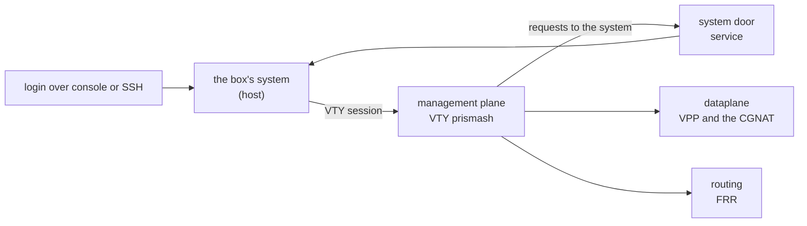

# What runs on the box

The parts of an installed box — the containers, the internal network between them, the system service that executes what the VTY asks for, and the kernel — with what each one holds and what it shares with the system. For anyone who needs to know where something is before diagnosing, or wants to understand what a VTY command actually touches.



# The containers

Since version 0.117 an installed box runs the dataplane and routing as containers, since 0.138 the VTY runs in a third one, and since 0.149 the records that go to the collector leave from a fourth. The four are started together, on every boot, by the `prisma-routing-containers` service. A fifth, PPPoE's, comes up only when the configuration has PPPoE.

## Dataplane

|     |     |
|-----|-----|
| What it holds | VPP, DPDK and the CGNAT: the claimed cards, the pools, the sessions and the port blocks of each subscriber |
| Network | the system's own: the dataplane cards are mirrored in Linux with the same name, and routing needs to see them |
| What it shares with the system | the hugepages, the dataplane configuration (read-only), the socket of its command line and the log directory `/var/log/prisma-routing` |
| Privileges | does not run privileged: it receives only the capabilities that were measured as necessary, and the device node of the card the boot chose |
| When it stops | it closes in the retention log the blocks it is holding **before** VPP receives the stop signal; the stop deadline is 30 seconds |
| When it gives up | after five attempts the container stays stopped; the box returns the cards to Linux and writes the reason to `/var/log/prisma-routing/why-the-dataplane-stopped`, which survives a reboot |

## Routing (FRR)

|     |     |
|-----|-----|
| What it holds | the FRR daemons: BGP, OSPF, IS-IS, BFD, static routes |
| Network | the system's own, for the same reason: FRR routes over the interfaces the dataplane mirrors in Linux |
| What it shares with the system | `/etc/frr`, the routing configuration, and the FRR sockets directory; and, for the routing protocols' SNMP, the SNMP agent's socket and its configuration, read-only |
| Restart | comes back on its own if it crashes, unless someone stopped it |

## Management plane (the VTY)

|     |     |
|-----|-----|
| What it holds | the `prismash` VTY and the clients it uses to talk to the dataplane and to FRR. It runs no daemon, except the [management API](/s/wiki-en/doc/management-api-grpc-for-integrators-I09RqhUqBn) server when the API is on (`api enabled yes`); the system exposes it on the management address and passes the connections on over the backplane |
| Network | **none**, other than a single link to the backplane (below), at 128.0.0.2. It does not reach the internet or the management network |
| What it shares with the system | the box configuration and its revisions (`/etc/prisma-routing`), the dataplane and FRR sockets, `/var/log/prisma-routing`, and the system accounts, **read-only** |
| What it reads from the system | cards, PCI bus, processors, memory, routes and the dataplane tuning file, all **read-only**. That is why `show hardware`, `show interface` and `show system cpu` answer there the same as on the system |
| How you get in | each login lands there **as its own account**, with the same role it would have on the system: a read-only account stays read-only |

`ping`, `traceroute` and `mtr` typed in the VTY go out through the system, not the container, because the container's network ends at the backplane. `install`, `system upgrade` and `system dataplane restart` also run on the system, with the system VTY on your terminal.

## Records (log)

|     |     |
|-----|-----|
| What it holds | sending the block records to the collector: syslog and IPFIX over TCP, with the spill file, its replay and reconnection, and usually the UDP IPFIX too |
| Network | the system's own: it leaves with the same route, source and VRF the dataplane would use |
| What it shares with the system | the memory segment where the dataplane leaves each event, and `/var/log/prisma-routing`, where the spill files are |
| Limits | its own limited memory: if a collector stalls, this container is what runs out of memory, never the dataplane |
| When it stops | the dataplane sends the records itself again within about a second. A UDP exporter in a VRF, or on a source the container cannot use, always stays in the dataplane; `show cgnat logging` says who is sending and why |

## PPPoE

|     |     |
|-----|-----|
| What it holds | the termination of PPPoE subscribers and the RADIUS client, driving the dataplane's PPPoE |
| When it comes up | only on a box with PPPoE configured; the `commit` that generates its configuration starts or restarts it, and a box without PPPoE never runs it |
| Network | the system's own, through which RADIUS is reached |
| What it shares with the system | the dataplane's API socket, the configuration the VTY generated (read-only) and `/var/log/prisma-routing` |
| Limits | its own memory and processes, and it is the first the system stops if memory runs short: a PPPoE failure takes neither forwarding, routing nor the VTY with it |
| When it stops | it ends each session with the subscriber and with RADIUS before exiting |

# The backplane: 128.0.0.0/8

The containers that need their own network talk to the system over an internal network, the **backplane**, at 128.0.0.0/8 — the same prefix Juniper uses between the routing engine and the line cards.

|     |     |
|-----|-----|
| Where it lives | in the `prisma-bp` VRF (table 128), **never** in the main table |
| The system | 128\.0.0.1/8 |
| The management plane | 128\.0.0.2 |
| Table 128 ends in | an unreachable default route |

**Why in a VRF.** 128.0.0.0/8 is real public space. In the main table, the box itself would lose the real servers in that prefix: measured, a server at 128.66.0.10 stopped answering the box. In a VRF, the box and the subscribers keep reaching those addresses normally.

**Why the unreachable route.** Without it, whatever the VRF cannot answer falls into the main table, and packets sourced from the backplane leave the box. Measured: without the route, two packets from 128.0.0.2 reached the other side; with it, none.

The boot self-test checks the backplane. When it is right, it says:

```
  [ ok ] backplane: 128.0.0.0/8 in VRF prisma-bp, out of the main table
```

When it is not, the line is a `[FAIL]` that names the leak: a route via the backplane bridge in the main table, the bridge outside the VRF, or the table without the unreachable route.

# The system door service

From inside a container the VTY cannot — and should not be able to — touch the system. What it needs done there it **asks** of a system service, `prisma-routing-doors`, which executes a closed list of actions and checks every argument.

| What the VTY asks for | VTY command that leads to it |
|-----------------------|------------------------------|
| create, change and remove accounts, their roles and passwords | `user <name>`, `role`, `password` |
| an account's SSH keys; checking and reloading SSH | `ssh-key` inside `user`; `ssh ...` |
| turning SNMP on and off, and its files | `snmp ...`, `snmp-user <name>` |
| DNS resolvers         | `dns server <address>`       |
| the box's name        | `hostname <name>`            |
| the Linux VRFs and the interfaces in them, management's included | `vrf` in an interface; `system` > `management` > `vrf` |
| the management API's settings | `api ...`                    |
| starting, restarting and stopping the PPPoE container, rereading RADIUS and ending sessions | `commit` with `pppoe ...` or `aaa ...`; `clear pppoe session` |
| the Linux side of a dataplane interface: up, down, MTU, description | `interface`, `shutdown`, `mtu`, `description` |
| restoring the management default route after a card changed owner | happens on its own           |
| writing the boot tuning after changing `cpu` or `memory` inside `system` | `commit`                     |
| rebooting and shutting down the box | `system reboot`, `system shutdown` |
| upgrading the box and restarting the dataplane in the background, when the API asks or an account with `operator` that is not root | `system upgrade`, `system dataplane restart` |

| Rule | What it guarantees |
|------|--------------------|
| every request has a checked owner | the service reads from the kernel who is asking, which cannot be forged. A change is **root**'s; rebooting, shutting down, `system upgrade` and `system dataplane restart` also belong to whoever has `operator` (group `prisma-operator`); PPPoE also to whoever has the administrator role (group `prisma-admin`). Questions that only read, any account may ask |
| it is not a way to run commands | an account name is never read as an option or a path, `root` is refused where the VTY never sends it, and files go only to a fixed set of paths |
| every request is a line in the journal | with the command, who asked and the result — **never** the password, whose hash passes through there |
| with the service down | the VTY executes the command itself, so the box keeps working while the service restarts |

To read what was requested, in a system shell:

```
journalctl -u prisma-routing-doors
```

# `start shell`

|     |     |
|-----|-----|
| Where it lands | **on the system**, never inside a container. The one that opens the shell is the process holding your terminal, not the VTY |
| Who can | `root` and accounts in the `prisma-admin` group. The VTY checks the role, and the system checks again through its own groups before opening; any other account is refused by role name |
| How it returns | `exit` in the shell returns to the VTY, with the candidate configuration intact |

# When the management plane is not up

A box whose management container went down **stays accessible**: the login lands on the system's own VTY, as before version 0.138. The same happens when the door service is not running.

| Situation | Where the login lands |
|-----------|-----------------------|
| normal    | on the management container VTY, as its own account |
| management container stopped, or door service down | on the system VTY     |
| the file `/etc/prisma-routing/vty-on-host` exists | on the system VTY, always |

To put a box's logins back on the system VTY, in a system shell:

```
touch /etc/prisma-routing/vty-on-host
```

Deleting the file returns logins to the management container on the next login.

# Going back to the systemd units

The containers replace the `vpp.service` and `frr.service` units, which remain installed: the three cannot run together, because they use the same cards, the same hugepages and the same sockets. The way back is two commands, in a system shell:

```
systemctl disable --now prisma-routing-containers.service
systemctl enable --now vpp.service frr.service
```

A box back on the units keeps answering for the card the dataplane holds, the saved configuration keeps being applied at boot, and the self-test stops talking about containers.


:::warning
The two commands stop the dataplane: forwarding stops and the port block and sessions of every subscriber are discarded. Do it in a window.

:::

# The kernel

The box's kernel is **Debian's, rebuilt by Prisma Routing**: the same source code, with Debian's patches and configuration. The name changes and the modules a router does not use are removed.

|     |     |
|-----|-----|
| Base | the Debian 12 `linux` source package (6.1.190 in the current version) |
| How it shows up | `uname -r` ends in `-prisma` |
| What is left out | sound, Wi-Fi, Bluetooth, NFC, video and TV capture, joysticks, graphics tablets, touchscreens, amateur radio, CAN, 802.15.4, cellular modems, FireWire, industrial sensors, AMD and NVIDIA dedicated graphics cards, and staging drivers |
| What **always** stays | every network card, storage, virtio, vfio, uio, InfiniBand/RDMA and hypervisor driver. The build refuses to finish if any of these modules that Debian ships is missing |

To read the version, in a system shell:

```
uname -r
```

The answer is the kernel version followed by `-prisma`, for example `6.1.190-prisma`.


:::info
**A new kernel only arrives with a new installation.** The upgrade package (`system upgrade`) does not carry a kernel: the upgraded box keeps the kernel of the medium it was installed from. Debian kernel security fixes arrive when a new medium brings them, and the release of a version is itself refused if its kernel has already been superseded by Debian. `apt` does not bring the Debian kernel back alongside this one.

:::

# See also

* [Access, login and roles](/s/wiki-en/doc/access-login-and-roles-uVm2WUy5xB) — where each account lands and what each role reaches
* [Routing, SSH, users and SNMP](/s/wiki-en/doc/routing-ssh-users-and-snmp-jjxcPssV72) — the commands the door service executes
* [Appliance installation](/s/wiki-en/doc/appliance-installation-gliHrNahhB) — the medium that carries the kernel
* [Taking the box to a new version](/s/wiki-en/doc/taking-the-box-to-a-new-version-spJOdnrvOD) — what the upgrade package carries and what it does not
* [Operations and troubleshooting](/s/wiki-en/doc/operations-and-troubleshooting-kql3GmIqmX) — the boot self-test
* [Management API (gRPC) — for integrators](/s/wiki-en/doc/management-api-grpc-for-integrators-I09RqhUqBn) — the API server from the integrator's side
