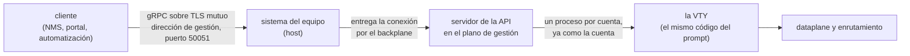

# API de gestión (gRPC) — para quien integra

Qué ofrece la API de gestión del equipo a un sistema externo — un NMS, un portal, una automatización —, cómo se activa, quién puede llamar qué, y cómo se comporta en una actualización. Para quien va a escribir el cliente; la configuración paso a paso del lado del equipo está en [Enrutamiento, SSH, usuarios y SNMP](/s/wiki-es/doc/enrutamiento-ssh-usuarios-y-snmp-aAKbYtvEg3).

# Qué es

Una API gRPC, paquete `prisma.v1`, servida por el propio equipo sobre **TLS mutuo**, solo en la red de gestión, **desactivada por defecto**.

**No es un segundo sistema de configuración**. Toda llamada de configuración es la VTY trabajando: el `configure`, las líneas que un operador escribiría, el `commit check`, el `commit`, el `commit confirmed`, el `rollback` y el `save`, ejecutados por el código de la VTY y como la cuenta que nombra el certificado del cliente. Por eso:

* un rechazo por la API es el rechazo de la VTY, con las mismas palabras;
* un cambio hecho por la API aparece en el `show running-config` del prompt, y en el historial de revisiones a nombre de la cuenta;
* lo que la VTY no le permite a una cuenta, la API tampoco se lo permite.

| Uso típico | Qué da la API |
|------------|---------------|
| NMS, panel de NOC | lecturas tipadas (interfaces, pools, suscriptores, BGP, OSPF, IS-IS, BFD, VRRP, transceivers), un flujo de contadores y eventos, 24 horas de historial y el health check estándar de gRPC |
| Portal, interfaz web | toda la configuración leída en campos y escrita como líneas de la VTY en una candidata, con el mismo `commit` del prompt |
| Automatización | candidata, validación, `commit confirmed` y confirmación; las acciones de sistema (reiniciar, actualizar) para una cuenta autorizada |



El host escucha en la dirección de gestión y entrega cada conexión, sin abrirla, al servidor que corre en el contenedor de gestión. El TLS termina en el servidor; el host no ve el contenido.

# Activarla en la VTY

Tres cosas: los certificados en el disco del equipo, la cuenta que va a ser el cliente, y el bloque `api` en la configuración.

## El bloque `api`

| Comando | Por defecto | Qué hace |
|---------|-------------|----------|
| `api enabled yes` | `no` | sirve la API. Sin `listen-address`, el commit la rechaza |
| `api listen-address <dirección> [<dirección> ...]` | ninguna | la dirección de gestión donde escuchar; acepta una lista, IPv4 e IPv6 juntas, desde la 0.151.8 |
| `api port <1-65535>` | `50051` | el puerto TCP |
| `no api enabled` | — | la desactiva |
| `no api listen-address` | — | quita la dirección |
| `no api port` | — | vuelve a 50051 |

```
configure
api enabled yes
api listen-address 192.0.2.10 2001:db8:6::10
commit
```

Activarla sin dirección se rechaza en el commit:

```
error: api enabled yes needs 'api listen-address <management address>'
```

El `listen-address` completa con `?` las direcciones del propio equipo; use las de gestión, porque la API pertenece a la red de gestión. Con la gestión en una VRF propia (desde la 0.152.4), la API sigue alcanzable por el gateway de gestión.

## Los certificados

No hay token ni contraseña en la API: **la identidad es el certificado del cliente**.

| Archivo en el equipo, en `/etc/prisma-routing/api/` | Qué es |
|-----------------------------------------------------|--------|
| `server.key`, `server.crt` | el certificado del equipo. El nombre que el cliente verifica tiene que estar en él (el `subjectAltName` con la dirección marcada, o el nombre que el cliente pasa como autoridad) |
| `clients-ca.crt` | la CA que firma los certificados de cliente. Solo se atiende a quien presente un certificado firmado por ella |

El servidor no arranca sin los tres archivos, y rechaza el handshake de un cliente sin certificado — incluso para el health check. La clave de la CA queda **fuera** del equipo. Los comandos `openssl` para generar la CA, el certificado del equipo y uno de cliente están en [Enrutamiento, SSH, usuarios y SNMP](/s/wiki-es/doc/enrutamiento-ssh-usuarios-y-snmp-aAKbYtvEg3).

## La cuenta

El **Common Name (CN)** del certificado del cliente es el nombre de una cuenta del equipo, y cada llamada corre **como esa cuenta**: en un proceso propio que ya asumió el uid y los grupos de ella antes de abrir la VTY. Cree una cuenta dedicada para cada sistema que integra (`user <nombre>` en la VTY), con el rol que necesita y nada más.

| Situación | Qué pasa |
|-----------|----------|
| un CN que no es un nombre de cuenta válido, o más de un CN | la llamada se rechaza con `UNAUTHENTICATED` |
| un rol u `operator` dado o quitado a la cuenta | vale desde la llamada siguiente; una candidata abierta antes del cambio pasa a leerse como expirada, para que ningún commit corra con derechos que la cuenta ya no tiene |
| un sistema que debe perder el acceso | el equipo no consulta lista de revocación: el certificado vale mientras la CA lo haya firmado y no haya expirado. Para cortarlo, elimine la cuenta del equipo, o quítele el rol para dejarla de solo lectura |

# Roles: quién puede llamar qué

Los roles son los de la VTY, sin traducción. La API nunca le da a una cuenta algo que su sesión en la VTY no tendría.

| Cuenta | Grupo del sistema | Qué puede por la API |
|--------|-------------------|----------------------|
| `role administrator` | `prisma-admin` | todo lo que se configura: enrutamiento, CGNAT, interfaces, cuentas, sistema, PPPoE; los `clear` de interfaz y de enrutamiento; terminar sesiones PPPoE |
| `role cgnat-operator` | `prisma-cgnat` | solo la configuración de CGNAT; terminar las sesiones de un suscriptor del CGNAT |
| sin rol | — | **solo lectura**: todas las lecturas, el `Show`, la telemetría, la tabla de rutas, el historial, el `WhoAmI`. No abre candidata: el `configure` se rechaza, como en el prompt |
| `operator` (junto a cualquier rol) | `prisma-operator` | además del rol: `Reboot`, `Shutdown`, `RestartDataplane` y `Upgrade`. Nada más de lo que es del root |

* Un `administrator` **no** reinicia ni actualiza el equipo solo por ser administrador: necesita `operator`. Una cuenta de solo lectura de un NOC **puede** tener `operator`.
* Preguntar cuál es la versión más nueva publicada (`Upgrade` con la versión vacía) no cambia nada, y cualquier cuenta puede.
* Una llamada sin el rol vuelve `PERMISSION_DENIED`, con el mismo motivo que daría la VTY.
* `SessionService.WhoAmI` responde, sin abrir nada, qué cuenta es el certificado, su rol (`administrator`, `cgnat-operator` o `read-only`) y si configura, configura el CGNAT y opera (`can_operate`). Es la primera llamada útil de un cliente nuevo.

# Los servicios

| Servicio | Qué alcanza |
|----------|-------------|
| `ConfigService` | la configuración: candidata, edición, comparación, validación, commit, confirmación, rollback, save; la configuración leída y escrita en campos; la gramática entera de la VTY |
| `OperationalService` | las lecturas tipadas detrás de los `show`, cualquier `show` como texto, los `clear`, el registro de eventos del equipo, `ping`, `traceroute` y `mtr` en flujo |
| `TelemetryService` | el flujo de contadores y eventos, 24 horas de historial, y los registros del CGNAT en vivo |
| `RouteService` | la tabla de rutas, en campos y paginada, y el resumen por VRF y protocolo |
| `SessionService` | quién es el cliente para el equipo |
| `SystemService` | reiniciar, apagar, reiniciar el dataplane, actualizar |
| `grpc.health.v1.Health` | el health check estándar de gRPC |

## Configuración, con la semántica del commit

La configuración **viaja como el texto de la VTY**: una candidata se edita con las líneas que escribe un operador, en una ruta de la jerarquía (por ejemplo `nat` > `cgnat` > `pool P` y la línea `block-size 256`), y se lee de vuelta como el texto que imprime el `show running-config`. Lo tipado son las operaciones y las lecturas.

| Llamada | Qué hace la VTY |
|---------|-----------------|
| `OpenCandidate` | `configure` (o a partir de una revisión) |
| `Edit` | las líneas, escritas en la ruta dada |
| `ShowCandidate`, `Compare` | el texto de la candidata; `show configuration compare` |
| `Check` | `commit check`. Encontrar un problema no es un error: responder eso es su trabajo |
| `Commit` | `commit`, con `confirmed <minutos>` y `comment <texto>` opcionales, y el reconocimiento de los avisos que la VTY exige confirmar |
| `Confirm` | el `commit` dentro de la ventana del `commit confirmed` |
| `GetPendingConfirm` | la ventana de confirmación que el equipo mantiene: plazo, quién y por qué |
| `Rollback`, `ListRevisions`, `GetRunning` | `rollback <n>` en la candidata; las revisiones; la configuración vigente |
| `Save` | `save`: lo que el equipo carga en el próximo arranque |
| `GetConfig`, `SetConfig`, `DeleteConfig` | la configuración en campos (interfaces, pools, exportación de registros, rutas estáticas, BGP, OSPF, IS-IS, BFD, sistema, cuentas, PPPoE...). La escritura se convierte en las líneas de la VTY en la candidata y devuelve cuáles fueron |
| `GetSchema` | la gramática entera, como la conoce el `?` del prompt, versionada por la versión del equipo y por un digest |
| `ValidateLines` | líneas verificadas por la VTY en una candidata descartable: cada una aceptada o rechazada con el motivo. Nada se aplica |
| `ListCandidates`, `CloseCandidate` | las candidatas abiertas de la cuenta, con su plazo de expiración; cerrar una |

Las reglas que un cliente tiene que respetar:

* **Una candidata es una sesión.** Vive en un proceso de la cuenta, como un `configure` en la VTY, hasta que se cierra o pasa **30 minutos** sin uso. Después la llamada vuelve `NOT_FOUND` con el motivo "expirada", y el cliente abre otra. El plazo viene en las respuestas (`idle_seconds`, `expires_at`); léalo, no lo suponga.
* **El commit no pasa por encima de nadie.** Si la configuración vigente cambió después de abrir la candidata — otro cliente, un operador en el prompt —, el commit se rechaza con la diferencia y la revisión actual. El cliente abre una candidata nueva y aplica las líneas de nuevo.
* **`commit` aplica; `save` graba para el arranque.** Como en el prompt. `Reboot` y `Shutdown` se rechazan mientras haya algo sin guardar o dentro de una ventana de `commit confirmed`, salvo que el cliente fuerce.
* **Una escritura parcial nombra los campos.** En un `SetConfig`, `fields` dice qué cambiar; vacío quiere decir **todos**, así que un objeto enviado a medias borra lo que no se envió. Nombre los campos.
* **Los secretos nunca se leen.** Contraseñas, claves, comunidades SNMP y secretos de RADIUS vuelven solo como "definido o no"; las líneas devueltas enmascaran el valor, como el `show running-config`.

Un rechazo es un status gRPC — `INVALID_ARGUMENT` para una línea que la VTY rechaza, `FAILED_PRECONDITION` para un commit rechazado o una base que cambió, `PERMISSION_DENIED` para quien no tiene el rol, `NOT_FOUND` para una candidata que no existe, `UNAVAILABLE` cuando el equipo no puede responder — y trae, en los metadatos finales `prisma-diagnostics-bin`, la explicación de la VTY y un **código de motivo** sobre el que el cliente puede decidir (base desactualizada, permiso, candidata expirada, límite de tamaño, uno de los avisos que exigen reconocimiento, gramática, validación, fallo al aplicar). La frase de la VTY sigue siendo el mensaje para la persona.

## Lecturas operativas

Cada lectura tipada usa el mismo lector del `show` correspondiente, y la mayoría trae también, en un campo `text`, la pantalla exactamente como la muestra la terminal — es la misma lectura, así que los campos y la pantalla no discrepan.

| Qué se lee | Ejemplos de llamada |
|------------|---------------------|
| el equipo | `GetVersion`, `GetSystem` (memoria, carga de cada worker, CPUs, por qué el dataplane y el enrutamiento arrancaron por última vez), `GetHardware`, `GetTuningAdvice` |
| interfaces | `ListInterfaces`, `ListBundles`, `ListTransceivers` (temperatura, potencia óptica y los umbrales del módulo) |
| CGNAT | `ListPools`, `GetSubscriber`, `LookupTranslation` (quién estaba detrás de una dirección pública y un puerto), `ListTop`, `GetDrops`, `ListBlocks`, `GetCgnatMemory`, `GetLogging` |
| enrutamiento | `ListBgpNeighbors`, `ListOspfNeighbors`, `ListIsisAdjacencies`, `ListBfdSessions`, `ListVrrp`, `ListPolicies`, `TestPolicy` |
| PPPoE | `ListPppoeSessions`, `GetPppoeSession`, `GetPppoeSummary`, `ListPppoeHistory` |
| el registro de eventos | `ListEvents` (el `show log`, con los mismos filtros) y `WatchEvents`, en vivo |
| acciones | `Clear` (contadores, sesiones de un suscriptor, BGP, OSPF, IS-IS, PPPoE); `Ping`, `Traceroute`, `Mtr`, línea a línea mientras corren |

**`Show`, el paso directo.** Cualquier `show`, `ping`, `traceroute` o `mtr`, con los filtros `| include`, `| exclude` y `| count`, vuelve como texto. Solo lectura: un comando que no empieza por una de esas palabras se rechaza con `INVALID_ARGUMENT`. El `monitor` no pasa (redibuja una terminal, y una llamada no tiene terminal); la vista en vivo de la API es la telemetría. Para un NMS, prefiera la llamada tipada cuando existe: el texto de una pantalla puede cambiar de una versión a otra, los campos no.

## Telemetría

| Llamada | Qué entrega |
|---------|-------------|
| `Subscribe` | un flujo, hasta que el cliente lo cancela: los contadores de las interfaces en el intervalo pedido, los totales del CGNAT y un evento en cada commit, con la revisión que dejó y el comentario — para que el cliente sepa qué commits fueron suyos |
| `GetHistory` | los contadores que el servidor muestreó, uno por minuto, en las últimas 24 horas: interfaces (hasta 256), totales del CGNAT, carga de los workers, memoria y, si se pide, cada CPU |
| `WatchLogging` | el `monitor cgnat logging`: cada asignación y liberación de bloque que el equipo exporta, a medida que la exporta, y cada 10 segundos lo que entregó cada destino |

Los contadores son los totales del dataplane, como los muestra el `show`: el cliente calcula las diferencias, y un total menor que el anterior es un dataplane que reinició.

## La tabla de rutas

`RouteService.ListRoutes` está hecho para la tabla completa: lee la RIB del FRR en páginas (1000 por defecto, hasta 5000), filtrando por VRF, familia, prefijo y protocolo, de **una sola fotografía** — que la tabla cambie en medio de la paginación no genera ruta repetida ni faltante. La primera página llega mientras el resto todavía se está leyendo. Una fotografía que nadie pagina durante 10 minutos se descarta, y el cliente vuelve a empezar. Si el enrutamiento deja de responder a mitad, las rutas leídas se entregan y la llamada siguiente dice `UNAVAILABLE`: una tabla incompleta nunca se hace pasar por entera.

# Límites que encuentra un cliente

| Límite | Valor | Qué hacer |
|--------|-------|-----------|
| una llamada sin respuesta | 300 segundos | vuelve `UNAVAILABLE`; la llamada siguiente se atiende |
| candidata parada | 30 minutos | abrir otra |
| una llamada a la vez en cada proceso de la cuenta | cada candidata, las lecturas, el `Show` y las rutas tienen procesos separados | un `ping` largo no retrasa una lectura de estado; dos `Show` de la misma cuenta corren uno después del otro |
| `commit confirmed` | 1 a 60 minutos | fuera de eso, la llamada se rechaza |
| la revisión en un evento | leída como la cuenta que se suscribe al flujo | una cuenta que ve menos de la configuración (una de solo lectura no ve los pools) lee otro identificador para la misma configuración |

El contrato solo crece dentro de `prisma.v1`: campos, llamadas y valores **solo se agregan**, con números nunca usados antes; nada se renumera ni se reaprovecha. Un cliente hecho para una versión más antigua sigue funcionando con un equipo más nuevo y simplemente no ve lo que no conoce. Un cambio incompatible sería un paquete `prisma.v2`, servido junto al `v1`.

:::info
El contrato — el archivo `.proto` del paquete `prisma.v1`, más el `grpc.health.v1` estándar — no se publica en esta wiki: pídalo junto con la versión que corren sus equipos. El servidor no ofrece reflexión de gRPC, así que herramientas como `grpcurl` necesitan el archivo. La gramática de la configuración, en cambio, la responde el propio equipo por `GetSchema`.

:::

# En una actualización y en un reinicio

| Evento | Qué ve el cliente |
|--------|-------------------|
| `system upgrade` (por la VTY o por la API) | el contenedor de gestión se recrea: la API queda fuera **cerca de un minuto**, y todo flujo, toda candidata abierta y todo proceso de cuenta terminan. Reconecte y abra de nuevo |
| `Upgrade` por la API | un flujo de fases (descarga con progreso, verificación, instalación) que termina **antes** de que la API reinicie, con cuántos segundos va a quedar fuera. Después, reconecte y lea `GetVersion`; `GetUpgradeStatus` lee de vuelta la última ejecución, cualquiera que haya sido la conexión que la pidió |
| el historial de 24 horas | sobrevive a un reinicio de la API y del contenedor (la actualización hace los dos): los gráficos continúan. Un reboot lo vacía, como pone a cero los contadores del dataplane |
| `RestartDataplane` | la respuesta llega cuando el reinicio terminó. Mientras el dataplane está fuera, las lecturas que dependen de él responden `UNAVAILABLE` y el health check marca `OperationalService` y `TelemetryService` como `NOT_SERVING` |
| `Reboot`, `Shutdown` | la respuesta llega antes de que el equipo caiga |

:::warning
`RestartDataplane` detiene el reenvío y descarta el bloque de puertos y las sesiones de **todos** los suscriptores, como el `system dataplane restart` en el prompt. Una automatización que lo llama necesita la misma ventana que pediría un operador.

:::

# Health check

Es el `grpc.health.v1` estándar, así que `grpc_health_probe`, el cliente de health de cualquier biblioteca gRPC o un balanceador funcionan sin nada específico. Necesita un certificado de cliente firmado por la CA, aunque no nombre una cuenta.

| Nombre del servicio | `SERVING` cuando | `NOT_SERVING` cuando |
|---------------------|------------------|----------------------|
| `""` (el servidor), `prisma.v1.ConfigService`, `prisma.v1.RouteService`, `prisma.v1.SessionService`, `prisma.v1.SystemService` | el servidor está arriba | — |
| `prisma.v1.OperationalService`, `prisma.v1.TelemetryService` | el dataplane responde a las lecturas de estadística | el dataplane no responde (detenido, reiniciando) |
| `prisma.v1.LogExport` | todo destino de registros configurado está entregando | un destino configurado no entrega nada hace 60 segundos, teniendo qué enviar |
| `prisma.v1.Configuration` | la configuración guardada se aplicó entera en el arranque | parte de ella espera una tarjeta que el equipo no tenía en el arranque (`GetPendingConfiguration` dice cuál) |

Un servicio que el equipo no sirve vuelve `NOT_FOUND`. El destino de registros detenido tiene nombre propio a propósito: un colector caído no es un equipo que no responde, y un cliente que dejara de llamar a `OperationalService` dejaría de leer justamente el estado que dice qué está mal.

```
grpc_health_probe -tls -tls-ca-cert ca.crt -tls-client-cert nms.crt \
  -tls-client-key nms.key -tls-server-name prisma-api \
  -addr 192.0.2.10:50051 -service prisma.v1.LogExport
```

# El rastro de lo que hizo la API

* Cada commit queda en el historial de revisiones a nombre de la cuenta del certificado, y en el trail de auditoría con `via api`.
* El registro de eventos del equipo separa quién actuó: `show log source api` lista lo que vino por la API.
* Un commit hecho por la API aparece en el `show running-config` del prompt en el mismo instante, y en el `Subscribe` de todo cliente conectado.

# Vea también

* [Enrutamiento, SSH, usuarios y SNMP](/s/wiki-es/doc/enrutamiento-ssh-usuarios-y-snmp-aAKbYtvEg3): activar la API paso a paso, con los certificados
* [Acceso, login y roles](/s/wiki-es/doc/acceso-login-y-roles-ZiA9s69LH4): los roles y el `operator`, que la API hereda
* [commit, rollback y save](/s/wiki-es/doc/commit-rollback-y-save-6sAWJkXNO3): el ciclo de configuración que recorre la API
* [Comandos show](/s/wiki-es/doc/comandos-show-yfCeHVInDX): las pantallas que el `Show` deja pasar, y el `show log`
* [Monitoreo y SNMP](/s/wiki-es/doc/monitoreo-y-snmp-zQ9bTfrh8z): la otra puerta de un NMS, de solo lectura
* [Llevar el equipo a una versión nueva](/s/wiki-es/doc/llevar-el-equipo-a-una-version-nueva-m1PIajBXEF): lo que una actualización le hace al equipo
* [Qué se ejecuta en el equipo](/s/wiki-es/doc/que-se-ejecuta-en-el-equipo-CKrjZRwjfW): el contenedor de gestión y el backplane por donde pasa la API
