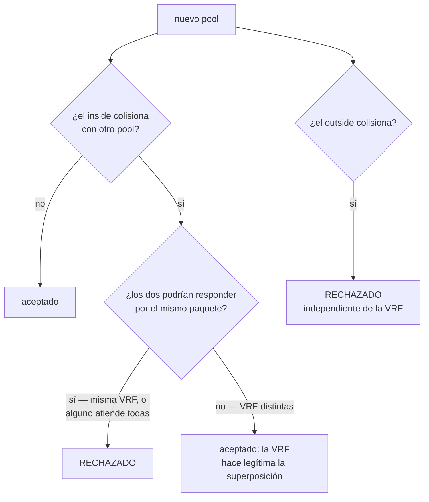

# Multi-tenant con VRF

Cómo atender a dos clientes que usan el **mismo rango de direcciones privadas** en el mismo equipo. Para quienes hacen mayorista, reventa u operan CGNAT para más de un cliente.

# El problema

Un proveedor no elige qué direcciones privadas entrega el CPE de sus clientes. Dos clientes en el mismo equipo van a usar `100.64.0.0/22`.

Antes de que un pool pudiera nombrar una VRF, no había nada que indicara a cuál de los dos pertenecía un paquete: la búsqueda devolvía el **primer** pool que reclamara la dirección. Un cliente era traducido por el pool del otro, y el segundo pool no traducía nada.

# Cómo resolverlo

Cada cliente llega por una interfaz propia, y esa interfaz queda en la VRF del cliente y del lado interno del CGNAT:

```
configure
 interface enp5s0
  vrf 1
  cgnat inside
  exit
 interface enp6s0
  vrf 2
  cgnat inside
  exit
 commit
```

Después, un pool por cliente, cada uno nombrando la VRF que atiende:

```
configure
 nat
  cgnat
   pool cliente-a
    prefix-inside 100.64.0.0/22
    prefix-outside 200.150.0.16/30
    vrf 1
    exit
   pool cliente-b
    prefix-inside 100.64.0.0/22
    prefix-outside 200.150.0.32/30
    vrf 2
    exit
   exit
  exit
 commit
```

| Campo | Qué define |
|-------|------------|
| `vrf <n>` | la VRF cuyos suscriptores atiende este pool |
| `outside-vrf <n>` | la VRF por donde sale el tráfico traducido, cuando difiere de la del suscriptor |


:::info
**La VRF debe existir antes que el pool que la nombra.** El dataplane rechaza un pool con `vrf` u `outside-vrf` de una tabla que todavía no tiene. Una VRF pasa a existir cuando se coloca una interfaz en ella; por eso la interfaz va primero, en un `commit` propio.

:::


:::warning
`vrf` es un campo de **mapeo**: cambiarlo reconstruye el pool y tira todas sus sesiones. Defínalo en la creación, no después.

:::


:::info
**Si está ausente, el pool atiende todas las VRF**, que es lo que significa toda configuración escrita antes de que esto existiera, y es una respuesta distinta de `vrf 0`.

:::

# Por dónde vuelve la respuesta

La sesión lleva la VRF en la que llegó el tráfico del suscriptor, y la respuesta se reenvía en ella.

Sin esto, la respuesta se consultaría en la FIB de la interfaz por la que llegó —la externa— y en un equipo en el que la interna y la externa son VRF distintas se descartaría por falta de ruta. El síntoma se lee como "el CGNAT no tradujo", cuando en realidad fue una consulta en la tabla equivocada.

El `outside-vrf` queda guardado **en la sesión**, no se lee del pool en cada paquete: la respuesta no puede cambiar durante la vida de una sesión.

# La superposición se rechaza, no se resuelve

Que dos pools reclamen la misma dirección interna no es algo que el camino de datos pueda resolver, por lo que se **rechaza al crear el pool**, nombrando el pool con el que colisiona.



**La VRF es lo que hace legítima una superposición**, así que el rechazo solo se aplica cuando los dos pools podrían responder por el mismo paquete: cuando al menos uno atiende todas las VRF, o cuando ambos nombran la misma.

Las direcciones **públicas** se comparan independientemente de la VRF. El camino de vuelta encuentra el pool por la dirección pública y no tiene VRF para separar dos respuestas; por eso dos pools que comparten una dirección pública se rechazan de entrada.

# Cómo verificarlo

```
show cgnat pool
```

Cada pool aparece con la línea `vrf` que lo separa del otro. Después, con tráfico de los dos clientes, tome una dirección pública y un puerto de cada pool y pregunte quién estaba detrás:

```
show cgnat translation 200.150.0.16 1024
show cgnat translation 200.150.0.32 1024
```

Como las direcciones públicas nunca se comparten entre pools, cada respuesta sale del pool correcto.


:::info
`show cgnat subscriber <dirección>` recibe solo la dirección interna, sin VRF. Con la misma dirección en dos VRF, responde por **uno** de los pools, no por los dos: no use esa pantalla para verificar la separación.

:::


:::success
Dos pools listados, cada uno con su VRF, y las consultas por la dirección pública de cada pool llegando al suscriptor del cliente correcto: los clientes están realmente separados.

:::

# Vea también

* [Configuración de pool](/s/wiki-es/doc/configuracion-de-pool-Y3cACG9QHA) — `vrf` y `outside-vrf` entre los campos de mapeo
* [Ampliar la capacidad sin tirar suscriptores](/s/wiki-es/doc/ampliar-la-capacidad-sin-tirar-suscriptores-eHEJEg47aX) — la VRF resuelve el tenancy, no la capacidad
* [Determinístico y BPA — conceptos y mapeo](/s/wiki-es/doc/deterministico-y-bpa-conceptos-y-mapeo-LgBbN0YDcl) — por qué el índice del suscriptor es por pool
