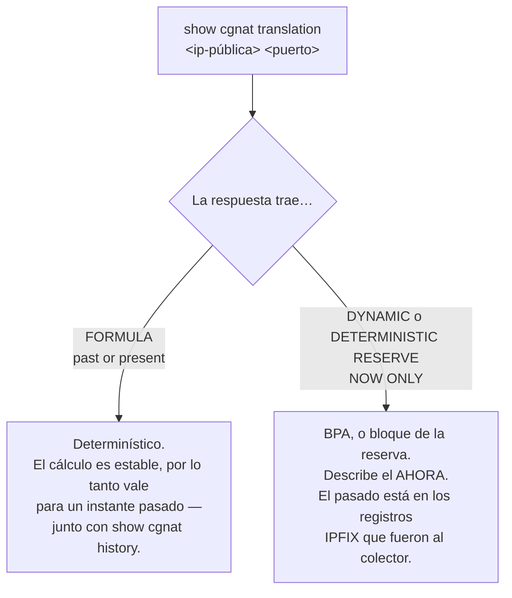

# Comandos show

Qué responde cada `show` del `prismash`, cómo filtrar la salida y cómo leer las pantallas que más importan en una investigación. Para quien opera el equipo y necesita saber qué comando responde la pregunta que tiene entre manos.

Los comandos `show` funcionan en los modos operacional **y** de configuración, en cualquier nivel.

## `show cgnat`

Los cuatro primeros responden la pregunta de un operador en lugar de informar un contador. Todos sacan la respuesta del **dataplane**, y todos se responden aquí: un operador que tuviera que bajar a la línea de comandos del dataplane para diagnosticar sería un operador para quien esta VTY es decoración.

| Comando | Argumento | Responde |
|---------|-----------|----------|
| `show cgnat subscriber` | `<dirección-interna>` | todo sobre un suscriptor |
| `show cgnat translation` | `<dirección-pública> <puerto> [at <tiempo>]` | quién estaba detrás de una dirección pública y puerto; con `at`, en un instante pasado |
| `show cgnat top` | `[<n>]`   | suscriptores más cerca de agotar sus bloques |
| `show cgnat drops` |           | por qué no pasaron los paquetes |
| `show cgnat pool` | `[<pool>]` | pools configurados, la capacidad de cada uno y la distribución de cuánto usan los suscriptores de su propio bloque; con el nombre, un solo pool, más lo que traduce y hacia dónde, y de qué prefix-list vino cada lado |
| `show cgnat session` |           | sesiones activas por thread |
| `show cgnat memory` |           | la memoria del CGNAT: cuánto tiene el heap, cuánto está en uso, cuántas sesiones caben todavía y el valor asignado |
| `show cgnat blocks` |           | bloques asignados en `mode bpa`, y cuántos retiene un reenvío de puertos |
| `show cgnat logging` |           | estado de la exportación de los eventos de bloque: UDP, TCP y syslog |
| `show cgnat identity` |           | cuántas identidades de suscriptor tiene el equipo y cuándo las leyó — nunca una identidad en sí |
| `show cgnat history` |           | trail fechado de configuración |
| `show cgnat history verify` |           | verifica el encadenamiento de hashes del trail y nombra la primera entrada que no coincide |
| `show cgnat alg` |           | qué ALG tiene activados el dataplane, por pool |
| `show cgnat forward` | `[<pool>]` | los reenvíos de puertos que tiene el dataplane |
| `show cgnat ha` | `[peer <archivo>]` | si este equipo y el par mapean a los suscriptores de la misma forma; sin `peer`, compara con la copia de la configuración del par guardada en el equipo |

`show cgnat translation` es el comando que responde una orden judicial: dada una IP pública, un puerto y un instante, quién era el suscriptor.

`at <tiempo>` pide la respuesta para un instante pasado, escrito como el `since` de `show log` (`2026-10-05T14:00`, o `2h` hacia atrás desde ahora). Solo vale donde la respuesta es la fórmula — un pool determinístico, fuera de la reserva —, porque la fórmula vale para cualquier instante; para un bloque BPA o de la reserva el equipo rechaza el `at` y dice dónde está el pasado: el log de bloques da la dirección interna, y `show pppoe history address <a> at <tiempo>` la sesión. En un equipo con PPPoE, la respuesta trae debajo la sesión PPPoE que tenía esa dirección interna, ahora o en el instante pedido.

`show cgnat` responde por el dataplane completo, NAT44 y NAT64 juntos. Para las preguntas solo de NAT64 están `show nat64 pool`, `show nat64 subscriber <dirección-IPv6>` y `show nat64 translation <dirección-pública> <puerto>`: cada una rechaza lo que no es NAT64 y dice qué `show cgnat` responde.

`show cgnat history` es el otro lado de eso en el modo determinístico — qué configuración estaba vigente en esa fecha, y quién la puso ahí. `show cgnat history verify` es lo que prueba que ese trail no fue alterado después: es la verificación que hay que ejecutar antes de entregar una respuesta, y antes de borrar el disco de un equipo.

### `show cgnat alg` y `show cgnat forward`: lo que tiene el dataplane, no lo que dice el archivo

Los dos responden una pregunta diferente de la que responde `show configuration`. El archivo dice lo que se pidió; estos dicen lo que está haciendo el equipo, y las dos cosas se separan en silencio.

```
prisma> show cgnat alg
provider-a
  ftp    on   FTP PORT/EPRT and the 227/229 replies
  rtsp   off  RTSP Transport client_port, and the media pair it needs
  pptp   on   PPTP control channel and its GRE data channel
  esp    on   IPsec ESP passthrough, bound to the peer gateway
  sip    on   SIP over UDP: Via, Contact, SDP, and the RTP pair it needs
```

Son los **cinco** ALG del producto, uno por línea, con la descripción que imprime el equipo en inglés. Es la pantalla para "las transferencias FTP de este cliente se cuelgan": dice si el ALG está activado **en el dataplane**, que no es la misma pregunta que si está en el archivo.

```
prisma> show cgnat forward
pool provider-a
  tcp 200.150.0.17:8080 -> 100.64.0.5:80
```

Y esto es lo primero que hay que establecer cuando alguien llama diciendo que el reenvío de puertos no funciona: si el equipo tiene el reenvío. Acepta el nombre de un pool para filtrar: `show cgnat forward provider-a`.

## `show route` — la tabla que reenvía

| Comando | Muestra |
|---------|---------|
| `show route` | la tabla de reenvío del VPP: lo que este equipo realmente hace con un paquete |
| `show route verbose` | la FIB del VPP y la RIB del FRR lado a lado, **marcando dónde discrepan** |
| `show route <prefijo>` | lo mismo, para un destino |

```
prisma> show route
  Destination    Next hop    Interface Kind
  0.0.0.0/0      200.150.0.1 enp2s0    forward
  200.150.0.0/24 -           enp2s0    connected

  2 entries carrying traffic
```


:::warning
`show ip route` responde por la tabla del **FRR**, no por la que reenvía. En un equipo que está descartando el tráfico, la ruta aparece presente y correcta ahí.

Cuando el tráfico no pasa y la ruta parece correcta, `show route verbose` es el comando: compara las dos tablas y dice qué prefijo está en una y no en la otra.

:::

## `show interface` — las del dataplane

```
prisma> show interface
  Interface                  State  MTU    Address             Linux
  enp1s0                     up     9000   203.0.113.1/24      tap0 enp1s0
  enp2s0                     up     1500   -                   -

  2 interface(s) on the dataplane can forward
```

Responde por el **dataplane**, con estado, MTU, direcciones y el par del `linux_cp`. Esto último porque es el nombre que usan el FRR y el `ip`, y quien transita entre las dos herramientas necesita los dos lado a lado.

**La placa aparece con el nombre que le daba Linux.** El equipo reclama las placas solo y bautiza cada una, en el dataplane, con el nombre que tenía en Linux: la `enp1s0` sigue siendo `enp1s0`, y así aparece aquí, en el prompt y en el enrutamiento. Una placa con bloque `interface` entra en Linux con ese mismo nombre, y es el que muestra la columna **Linux**, al lado del `tap` interno que usa el par - `linux-name` solo hace falta para elegir otro. Un puerto cuyo nombre tiene barras es una placa que nadie nombró; el enrutamiento rechaza nombres de más de 16 caracteres, y el `commit` lo dice antes de intentarlo.


:::warning
Este comando ya se pasó al `vtysh`, que ve solo lo que el `linux_cp` espejó. En un equipo con una `GigabitEthernet0/12/0` configurada, la respuesta era `lo` — la lista sin las interfaces que llevan el tráfico.

Es la misma trampa del `show ip route`: la pregunta respondida por el lado equivocado.

:::

**La lista es de lo que usted configuró**: placas, subinterfaces de VLAN y loopbacks. El `local0` no aparece — es la interfaz nula del VPP y no configura nada — y el `tap` del par `linux_cp` tampoco: lo crea y lo destruye este producto, y su nombre ya está en la columna **Linux** de la interfaz a la que pertenece.

Los dos aparecían hasta la 0.103.0, con el argumento de que ocultar lo que informa el dataplane sería el comando decidiendo lo que usted puede ver. El argumento vale para interfaces que tiene el equipo; no vale para un artefacto del VPP ni para la mitad de un par — y el precio de mantenerlos era un conteo equivocado del número de placas, cada una contada dos veces, una como ella misma y otra como su `tap`. La mitad del argumento que se refería al diagnóstico sigue en pie: un `tap` **nombrado explícitamente** todavía responde, así que `show interface tap4096` muestra lo que existe en un equipo con el par roto.

**El número al final de la lista** es el de interfaces que reenvían, que es el número que hay que comparar con las placas que usted instaló.

La vista del FRR sigue en `show ip interface`.

### `show interface terse` — administrativo y enlace, separados

Una línea por interfaz, con **dos** columnas de estado:

```
prisma> show interface terse
  Interface                  Admin  Link   Proto  Local
  enp1s0                     up     up     inet   203.0.113.1/24
  enp2s0                     up     down   -      -

  2 interface(s) on the dataplane can forward
  enp2s0: configured up, link down - that is the wire or the far end, not this configuration
```

| `Admin` | `Link` | Qué es |
|-------|------|--------|
| `up`  | `up` | normal |
| `up`  | `down` | **es el cable, el transceiver o el otro lado** — la configuración está en pie |
| `down` | `down` | alguien escribió `shutdown` |

Son dos columnas porque son dos hechos, y la diferencia entre ellos es el defecto. Una sola columna de "estado" no distingue *alguien aplicó* `shutdown` de *se cortó la fibra* — y esa es justamente la lista que se abre cuando algo está mal. Por eso el equipo también nombra, al final, las interfaces configuradas up cuyo enlace está down: es la conclusión de la tabla, dicha sin necesidad de buscarla.

Una subinterfaz no es hardware y el dataplane no informa enlace para ella. Su enlace es el **del padre**, y es eso lo que muestra la columna — los puertos de suscriptor de un proveedor son todos subinterfaces, y una columna vacía justamente en ellos no serviría para nada.

Una dirección por línea: una interfaz con IPv4 e IPv6 aparece en dos líneas, con `inet` e `inet6` en la columna `Proto` y el nombre escrito una sola vez.

### `show interface description` — para qué sirve cada puerto

```
prisma> show interface description
  Interface                  Admin  Link   Description
  enp1s0                     up     up     ASSINANTES PON-3
  enp2s0                     up     down   TRANSITO Vivo AS26599

  2 of 2 interface(s) described
```

La descripción se guarda como la **etiqueta de la interfaz en el propio dataplane**, con espacios y todo: sobrevive a un reinicio de la VTY y dice lo mismo a quien consulte el dataplane por otro camino. Se escribe con `description <texto>` dentro de `interface <nombre>`.

La columna viene al lado de `Admin` y `Link` a propósito: la pregunta *"¿qué es este puerto?"* casi nunca viene sola — viene junto con *"¿y está funcionando?"*.

### `show interface utilization` — cuánto está pasando ahora

```
show interface utilization [<nombre>] [interval <segundos>] [count <n>]
```

`show interface` muestra un **contador**, que es un total desde el arranque. Nadie quiere el total: quiere saber si el enlace está lleno **ahora**. Para eso hacen falta dos lecturas y la división por el tiempo entre ellas — así que este comando **tarda**, y dice cuánto va a tardar antes de empezar:

```
prisma> show interface utilization
  sampling every 2s, 5 time(s) - 10s in total; Ctrl-C stops early

  Interface                             rx            tx  rx history tx history
  enp1s0                       8.40 Mbit/s   3.10 Mbit/s  ▁▁▁▂▁      ▁▁▁▁▁
  enp2s0                     675.56 Mbit/s   1.24 Gbit/s  ▃▄▄▅▄      ▆▇▇█▇

  bars are each interface's share of its own line rate
    enp1s0                     0.8% of 1.00 Gbit/s
    enp2s0                    12.4% of 10.00 Gbit/s
```

| Argumento | Efecto |
|-----------|--------|
| `<nombre>` | solo las interfaces cuyo nombre empieza así |
| `interval <segundos>` | tiempo entre muestras; por defecto 2, entre 0,1 y 60 |
| `count <n>` | cuántas muestras; por defecto 5, entre 1 y 120 |

Lo que conviene saber para leer el gráfico:

* **La tasa es en bit/s**, en el múltiplo en que un operador diría el número.
* **El tiempo transcurrido se mide, no se supone.** En un equipo cargado — el único en que la pregunta interesa — dos segundos de espera no son dos segundos, y una tasa calculada por el intervalo nominal estaría equivocada justamente ahí.
* **Cuando el dataplane informa la velocidad del enlace**, la barra es la porción de esa interfaz de su propia tasa de línea, y el porcentaje es real.
* **Cuando no la informa** — una interfaz virtual, por ejemplo — la barra se escala a la mayor muestra de esa ejecución, y el equipo **lo dice** en lugar de presentar un porcentaje de una capacidad que no conoce.
* El tráfico que redondearía a nada se dibuja en el nivel más bajo, no en el trazo de base: *un hilo de tráfico* y *silencio* son respuestas diferentes.
* `Ctrl-C` termina antes del final y el gráfico sale con lo que ya se muestreó. Interrumpido antes de la segunda lectura, no hay ninguna tasa que mostrar, y el equipo lo dice en lugar de imprimir ceros.
* Los paquetes descartados durante el muestreo, y un contador que retrocedió porque alguien limpió las interfaces en el medio, se informan al final.

### `monitor interface` — lo mismo, en vivo

```
monitor interface [<nombre>...] [interval <segundos>]
```

`show interface utilization` responde durante algunos segundos y termina. `monitor interface` es la pantalla que **se queda**: redibujada en el lugar en cada muestra hasta `q` o `Ctrl-C`, con un gráfico por interfaz para cada sentido. Esta es la pantalla de un puerto que recibe un flujo de 800 kbit/s:

```
monitor interface   every 1s   page 1/1   q quit  l scale  n/p page    07:17:26
pg0   scale 1.00 Mbit/s, auto
  1.00 Mbit/s┤                                      ▂ ▂▂ rx 822.98 kbit/s
             │                                      █▄██    1029 pps
             │                                      ████
            0┤                                      ████ errors 0
  1.00 Mbit/s┤                                           tx 0 bit/s
             │                                              0 pps
             │
            0┤                                      ···· drops 0
```

| Tecla | Efecto |
|-------|--------|
| `q` o `Ctrl-C` | sale, y devuelve el terminal exactamente como estaba |
| `l`   | cambia la escala de todos los gráficos entre la propia y la tasa de línea |
| `n`, espacio, flecha a la derecha o hacia abajo, Page Down | página siguiente |
| `p`, `b`, flecha a la izquierda o hacia arriba, Page Up | página anterior |

| Argumento | Efecto |
|-----------|--------|
| `<nombre>` | esa interfaz; una palabra que no es el nombre de ninguna vale para todas las que empiezan así. Sin nombre, todas menos `local0` |
| `interval <segundos>` | tiempo entre muestras; por defecto 1, entre 0,5 y 60 |

Lo que conviene saber para leer la pantalla:

* **La escala siempre está escrita.** Por defecto cada interfaz usa la suya, redondeada a 1, 2 o 5 veces una potencia de diez — así un hilo de 10 Mbit/s en un puerto de 10G aparece. Con `l` el gráfico pasa a ser la porción de la tasa de línea, y el título dice, por ejemplo, `line rate 10.00 Gbit/s: rx 12.4% tx 0.1%`. Una interfaz cuya velocidad no informa el dataplane dice `no line rate known` y se queda en su propia escala.
* **Al lado de cada gráfico**: la tasa más reciente en bit/s y en paquetes por segundo, y los errores y descartes sumados sobre las muestras de la pantalla. Antes de la segunda lectura no hay tasa, y la columna dice `--` — nunca 0.
* **La ventana avanza**: tantas muestras como ancho tiene el terminal, la más nueva a la derecha. Las interfaces que no caben en la altura van a las páginas siguientes, nunca se cortan. Cabe en una consola serial de 80 columnas, y en una consola que responde en ASCII el gráfico se dibuja en ASCII.
* **El mismo muestreo de** `**show interface utilization**`, así que los dos no discrepan sobre una tasa. Si el dataplane deja de responder la pantalla no se cierra: el gráfico mantiene la última muestra y la línea de abajo dice desde cuándo.
* **No es para scripts.** En `prismash -c`, en un pipe o en un archivo el comando se rechaza e indica `show interface utilization`, sin escribir ninguna secuencia de control.
* **El costo se midió antes de fijar el valor por defecto de 1 segundo**: con 201 interfaces y tráfico, cada lectura tardó 4 ms y ocupó 2,2 ms del hilo principal del VPP — menos del 1% de un núcleo a una lectura por segundo.

### `show interface transceiver` — el módulo óptico de cada puerto

```
show interface transceiver
show interface <nombre> transceiver
```

El módulo que está en la jaula del puerto (SFP, SFP+, QSFP): quién lo fabricó, cuál es, y — cuando tiene diagnóstico (DDM) — la temperatura, la tensión, la corriente del láser y las potencias de TX y RX, cada una al lado de los límites de alarma y de advertencia **que graba el propio módulo** y diciendo si superó alguno. Es la misma lectura que da el `display transceiver ... verbose` del switch del otro lado, y es la que se compara con ella:

```
prisma> show interface enp1s0 transceiver
  enp1s0: SFP/SFP+/SFP28, LC connector, 1310 nm
    vendor      Rei do SFP (OUI 00:90:65)
    part        RSMPP8510GL-03D  revision 2.1
    serial      FP23H150378  date 2023-08-15
    read from   the dataplane, through DPDK (0000:01:00.0)
    ddm         internally calibrated; rx power is an average

                     value  hi alarm   hi warn   lo warn  lo alarm  state
    temp (C)         36.50     75.00     70.00      0.00     -5.00  ok
    voltage (V)      3.300     3.600     3.500     3.100     3.000  ok
    bias (mA)        7.500    15.000    12.000     2.000     1.000  ok
    tx power (mW)   0.6166    1.5849    1.2589    0.1514    0.1202  ok
    tx power (dBm)   -2.10      2.00      1.00     -8.20     -9.20  ok
    rx power (mW)   0.0126    1.0000    0.7943    0.0158    0.0100  low warn
    rx power (dBm)  -19.00      0.00     -1.00    -18.01    -20.00  low warn
```

* **La potencia viene en mW y en dBm**, con los límites en las dos unidades. Un receptor que lee 0 mW no tiene dBm: la línea dice `-inf` y el estado `no light` — sin luz llegando, no un nivel bajo.
* **El estado** es dónde está el valor respecto de los límites del módulo: `ok`, `high warn`, `low warn`, `high alarm`, `low alarm`. Estar **exactamente** en el límite no es superarlo, como marca el propio módulo. Un módulo que no graba límites (todos cero) muestra `-` en las columnas y ningún estado — no "todo en alarma".
* **Un QSFP** muestra los cuatro carriles: `bias1` a `bias4`, `tx1` a `tx4`, `rx1` a `rx4`.
* **Sin DDM, cable de cobre, jaula vacía**: cada uno dice lo que es, en una línea, en lugar de una tabla de ceros.
* **La calibración externa** (SFF-8472) se aplica: el módulo graba el conteo bruto del conversor y las constantes, y la pantalla muestra el valor ya calibrado.
* `read from` dice **de dónde** vinieron los bytes. En una placa del dataplane, por el propio DPDK, sin sacar la placa del dataplane y sin detener el reenvío; en una placa del Linux — la de gestión, una placa *hot* en AF_XDP, un puerto af_packet —, por el host, como lee el `ethtool -m`.

**El costo de la lectura.** El módulo se lee por I2C, y en el 82599 (X520) cada byte es una transacción de una fracción de milisegundo. El equipo lee la identidad y los límites una vez por minuto y, el resto de las veces, solo los 24 bytes de las lecturas; dos pedidos en menos de 2 segundos (la pantalla y el SNMP, por ejemplo) cuestan una sola lectura. La lectura se ejecuta en el hilo principal **sin detener los workers**: en un equipo con workers el reenvío no lo siente. En un equipo sin workers, el hilo principal es el que reenvía, y cada lectura lo ocupa durante algunos milisegundos.

**Cuando la lectura no ocurre.** `the card's driver cannot read a module` es un driver sin acceso al módulo (virtio, por ejemplo). `no module answered` es una jaula vacía — o un módulo que no responde. Un dataplane que no es el build para el que se hizo el equipo dice `unavailable` y no lo intenta.

**En el** `**show interface**`, aparecen dos notas debajo de la lista cuando corresponden — notas, no errores: el puerto reenvía, y la nota dice dónde mirar.

```
  enp1s0: rx power -19.00 dBm, below its low warning (-18.01 dBm)
    'show interface enp1s0 transceiver' has the module's levels
  enp1s0: 0.58% of received frames failed their CRC (60,674 of 10,460,674)
    since the counters started: look at the fibre, the connectors and the
    modules at both ends; 'show interface enp1s0 transceiver' has this end's
```

La primera, cuando la potencia de RX de un módulo superó una de sus advertencias. La segunda, cuando los errores de CRC de un puerto superan el **0,01%** de las tramas recibidas desde que empezaron los contadores (y son al menos diez, para que un enlace que tuvo media docena al levantar no lo diga para siempre). Una óptica y una fibra limpias no cuentan ningún error — la tasa de error especificada de un enlace de 10G es de 1 bit en 10¹², algunas tramas por día —, así que una tasa de ese tamaño es fibra, conector o módulo. El puerto que motivó esto contaba 0,58%: 58 veces por encima.

## `show hardware` — las placas de red que tiene el equipo

`show interface` responde por el **dataplane**. En un equipo recién instalado el dataplane no recibió ninguna placa, así que esa pantalla viene vacía — justamente en el momento en que hace falta ver qué placas existen para elegir una. `show hardware` responde otra pregunta: **qué placas físicas ve Linux en este equipo**, con lo suficiente para decidir.

```
  Interface     PCI            Driver           Link           Speed
  eno1          0000:03:00.0   ixgbe            up             1000Mb/s
    3c:ec:ef:1a:2b:3c  ixgbe, a kernel driver
      DPDK cannot take the card through it as it is; when this card is given to
      the dataplane the box moves it to vfio-pci
    *** carries the DEFAULT ROUTE ***
  ens1f0        0000:5e:00.0   ixgbe            down           -
    b4:96:91:0d:1e:2f  ixgbe, a kernel driver
      DPDK cannot take the card through it as it is; when this card is given to
      the dataplane the box moves it to vfio-pci
```

Encima de la lista viene una línea sobre lo que el dataplane ya tiene; debajo, el conteo de placas y **lo que el equipo va a hacer con cada una** — las dos partes se describen más abajo.

| Columna | Qué es |
|---------|--------|
| `Interface` | el nombre que Linux le da a la placa |
| `PCI`   | la dirección PCI, que es por donde el dataplane reclama el dispositivo |
| `Driver` | el driver que tiene la placa **ahora** |
| `Link`  | el enlace, como lo informa el kernel |
| `Speed` | la velocidad, cuando el kernel la informa; `-` cuando el enlace está caído y no hay velocidad que informar |

La columna `Link` es ancha porque los valores que el kernel escribe ahí no son solo `up` y `down`: cuando el estado no puede leerse pasa a `unknown`, y existen `lowerlayerdown`, `notpresent`, `dormant` y `testing`. Durante un tiempo la columna tenía exactamente el ancho de `up`, y con un estado más largo el estado y la velocidad salían pegados - `unknown-`, `unknown1000Mb/s` -, que es una pantalla que el operador lee mal sin darse cuenta de que la leyó mal.

Debajo de cada placa vienen la **MAC**, entera en una sola línea — es lo que se compara con la etiqueta del puerto o con la reserva en el DHCP —, el driver que la tiene, y lo que pasa con ese driver cuando la placa se entregue al dataplane.

Esa última línea importa más de lo que parece. Todo equipo recién instalado tiene todas las placas en driver de kernel: decir solo *"DPDK no toma una placa por ese driver"* es verdad y se lee como *"esta placa no sirve"* — más aún en una VM de una sola placa, donde es lo único que se dice sobre la única placa. Decir **a qué driver mueve el equipo la placa** convierte un callejón sin salida en un paso. El nombre del driver ahí no es una suposición: es el mismo que el equipo va a usar de verdad, preguntado a quien decide, y en un equipo sin IOMMU sale `uio_pci_generic` en lugar de `vfio-pci`.

### La marca `*** carries the DEFAULT ROUTE ***`

Es la mitad más importante de la pantalla. La placa que lleva la ruta por defecto es por donde se alcanza este equipo, y es la pregunta que hay que hacerse antes de decidir cualquier cosa sobre placas.

El equipo no espera que alguien nombre la placa del dataplane: reclama **todas las placas que tiene, menos una reservada para Linux** — la de la red de gestión grabada en la instalación — **y nunca la última**. Debajo de la lista la pantalla dice eso sobre este equipo, con los nombres, y dice qué pasa con la placa de la ruta por defecto si el dataplane se queda con ella:

```
  2 NIC(s) on this box, as Linux has them
  The dataplane claims 1 of this box's 2 cards. It claims every card this box
  has except one reserved for Linux, and never the last one.
  Claimed by the dataplane:
    ens1f0
  Reserved for Linux:
    eno1
  It is the management network this box was installed with.
  'interface <name>' under 'system', 'dataplane' claims that card alone
  instead.
  'eno1' carries the default route: it is how this box is reached. If the
  dataplane takes it, named or claimed, its address moves onto the linux_cp
  pair the dataplane keeps for it, and this box is then reached through the
  dataplane rather than beside it.
```

El conteo es de las placas **del equipo**, no de la lista de arriba. Una placa que el dataplane ya tomó desaparece de Linux, así que en un equipo con una placa de gestión y dos de datos ya entregadas la lista muestra solo la de gestión — y la pantalla, hasta la 0.153.3, contaba esa lista como el equipo entero: decía que la placa de gestión era *"the only card this box has"*, que el dataplane se quedaría con ella y que eso ocurriría en el próximo arranque. No ocurría; la reserva valía. Ahora la pantalla suma a las placas de Linux las que el ajuste reclamó en este arranque (los bloques `dev` del `/etc/vpp/startup.conf`) y dice `claims 2 of this box's 3 cards`, con las dos debajo de `Claimed by the dataplane:` y la de gestión debajo de `Reserved for Linux:`.

`interface <placa>` en `system` > `dataplane` es una **elección explícita**: el equipo pasa a reclamar esa placa y ninguna otra, y la pantalla lo dice en lugar de la regla. `no interface`, en el mismo nivel, devuelve la elección al equipo.

Cuando la ruta por defecto está en una placa que **no** es la reservada en la instalación, la pantalla advierte que el equipo la va a reclamar en el próximo inicio del dataplane — es aquí donde se descubre que no se hizo la reserva.

En un equipo que tiene **solo esa** placa, va al dataplane de todos modos, porque la reserva nunca se queda con la última, y la dirección de gestión se va junto al par que mantiene el dataplane: el equipo pasa a alcanzarse **a través** del dataplane. La placa mantiene la MAC, así que nada del lado de afuera tiene que aprender una dirección nueva. La pantalla lo dice y cierra con:

```
  Nothing is armed and nothing has to be confirmed.
```

No hay `commit confirmed` ni reinicio que confirmar en esa entrega. El paso a paso está en [Primeros pasos](/s/wiki-es/doc/primeros-pasos-1atRsTUyKZ).

En un equipo sin ninguna ruta por defecto, la pantalla lo dice en lugar de simplemente no marcar nada:

```
  no interface carries a default route on this box, so none of them is the
  management path by that test.
```

Y cuando la ruta por defecto está en algo que esta lista no admite — un bridge, un *bond*, una VLAN, una placa sin dirección PCI —, el equipo **nombra** eso, en lugar de dejar que hable la ausencia de la marca:

```
  none of these carries the default route. It is on 'br0', which is not a PCI
  NIC, and that is still the path this box is reached over.
```

Una lista sin ninguna marca se leería como *"ninguna de estas es el camino de gestión"*, y es exactamente esa lectura la que cuesta el equipo.

Una placa que Linux ve y el dataplane **todavía no** tiene — una placa instalada con el equipo encendido, por ejemplo — se nombra debajo de la lista: el equipo dice que el dataplane todavía no la tiene y que `system reboot` lo resuelve, diciendo antes lo que cuesta el reinicio.

### El veredicto del driver, y lo que el equipo hace con él

El dataplane no puede tomar una placa que está atada a un driver del kernel. Son tres veredictos, y dos de ellos vienen con la segunda línea que dice lo que hará el equipo:

| Veredicto | Qué significa | Segunda línea |
|-----------|---------------|---------------|
| `<driver>, a kernel driver` | la placa está con el driver del kernel (`ixgbe`, `i40e`, `virtio-pci`, …) | `DPDK cannot take the card through it as it is; when this card is given to the dataplane the box moves it to <driver de DPDK>` |
| `<driver> is a driver DPDK can use` | la placa ya está preparada para el dataplane — `vfio-pci`, `uio_pci_generic` o `igb_uio` | ninguna: no hay nada que mover |
| `no driver is bound to it at all` | ningún driver tiene el dispositivo | `DPDK needs a driver bound to the card; when this card is given to the dataplane the box moves it to <driver de DPDK>` |

```
  Interface     PCI            Driver           Link           Speed
  eno1          0000:03:00.0   ixgbe            up             1000Mb/s
    3c:ec:ef:1a:2b:3c  ixgbe, a kernel driver
      DPDK cannot take the card through it as it is; when this card is given to
      the dataplane the box moves it to vfio-pci
    *** carries the DEFAULT ROUTE ***
  ens1f0        0000:5e:00.0   vfio-pci         up             10000Mb/s
    b4:96:91:0d:1e:2f  vfio-pci is a driver DPDK can use
  ens1f1        0000:5e:00.1   (none)           down           -
    b4:96:91:0d:1e:30  no driver is bound to it at all
      DPDK needs a driver bound to the card; when this card is given to the
      dataplane the box moves it to vfio-pci
```

El nombre del driver de DPDK en la segunda línea **es el de este equipo**, y no un nombre genérico: en un equipo con IOMMU activado sale `vfio-pci`, y en uno sin IOMMU sale `uio_pci_generic`. La pantalla no recalcula esa elección — le pregunta a quien la hace de verdad en el momento de entregar la placa, para que una pantalla no pueda prometer un driver y la entrega usar otro.

Una placa sin ningún driver aparece con `(none)` en la columna `Driver`. Es un estado normal y no un defecto: ocurre con la placa que ya estuvo con el dataplane y fue devuelta, y con la que el kernel no pudo reclamar.

El `mlx5` de Mellanox es la excepción: es un driver bifurcado y el dataplane trabaja con él sin cambiar de driver.

### La primera línea dice lo que el dataplane ya tiene

Siempre, y antes de la lista. Una placa que el **dataplane ya tomó** desaparece del listado de Linux — ya no está ahí para listarse. Sin esa línea, una placa entregada al dataplane y una placa que nunca existió en el equipo se verían igual, y una de esas dos es un defecto de hardware.

```
prisma> show hardware
  the dataplane holds enp2s0. A NIC VPP owns is no longer listed by Linux, so
  it is not in the list below.
```

Cuando el dataplane no tiene ninguna interfaz, la línea es el **mismo diagnóstico** que dan el `show interface` y el autotest de arranque, leído de las mismas fuentes: dos diagnósticos del mismo hecho que discrepan entre sí son peores que uno.

Y un equipo donde Linux no ve ninguna placa PCI recibe una frase, no una tabla vacía. La frase separa los tres casos, que se ven igual en una tabla: el dataplane ya tiene todas las placas (la línea de arriba dice cuáles), el dataplane no pudo consultarse (y entonces `systemctl status vpp` dice cuál de los dos es), o no hay ninguna placa en ningún lado. Una placa virtio en una máquina virtual tiene dirección PCI y sirve: si no aparece aquí, tampoco está en Linux.

*"No hay nada que mostrar"* y *"no hay nada mal"* tienen la misma apariencia en una pantalla, y esta pantalla se lee en un equipo que no reenvía nada.

## `show this` — qué hay en la jerarquía en la que estoy

Dentro de un bloque de configuración, muestra lo que tiene ese bloque y nada por encima de él:

```
prisma# [edit nat / cgnat / pool residential] show this
pool residential
 prefix-inside 100.64.0.0/22
 prefix-outside 200.150.0.16/30
 block-size 512
 policy interleaved
 mode deterministic
 tcp-mss 1400
 exit
```

Muestra la **candidata**, no la configuración vigente: quien está en medio de una edición pregunta sobre lo que está construyendo.

Observe que `policy` y `mode` aparecen sin que usted los haya escrito. No es la pantalla agregando nada: son los tres campos que todo pool tiene por construcción — `block-size`, `policy` y `mode` —, y un pool sin ellos no existe. Si la pantalla los omitiera cuando están en el valor por defecto, dejaría de decir lo que el pool está haciendo mientras el pool sigue haciéndolo. Es la misma razón por la que `no policy` se rechaza.

Dentro de un pool, el bloque sale como se escribe ahí: `pool residential` y los campos. En `cgnat`, `show this` muestra lo que tiene el nivel; en `nat`, el bloque entero; en `system` y en los niveles debajo de él, lo que tiene ese nivel. `show configuration` y `show running-config`, que muestran el equipo entero, traen el CGNAT como el bloque `nat` > `cgnat` — pools y ajustes globales, en el orden en que se escribe —, el lado de CGNAT de cada interfaz (`cgnat inside` o `cgnat outside`) dentro del bloque de la propia interfaz, y las rutas estáticas en un bloque `router static`. Es también como graba el `save`, así que copiar la pantalla a un archivo y cargarlo de vuelta funciona.

El prompt nombra dónde está usted, incluso qué pool o qué interfaz — `[edit interface enp2s0]` — para que la próxima declaración no caiga en el bloque equivocado.

## Lo que el equipo verificó, y lo que solo pasó de largo

El `prismash` conoce parte de las sentencias de enrutamiento y pasa el resto al enrutamiento sin leerlo. Las dos cosas aparecían iguales en la pantalla. Ahora no:

```
prisma# [edit] show configuration
...
! routing
router bgp 65000
neighbor 10.0.0.2 remote-as 65001
coalesce-time 1000  <- not checked
neighbor 10.0.0.2 soft-reconfiguration inbound  <- not checked
exit
! prismash: 2 statement(s) above are marked '<- not checked': this VTY has no
! prismash: grammar for them and handed them to FRR word for word
```

La marca `<- not checked` quiere decir: **este equipo no tiene gramática para esta línea y la entregó al enrutamiento exactamente como se escribió.** No quiere decir que la línea esté mal - mucha configuración correcta de FRR pasa por aquí. Quiere decir que quien la verificó fue el enrutamiento, en el `commit`, y no el `prismash`, en el prompt.

Lo que decide la marca es la misma lista que ofrece el `?` en ese bloque. Por eso la **misma** sentencia puede salir marcada en un lugar y no en otro: `soft-reconfiguration inbound` se conoce dentro de `address-family` y no se conoce directamente dentro de `router bgp`.

La marca aparece en `show configuration`, `show running-config` y `show this`. La más útil es la del `show this`, porque es la que aparece **mientras usted todavía está escribiendo**, y no después.

En un bloque que el equipo no modela de ninguna forma, la marca viene ya en el encabezado - la noticia ahí es que no se leyó nada de ese bloque:

```
prisma# [edit vrf red] show this
vrf red  <- not checked
 ip route 10.9.0.0/16 10.0.0.9  <- not checked
```

La marca es **solo de pantalla**. No entra en el archivo que graba el `save`, no va al enrutamiento en el `commit` y no aparece en las revisiones de rollback: el archivo que el equipo lee en el arranque tiene que ser un archivo que el enrutamiento acepte. Copiar la pantalla marcada a un archivo y cargarla de vuelta funciona - el equipo quita la marca y la línea final en la lectura.

La línea final solo aparece cuando hay algo marcado. Una advertencia que aparece siempre es una advertencia que nadie lee.

## `show bgp summary`, `show ospf` y `show isis` — la adyacencia, y lo que de ella llegó a reenviar

Son cinco comandos — `show bgp summary`, `show ospf neighbor`, `show ospf interface`, `show isis adjacency` y `show isis interface` — y lo que agregan a lo que el enrutamiento ya responde es la **última línea**: cuántos prefijos de ese protocolo están en la tabla que de hecho reenvía. Una ruta que el enrutamiento tiene y el dataplane nunca recibió es invisible en cualquier comando que responda por el enrutamiento, y las dos mitades parecen sanas miradas por separado.

`show bgp summary` trae una línea por sesión — vecino, AS, estado, prefijos recibidos y hace cuánto tiempo está arriba —, después el conteo de sesiones establecidas y luego la misma última línea sobre la tabla que reenvía. El resto de `show bgp` se pasa al enrutamiento sin cambios.

```
prisma> show ospf neighbor
  Neighbour         Interface      State            Dead       Up
  10.0.0.2          vppwan0        Full/DR          38         00:12:41

  1 adjacency(ies), 1 full
  all 3 OSPF prefix(es) are in the forwarding table
```

Cuando alguno no llegó, la línea dice **cuántos** y nombra hasta cinco:

```
  2 of 7 OSPF prefix(es) are NOT in the forwarding table
    10.20.0.0/24
    10.20.1.0/24
    'show route verbose' compares the two tables in full
```

### La adyacencia que se detiene en Exchange

`show ospf neighbor` es donde el equipo dice algo que el enrutamiento no dice: una adyacencia que no sale de `Exchange` casi siempre es MTU. OSPF lleva la MTU de la interfaz dentro de los paquetes de descripción de la base, y quien los recibe descarta los que anuncian una MTU mayor que la suya **sin registrar nada, en los dos lados**. Es la falla que cuesta una tarde en lugar de un minuto.

El equipo no tiene forma de saber la MTU del otro lado, pero sabe lo que **él** está anunciando - y ese es el número que hay que comparar. En este equipo quien anuncia es la interfaz del lado del sistema, que empieza en la MTU de la interfaz del dataplane — 1500 desde la 0.152.1, 9000 en un equipo instalado antes —, así que verifique los dos lados antes que nada.

### `show ospf interface` y `show isis interface`

Lo que cada protocolo cree sobre cada interfaz, al lado de lo que tiene el dataplane. En IS-IS esa pantalla responde una pregunta específica: un circuito `Up` con **cero** vecinos, y por qué.

```
prisma> show isis interface
  Interface      Area       Circuit   State      Level   Metric   Neighbours
  vppwan0        CORE       0x1       Up         L2      10       0
```

Cero vecinos en un circuito que está `Up` es el síntoma de que IS-IS no se está entregando al sistema: las tramas de IS-IS no viajan sobre IP, viajan directamente sobre el enlace, y tienen que entregarse explícitamente. Sin eso el equipo arranca, commitea limpio, el proceso de IS-IS sube, la configuración se lee de vuelta correcta **y la adyacencia nunca se forma**. La pantalla lo dice en lugar de dejar al operador con un contador.

`show isis adjacency` es la misma lectura por vecino, con la misma última línea sobre la tabla que reenvía.

## `show version` — las versiones del equipo y qué daemons están arriba

Cuando un `show bgp`, un `show ospf` o un `show isis` no responde, y cuando un `commit` rechaza una instancia de enrutamiento, el equipo lo manda aquí. Esta pantalla responde: nombra los daemons en ejecución y los detenidos, uno por uno.

```
prisma> show version
Prisma Routing 0.67.0 (a1b2c3d)
  dataplane: 26.06
  plugin:    0.67.0 (a1b2c3d)
  api:       one connection (vpp_papi)
  routing:   FRRouting 10.7.1
  daemons:   running  bgpd mgmtd ospfd staticd zebra
             stopped  isisd ospf6d
             a stopped daemon takes the configuration that needs it and reaches
             nothing; enable it in /etc/frr/daemons and restart frr
```

La línea `api:` dice cómo habla esta sesión con el dataplane: `one connection (vpp_papi)` es lo normal; `vat2, a process per message` funciona, es bastante más lento por mensaje, y viene con el motivo debajo. Después de los daemons viene la línea `uptime:`, con el tiempo que lleva arriba el equipo y el dataplane.

La línea de los daemons dice qué hacer: un daemon detenido recibe la configuración que depende de él y no llega a ningún lado. Habilítelo en `/etc/frr/daemons` y reinicie el `frr`. Si el que está detenido es uno de los que el propio FRR levanta solo, el mensaje es otro — en ese caso el FRR no terminó de subir, y editar `/etc/frr/daemons` no cambia nada.

Los detenidos aparecen **por nombre**, y no como ausencia en la lista de los que se ejecutan. Quien llega aquí vino de un mensaje que citó **un** daemon, y buscar una palabra que no está ahí es exactamente como se saca la conclusión equivocada.

Si el FRR no responde, la pantalla lo dice, y no "ningún daemon en ejecución":

```
  daemons:   FRR is not answering, so which daemons are running is not known
             this box's routing control plane is down rather than idle:
             'systemctl status frr' and its journal say why
```

Son fallas diferentes con correcciones diferentes: un FRR que no responde es el plano de control caído, y la corrección es levantar el FRR; un FRR que responde sin nada arriba es un equipo cuyos daemons nunca se habilitaron, y la corrección está en `/etc/frr/daemons`. Leer la primera como la segunda lleva al operador a editar un archivo en un equipo que no lo habría leído.

### Qué build está reenviando de verdad

La línea `plugin:` es la versión del **dataplane que está cargado ahora**, leída del propio equipo. La primera línea, `Prisma Routing`, es la versión de lo que está instalado en disco. En la inmensa mayoría de los casos las dos son iguales y el equipo no dice nada más al respecto.

Se separan en un momento previsible: **entre una actualización y el próximo arranque**. Actualizar cambia el dataplane en disco y **no reinicia** el dataplane que se está ejecutando — a propósito, porque reiniciarlo tira todas las sesiones del equipo. Hasta el reinicio, por lo tanto, la VTY, el autotest y el colector ya son la versión nueva y quien traduce paquetes sigue siendo la antigua. La pantalla pasa a decirlo:

```
prisma> show version
Prisma Routing 0.68.0 (9f8e7d6)
  dataplane: 26.06
  plugin:    0.67.0 (a1b2c3d)
             this is the build the dataplane was loaded with at the last boot,
             and it is not the Prisma Routing build above. An upgrade replaces
             bpa_plugin.so on disk and does not restart the dataplane, so until
             this box is rebooted, or 'system dataplane restart' is run, it
             goes on translating with the old one - and both of those end every
             session it is carrying.
```

No es un defecto, es un estado — y es un estado que **usted elige cuándo terminar**. Reiniciar el dataplane, por reinicio o por el comando que cita el propio mensaje, carga la versión nueva y tira todas las sesiones traducidas en el momento en que se da el comando. Por eso el equipo informa y no actúa solo: esa es una ventana de mantenimiento, no una tarea de rutina.

El sufijo entre paréntesis identifica el árbol del que salió ese build. Si termina en `-dirty`, ese build **no** es una versión publicada: salió de un árbol con cambios no commiteados, y eso tiene que aparecer antes de que cualquier investigación empiece por el camino equivocado.

Si el dataplane no responde, la línea lo dice — y no "sin plugin":

```
  plugin:    the dataplane is not answering, so its build is not known
             this box is not forwarding at all rather than forwarding with an
             old build: 'systemctl status vpp' and its journal say why the
             dataplane is silent
```

Y si responde estando arriba **sin el plugin de CGNAT cargado**, el mensaje es otro, porque la corrección es otra: en ese caso el equipo reenvía y no traduce nada.

### Lo que esta pantalla no verifica

La comparación de arriba es entre **dos** archivos: el que está en disco y el que cargó el dataplane. La línea `Prisma Routing` es una frase sobre cerca de treinta, y los otros veintiocho no se verifican aquí, a propósito: `show version` se ejecuta todo el tiempo mientras se trabaja, y rehacer el cálculo cada vez saldría caro para decir que todo está bien.

Quien los verifica todos es el **autotest de arranque**, una vez por arranque, contra la lista que la instalación dejó en el equipo. Si algún archivo no es de la versión que informa el equipo, es ahí donde aparece, con el nombre del archivo. La página **Operación y diagnóstico** describe esa línea y qué hacer con ella.

## `show` — el resto

| Comando | Muestra |
|---------|---------|
| `show configuration` | la configuración candidata; en el modo operacional, donde no hay candidata, la vigente |
| `show configuration compare` | diferencias de la candidata contra la configuración vigente, o `no differences` |
| `show configuration pending` | lo que el archivo guardado tiene para una placa que el equipo no tenía en el arranque, y que quedó esperándola (vea *commit, rollback y save*) |
| `show running-config` (o `show run`) | la configuración en efecto, CGNAT y enrutamiento |
| `show this` | la configuración del nivel en el que usted está (arriba) |
| `show rollback` | revisiones commiteadas disponibles, con fecha y comentario |
| `show interface [<nombre>]` (o `show interfaces`) | las interfaces del dataplane; con el nombre, una interfaz en detalle, con los contadores |
| `show interface terse`, `description`, `utilization` | las tres lecturas de interfaz descritas arriba |
| `show interface transceiver`, `show interface <nombre> transceiver` | el módulo de cada puerto: identidad, temperatura, tensión, bias, potencias de TX y RX y los límites del módulo (arriba) |
| `show hardware` | las placas de red físicas del equipo, con dirección PCI, driver, enlace y **cuál de ellas lleva la ruta por defecto** |
| `show lacp` | los bundles LACP: cada miembro y si está en el bundle |
| `show system cpu` | qué núcleos hacen qué: lo configurado y lo vigente |
| `show system cpu cores` | cada CPU lógica, una por línea: socket, núcleo, nodo NUMA, hermanos de HT, el plano al que sirve en este arranque (plano de control, hilo principal, worker N o ninguno) y cuán ocupada está, con el steal aparte, medido en un segundo. Una CPU donde un hilo del VPP hace polling marca `polling` — aparece cerca del 100% ocupada sin importar lo que reenvíe — y, en un worker, el busy del propio VPP al lado, que es la carga real |
| `show system memory` | la RAM por rol: lo configurado y lo vigente |
| `show system hardware` | los ajustes de los drivers de las placas (módulos SFP+ no listados por `ixgbe`): lo configurado, que vale a partir del próximo arranque, y lo que tiene este arranque |
| `show system management` | en qué VRF está la gestión del equipo: lo configurado y lo que el host tiene vigente — las reglas, los servicios que atienden en esa VRF y las interfaces en ella; el paso a paso está en [Gestión en una VRF propia](/s/wiki-es/doc/gestion-en-una-vrf-propia-ibjQgO0n3X) |
| `show system tuning advice [seconds <1-60>] [host-topology]` | el ajuste de este equipo juzgado por lo que tiene y mide en una ventana de algunos segundos (5 por defecto): cada hallazgo con la medida, el límite y el porqué, y qué cambiar, en el equipo y — en una máquina virtual — en el host. No cambia nada |
| `show system logging` | adónde va el registro de eventos del equipo: cada destino syslog configurado en `system` > `logging` y si el vigilante está logrando entregar (`sending`, `not reached: <motivo>`), con cuántos eventos ya envió |
| `show system uptime` | desde cuándo están arriba el equipo, el dataplane (VPP) y el enrutamiento (FRR), el motivo del último arranque cuando se registró (`system reboot by <cuenta>`; si no, `not recorded`) y cuándo se instaló la versión. Un dataplane más nuevo que el equipo aparece como `restarted after the boot`, y desde la 0.151.14 la línea `started by:` dice **por qué**, como lo registró el equipo: el arranque, un `system dataplane restart`, una actualización, o `nothing recorded: unexpected` cuando nada en el equipo lo pidió |
| `show version` | versiones de Prisma Routing, del VPP y del FRR, **qué build es el dataplane cargado**, **qué daemons de enrutamiento se están ejecutando** y una línea `uptime` con el tiempo del equipo y del dataplane |
| `show route [verbose] [<prefijo>]` | la tabla que reenvía (arriba) |
| `show bgp summary` | una línea por sesión BGP, con lo que llegó a la tabla que reenvía |
| `show bgp neighbor <vecino>` | una sesión en detalle; con `received-routes`, lo que envió el vecino antes de la política de entrada |
| `show bgp ...` | el resto del BGP (pasado al FRR) |
| `show ospf neighbor`, `show ospf interface` | las adyacencias OSPF y lo que cree cada interfaz (arriba); `show ip ospf ...` llega al mismo lugar |
| `show isis adjacency`, `show isis interface` | lo mismo para IS-IS |
| `show bfd peers` | cada sesión BFD en dos líneas: dónde corre, el estado, desde hace cuánto, el intervalo, el tiempo de detección, el diagnóstico y cuántas veces cayó |
| `show bfd peer <dirección>` | las sesiones con ese vecino en detalle: los timers de los dos lados, el eco, los paquetes y los conteos de subidas y caídas |
| `show policy [<política> \| route <prefijo> [vrf <nombre>]]` | las políticas de enrutamiento, los terms de cada una y dónde están aplicadas; con el nombre, la política completa y cuántas rutas hizo match cada term en cada lugar donde está aplicada; con `route`, qué política decidió una ruta en cada lugar por donde pasó |
| `show nat64 pool`, `show nat64 subscriber <dirección-IPv6>`, `show nat64 translation <dirección-pública> <puerto>` | las preguntas de `show cgnat`, solo para NAT64 (arriba) |
| `show pppoe sessions` | una línea por sesión PPPoE: id, usuario, dirección, límite de ancho de banda, desde hace cuánto |
| `show pppoe session <id>` | una sesión completa: MAC, tráfico, límite y los contadores de los policers |
| `show pppoe summary` | el plano de control PPPoE, los conteos de sesiones, el trail de sesiones y el estado de cada servidor RADIUS |
| `show pppoe history [user <nombre>] [address <dirección>] [session <id>] [at <tiempo> \| since <tiempo>] [last <n>]` | el trail de sesiones: quién tuvo qué dirección interna, desde cuándo hasta cuándo; `show pppoe history verify` verifica su encadenamiento de hashes |
| `show aaa radius dictionary` | el diccionario RADIUS de Prisma Routing (vendor 67033), para instalar en el servidor RADIUS |
| `show snmp mib` | la PRISMA-ROUTING-MIB, con el número de empresa que sirve este equipo, para cargar en el NMS |
| `show snmp zabbix-template` | el template de Zabbix 7.0 para este equipo, con el número de empresa completado, para importar |
| `show ip ...` | información de IP (pasado al FRR) |
| `show ip interface` | las interfaces como las ve el FRR |
| `show log [last <n>] [since <tiempo>] [severity <nivel>] [source <origen>] [kind <tipo>]` | **lo que pasó en el equipo**, lo más nuevo al final: commits, rollbacks, `commit confirmed` vencido, actualización, reinicio del equipo y del dataplane pedidos (por quién y desde dónde), cada arranque del dataplane y del enrutamiento con la causa, y lo que el equipo ve pasar — enlaces, módulos, sesiones BGP y BFD, pool agotado, colector de log, logins. Vea abajo |
| `show logging` | la configuración de log de cada daemon de enrutamiento, como la informa el FRR — no lo que pasó; eso es `show log` |

Lo que no responde el propio equipo se pasa al `vtysh` del FRR, así que la sintaxis completa del FRR vale después de la primera palabra.

## Lo que pasó en el equipo: `show log`

Un solo registro, del equipo entero, escrito por quien actúa — la VTY, la API, el host — y nunca copiado del journal. Por eso las líneas de rutina que llenan el journal (`door: uid 1000: hostname -> 0` cada 2 s, el temporizador del `commit confirmed` que no tiene nada que hacer) no aparecen aquí. Está en `/var/log/prisma-routing/events.log`, en el volumen de registros: sobrevive a reinicios y actualizaciones, y tiene tamaño limitado (dos archivos de 256 KiB, el más antiguo sale).

```
prisma> show log
prisma> show log last 20
prisma> show log since 2h
prisma> show log since 2026-10-05
prisma> show log severity warning
prisma> show log source dataplane
prisma> show log since 1d source vty | match rollback
prisma> show log kind bgp
prisma> show log kind link since 1h
```

Sin `last` ni `since`, los últimos 50. `since` acepta `30m`, `1h`, `2d`, `1w` o una fecha ISO (`2026-10-05`, `2026-10-05T14:00`; sin huso horario es el huso del equipo). `severity` es `error`, `warning`, `notice` o `info` y muestra ese nivel y los más graves. `source` es `vty`, `api`, `host`, `dataplane` o `routing` — quién lo vio. `kind` es lo que es el evento: `commit`, `rollback`, `confirm`, `confirm-expired`, `asked`, `start`, `boot`, `upgraded`, y, desde la 0.152.0, `link`, `transceiver`, `bgp`, `bfd`, `pool`, `collector`, `login`, `settings` y `gave-up`; con PPPoE, `exit` (el plano de control PPPoE se detuvo, con el motivo), `radius` (un servidor RADIUS caído, y de vuelta) y `trail` (la cabeza del trail de sesiones PPPoE, enviada fuera del equipo). Un evento más ancho que la consola se dobla, con la continuación sangrada, como toda línea que imprime la VTY: la primera línea lleva la hora, el nivel, el origen y el comienzo de la frase, y es por ella que el `| match` encuentra el evento. `source` y `severity` eligen eventos enteros.

Lo que registra hoy:

| Evento | Ejemplo |
|--------|---------|
| commit, con comentario y ventana de confirmación | `configuration committed: first pool (by ana, from ssh 192.0.2.7)` |
| rollback aplicado | `rollback to revision 1 committed (by ana, from ssh 192.0.2.7)` |
| `commit confirmed` confirmado o vencido | `a commit confirmed 1 was not confirmed in time: the configuration before it was put back (from the box)` |
| reinicio, actualización, reboot y apagado pedidos | `system dataplane restart asked (by ana, from ssh 192.0.2.7)` |
| actualización concluida | `upgraded from 0.151.13 to 0.151.14 (from the box)` |
| el arranque | `the box booted; the reason recorded: system reboot by ana` |
| cada arranque del dataplane y del enrutamiento, **con la causa** | `the dataplane started again: system dataplane restart asked by ana from ssh 192.0.2.7` |

**La causa de un reinicio se registra antes del reinicio.** Quien lo pide (`system dataplane restart`, `system upgrade`, `system reboot`, desde la VTY o desde la API) escribe el pedido primero; cuando el equipo ve el dataplane o el enrutamiento arriba de nuevo, busca el pedido más reciente antes de ese arranque. Sin pedido, y lejos del arranque del equipo, el arranque sale como `unexpected`, en nivel `warning`: **nadie lo pidió**, y eso es lo que vale la pena investigar (`/var/log/prisma-routing/why-the-dataplane-stopped` suele decir el resto). Un equipo que acaba de llegar a la 0.151.14 no sabe la causa de los arranques anteriores a ella, y no la inventa.

**Lo que el equipo ve pasar (desde la 0.152.0).** Un vigilante en el host (`prisma-routing-events-watch.service`) lee el estado del propio equipo cada 10 s y registra lo que cambió desde la lectura anterior — nunca una línea de log:

| Tipo (`kind`) | Ejemplo |
|-------------|---------|
| `link`: enlace de un puerto, diciendo si no fue administrativo y cuántas subinterfaces cayeron con él | `interface memif1/0: link down, administratively up: the wire or the far end; its 1 sub-interface(s) with it` |
| `link`: `shutdown` en un puerto o subinterfaz | `sub-interface memif1/0.100 is administratively down: shut down by configuration` |
| `transceiver`: módulo insertado, retirado, cambiado; RX o temperatura más allá de un umbral, y de vuelta | `memif1/0: rx power -19.00 dBm, below its low warning (-18.01 dBm)` |
| `bgp`: sesión Established, o saliendo de ella con el motivo del FRR | `BGP session with 10.9.0.2 (AS 65001) left Established: BGP Notification received: Cease/Administrative Shutdown ('maintenance window')` |
| `bfd`: sesión arriba o caída, con el diagnóstico del bfdd | `BFD session with 10.9.0.2 (on veth-a) down: control detection time expired` |
| `pool`: pool CGNAT sin bloques (una vez, mientras rechace), y con bloques libres de nuevo | `CGNAT pool small ran out of blocks: 1 request(s) for a block refused since the last reading, 4 of 4 blocks in use` |
| `collector`: la exportación de log del CGNAT perdió o alcanzó el colector | `the CGNAT log export (syslog) lost its collector 198.51.100.3:601: connecting` |
| `login`: login (por quién, desde dónde, en la VTY o en un shell), logout, login con contraseña equivocada | `failed login as noc (from ssh 127.0.0.1)` |
| `settings`: la configuración de SNMP y de la API aplicada o rechazada por un commit | `the SNMP settings were refused: ...` |
| `gave-up`: el dataplane abandonado, las placas devueltas a Linux, o un `system dataplane restart` que no terminó | `system dataplane restart did not finish: the saved configuration did not load in 180 s` |
| `start` y `exit` del plano de control PPPoE (`component` `bng`): cada arranque con la causa, cada salida con el código o la señal | `the PPPoE control plane (prisma-bng) exited with code 1: accel-pppd was killed by signal 9 (KILL)` |
| `radius`: un servidor RADIUS que el plano de control PPPoE dio por caído, y de vuelta | `RADIUS server 192.0.2.10 failed: it did not answer, and accel-ppp uses the others for its dead-time` |

Un puerto que se cae y vuelve una y otra vez no llena el registro: cuatro cambios en 5 minutos salen uno por uno; a partir de ahí se cuentan, y sale una línea por ventana de 5 minutos — `interface X flapped 37 times in 5 min, not each recorded; it is now link up`. Una ráfaga de contraseñas equivocadas desde la misma dirección, igual. En el primer minuto después de que arranca el dataplane o el FRR, nada de esto se compara: el reinicio ya es un evento, y los puertos que vuelven son el reinicio. Los logins vienen de `/var/log/wtmp` y `/var/log/btmp`, los registros que ya escriben el sshd y el login(1); las placas que quedan con Linux (la de gestión, un puerto sobrante) también se vigilan — su enlace y su módulo, cuando lo hay — y aparecen como `interface <placa> (held by Linux)`, origen `host`.

**Lo que ya estaba mal cuando arrancó el vigilante (desde la 0.152.2).** El vigilante registra cambios, así que una condición que ya existía cuando subió nunca se decía — fue el caso de un puerto con el RX por debajo de la advertencia antes de que el vigilante se ejecutara por primera vez. Ahora la primera lectura de cada arranque también dice lo que **está** mal, una vez, en presente: un puerto activado y sin enlace, un módulo más allá de una advertencia o alarma, una sesión BGP o BFD configurada que no está arriba, un pool sin bloques que rechaza, un colector de la exportación CGNAT no alcanzado.

```
2026-10-07 00:04:12  warning  dataplane  standing at start: enp1s0: rx power
    -14.79 dBm, below its low warning (-13.00 dBm)
```

Reiniciar el vigilante en el mismo arranque no repite nada (el archivo de estado guarda lo que ya se dijo); el próximo arranque dice lo que esté mal entonces. Lo que está bien no se anuncia. Una sesión BGP solo entra después de que el FRR lleva 3 minutos arriba, para no llamar problema a la sesión que todavía está subiendo.

**Seguir en vivo:** `**monitor log**`**.** El registro a medida que se escribe, una línea por evento, hasta Ctrl-C, con los mismos filtros del `show log`:

```
prisma> monitor log
prisma> monitor log severity warning
prisma> monitor log kind bgp last 5
```

`severity`, `source` y `kind` eligen qué se sigue; `last` y `since` qué se muestra antes. Sin ninguno de los dos, empieza ahora. `seconds <n>` se detiene solo después de ese tiempo. Un evento que llega después de su propia hora — el arranque del dataplane, que el host registra cuando lo ve; un login, con la hora del wtmp — aparece cuando llega, con su hora.

**Enviar a un syslog:** `**system**` **>** `**logging**`**.** El registro va a hasta cuatro colectores syslog (RFC 5424, UDP o TCP), cada uno con su nivel mínimo; quien envía es el propio vigilante, a partir del `events.log`, que sirve de cola: un colector TCP que se cayó recibe lo que esperó cuando vuelve, sin perder y sin repetir. Vea la configuración en [Enrutamiento, SSH, usuarios y SNMP](/s/wiki-es/doc/enrutamiento-ssh-usuarios-y-snmp-aAKbYtvEg3) y el paso a paso en [Enviar el log de eventos del equipo al syslog del NOC](/s/wiki-es/doc/enviar-el-log-de-eventos-del-equipo-al-syslog-del-noc-CUCA15bcYb). **No es la exportación de registros del CGNAT** (`nat` > `cgnat` > `logging`), que es el registro de quién usó qué puerto público, para órdenes judiciales: son dos configuraciones y dos flujos separados, y deben ir a colectores diferentes.

El `show logging` sigue siendo el del FRR: la configuración de log de cada daemon de enrutamiento.

## Filtrar la salida con `|`

Cualquier `show` acepta filtros después de una barra vertical, y pueden encadenarse:

```
show running-config | section interface
show running-config | include timeout | count
show log | exclude vty | last 20
```

| Filtro | Qué hace |
|--------|----------|
| `include <texto>` | mantiene las líneas que contienen el texto |
| `match <texto>` | lo mismo que `include`, para quien escribe así |
| `exclude <texto>` | descarta las líneas que contienen el texto |
| `section <texto>` | mantiene el bloque que abre la línea que coincide, hasta la próxima línea que empieza en la columna 0 |
| `count` | cuántas líneas, en lugar de las líneas |
| `first <n>` | las primeras n líneas |
| `last <n>` | las últimas n líneas |
| `no-more` | todo de una vez, sin detenerse en el `--More--` |

El argumento puede tener espacios: `include mode deterministic` busca esas dos palabras juntas. Un par de comillas **alrededor del argumento entero** se quita antes de la búsqueda — `section "interface Gi"` busca `interface Gi` —, porque así se escribe un pipe en cualquier shell y nadie lo escribiría de otra forma. Una comilla en medio del texto sigue siendo un carácter buscado.

Un filtro que el equipo no conoce se **rechaza**, con la lista de lo que existe — no se ignora. Ignorarlo respondería la pregunta que nadie hizo, sin nada en la pantalla que diga que eso fue lo que pasó. `first` y `last` sin número, o con algo que no es un número, también se rechazan (`needs a number, not 'x'`).

## Salida mayor que la pantalla: `--More--`

En una sesión interactiva, un `show` cuya salida supera la altura de la pantalla se detiene en el `--More--`, con la línea `--More-- (space: next page, enter: next line, q: stop)`. La paginación es automática: no existe un filtro `| more` para pedirla, y escribirlo se rechaza como cualquier filtro que el equipo no conoce.

| Tecla | Qué hace |
|-------|----------|
| espacio (o cualquier otra tecla) | la siguiente pantalla |
| Enter | la siguiente línea |
| `q` o Ctrl-C | se detiene aquí; el resto no se muestra y la sesión continúa |

`| no-more` desactiva la paginación para un comando: `show running-config | no-more`. Los filtros siguen valiendo y la paginación vale para lo que queda de ellos, así que `show running-config | include interface` solo se detiene si el resultado filtrado no cabe.

**No pagina**: `prismash -c`, `ssh <cuenta>@<equipo> "<comando>"` y cualquier salida que no va a un terminal. Un script nunca se queda esperando una tecla.

El paginador es de la propia VTY, y no el `more` o el `less` del sistema. Los dos tienen un atajo para abrir un shell (`!comando`), y entregarle la salida a uno de ellos daría un shell a una cuenta de solo lectura, que es justamente lo que el equipo no da.

`section` sirve a la forma de esta configuración: un bloque es una línea en la columna 0 más todo lo que está indentado debajo de ella. Es como se pide la configuración de una interfaz, o de un pool, sin leer el equipo entero.


:::info
**El filtro se ejecuta sobre el texto que el comando ya produjo, después de los ocultamientos.** Eso es lo que hace que `show running-config | include password` sea seguro: lo que ve el filtro es `<set, not shown>`, la misma línea que usted vería sin ningún filtro. Ningún filtro alcanza el valor que hay detrás.

La barra vertical solo es filtro después de un `show`. En una declaración de configuración es un carácter de expresión regular o de descripción — una lista de AS-path está llena de ellas — y tratarla como filtro cortaría una política en silencio.

:::

## Qué mirar primero

| Síntoma | Comando |
|---------|---------|
| "suscriptor sin internet" | `show cgnat subscriber <ip-interna>` |
| "paquetes que desaparecen" | `show cgnat drops` |
| "la ruta está ahí y el tráfico no pasa" | `show route verbose` |
| "¿de quién era esta IP:puerto?" | `show cgnat translation <ip> <puerto>` |
| "¿se va a llenar el pool?" | `show cgnat top` |
| "¿el colector está recibiendo?" | `show cgnat logging` |
| "¿qué cambió aquí?" | `show cgnat history` |
| "¿qué estoy a punto de aplicar?" | `show configuration compare` |
| "¿este puerto se cayó o alguien hizo shutdown?" | `show interface terse` |
| "¿para qué sirve este puerto?" | `show interface description` |
| "el dataplane no tiene ninguna interfaz" | `show hardware` |
| "¿el enlace está lleno?" | `show interface utilization <nombre>` |
| "¿cuánta luz está llegando? ¿errores de CRC?" | `show interface <nombre> transceiver` |
| "¿se cayó la sesión BFD?" | `show bfd peers` |
| "¿qué pasó en este equipo?" | `show log` |

## Cómo leer la respuesta de `show cgnat translation`

Este es el comando que responde una orden judicial, y su respuesta **dice cuánto vale como prueba**. No son lo mismo:



Una respuesta de bloque BPA o de la reserva **nunca** afirma `FORMULA`. Ese rechazo es deliberado: tratar una asignación bajo demanda como si fuera aritmética estable sería presentar como prueba algo que no sostiene la afirmación.

## Qué trae cada respuesta

| Comando | En la respuesta usted encuentra |
|---------|---------------------------------|
| `show cgnat subscriber <ip>` | la dirección pública, el rango de puertos y `sessions N` |
| `show cgnat subscriber` de una IP fuera de los pools | `not inside any configured pool` — es una respuesta, no un error |
| `show cgnat translation` | el suscriptor, más `FORMULA`/`past or present`, o `DYNAMIC` (o `DETERMINISTIC RESERVE`)/`NOW ONLY` |
| `show cgnat top` | los suscriptores más cargados, con los puertos que tienen (ej.: `3/512`) |
| `show cgnat drops` | sección *packets that did not get through* con el motivo, por ejemplo `no pool for source address` |


:::info
`**show cgnat drops**` **no mezcla éxito con falla.** Los paquetes traducidos aparecen bajo su propio encabezado, fuera de la sección de descartes. El VPP cuenta las dos cosas como si fueran iguales; durante un incidente no lo son.

:::

# Ver también

* [Operación y diagnóstico](/s/wiki-es/doc/operacion-y-diagnostico-iHMcBJQ91I) — estos comandos aplicados a un problema real
* [Logging IPFIX y trail de auditoría](/s/wiki-es/doc/logging-ipfix-y-trail-de-auditoria-LHGHuvEHJy) — lo que responde por el pasado
