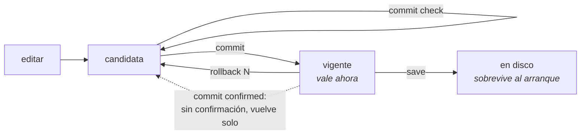

# commit, rollback y save

El modelo es el de Juniper: usted edita una **configuración candidata**, la revisa y solo entonces la aplica. Nada de lo que escribe llega al equipo antes del `commit`.



## `commit` y sus variantes

| Comando | Argumento | Qué hace |
|---------|-----------|----------|
| `commit` |           | aplica la candidata |
| `commit check` |           | valida sin aplicar |
| `commit remap` |           | aplica un cambio que mueve suscriptores existentes a nuevas direcciones públicas y bloques |
| `commit cutoff` |           | aplica un cambio que deja de anunciar el prefijo por donde llegó esta sesión |
| `commit diverge` |           | aplica un cambio que mapea suscriptores de forma diferente al par con quien este equipo comparte una dirección de servicio |
| `commit confirmed [<1-60>]` | minutos; sin número, 10 | aplica, y se deshace solo a menos que se confirme |
| `commit comment <texto>` | texto libre; las comillas alrededor se eliminan | registra una nota junto con este commit, que `show rollback` muestra al lado de la revisión |

`commit` funciona en cualquier nivel del modo de configuración — dentro de `nat`, de `cgnat`, de un pool, de una cuenta, de un bloque de enrutamiento — y después de él usted sigue en el nivel en que estaba. En el modo operacional se rechaza: entre con `configure` antes.

**Cómo se combinan las palabras.** `remap`, `cutoff` y `diverge` se combinan entre sí, en cualquier orden, y van **antes** de `confirmed` o de `comment`: `commit remap comment "ampliação do pool residencial"` y `commit cutoff remap confirmed 5` funcionan. Cada una reconoce solo la consecuencia que nombra — `diverge` no deja pasar un corte que pedía `cutoff`. `confirmed` y `comment` van juntos, en ese orden:

| Escrito | Qué hace el equipo |
|---------|--------------------|
| `commit confirmed 5 comment "teste"` | ventana de 5 minutos, y el comentario `teste` grabado con la revisión |
| `commit comment teste confirmed 5` | rechazo: `'confirmed' comes first` — no se aplica nada |
| `commit comment "teste confirmed 5"` | graba el comentario `teste confirmed 5`, sin ventana: entre comillas es texto |

El rechazo de la segunda línea existe porque quien escribe eso espera un deshacer automático; antes se grababa todo como comentario y no se abría ninguna ventana.

`commit check` va solo: es una pregunta, no aplica nada, y lo que venga después de `check` no cambia la respuesta.

### `commit check` antes que nada

Es el comando que responde *"¿esto pasa la validación?"* antes de aplicar. Revisa la candidata completa sin tocar el equipo — solo comandos de lectura van al dataplane.

**Dice quién sería re-mapeado**, que es la razón de ser de preguntar antes:

```
configuration check succeeds
  this change RE-MAPS subscribers that already have mappings
    194 of 256 subscribers move
    100.64.0.1 -> 200.150.0.9 port 1536-2047
    100.64.0.2 -> 200.150.0.10 port 1024-1535
  'commit' refuses this until it is asked for by name, with 'commit remap'
```

La cuenta no es una estimación: la hace el dataplane, con las dos definiciones y la misma aritmética que ejecutaría después. No es un rechazo — el `check` no aplicó nada, así que no hay nada que rechazar; es la advertencia que el comando existe para dar. Quien rechaza es el `commit` común, descrito en `*commit remap*`, más abajo.

Un cambio que no mueve a nadie no imprime nada de esto. Una advertencia que aparece siempre es una advertencia que nadie lee.

### `commit diverge`, cuando el equipo forma par con otro

En un equipo que **sostiene una dirección de servicio con un par** — es decir, que tiene `vrrp` en una interfaz — el `commit` compara la candidata con la configuración del par, la que usted copió a `/etc/prisma-routing/peer.conf`, y **rechaza** un cambio que haría que los dos mapearan suscriptores de formas diferentes:

```
error: this change maps subscribers differently from the peer
    this box stands for a service address with another one, so a takeover would
    translate them there
error: pool 'business' is on this box and not on the peer, so after a failover
    its subscribers are translated by nothing at all
    nat / cgnat / pool business
    a takeover would put subscribers on blocks the other box never used, and
    neither box would log anything unusual, because nothing unusual happened to
    either of them
    if that is what you mean, type: commit diverge
```

**Por qué esto es un rechazo y no una advertencia.** En modo determinístico el mapeo es función de la configuración: dos equipos con el mismo pool coinciden sin intercambiar un byte, y dos equipos con pools diferentes **fallan en silencio** — el failover pasa a mapear suscriptores a bloques que el otro equipo nunca usó, y ambos registran un día perfectamente normal. No existe síntoma que notar después.

**Por qué existe la palabra que lo pasa por alto.** Dos equipos no hacen commit en el mismo instante. Toda ampliación de capacidad correcta hace divergir el par entre el primer commit y el segundo, así que un rechazo sin salida se dispararía en todo procedimiento correcto — y la salida se volvería "dejar de copiar la configuración del par", que elimina la verificación en lugar de la divergencia. `commit diverge` es usted diciendo que lo sabe, y el commit sigue.

**En un equipo que no forma par, nada de esto ocurre.** Sin `vrrp` en ninguna interfaz, un `peer.conf` ahí es material de comparación y nada más: el equipo **advierte** sobre la diferencia y aplica, como siempre lo hizo. Ningún archivo en `/etc` crea una relación que la configuración no declara.

También dice **lo que no verificó**:

```
configuration check succeeds for CGNAT and the box's own configuration
  2 routing statement(s) have no grammar in this VTY and were not read at all
    'show configuration' marks them; they go to FRR exactly as typed
  routing statements are checked for structure only; FRR validates them at
  commit, and can still refuse one
```

La cuenta es de las sentencias que el equipo pasó al enrutamiento sin leerlas. `show configuration` y `show this` muestran **cuáles** son, marcadas con `<- not checked`. El `commit` común no dice nada al respecto, a propósito: pasar sentencias es el caso normal aquí, y una advertencia en cada commit se vuelve una advertencia que nadie lee - incluida la advertencia que importa, la de que el enrutamiento no guardó lo que se aplicó.


:::warning
Cada statement de enrutamiento — prefix-list, route-map, vecinos BGP — es verificado por la gramática del propio enrutamiento **en el momento en que se escribe**, dentro del bloque en el que usted está: un statement que el enrutamiento no acepta se rechaza ahí mismo, con sus propias palabras, y nada entra en la candidata. Lo que esa verificación no ve es lo que solo tiene sentido frente a la configuración completa — y eso el enrutamiento solo lo decide en el `commit`.

Esto significa que un `commit check` aprobado **no garantiza** que el `commit` siguiente vaya a pasar.

Y los rechazos no son todos iguales. La mayoría se decide **antes** de que se aplique cualquier cosa — el bloqueo de SSH, un route-map que no existe, un pool que el dataplane rechazaría — y en esos no se aplica nada: el equipo queda entero como estaba y la candidata también.

El rechazo por lectura de vuelta es la excepción, y es el que importa aquí. Solo puede decidirse **después** de que el enrutamiento ya recibió la configuración, porque es exactamente el descubrimiento de que la recibió y no la guardó. En ese caso **el resto del commit está vigente** — el CGNAT y la configuración del propio equipo — y la vuelta es `rollback 1`. El propio mensaje lo dice.

Una línea de **route-map** o de **lista** (prefix-list, community-list, as-path) es diferente, y ahí el commit **se revierte solo**. Una línea que el daemon rechazó después de que la verificación de sintaxis la aceptara queda en el texto de la configuración del enrutamiento, palabra por palabra, pero la cláusula se ejecuta sin ella — sin el `set`, o coincidiendo con más de lo que se escribió — en rutas reales. Por eso el `commit` lee lo que cada daemon que aplica el route-map está ejecutando de hecho y, si ninguno ejecuta la línea, rechaza, nombra la línea y restablece el estado anterior. Vale para el route-map que usted escribe y para el que la política compila:

```
error: FRR refused 1 line(s) of your route-maps and lists
      route-map OP permit 10: set extcommunity rt 65000:100 additive
error: commit failed; rolling back to the previous state
```

Un route-map usado al mismo tiempo por un vecino BGP y por una redistribución de OSPF puede tener `set community`: OSPF no ejecuta esa línea, BGP sí, y el commit pasa.

:::

Antes este comando decía solamente *"configuration check succeeds"*, lo que prometía más de lo que había verificado — y en una ventana de mantenimiento es esa frase la que decide si la persona sigue adelante.

### `commit remap` — el seguro contra el desastre silencioso

Un `commit` común **rechaza** cambios que alteren el mapeo de suscriptores existentes. Deben pedirse por su nombre, con `commit remap`.

El motivo es que este es el peor tipo de falla posible en este equipo: agregar un prefijo público tira **toda** la base de suscriptores al mismo tiempo, y la máquina no reporta nada anormal — porque, desde su punto de vista, no ocurrió nada anormal. El rechazo transforma un accidente silencioso en una decisión explícita.

**Es en este rechazo donde aparecen los números.** El dataplane sostiene las dos definiciones y ejecuta la misma aritmética que ejecutaría después, así que la cuenta es exacta y no una estimación — y viene con dos suscriptores de ejemplo, de dónde a dónde:

```
error: this change re-maps subscribers that already have mappings
    1024 of 1024 subscribers change public address or port block; 512 hold live
    state right now
    100.64.0.5 moves from 200.150.0.17:1536-2047 to 200.150.0.33:2048-2559
    100.64.0.9 moves from 200.150.0.17:2048-2559 to 200.150.0.34:1536-2047
    every session on this pool ends when it is applied. Past answers stay
    resolvable - the configuration trail records which definition was in force
    - but the subscribers do not.
    if that is what you mean, type: commit remap
```

Registre ese primer número en el ticket de cambio: es cuántos clientes van a llamar.

### `commit cutoff` — el mismo seguro para el prefijo que lleva su sesión

El otro cambio que el equipo no aplica sin oír la palabra: el que deja de anunciar el prefijo por donde llegó **su propia sesión**. Retirar un prefijo a propósito es rutina — un drenaje de mantenimiento, un cliente que se fue —, y el equipo no distingue eso de un error de política. Así que no rechaza para siempre: pide el nombre.

Dos formas, según lo que hace el cambio:

```
error: 200.150.0.0/24: this change stops originating it, and it covers 200.150.0.7 - the address this session arrived on
    nothing here would advertise a route back to this box's end of your own session
    if that is what you mean, type: commit cutoff
```

```
error: 200.150.0.0/24: no neighbour would be sent it after this change, and it covers 200.150.0.7 - the address this session arrived on
    the outbound policy denies it to every neighbour that has one, so nothing would advertise a route back to this box's end of your own session
    if that is what you mean, type: commit cutoff
```

**Se calla** cuando no puede estar seguro: cuando este equipo no origina hoy un prefijo que cubra la dirección, cuando nada la anunciaría de todos modos, cuando la política de salida de algún vecino no puede leerse hasta el final, o cuando hay `redistribute` y `aggregate-address` de por medio. En una sesión de consola serial no hay dirección contra la cual verificar, y el equipo lo dice en lugar de dejarle creer que la verificación se ejecutó.

Y `commit cutoff` **no** es una licencia para quedarse afuera: se aplica como `commit confirmed 10` — vea más abajo.

### `commit confirmed` — la red de seguridad para cambios remotos

```
prisma# [edit] commit confirmed 5
```

Aplica ahora, y deshace automáticamente en 5 minutos a menos que usted confirme. Es lo que permite tocar el enrutamiento en una máquina remota: si el cambio corta su propio acceso, la máquina se recupera sola.

Sin número, la ventana es de 10 minutos. El plazo va de 1 a 60; fuera de eso el commit se rechaza y no se aplica nada:

```
error: commit confirmed 0: expected 1-60 minutes
    the window has to outlast a reconnection and end while somebody is still at
    the console
```

Cero se rechaza a propósito: sería una ventana que nunca se arma, bajo un `commit complete` que parece haber salido bien.

El equipo responde diciendo dónde está armado el deshacer:

```
rollback at 2026-02-11T14:32:07Z, in 5 minute(s)
    unless you type 'commit' to confirm
    the revert is armed on the box, not in this session: logging out, losing
    this session or rebooting does not cancel it, and confirming does
```

**Quien deshace es la máquina, no su sesión.** El plazo queda grabado en el equipo. Salir de la VTY, perder el SSH, cerrar la consola serial o reiniciar la máquina **no** cancela nada — solo `commit` cancela. Eso es lo que hace útil al comando: la falla contra la que protege es exactamente la que tira la sesión en la que usted está escribiendo.

#### Confirmar

Cualquier `commit` confirma la ventana abierta — el `commit` sin nada más, y también el que ya trae el próximo cambio:

```
prisma# [edit] commit
confirmed: the box will not roll this change back
```

La excepción es otro `commit confirmed`: no confirma la ventana anterior, abre una nueva, con el plazo nuevo.

Mientras la ventana esté abierta, quien entre a la VTY es advertido en el banner:

```
A 'commit confirmed' is waiting: this box rolls the last change back at 2026-02-11T14:32:07Z
unless you type 'commit' to confirm it.
```

#### Reinicio dentro de la ventana

* Reinició **después** de confirmar: no se deshace nada. La confirmación se registra en el momento en que usted la da, no al final de la ventana.
* Reinició **antes** del plazo: el plazo sigue vigente, y es un horario — no un conteo que vuelve a empezar. Un equipo que estuvo apagado más allá de su propio plazo vuelve y deshace de inmediato, porque nadie confirmó.


:::warning
La máquina no distingue "reinicié porque el cambio salió mal" de "reinicié en medio del mantenimiento". En los dos casos deshace. Es el lado seguro: confirmar cuesta una palabra, y recuperar un equipo inalcanzable no cuesta ninguna palabra — cuesta un viaje.

:::

#### Los cambios que se vuelven `commit confirmed` solos

Tres casos se vuelven `commit confirmed 10` **aunque usted no lo pida**: cualquier cambio en `ssh`, cualquier cambio en `user`, y el `commit cutoff` que usted acaba de escribir. Los tres pueden cortar la sesión en la que usted está escribiendo, y el equipo dice por qué:

```
this commit can cut off the session you are using
    it changes SSH or accounts, or stops advertising the prefix this session
    runs over
    applying it as 'commit confirmed 10' rather than as a plain commit
```

Son **tres**, y no cuatro. Entregar al dataplane la placa por donde se alcanza el equipo ya fue el cuarto caso, con una ventana de treinta minutos y un `commit` de confirmación después del reinicio. Dejó de serlo: el equipo reclama su propia placa al iniciar, y el estado que producía aquel deshacer — el ajuste vacío, en un equipo de una sola placa — es exactamente el estado que reclama esa placa. Quien confirmaba y quien no hacía nada terminaban en el mismo lugar, y el segundo pagaba un reinicio para llegar ahí.


:::warning
**Si usted tiene un procedimiento escrito que dice "reinicie, vuelva a entrar y escriba** `**commit**` **para mantener la placa", borre ese paso.** No existe ventana que confirmar. El `commit` es inofensivo y no hace nada, y ningún deshacer reinicia el equipo. `commit confirmed <minutos>` sigue igual para cualquier cambio en el que usted quiera una ventana.

:::

#### Cuando la promesa no puede cumplirse

Si el equipo no logra grabar el plazo — disco lleno, permiso denegado en `/etc/prisma-routing` —, **no** finge:

```
warning: the revert could NOT be armed on the box
    /etc/prisma-routing: Permission denied
    it will run in 10 minute(s) IF THIS SESSION LASTS THAT LONG, and not
    otherwise
    which is not the case it exists for: keep a second session open, and use
    'rollback 1' there if this one stops answering
```

En ese estado el deshacer vale solo mientras dure la sesión. Abra una segunda sesión antes de hacer cambios.

## Lo que el `commit` rechaza, y qué hacer

Rechazar es lo más fuerte que hace este equipo: conoce el estado del equipo y el cambio al mismo tiempo, y hay casos en los que aplicar significa perder el equipo.

En los rechazos de esta sección **no se aplica nada** - la candidata queda como está y usted sigue en la sesión. Todos se deciden antes de que el equipo toque cualquier cosa.

Hay **dos** mensajes que no funcionan así, y están más abajo: el de lectura de vuelta del enrutamiento y el del enrutamiento que no cambió nada. Los dos se descubren después de que el enrutamiento ya recibió la configuración, y en ellos el resto del commit está aplicado. Antes de salir de un error creyendo que el equipo está intacto, lea el mensaje: dice cuál de los casos tiene en pantalla.

Los mensajes aparecen en inglés, porque es lo que imprime el equipo. Están aquí para que usted encuentre el suyo.

### `this change locks everybody out`

Después de este cambio ninguna cuenta entraría por SSH: o ninguna tiene clave autorizada, o la autenticación por contraseña quedaría deshabilitada para todas las que tienen contraseña. Dé una clave a alguna cuenta, o vuelva a permitir contraseña para una que la tenga.

### `this change leaves nobody able to configure the box`

Alguien todavía entra, pero nadie que entre tiene el rol de administrador. Un operador de CGNAT no concede roles, así que la vuelta sería por un shell de root que tal vez nadie tenga. Dé `role administrator` a otra cuenta antes, o permita root por SSH.

### `cgnat logging enable: UDP export has no collector`

El log está habilitado y no hay adónde enviarlo. Un equipo en ese estado parece registrar todo y no entrega nada - y el registro es justamente lo que necesita existir un año después. Agregue `logging udp <colector> src <origen>` dentro de `nat` > `cgnat`, o exporte por TCP con `logging tcp <colector>`, en el mismo nivel.

Vale la pena notar dónde se rechaza esto: **aquí**, y no en el dataplane. Rechazado allá, el resto del cambio ya se habría aplicado.

### `routing is configured and FRR is not answering`

Hay configuración de enrutamiento en la candidata y el enrutamiento no responde. Aplicar ahora significaría perder silenciosamente todo lo que es de enrutamiento. El rechazo viene en tres líneas, y la segunda y la tercera dicen dónde **no** mirar:

```
error: routing is configured and FRR is not answering
    'systemctl status frr' and its journal say why; blaming the configuration
    for a daemon that is not running sends somebody to debug the wrong thing
```

La configuración no es el problema. Un daemon que no está levantado no rechaza nada, no responde nada y no deja ningún log en la candidata - quien vaya a buscar el error en la configuración va a buscar mucho tiempo.

### `pool '<nombre>': no prefix-inside` / `no prefix-outside`

Un pool sin uno de los dos lados no traduce nada. No es un ajuste que se completa después: un pool así aceptado sería un pool que existe y no sirve. El rechazo dice cuál de los dos falta y muestra la instrucción que lo completa:

```
error: pool 'RFC6598': no prefix-inside and no prefix-outside
    e.g. 'prefix-inside 100.64.0.0/10', 'prefix-outside 203.0.113.0/28'
```

Son los **prefijos del pool** - quién llega (`prefix-inside`) y a dónde se traduce (`prefix-outside`) -, no el rol de la interfaz (`interface <nombre> inside|outside`), que es otra cosa. Hasta la versión 0.148.2 el mensaje decía `inside and outside required`.

### `pool '<nombre>' would be refused`

El dataplane miró la definición completa - tamaño de bloque, superposición de prefijo, capacidad, y si el rango público choca con una dirección local - y dijo que no. La línea siguiente trae su motivo, en sus propias palabras.

### `block-stride applies to bpa pools only, not to pool <nombre>`

El `block-stride` indica a qué distancia queda el **segundo** bloque de un suscriptor que llenó el primero, contada a lo largo de los bloques **mapeados** de su dirección pública. En un pool `deterministic` el bloque adicional no sale de ahí: sale de la **reserva**, que es un conjunto aparte con su propia regla de elección - un bloque libre de la reserva en la propia dirección del suscriptor, si la porción de ese worker tiene uno; si no, cualquier bloque libre que la porción de ese worker tenga en la reserva, en cualquier dirección, como describe la página de [Configuración de pool](/s/wiki-es/doc/configuracion-de-pool-Y3cACG9QHA). Ese camino nunca pasa por los bloques mapeados, y por eso el `block-stride` nunca se lee ahí - en ningún tamaño, y en ninguna máquina.

El rechazo muestra las dos líneas en conflicto, el `mode` y el `block-stride`, porque cualquiera de las dos lo resuelve y cuál cambiar es decisión suya: quite el `block-stride`, o ponga el pool en `mode bpa`.

Es la misma simetría de la `reserve`, que solo existe en pool determinístico: cada uno de los dos ajustes pertenece a un solo modo, y el equipo prefiere decirlo antes que guardar un ajuste que nunca tendría efecto. Un pool que **era** dinámico, tenía `block-stride` y pasa a `deterministic` cae exactamente aquí - y ese es el momento de enterarse de lo que está perdiendo, no meses después, mirando una pantalla que promete una distribución que el equipo no hace.

**Un archivo guardado por una versión anterior** puede tener los dos en el mismo pool, porque la combinación se aceptaba y el `block-stride` simplemente nunca tenía efecto ahí. En el arranque el equipo **no rechaza** ese archivo: levanta el pool sin el `block-stride`, exactamente como ya funcionaba, y deja en el log de arranque la línea `note: block-stride <n> dropped from pool <nombre>`. El próximo `save` graba el archivo sin la línea. Un `rollback` a una revisión que todavía tiene los dos carga la revisión en la candidata y no aplica nada, como cualquier `rollback`; es el `commit` siguiente el que cae en el rechazo de arriba. En un equipo que arrancó por ese camino el pool ya está funcionando **sin** el `block-stride`, así que lo que ese `commit` rechaza es la línea agregada a un pool que se queda donde está - y no un pool nuevo. La diferencia entre el arranque y el prompt es deliberada: en el arranque nadie está mirando, y un equipo que arranca sin ningún pool por culpa de un ajuste que nunca tuvo efecto es un precio que nadie pidió pagar.

### `this box has no interface <nombre>` y `interface <nombre>: this box has no such interface`

Un statement nombra una interfaz que no existe aquí. La primera forma viene de una línea de enrutamiento o de CGNAT que apunta a ella; la segunda, de entrar a un bloque `interface` que el equipo no tiene. `show interface` lista los nombres que tiene, y de ahí debe salir el nombre - inventar uno es como empieza el problema.

**En el arranque es diferente: una placa que desapareció no tira el resto.** Si el archivo guardado menciona una placa que el dataplane no tiene cuando el equipo arranca - un módulo SFP que el driver rechazó, una placa retirada del servidor -, el equipo aplica todo lo que no depende de ella y deja afuera solo lo que depende: el bloque de la propia placa, sus subinterfaces, un bundle que quedó sin ningún miembro, un `track` de VRRP en ella, el bloque de FRR y cualquier línea de enrutamiento que la mencione. La gestión, las rutas y los otros pools arrancan normalmente. La consola y el journal advierten con `warning: this box does not have: <placa>`, y lo que quedó afuera aparece en:

```
show configuration pending
```

Mientras haya algo pendiente, el `save` se rechaza (`save: refused, nothing was written`): la configuración en uso está sin las líneas de la placa, y grabar sería la forma en que el archivo las perdería. Cuando la placa aparece, el equipo aplica solo lo que esperaba por ella - lo mismo que haría un arranque con la placa. Si alguien hizo `commit` después del arranque, no sobrescribe con el archivo: advierte una vez y deja la decisión en sus manos. Para renunciar a lo pendiente y volver a poder grabar:

```
clear configuration pending
```

Por la API, el servicio de health `prisma.v1.Configuration` queda `NOT_SERVING` mientras haya algo pendiente.

### `a bundle member this box does not have`, `a port in two bundles` y `a bundle member with config of its own`

Los tres rechazos de un bundle LACP (`interface ae<n>`), cada uno con el nombre del puerto al final:

```
error: a bundle member this box does not have: ens29
error: a port in two bundles: enp2s0
error: a bundle member with config of its own: enp2s0
```

El primero es un `member` con un puerto que el dataplane no tiene, casi siempre un error de tipeo. El segundo es el mismo puerto en dos bundles: un puerto solo puede pertenecer a uno. El tercero es un miembro con dirección o lado de CGNAT propio. Un miembro no reenvía por sí solo, así que esa configuración va en el `ae<n>`, no en el puerto. Quite la configuración del puerto y póngala en el bundle.

### `this next hop is on no connected network: <próximo salto>`

Una ruta estática cuyo próximo salto no está en ninguna red conectada de este equipo. Se aceptaría y nunca reenviaría nada, porque no hay interfaz por donde alcanzar esa dirección. Revise la dirección, o configure la interfaz que debería llevarla.

### `cannot reach the dataplane: <motivo>`

La VTY no logró hablar con el dataplane, así que no puede ni aplicar ni verificar. No es un rechazo sobre su cambio: es el equipo diciendo que la mitad de él no está respondiendo. `show version` dice qué servicios están levantados.

### `FRR accepted <n> statement(s) of this commit and did not keep them`

**Este es el rechazo diferente.** No se decide antes de aplicar: el equipo entregó la configuración al enrutamiento, leyó de vuelta lo que este guardó, y descubrió que una parte no está ahí. El descubrimiento solo existe después de aplicar.

```
error: FRR accepted 1 statement(s) of this commit and did not keep them
    router static / 203.0.113.0/24 next-hop blackhole
    this commit is NOT in effect as written, and nothing was rolled back: the
    rest of it is applied. 'rollback 1' puts the box back
    the configuration this box holds and the one FRR is running are not the
    same; 'show configuration' is this box's, 'start shell' then 'vtysh -c
    "show running-config"' is FRR's
```

Lea la segunda frase con cuidado, porque contradice lo que vale para todos los demás rechazos: **no se deshizo nada, y el resto del commit está vigente**. El CGNAT y la configuración del propio equipo están aplicados. Quien salga de aquí creyendo que el equipo está como estaba va a diagnosticar el equipo equivocado.

`rollback 1` es la vuelta: carga la revisión anterior en la candidata, y usted la aplica con `commit` como cualquier otra.

Las sentencias rechazadas aparecen una por línea, con el bloque al que pertenecen. Las marcadas con `<- not checked` son las que este equipo pasó sin leer: no tienen gramática aquí, fueron al enrutamiento palabra por palabra, y son las que el enrutamiento tiene más probabilidad de haber descartado.

La última frase es qué hacer a continuación. Las dos configuraciones divergieron, y hay un comando para leer cada una: `show configuration` muestra la de este equipo.

### `the routing half of this commit reached FRR and changed nothing`

La hermana de la anterior, y también descubierta **después** de aplicar: el CGNAT y la configuración del propio equipo están vigentes, y ninguna de las sentencias nuevas de enrutamiento tomó efecto. El equipo lista hasta cinco de ellas y dice las dos causas probables:

```
error: the routing half of this commit reached FRR and changed nothing
    all 2 new statement(s) are still outstanding
```

La causa común es un daemon de enrutamiento detenido — `show version` dice cuáles están levantados. La otra es inofensiva: sentencias que repiten el valor por defecto del propio enrutamiento, que este no guarda. En los dos casos el equipo no escribe `commit complete`, porque esa es la frase sobre la cual se construye todo diagnóstico posterior.

### Y las dos que no son rechazo, sino pedido explícito

`commit remap` y `commit cutoff` existen porque re-mapear suscriptores y retirar el prefijo que lleva su sesión son las dos peores cosas que se pueden hacer aquí sin querer. Están descritas arriba, y la diferencia es que esos cambios **pueden** hacerse: lo que no pueden es hacerse por accidente.

Son palabras diferentes a propósito: una mueve a los suscriptores, la otra cuesta la sesión en la que usted está escribiendo, y quien reconoció una no fue advertido de la otra.

## `rollback`

```
rollback <0-19>
```

Carga una revisión ya aplicada con commit en la candidata. **No se aplica** — se vuelve su candidata, que usted revisa y aplica con `commit`, como cualquier otra edición.

| Comando | Qué hace |
|---------|----------|
| `rollback 0`, o `rollback` sin número | descarta lo que usted editó y devuelve la candidata a lo que está vigente ahora (`candidate reset to the running configuration`) |
| `rollback 1` | la revisión del commit anterior al último — es la vuelta de un commit que salió mal |
| `rollback <2-19>` | revisiones más antiguas, una por commit |
| `show rollback` | las revisiones guardadas: número, fecha y hora del commit en UTC, cuántos commits atrás, y el `comment` cuando lo hubo |

Después de cargar una revisión el equipo responde `load complete (revision <n>)` y sugiere el próximo paso: `show configuration compare` para revisar, `commit` para aplicar. Un número que no tiene revisión se rechaza con `revision <n> does not exist`.

Se mantienen las **20 revisiones** más recientes, en `/etc/prisma-routing/rollback/`; cada `commit` que aplica algo graba una y empuja las demás una posición hacia atrás.

Funciona en el modo operacional — y ahí ya **entra al modo de configuración**, con la revisión como candidata — y en cualquier nivel del modo de configuración, salvo dentro de un pool, de una cuenta (`user`) o de un usuario SNMP (`snmp-user`): en esos tres, ejecute `exit` antes.

## `save` — el segundo paso que la gente olvida

`commit` hace que la configuración pase a estar vigente. `save` la graba en `/etc/prisma-routing/prisma-routing.conf` para que sobreviva al reinicio, y responde `configuration saved to /etc/prisma-routing/prisma-routing.conf`.

`save` es un comando del **modo operacional**. Graba la configuración **vigente**, no la candidata, y por eso no existe dentro del modo de configuración: salga con `exit` (desde cualquier nivel, `top` y después `exit`) y escriba `save` en el prompt `prisma>`.

**Son cosas diferentes y ninguna implica la otra.** Una configuración aplicada con commit y no guardada desaparece en el próximo arranque. Una configuración guardada pero con la candidata todavía modificada no es la que está vigente.

La separación es intencional: *"que pase a valer ahora"* y *"que siga valiendo después de reiniciar"* son dos decisiones, y el `commit confirmed` solo tiene sentido si la segunda no es automática.


:::warning
`save` dentro de una ventana de `commit confirmed` graba en disco un cambio que todavía no fue confirmado. El deshacer devuelve lo que está **vigente** y no reescribe el archivo — así que el equipo desharía ahora y traería el cambio de vuelta en el próximo arranque. Por eso el `save` advierte:

```
warning: what you just saved has NOT been confirmed
    this box rolls the running configuration back at 2026-02-11T14:32:07Z, and
    does not touch the file you just wrote - so a reboot after that would bring
    the unconfirmed change back. Type 'commit' to confirm, then 'save' again
```

Confirme primero, guarde después.

:::

## Inspeccionar antes de aplicar

```
show configuration            la candidata completa
show configuration compare    solo lo que cambia respecto de lo vigente
commit check                  valida sin tocar el equipo
```

`show configuration compare` responde `no differences` cuando la candidata es igual a lo vigente — es la forma de saber, antes de salir, si hay algo pendiente de aplicar.

Quién sería re-mapeado sale del `commit check` y, con los mismos números, del rechazo del `commit` común que pide `commit remap`.

Un reemplazo en muchas líneas puede verse antes de entrar en la candidata: `replace pattern <regex> with <sustituto> | compare` muestra la diferencia y dice si el resultado pasaría, sin guardar nada. `replace pattern` y `rename` cambian solo la candidata, así que todo lo que está en esta página — `show configuration compare`, `commit check`, `commit confirmed`, `rollback 0` — vale para el resultado igual que para líneas escritas. Ambos están en [VTY prismash — guía de uso](/s/wiki-es/doc/vty-prismash-guia-de-uso-gPIR8ZKwdC).

## Salir sin aplicar

`exit` en el nivel superior del modo de configuración vuelve al modo operacional y **descarta** la candidata. Si tenía algo que no se aplicó, el equipo advierte al salir — y lo descartado no vuelve:

```
warning: uncommitted changes were discarded (use 'commit' to apply them)
```

Después de un `commit` que aplicó todo, esa advertencia no aparece.

## En el arranque

`prisma-routing.service` ejecuta `prismash --load /etc/prisma-routing/prisma-routing.conf` después de que VPP acepta comandos.

El `--load` **rechaza el archivo completo** si hay una línea que la VTY no logra interpretar, en lugar de aplicar el resto. Esto es deliberado: ejecutándose sin nadie mirando, aplicar un archivo *menos una línea* dejaría diferentes la configuración en disco y la que está en ejecución, y alguien lo descubriría leyendo las dos mucho después.

Lo que el `--load` **no** rechaza, y por qué:

* **Una placa que el equipo no tiene.** Lo que depende de ella queda esperando, el resto arranca, y `show configuration pending` lista lo que quedó afuera — vea `this box has no interface <nombre>`, más arriba.
* **El** `**block-stride**` **de un pool** `**deterministic**`, que nunca tuvo efecto ahí. El pool arranca como ya funcionaba, el log de arranque dice `note: block-stride <n> dropped from pool <nombre>`, y hasta el próximo `save` el archivo en disco y la configuración en ejecución difieren en esa línea. El rechazo `block-stride applies to bpa pools only`, más arriba, explica por qué.
* **Palabras antiguas que cambiaron de nombre.** `mode dynamic` se lee como `mode bpa`, con la nota `note: 'mode dynamic' is now 'mode bpa' in pool <nombre>`, y `radius` dentro de `pppoe` se lee como `aaa` > `radius`; el archivo se vuelve a grabar con la forma nueva. Un pool NAT64 escrito dentro de `cgnat`, al contrario, se rechaza: va en `nat` > `nat64`, y el cambio no es automático.

El rechazo se lee en el arranque, en una consola de 80 columnas, así que se divide en partes que caben: la ruta del archivo y la línea rechazada salen **enteras**, cada una en su propia línea, para que usted pueda copiarlas y buscarlas; el motivo viene en texto corrido debajo.

```
error: refusing to load this file, these lines are not understood:
    /etc/prisma-routing/prisma-routing.conf
    line 2: password 6$Xq7kPz2r$4Pv3cJ9sQm2WdT1hRfLb8XkY6nAeUoZgC5iMt...
        (password: expected a crypt hash such as $y$... or $6$... (openssl
        passwd -6), not a plaintext password)
```

Lo mismo vale cuando el deshacer automático de un `commit confirmed` encuentra una línea así en lo que iba a restaurar, y cuando `rollback` no logra leer una revisión: la ruta y la línea quedan enteras, el motivo se divide.

# Ver también

* [Configuración de pool](/s/wiki-es/doc/configuracion-de-pool-Y3cACG9QHA) — qué cambios exigen `commit remap`
* [Operación y diagnóstico](/s/wiki-es/doc/operacion-y-diagnostico-iHMcBJQ91I) — el orden de arranque que aplica lo que se guardó
