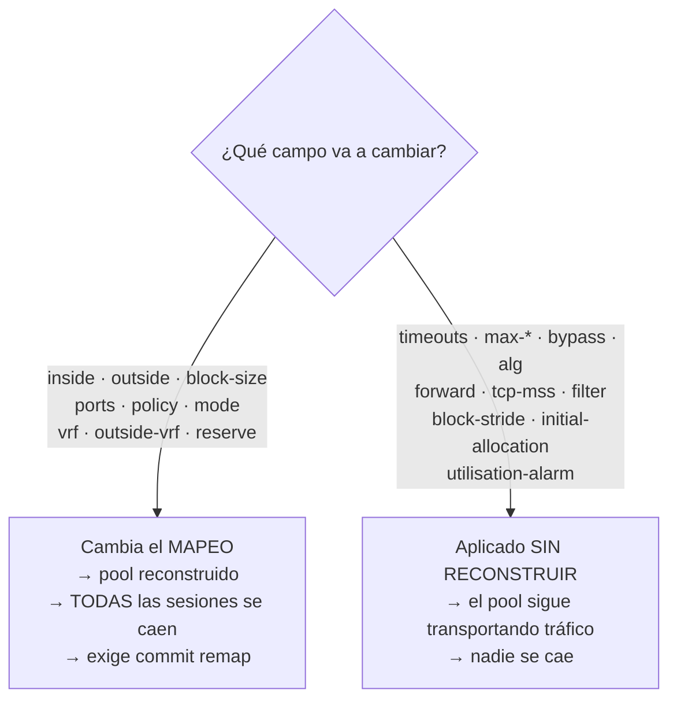

# Configuración de pool

Cada campo que acepta un pool de CGNAT, con el argumento, el rango, el valor predeterminado y si el cambio tira sesiones. Para quien está creando un pool o modificando uno que transporta suscriptores.

Se entra en `nat`, después en `cgnat`, y allí `pool <nombre>`; el nombre tiene hasta 63 caracteres. El prompt pasa a ser `prisma# [edit nat / cgnat / pool residencial] `: nombra el pool y los niveles en los que está. `exit` vuelve a `cgnat`; `top` va directo al nivel superior. La página [Configuración de CGNAT](/s/wiki-es/doc/configuracion-de-cgnat-WTgNXqphc5) explica los niveles. `commit` funciona desde dentro del pool, y después de él usted sigue en el pool.

Modificar un pool exige la capacidad de CGNAT: una cuenta `cgnat-operator` o de administrador.


:::info
¿Busca **cómo hacer una tarea** (abrir un puerto, limitar un host, ampliar el pool)? Empiece por las **Recetas del día a día**. Esta página es la referencia campo por campo.

:::

# La división que importa antes que nada

Algunos campos **reconstruyen el pool**, y todas sus sesiones mueren en el instante de la aplicación. Otros se aplican **sin reconstruir**, en un pool que está transportando tráfico.

| Reconstruyen el pool: tiran todas las sesiones | Aplicados sin reconstruir: sin impacto en las sesiones |
|------------------------------------------------|--------------------------------------------------------|
| `inside`                                       | `timeout ...`                                          |
| `outside`                                      | `max-blocks`                                           |
| `reserve`                                      | `block-stride`                                         |
| `block-size`                                   | `bypass ...`                                           |
| `ports`                                        | `utilisation-alarm`                                    |
| `policy`                                       | `max-sessions`                                         |
| `mode`                                         | `max-session-rate`                                     |
| `vrf`                                          | `tcp-mss`                                              |
| `outside-vrf`                                  | `filter`                                               |
|                                                | `alg ...`                                              |
|                                                | `forward ...`                                          |
|                                                | `initial-allocation`                                   |



La regla detrás: los de la izquierda cambian el **mapeo**, es decir, qué dirección pública y qué bloque de puertos recibe cada suscriptor. Si cambió el mapeo, toda sesión existente pasó a ser inválida.

Equivocarse en esta clasificación es malo en los dos sentidos: un campo de mapeo tratado como sin reconstrucción nunca llega al dataplane; un campo sin reconstrucción tratado como de mapeo **desconecta a toda la base de suscriptores para desactivar un ALG**.


:::warning
**Cuidado con** `**inside**` **y** `**outside**`**.** Cambiar cualquiera de los dos reconstruye el pool y termina todas sus sesiones, en ambos modos. En un pool `mode deterministic` el costo es mayor: el mapeo es **aritmético, no una tabla** (la dirección pública y el bloque de puertos de un suscriptor se *calculan* a partir de la definición del pool), así que **cambiar la definición cambia la función**. Agregar un prefijo público mueve a **todos** los suscriptores en ese instante. Nada se corrompe, las respuestas pasadas siguen pudiendo resolverse con la configuración que estaba vigente, pero todos los clientes se caen de una vez y la máquina no reporta nada anormal, porque no pasó nada anormal. Por eso el `commit` **rechaza** un cambio que remapea suscriptores hasta que se pida por su nombre, con `commit remap`.

:::

# Campos de mapeo

| Comando | Argumento | Qué define |
|---------|-----------|------------|
| `prefix-inside <prefijo>` | `<A.B.C.D/M\|X:X::X:X/M>` | prefijo interno (los suscriptores); se puede repetir. Obligatorio: el `commit` rechaza un pool sin `prefix-inside` o sin `prefix-outside` (o la `prefix-list-inside`/`prefix-list-outside` de ese lado, más abajo). IPv6 convierte el pool en un pool NAT64 (vea más abajo) |
| `prefix-outside <prefijo>` | `<A.B.C.D/M>` | prefijo público; se puede repetir |
| `subscriber-length <n>` | `<32-128>` | solo NAT64: la longitud del prefijo IPv6 de **un** suscriptor, el prefijo delegado, por ejemplo `56` |
| `nat64-prefix <prefijo>` | `<X:X::X:X/M>` | solo NAT64: dónde están los destinos IPv4 (RFC 6052); si no está, vale `64:ff9b::/96` |
| `block-size <n>` | `<64-32768>` | puertos por bloque, potencia de dos; predeterminado `512`. Un número que no es potencia de dos se rechaza indicando las dos potencias más cercanas |
| `ports <min> <max>` | `<1-65535> <1-65535>` | rango de puertos utilizable; si no está, vale el rango del propio equipo |
| `policy interleaved` |           | vecinos en direcciones públicas distintas; es el valor predeterminado |
| `policy blocked` |           | vecinos en la misma dirección pública |
| `mode deterministic` |           | por fórmula, sin log de asignación: al suscriptor se lo encuentra mediante la configuración vigente. Es el valor predeterminado. Solo se registra el bloque entregado de la reserva |
| `mode bpa` |           | BPA: bloques asignados bajo demanda, cada asignación registrada. En este modo el registro es la única prueba de quién usó un puerto: configure la exportación (`logging` en `cgnat`). El `commit` no advierte cuando falta; quien dice si el equipo exporta es el `show cgnat logging` |
| `vrf <n>` | `<0-4294967295>` | la VRF cuyos suscriptores atiende este pool; si no está = todas |
| `outside-vrf <n>` | `<0-4294967295>` | la VRF por donde sale el tráfico traducido; si no está = lo deja donde estaba |
| `reserve <n>` | `<0-65535>` | bloques de **cada** dirección pública guardados fuera de la fórmula, para dárselos a quien llene el suyo; `0` = ninguno |

Hasta la 0.148.2 estas dos instrucciones se llamaban `inside` y `outside`. Los nombres antiguos se siguen leyendo (de una configuración guardada, de una revisión de rollback o escritos), pero el equipo solo escribe los nuevos, y `?` solo ofrece los nuevos. El rol de una interfaz en el CGNAT (`interface <nombre> inside|outside`) no cambió.

**Los prefijos.** `prefix-outside` y `bypass` son IPv4; `prefix-inside` es IPv4 o, en un pool NAT64, IPv6, nunca los dos en el mismo pool. Un prefijo con bits de host (`100.64.0.1/10`) se rechaza indicando qué red nombra (`100.64.0.0/10`), y un `/0` se rechaza: todas las direcciones no son ni pool ni bypass.

`**policy interleaved**` **vs** `**blocked**`: `interleaved` distribuye vecinos en direcciones públicas distintas, lo que diluye el impacto de un bloqueo de reputación en una IP. `blocked` mantiene a los vecinos en la misma dirección pública.

# Lados definidos por prefix-list

Un lado del pool puede venir de una `ip prefix-list` en lugar de prefijos escritos: la misma lista del enrutamiento, con `seq`, `permit`/`deny`, `ge`/`le` y una descripción por entrada.

| Comando | Argumento | Qué define |
|---------|-----------|------------|
| `prefix-list-inside <lista>` | `<prefix-list>` | los suscriptores: el origen que coincide con un `permit` se traduce; el origen que coincide con un `deny` **sale sin NAT**, con su propia dirección; el origen que no coincide con nada no es de este pool |
| `prefix-list-outside <lista>` | `<prefix-list>` | las direcciones públicas: los `permit` **menos** los `deny` |

Cada lado es **uno u otro**: `prefix-inside` o `prefix-list-inside`, `prefix-outside` o `prefix-list-outside`. El `commit` rechaza un pool con los dos en el mismo lado e indica qué pool y qué lado.

```
prisma# [edit] ip prefix-list CGN-IN seq 5 deny 100.64.1.0/24 description "faixa de gerência"
prisma# [edit] ip prefix-list CGN-IN seq 10 permit 100.64.0.0/22 le 32
prisma# [edit] ip prefix-list CGN-OUT seq 5 deny 203.0.113.129/32
prisma# [edit] ip prefix-list CGN-OUT seq 10 permit 203.0.113.128/28
prisma# [edit] nat
prisma# [edit nat] cgnat
prisma# [edit nat / cgnat] pool residencial
prisma# [edit nat / cgnat / pool residencial] prefix-list-inside CGN-IN
prisma# [edit nat / cgnat / pool residencial] prefix-list-outside CGN-OUT
```

Con esto el pool traduce `100.64.0.0/24` y `100.64.2.0/23`, deja pasar `100.64.1.0/24` sin traducción, y usa las quince direcciones de `203.0.113.128/28` que quedan quitando la `.129`.

**Cómo una lista se convierte en un conjunto de direcciones.** En el enrutamiento, una entrada coincide con una **ruta** por la longitud: `permit 203.0.113.128/28` coincide solo con la ruta `/28`. Un pool lee la misma lista como **direcciones**, y por eso aquí la regla es otra:

* una entrada sin `ge` ni `le` cubre **todas** las direcciones del prefijo;
* con `ge` o `le`, cada dirección cuenta como un `/32`, y la entrada cubre el prefijo cuando 32 está en la ventana; `le 32` o un `ge` solo cubren todo;
* una entrada cuya ventana deja fuera el `/32` (`le 24`, por ejemplo) no coincide con ninguna dirección, y el `commit` rechaza el pool que usa la lista, nombrando la entrada.

Vale la primera entrada que coincida, en el orden del `seq`, como en el enrutamiento. Donde la misma lista la usa un vecino BGP o una route-map, sigue valiendo según la regla de rutas: solo el pool la lee como direcciones.

**Lo que el** `**commit**` **rechaza:** una lista que no existe o que no tiene entradas; una entrada que no coincide con ninguna dirección; una `prefix-list-inside` que no traduce a nadie; un `deny` en la `prefix-list-outside` que deja el pool **sin dirección pública**; un `deny` de origen que otro pool traduce (el origen es de un pool o sale sin traducción, no las dos cosas); y una lista que se despliega en más de 255 prefijos, el máximo que recibe el dataplane en un mensaje. Un pool NAT64 no acepta prefix-list.

**Cambiar la lista vuelve a aplicar el pool.** El conjunto que da la lista es el mapeo: si cambia, el pool se reconstruye en el `commit`, como si se hubiera vuelto a escribir el prefijo, y, en un pool determinístico, eso remapea suscriptores. `show configuration compare` muestra la línea de la lista que cambió y, debajo del pool, lo que pasa a traducir, en líneas `!`:

```
prisma# [edit] ip prefix-list CGN-OUT seq 10 permit 203.0.113.128/27
prisma# [edit] show configuration compare
```

Solo el nombre de la lista y lo que deja fuera (los orígenes sin traducción, los públicos excluidos) cambian **sin reconstruir**; cambiar la lista por otra que da las mismas direcciones no tira a nadie.

**Mover entradas, como en Junos.** `ip prefix-list <lista> insert seq <n> before|after seq <m>` mueve la entrada `n` antes o después de la `m`; si no hay un número libre entre las dos, toda la lista se renumera de 10 en 10 en el nuevo orden, y el equipo lo advierte. `ip prefix-list <lista> resequence` renumera de 10 en 10. La descripción de cada entrada va con ella.

```
prisma# [edit] ip prefix-list CGN-IN insert seq 10 before seq 5
prisma# [edit] ip prefix-list CGN-IN resequence
```

**La descripción por entrada** la guarda el propio equipo (el enrutamiento solo tiene descripción para la lista completa) y aparece en `show configuration` al final de la línea de la entrada. Una entrada con descripción necesita `seq`; si se escribe sin él, el equipo le asigna el `seq` que le daría el enrutamiento.

**Lo que el pool usa en realidad:** `show cgnat pool <nombre>` muestra las líneas del dataplane para el pool y, debajo, cada lado con su origen (`prefix-list CGN-IN` o `typed`), lo que traduce (`translated`, `public`) y lo que las listas dejaron fuera (`untranslated`, `excluded`). El trail con fecha (`show cgnat history`) registra los mismos conjuntos y los nombres de las listas, para que un mapeo determinístico pueda recalcularse sabiendo qué direcciones quedaron fuera.

```
prisma> show cgnat pool <nombre>
```

## Los dos extremos de `ports` se verifican en el momento, y el rango en el `commit`

Un puerto es un número de 16 bits en ambos lados: si se aceptara `ports 70000 80000`, lo que llegaría al dataplane sería `4464-14464`, y a partir de ahí ningún rechazo podría nombrar los 70000: el número ya no existiría. Así que cada extremo se rechaza donde usted lo escribe, y el rechazo indica **cuál de los dos**:

```
error: invalid argument: ports min 70000: expected 1-65535
```

```
error: invalid argument: ports max 70000: expected 1-65535
```

Algo que no es un número responde por extenso, porque la acción es otra: no se trata de elegir otro valor, sino de escribir un número:

```
error: invalid argument: ports min 'x': expected a number 1-65535
```

Dos puertos legítimos en el orden equivocado son un rechazo diferente, y a propósito: el rango no es lo que está mal ahí.

```
error: invalid argument: ports 9000 100: the max is below the min
```

La tercera cosa que puede estar mal solo aparece en el `commit`, y no en la línea: un rango demasiado estrecho para que quepa **un bloque**. Depende del `block-size`, que usted puede escribir después del `ports`; verificarlo en la línea rechazaría un orden de edición legítimo. Así que la pregunta se hace una vez, con el pool terminado:

```
error: pool 'residencial': block-size 512 exceeds the 177 usable ports
    ports 1024 1200
    block-size 512
    a pool whose port range is smaller than its block has no block to give
    anyone: widen the range, or make the block smaller
```

Las dos sentencias salen completas, cada una en su línea, por el mismo motivo de siempre: es una de ellas la que usted va a editar, y las dos contienen números que usted va a comparar.

# Timeouts del pool

`timeout <tipo> <segundos>`, de `1` a `4294967295`. Si no está, hereda el global. Cero no es un timeout: es el valor que el equipo lee como "no toque este", y por eso se rechaza en el momento en que usted lo escribe, y no se ignora en silencio.

| Tipo | Qué expira |
|------|------------|
| `udp` | sesiones UDP |
| `icmp` | sesiones ICMP |
| `tcp-syn` | TCP semiabierto |
| `tcp-transitory` | TCP en transición |
| `tcp-established` | TCP establecido |
| `gre` | el mapeo GRE de una llamada PPTP |
| `port-holddown` | cuánto tiempo espera un puerto liberado antes de ser reutilizado |
| `alg-expect` | cuánto tiempo espera un puerto de medios anunciado |

`port-holddown` no es un detalle: reutilizar un puerto de inmediato hace que el registro de quien lo usaba se superponga con el del próximo dueño.

# Límites por suscriptor

| Comando | Argumento | Qué limita |
|---------|-----------|------------|
| `max-blocks <n>` | `<1-255>` | cuántos bloques puede retener un suscriptor |
| `initial-allocation <puertos>` | un número entero de bloques | cuántos puertos recibe de una vez un suscriptor nuevo de un pool dinámico |
| `block-stride <n>` | `<0-65535>` | distancia entre los bloques de un mismo suscriptor; `0` deja que elija el pool |
| `max-sessions <n>` | `<0-4294967295>` | máximo de sesiones simultáneas por suscriptor; `0` = ilimitado |
| `max-session-rate <n>` | `<0-4294967295>` | máximo de sesiones nuevas por segundo, por suscriptor; `0` = ilimitado |
| `utilisation-alarm <pct>` | `<1-100>` | registra en el log una vez cuando el bloque de un suscriptor alcanza ese porcentaje |

`max-sessions` y `max-session-rate` son la defensa contra una máquina infectada que consume el pool completo. `utilisation-alarm` advierte **antes** del agotamiento, no después.

# El rango de puertos que puede llegar a tener un suscriptor

`block-size` y `max-blocks` juntos **ya son un rango**, y así es como un pool atiende al mismo tiempo a un medidor inteligente y a un hogar de uso intensivo:

```
block-size 64
max-blocks 8
```

Un suscriptor **empieza con 64 puertos**. Solo recibe un segundo bloque cuando llena el primero, y solo entonces un tercero, hasta 8 bloques, 512 puertos. El medidor nunca pide el segundo y le cuesta 64 puertos al pool; el hogar de uso intensivo llega a los 512 por sí solo, sin que nadie configure nada para él.

`show cgnat pool` muestra el rango en puertos, que es la unidad en la que se vende:

```
  per sub      64-512 ports (1-8 blocks, grown one at a time as each fills)
```

## Una primera asignación mayor que el escalón

En un pool `mode bpa`, la primera asignación puede ser mayor que el escalón en el que crece el suscriptor. Para empezar con 512 puertos y crecer de 256 en 256, hasta 2560:

```
block-size 256
max-blocks 10
initial-allocation 512
```

El bloque es de 256 puertos, y ese es el escalón. `initial-allocation 512` hace que el suscriptor nuevo reciba **dos** bloques ya en el primer paquete. De ahí en adelante gana un bloque de 256 cada vez que llena los que tiene, hasta los 10 bloques del `max-blocks`. `show cgnat pool` muestra el rango a partir de la primera asignación:

```
  per sub      512-2560 ports (starts at 2 blocks, grown one at a time to 10 as each fills)
```

El `commit` rechaza tres cosas, porque en ninguna de ellas el número haría lo que dice:

* **puertos que no completan un número entero de bloques** (`initial-allocation 300` con `block-size 256`);
* **más de lo que permite el** `**max-blocks**` (`initial-allocation 4096` con 10 bloques de 256);
* **un pool** `**mode deterministic**`, en el que el primer bloque del suscriptor es el de la fórmula.

Cada bloque de la primera asignación se convierte en un registro propio en el log de bloques, exactamente como si se hubiera entregado uno por vez. Cambiar `initial-allocation` vale para los **próximos** suscriptores nuevos y no afecta a quien ya tiene bloques, por eso se aplica sin reconstruir, sin tirar sesiones.

Un suscriptor que se queda sin ninguna sesión y vuelve antes de que se libere su bloque recibe de vuelta el mismo primer bloque, y crece desde ahí por los escalones normales. La primera asignación completa es para quien llega sin ningún bloque.

El precio de un bloque pequeño es el **volumen de registros**: cada bloque entregado a un suscriptor se convierte en un registro propio en el log de bloques. Un hogar que llega a 8 bloques genera 8 registros; con `block-size 512` y un solo bloque, genera 1. Elija el bloque más pequeño que todavía deje a la mayoría de los suscriptores dentro de **un** bloque, y use `max-blocks` para la minoría que necesita más.

# El bloque de reserva de un pool determinístico

En un pool `mode deterministic` **no existen bloques de sobra**: la fórmula entrega todos los bloques a algún suscriptor. A quien llena su bloque se le corta el servicio (la internet del cliente se detiene con el equipo sano) porque cualquier bloque entregado como extra sería el bloque de otra persona, y su mapeo se rompería en silencio.

`reserve <n>` guarda **n bloques de cada dirección pública** fuera de la fórmula. Esos, y solo esos, son los bloques que un pool determinístico tiene para dar.

```
reserve 1
```

La cuenta cambia con ello, y ese es el precio:

```
bloques por dirección      = puertos por dirección / block-size
bloques que usa la fórmula = bloques por dirección - reserve
capacidad                  = direcciones públicas x bloques que usa la fórmula
```

`show cgnat pool` muestra las dos cuentas lado a lado, y la capacidad ya viene descontada:

```
  reserve      1 block(s) per public IP -> 3 mapped, 1 held for extensions
  capacity     3 subscribers (usable 3)
```

Cada bloque entregado de la reserva se convierte en **un registro propio** en el log de bloques, y su devolución también. Es lo único que el modo determinístico registra por suscriptor, y tiene que ser así: es el único bloque que la fórmula no produce, así que la configuración con fecha no responde por él por sí sola.

`show cgnat blocks` muestra la reserva y cuenta los rechazos:

```
  reserve exhausted 3 time(s): a subscriber filled its block, was under
  max-blocks 2, and the reserve had nothing left
```

Ese conteo es **independiente** de que un suscriptor alcance el `max-blocks`, porque la acción es otra: contra uno, aumentar la reserva o agregar direcciones públicas; contra el otro, aumentar el límite por suscriptor.

Tres cosas que conviene saber antes de elegir el número:

* **Una reserva menor que el número de workers deja workers sin nada.** El equipo lo advierte al crear el pool y crea el pool de todas formas: rechazarlo haría que un pool aceptado hoy no arrancara después de que la máquina gane workers, lo que tira a todo el mundo.
* **El equipo prefiere un bloque de la propia dirección pública del suscriptor**, para que quien está del otro lado siga viendo un solo host. Es una preferencia, no una garantía: si no hay uno libre en la porción de ese worker, entrega otro en lugar de rechazar.
* `**reserve**` **no vale en** `**mode bpa**` y allí se rechaza. Un pool dinámico ya tiene bloques de sobra (la lista de libres es exactamente de donde sale el bloque extra), así que una reserva quitaría bloques de la misma lista de donde provienen.

# Dónde quedan los bloques extra de un suscriptor

`block-stride <n>` decide la distancia entre los bloques que retiene un mismo suscriptor. Solo vale en `mode bpa`: en un pool determinístico el bloque extra viene de la reserva, que es un conjunto aparte, y la distancia no se le aplica; el `commit` rechaza la combinación, en lugar de guardar un ajuste que nunca tendría efecto; la frase está en [commit, rollback y save](/s/wiki-es/doc/commit-rollback-y-save-6sAWJkXNO3).

| Valor | Qué sucede |
|-------|------------|
| `0` (predeterminado) | el bloque extra va adonde el pool tenga uno libre: el comportamiento de siempre |
| `1`   | los bloques quedan **contiguos**: el segundo empieza donde termina el primero |
| `n`   | los bloques quedan separados `n × block-size` puertos, en la misma dirección pública |

**Contiguo (**`**1**`**)** deja al suscriptor con un rango continuo de puertos. Es la opción para quien atiende órdenes judiciales e investigaciones: un rango en lugar de varios, y el técnico que revisa un horario no necesita cruzar tres intervalos separados.

**Separado (**`**n**` **mayor)** distribuye al suscriptor por el rango de puertos de su propia dirección pública. Es la opción para quien quiere que observar un intervalo de puertos desde afuera revele lo mínimo posible sobre un cliente.

Ninguna de las dos es obviamente correcta; por eso es un ajuste, y por eso el valor predeterminado es el comportamiento antiguo: una configuración escrita antes de que existiera el `stride` se comporta igual cuando el equipo pasa a ejecutar una versión nueva.


:::info
**El** `**stride**` **nunca le cuesta tráfico a un cliente.** Si el bloque al que apunta la distancia ya lo tiene otro suscriptor, o si el suscriptor está al final del rango de puertos de su dirección pública, el equipo entrega **cualquier otro bloque** en lugar de rechazar. El cliente sigue funcionando; lo único que cambia es dónde cayó el bloque.

:::

`show cgnat blocks` cuenta los dos casos, y es donde se verifica si el ajuste está realmente vigente:

```
  stride 1: 412 extensions placed where it says, 7 fell back to the free list
```

Solo ceros en la primera columna con números en la segunda significa que la distancia elegida **no cabe** en este equipo. Eso sucede cuando la máquina funciona con varios workers: los bloques se dividen entre ellos, y un suscriptor solo puede recibir bloques de la porción de su propio worker. El equipo lo advierte en el momento en que se crea el pool e indica qué distancia sirve:

```
warning: block-stride 1 on pool residencial cannot be honoured: blocks are sharded 4 ways and a stride step moves by 2, so every block the stride names belongs to another worker
         the nearest stride that can be: 2
         the setting is applied and extensions fall back to the free list; this is a warning, not a refusal
```

Son **tres** líneas, y el dataplane las escribe completas: la primera supera las 170 columnas y la última las 100, así que en una consola de 80 es el terminal el que las corta. Quien busque la frase completa en pantalla debe buscar su comienzo, no una línea que termina donde termina su ventana.

Es una advertencia y no un rechazo a propósito: el número de workers es un ajuste de inicialización, y una configuración rechazada por su causa dejaría el pool **sin arrancar** después de un reinicio, lo que tira a todo el mundo, para atender una preferencia de orden.

# Bypass: lo que no se traduce

| Comando | Argumento | Efecto |
|---------|-----------|--------|
| `bypass source <prefijo>` | `<A.B.C.D/M>` | origen que necesita mantener su propia dirección |
| `bypass destination <prefijo>` | `<A.B.C.D/M>` | destino que necesita ver el origen real |

El tráfico en bypass sale **sin traducción y sin asignar nada**.

# Reenvío de puertos

```
forward tcp <puerto-público> to <ip-privada> <puerto-privado>
forward udp <puerto-público> to <ip-privada> <puerto-privado>
```

Fija un puerto de entrada en un suscriptor. **La dirección pública es la del propio suscriptor**, no una IP suelta del pool.

# Comportamiento NAT

| Comando | Efecto |
|---------|--------|
| `filter endpoint-independent` | cualquiera alcanza un mapeo abierto (*full cone*): **predeterminado** |
| `filter address-dependent` | solo el remoto al que contactó el suscriptor (*restricted cone*) |

Corresponde al REQ-8 de la RFC 4787.

# MSS clamping

```
tcp-mss <536-9000>
tcp-mss auto
```

Rebaja el MSS de los handshakes para que los segmentos quepan en el camino. `auto` deriva el valor de las MTU de las interfaces con `cgnat inside` o `cgnat outside` (la menor de ellas menos 40: con las interfaces en el valor predeterminado del equipo, 1500, da 1460); mientras ninguna interfaz esté en el CGNAT, no tiene de dónde derivarlo y no rebaja nada. Por debajo de 536 (el MSS que acepta todo host IPv4) el valor no sirve para nada, y por encima de 9000 no describe ningún camino: los dos se rechazan. `no tcp-mss` lo desactiva.

Conviene notar el modo de falla que esto corrige: sin clamp, el par descarta el segmento y la conexión se traba, en silencio, con un contador afirmando que todo se aplicó.

# ALG

```
alg ftp  <on|off>
alg rtsp <on|off>
alg pptp <on|off>
alg esp  <on|off>
alg sip  <on|off>
```

| ALG | Qué reescribe |
|-----|---------------|
| `ftp` | PORT/EPRT y las respuestas 227/229 |
| `rtsp` | el `client_port` del encabezado Transport |
| `pptp` | el canal de control y el canal de datos GRE |
| `esp` | nada del payload: ata el túnel IPsec al gateway remoto |
| `sip` | `Via`, `Contact` y el SDP de SIP sobre UDP, y abre el par RTP/RTCP |

Son los protocolos que llevan una dirección dentro del payload o, en el caso de `esp`, que no tienen ningún puerto que pueda usar el CGNAT. Sin el ALG correspondiente, anuncian la dirección privada al otro lado y la conexión de datos nunca se establece.

Los cinco vienen **activados**. `alg <nombre> off` es la excepción escrita en el pool, y `no alg <nombre>` devuelve el ALG al valor predeterminado del equipo en lugar de fijarlo en un valor.

# Quitar un ajuste: `no`

Dentro del bloque, `no <ajuste>` quita el ajuste. `no ?` lista lo que se puede quitar, y `?` después de la palabra sigue ofreciendo el argumento:

```
prisma# [edit nat / cgnat / pool residencial] no ?
  alg                  stop choosing for one ALG; the pool takes the device default again
  block-stride         let the pool place a subscriber's extra blocks wherever it has one free
  bypass               stop excluding a prefix from translation
  filter               go back to endpoint-independent filtering
  forward              remove one inbound port forward
  initial-allocation   a new subscriber starts with one block again
  max-blocks           go back to one block per subscriber
  max-session-rate     no per-subscriber session rate cap
  max-sessions         no per-subscriber session cap
  nat64-prefix         go back to the well-known 64:ff9b::/96
  outside-vrf          leave translated traffic where it was
  ports                go back to the device's own port range
  prefix-inside        remove one subscriber prefix
  prefix-list-inside   stop taking the subscribers from a prefix-list
  prefix-list-outside  stop taking the public addresses from a prefix-list
  prefix-outside       remove one public prefix
  reserve              give the reserved blocks back to the formula; this too re-maps subscribers
  subscriber-length    no subscriber length; an IPv6 inside needs one
  tcp-mss              stop clamping the MSS
  timeout              stop overriding one timeout; the pool inherits the global again
  utilisation-alarm    stop alarming on block utilisation
  vrf                  serve every VRF again
```

Quitar un timeout, un ALG o un límite **no es lo mismo que ajustarlo al valor predeterminado**: el pool vuelve a **heredar** el global, y la línea desaparece de la configuración en lugar de aparecer en ella con un número. Un `timeout udp 300` global cambiado después pasa a valer de nuevo para el pool.

## Pool NAT64: suscriptores solo IPv6 saliendo por el IPv4 público

Un pool con `prefix-inside` IPv6 es un pool NAT64 (RFC 6146): el suscriptor que solo tiene IPv6 alcanza servidores IPv4 por el mismo pool público, repartido en bloques de puertos como en el CGNAT IPv4. El suscriptor es el **prefijo delegado**, no una dirección: un /128 dentro de un /64 cambia con las extensiones de privacidad, y el prefijo es lo que RADIUS asigna a una persona.

```
nat
 nat64
  pool v6
   prefix-inside 2001:db8:1200::/40
   subscriber-length 56
   nat64-prefix 64:ff9b:1::/48
   prefix-outside 203.0.113.0/29
   block-size 2048
   exit
```

Cada /56 de `2001:db8:1200::/40` recibe un bloque de 2048 puertos mediante la misma fórmula del modo determinístico. El suscriptor habla con `64:ff9b:1:c000:2:200::` y el servidor `192.0.2.2` ve la dirección pública y un puerto del bloque de ese suscriptor. Con el prefijo conocido `64:ff9b::/96` (el predeterminado), las direcciones IPv4 no globales (privadas, de documentación, de laboratorio) no son alcanzables, como manda la RFC 6052.

`subscriber-length` y `nat64-prefix` son campos de **mapeo**: cambiar cualquiera de ellos reconstruye el pool.

**Atención:** el pool NAT64 queda en `nat` > `nat64`, no en `cgnat`. Escrito dentro de `cgnat`, como en las versiones 0.150.0 a 0.150.11, se rechaza en el `commit check` y al cargar el archivo guardado, con la forma nueva en el mensaje: reescriba el pool en `nat64` antes de actualizar el equipo. En `nat64` solo existen pools; las interfaces, el logging, los timeouts y la memoria siguen en `cgnat`, y valen para los dos tipos de pool. Un nombre de pool es un único pool, en los dos niveles. Para ver solo NAT64 están `show nat64 pool`, `show nat64 subscriber <IPv6>`, `show nat64 translation <público> <puerto>` y `clear nat64 subscriber <IPv6>`; `show cgnat` sigue mostrando todo el equipo, NAT44 y NAT64.

**Determinístico o BPA.** En `mode bpa`, con `max-blocks`, `initial-allocation` y `block-stride`, el pool NAT64 asigna bloques bajo demanda como un pool IPv4, y cada asignación y liberación sale en el log nombrando al suscriptor por el prefijo delegado (vea [Logging IPFIX y trail de auditoría](/s/wiki-es/doc/logging-ipfix-y-trail-de-auditoria-LHGHuvEHJy)). Los demás ajustes del pool valen en un pool NAT64 como en un pool IPv4 (`reserve`, `tcp-mss`, `vrf` y `outside-vrf`, `max-sessions`, `max-session-rate`, `utilisation-alarm`, timeouts y `filter`), con dos diferencias. El `tcp-mss auto` queda 20 bytes por debajo del de un pool IPv4, porque el encabezado IPv6 del lado del suscriptor es 20 bytes mayor. Y el `vrf` de un pool NAT64 es una tabla IPv6: dos clientes pueden tener el mismo prefijo interno en VRF diferentes, cada uno con su pool.

**Reenvío de puertos hacia un host IPv6.** En un pool NAT64 el `forward` apunta a un host del prefijo del suscriptor, y quien está en la internet IPv4 alcanza ese host por el puerto público:

```
forward tcp 12000 to 2001:db8:1200:ab00::10 8080
```

El puerto público debe estar en el bloque del propio suscriptor, como en un pool IPv4. Un segundo host del mismo prefijo con el mismo puerto privado se rechaza.

**ALG en un pool NAT64:** solo `ftp`, que traduce el `EPSV` y el `EPRT` de un cliente IPv6 al `PASV` y al `PORT` de un servidor IPv4 (RFC 6384), y que en un pool NAT64 viene **desactivado** hasta que usted escriba `alg ftp on` (vea [Protocolos y ALG](/s/wiki-es/doc/protocolos-y-alg-EQ2SXh1xAu)).

**Rechazados en un pool NAT64:** `bypass`, para siempre (un paquete IPv6 hacia el prefijo NAT64 solo llega a IPv4 traducido, así que no existe un camino sin traducción), y los ALG `rtsp`, `sip`, `pptp` y `esp`, también para siempre, cada uno por su nombre: no existe una traducción de ellos entre IPv6 e IPv4 que hacer.

**IPv4 para el suscriptor solo IPv6 (464XLAT).** El programa del suscriptor que solo habla IPv4 pasa por el pool NAT64 a través de un CLAT de su lado, y el CLAT aprende el `nat64-prefix` por los anuncios de router de la interfaz de los suscriptores: `ipv6 nd nat64 <prefijo>` en esa interfaz (vea [Configuración de interfaz](/s/wiki-es/doc/configuracion-de-interfaz-5s5Ar68nsg)). El `commit check` rechaza anunciar un prefijo que ningún pool NAT64 traduce.

**Rutas.** Un pool NAT64 le debe al enrutamiento dos prefijos: el `prefix-outside`, como cualquier pool, y el `nat64-prefix`, del lado IPv6: es hacia él que los suscriptores envían el tráfico destinado a IPv4. Con BGP configurado, el `commit check` advierte cuando nada anuncia el `nat64-prefix` en la familia IPv6, y la advertencia trae las dos líneas que lo resuelven: `ipv6 route <prefijo> blackhole` y `network <prefijo>`.

**Par de alta disponibilidad.** La comparación de mapeo del par cubre el pool NAT64, y el failover se lleva el lado IPv6: una dirección IPv6 en el `vrrp <vrid>` de la interfaz de los suscriptores (la link-local y la global, vea [Configuración de interfaz](/s/wiki-es/doc/configuracion-de-interfaz-5s5Ar68nsg)) hace que el gateway IPv6 acompañe al maestro. En un par de laboratorio el servicio volvió entre 2,8 y 4,0 segundos en las tres fallas medidas (cable del uplink, dataplane detenido, dataplane muerto), en la misma dirección pública y en el mismo bloque; las conexiones en curso se caen, como en IPv4. El `commit check` solo advierte sobre el pool NAT64 cuando el par no tiene ningún router virtual IPv6.

Quién estaba detrás de un puerto público: `show cgnat translation 203.0.113.3 44100` responde con el prefijo IPv6 del suscriptor, mediante la fórmula. A la inversa: `show cgnat subscriber 2001:db8:1200:ab00::10` da el bloque del suscriptor, y `show cgnat top` lista a los suscriptores por prefijo.

## Tres ajustes no se pueden quitar, y el equipo lo indica

`block-size`, `policy` y `mode` **siempre tienen un valor**. No existe un pool sin tamaño de bloque, sin política y sin modo, así que `no block-size 512` no tendría qué significar: quitar la línea no quitaría el ajuste, solo haría que la configuración dejara de decir lo que está haciendo el pool, mientras el pool lo sigue haciendo. El equipo lo rechaza e indica qué escribir en su lugar:

Escribir `no block-size 512` dentro del pool se rechaza, y el rechazo indica qué hacer en su lugar:

```
error: block-size cannot be removed
    every pool has one, so there is no state without it
    set the value you want instead: block-size <64-32768>
```

`policy` y `mode` responden de la misma forma, cambiando el nombre del campo y lo que hay que escribir en su lugar: `policy interleaved|blocked` y `mode deterministic|bpa`.

Para cambiar cualquiera de los tres, escriba el valor que quiere. Son campos de mapeo: el cambio reconstruye el pool y exige `commit remap`.

## `ports`, `vrf` y `outside-vrf` tienen un estado "no dicho"

Estos tres aceptan `no`, y el estado al que vuelven no es un valor: es la **ausencia** de valor, que significa otra cosa:

| Comando | Adónde vuelve |
|---------|---------------|
| `no ports` | al rango de puertos del propio equipo |
| `no vrf` | atiende **todas** las VRF, que no es la misma respuesta que `vrf 0` |
| `no outside-vrf` | deja el tráfico traducido donde ya estaba |

Los tres también son campos de mapeo: quitarlos reconstruye el pool.

## Quitar algo que no está se rechaza

`no prefix-inside 10.0.0.0/8` en un pool que no tiene ese prefijo se rechaza, con el prefijo escrito de vuelta. El pool sigue con el prefijo que usted quería, y casi siempre lo que pasó fue un error de tipeo:

```
error: the pool has no prefix-inside 10.0.0.0/8
```

En cambio `no timeout udp` en un pool que no sobrescribe el timeout de UDP se acepta en silencio: el estado posterior es exactamente el estado pedido; este pool no sobrescribe nada.

# Ejemplo completo

```
configure
 nat
  cgnat
   pool residencial
    prefix-inside 100.64.0.0/10
    prefix-outside 203.0.113.0/24
    block-size 512
    ports 1024 65535
    policy interleaved
    mode deterministic
    timeout udp 300
    timeout tcp-established 7440
    max-sessions 2000
    max-session-rate 200
    utilisation-alarm 85
    tcp-mss auto
    alg ftp on
    alg pptp on
    bypass destination 198.51.100.0/24
    exit
   exit
  exit
 interface enp1s0
  cgnat inside
  exit
 interface enp2s0
  cgnat outside
  exit
 show configuration compare
 commit check
 commit comment "pool residencial inicial"
 exit
save
```

Los campos dentro del pool son los mismos de siempre. Lo que cambió fue el camino hasta él: la forma de una sola línea (`nat cgnat pool residencial`, o la más antigua `cgnat pool residencial`) **ya no se acepta**, ni escrita ni en un archivo guardado. Después de actualizar un equipo, ejecute `save` antes de reiniciar: reescribe el archivo ya en el bloque `nat` > `cgnat`, y el arranque siguiente lee el archivo completo.

# Vea también

* [Recetas del día a día](/s/wiki-es/doc/recetas-del-dia-a-dia-maiZboGbqY): estos campos aplicados a tareas reales
* [Determinístico y BPA — conceptos y mapeo](/s/wiki-es/doc/deterministico-y-bpa-conceptos-y-mapeo-LgBbN0YDcl): por qué algunos campos tiran sesiones
