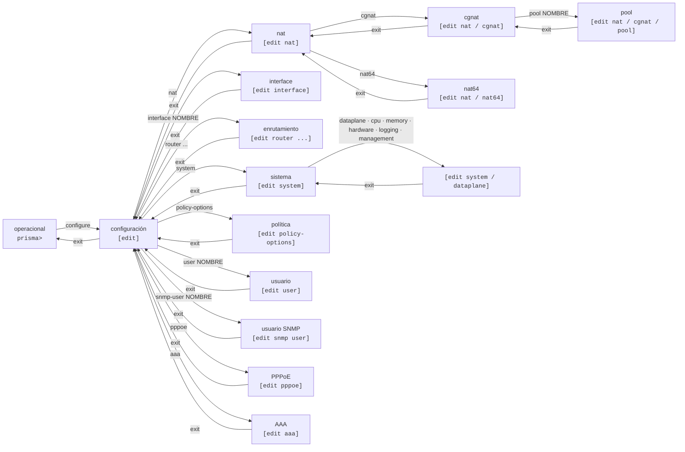

# VTY prismash — guía de uso

`prismash` es la VTY única de Prisma Routing: configura CGNAT **y** enrutamiento desde la misma interfaz, con un modelo de configuración candidata al estilo Juniper — usted edita, revisa y solo entonces aplica con `commit`.



## Modos y prompts

| Modo | Prompt | Cómo entrar | Cómo salir |
|------|--------|-------------|------------|
| Operacional | `prisma> ` | es donde comienza la sesión | `exit` cierra la sesión |
| Configuración | `prisma# [edit] ` | `configure` | `exit`     |
| NAT  | `prisma# [edit nat] ` | `nat`       | `exit`, `up` o `top` |
| CGNAT | `prisma# [edit nat / cgnat] ` | `cgnat`, dentro de `nat` | `exit`, `up` o `top` |
| NAT64 | `prisma# [edit nat / nat64] ` | `nat64`, dentro de `nat` | `exit`, `up` o `top` |
| Pool | `prisma# [edit nat / cgnat / pool residencial] ` | `pool <nombre>`, dentro de `cgnat` — o de `nat64`, con `[edit nat / nat64 / pool <nombre>]` | `exit` vuelve a `cgnat` (o `nat64`); `top` va a la raíz |
| Interface | `prisma# [edit interface enp1s0] ` | `interface <nombre>` | `exit`, `up` o `top` |
| Usuario | `prisma# [edit user joao] ` | `user <nombre>` | `exit`, `up` o `top` |
| Usuario SNMP | `prisma# [edit snmp user nms] ` | `snmp-user <nombre>` | `exit`, `up` o `top` |
| Rutas estáticas | `prisma# [edit router static] ` | `router static` | `exit`, `up` o `top` |
| Bloque de FRR | `prisma# [edit router bgp 65000] ` | `router bgp <AS>`, `router ospf`, `router ospf6`, `router isis <nombre>`, `route-map ...`, `rpki`, `bfd`, `vrf <nombre>` | `exit`, `up` o `top` |
| Sistema | `prisma# [edit system] ` | `system`    | `exit`, `up` o `top` |
| Placa, núcleos, memoria, drivers, log y gestión | `prisma# [edit system / dataplane] ` (el prompt nombra el nivel) | `dataplane`, `cpu`, `memory`, `hardware`, `logging` o `management`, dentro de `system` | `exit` vuelve a `system` |
| Política de enrutamiento | `prisma# [edit policy-options] ` | `policy-options` | `exit`, `up` o `top` |
| PPPoE | `prisma# [edit pppoe] ` | `pppoe`     | `exit`, `up` o `top` |
| AAA  | `prisma# [edit aaa] ` | `aaa`       | `exit`, `up` o `top` |
| RADIUS | `prisma# [edit aaa / radius] ` | `radius`, dentro de `aaa` | `exit` vuelve a `aaa`; `top` va a la raíz |

**El prompt empieza por el nombre del equipo.** En un equipo con el nombre que le da el instalador, o cuyo nombre no se pudo leer, es `prisma`, como en todas las pantallas de esta wiki; después de `hostname borda-01`, la próxima sesión — y la propia sesión que hizo el `commit` — muestra `borda-01> ` y `borda-01# [edit] `. Un nombre de más de 20 caracteres aparece con los 19 primeros y un `~`.

**El prompt nombra el objeto, no solo el tipo de bloque.** `[edit nat / cgnat / pool]` sería el mismo prompt en un equipo con veinte pools: diría que usted está *en* un pool sin decir en cuál, que es justamente la pregunta que usted tiene.

Los bloques anidados aparecen con el más interno al final, separados por `/`, para que se vea qué contiene a qué. Un prompt demasiado largo se trunca por el principio — el final es donde caerá la próxima línea, y es la mitad que vale el espacio.

**Ctrl-C nunca cierra la sesión.** En el prompt, descarta la línea que se estaba escribiendo y muestra un prompt nuevo. Durante un comando, interrumpe el comando y devuelve el prompt. La excepción es mientras se aplica un `commit`, un `rollback` o una carga de configuración: ahí el Ctrl-C se ignora. La pantalla muestra `^C`, y el commit termina y dice lo que hizo, porque una configuración aplicada a medias es peor que una demorada. Para salir, `exit` o Ctrl-D.

`**commit**` **vale en cualquier nivel**, incluso dentro de un pool, de una cuenta y de un usuario SNMP. Después de él usted sigue en el mismo bloque; si la candidata aplicada ya no tiene ese bloque, el equipo lo lleva de vuelta a `[edit]` y lo indica.

## Dónde estoy, y qué ya escribí aquí

```
show this
```

Muestra la configuración de la jerarquía en la que usted está, en la **candidata** — dentro de un pool, el pool; dentro de una interfaz, su bloque completo (direcciones, MTU, VLAN, lado del CGNAT, VRRP y las líneas de enrutamiento); dentro de `system` o de `dataplane`, ese nivel; en la raíz del modo de configuración, la candidata completa.

## Moverse en la jerarquía: `top` y `up`

Dos palabras lo mueven **dentro** del modo de configuración, sin salir de él y sin tocar la candidata:

| Palabra | Qué hace |
|---------|----------|
| `top`   | va a la raíz del modo de configuración, desde cualquier profundidad |
| `up`    | sube un nivel |
| `up <n>` | sube `n` niveles |

```
prisma# [edit] nat
prisma# [edit nat] cgnat
prisma# [edit nat / cgnat] pool residencial
prisma# [edit nat / cgnat / pool residencial] prefix-inside 100.64.0.0/10
prisma# [edit nat / cgnat / pool residencial] top
prisma# [edit] router bgp 65000
prisma# [edit router bgp 65000] address-family ipv4 unicast
prisma# [edit ...r bgp 65000 / address-family ipv4 unicast] up
prisma# [edit router bgp 65000] top
prisma# [edit]
```

**Ninguna de las dos sale del modo de configuración.** La candidata sigue, el modo de configuración sigue, y usted queda donde indicó. Un pool, una interfaz, una cuenta y un bloque de FRR cuentan **un nivel cada uno** — y por eso `up` sirve para todos.

**Subir más niveles de los que existen se rechaza, no se recorta.** Salir de más niveles de los que usted pidió lo deja en un lugar que no escribió, y la próxima declaración cae ahí:

```
prisma# [edit router bgp 65000] up 2
error: up 2: there are only 1 level(s) below the top here
    'top' goes all the way up in one word
```

## Descubrir comandos

Dos herramientas, siempre disponibles:

* **TAB** completa el comando o lista las opciones posibles en el punto en que usted está.
* `**?**` muestra las opciones válidas en ese punto, cada una con su descripción.

Y donde el árbol espera un **nombre**, ambos completan con lo que el equipo realmente tiene:

```
prisma# [edit] interface ?
  enp1s0  interface (up)
  enp2s0  interface (up)
  <interface>, or a name that creates one
```

Debajo de la sugerencia aparece una nota que indica qué nombres **crean** una interfaz: `<padre>.<tag>` crea una subinterfaz VLAN, `loop<n>` un loopback y `ae<n>` un bundle LACP. Cualquier otro nombre que el equipo no tenga se rechaza en el `commit`.

Las interfaces vienen del dataplane, con su estado. El `local0` y el TAP de cada par con Linux quedan fuera de la lista: no son interfaces que se configuren. Los pools, las cuentas y los usuarios SNMP vienen de la **candidata** — por lo tanto completan lo que usted está editando, no solo lo que ya se hizo commit.

Una fuente que no puede responder simplemente no ofrece nada y deja la sugerencia en su lugar: una VTY que se vuelve inútil cuando el dataplane cae es una VTY que no sirve para repararlo.

Ambas son contextuales: dentro de un pool, `?` lista los campos del pool, no los comandos globales.

### Quitar lo que está configurado: `no` + TAB

Después del `no`, el TAB completa **lo que está configurado ahí**, palabra por palabra, y el valor viene completo — quitar es escribir exactamente lo que existe, y es ahí donde la completación más ayuda:

* dentro de una interfaz, `no ipv4 address <TAB>` inserta la dirección que tiene;
* en `router bgp`, `no neighbor <TAB>` ofrece la sesión configurada; `no neighbor X` quita el vecino y todas sus líneas, incluidas las de las address-families (un peer-group que todavía tiene miembros se rechaza, con los miembros nombrados);
* en un pool, `no prefix-outside <TAB>` ofrece su prefijo;
* `no user <TAB>` lista las cuentas.

Lo que el equipo se niega a quitar no se ofrece: un puerto físico, la cuenta `root`, la VRF del backplane, y el `no hostname` nunca lleva el nombre.

### Palabras opcionales y el fin del comando: `<Enter>`

Después de un argumento posicional, las palabras opcionales se completan una a una. En una ruta estática, una vez escrito el next-hop, aparecen `distance`, `tag` y `description` (`d<TAB>` completa); la que ya está en la línea desaparece de la lista; después de la palabra clave viene la sugerencia de su valor (`<1-255>`). Lo mismo vale para BGP (`network`, `aggregate-address`, `maximum-prefix`), OSPF, IS-IS, route-map y para el `logging` del CGNAT.

Cuando el comando ya está completo, el `?` y el TAB doble muestran una línea `<Enter>` — junto con las opcionales, si las hay:

```
prisma# [edit router static] 10.77.0.0/16 next-hop 10.9.9.2 ?
  bfd          optional
  description  optional
  distance     optional
  tag          optional
  <Enter>      the command is complete: Enter runs it
```

El mensaje "(no known options here; the command is passed to FRR)" queda solo para lo que la VTY de verdad no conoce.

### Direcciones

El next-hop de una ruta estática se completa con los vecinos que el dataplane resolvió, los vecinos BGP y los next-hops que otras rutas ya usan — solo los que están en una red de alguna interfaz — además de `blackhole`, `reject` y `Null0`. El `listen-address` de `ssh`, `snmp` y `api` se completa con las direcciones del propio equipo. Donde no hay nada que ofrecer, la sugerencia muestra el formato: `<A.B.C.D/M>`, `<X:X::X:X/M>`, `<A.B.C.D|X:X::X:X>`.

## Abreviaturas

No es necesario escribir la palabra completa. **Cualquier abreviatura que corresponda a una única declaración vale por la declaración completa** — el equipo completa por usted antes de leer la línea:

```
prisma# [edit] interf enp1s0
prisma# [edit interface enp1s0] no shut
prisma# [edit interface enp1s0] descr uplink da transito
prisma# [edit interface enp1s0] mt 9000
```

es exactamente lo mismo que `interface enp1s0`, `no shutdown`, `description uplink da transito` y `mtu 9000`. Las palabras válidas son las mismas que el `?` y el TAB ofrecen en ese punto, así que lo que el equipo acepta y lo que ofrece nunca discrepan.

**Lo que se guarda es siempre la forma completa.** `show this`, `show configuration` y el archivo que graba `save` nunca muestran `no shut`: `mt 9000` aparece como `mtu 9000`, y una interfaz encendida con `no shut` simplemente deja de tener la línea `shutdown` - el equipo solo escribe `shutdown` cuando la interfaz está apagada. La abreviatura existe para sus dedos, no para el archivo.

### Una abreviatura ambigua se rechaza, con los candidatos

```
prisma# [edit interface enp1s0] i 1
error: an ambiguous abbreviation
    'i' begins 4 statements here: ip, ipv4, ipv6, isis
    type enough of one to tell them apart, or '?' to read what each does
```

El equipo no elige por usted. `ipv address 10.0.0.1/24` también se rechaza: son dos familias de direcciones, y adivinar pondría la dirección en la equivocada.

### Lo que **no** se abrevia

* **Nombres que son suyos**, y no del equipo: el nombre de una interfaz, de un pool, de una cuenta. `show interface Te` busca una interfaz llamada `Te`; no se convierte en `show interface terse`.
* **Las declaraciones de FRR** dentro de un bloque de enrutamiento (`router bgp`, `route-map`, `router ospf`). Ahí vale la sintaxis completa de FRR, y esta VTY modela solo una parte de ella — abreviar contra un modelo parcial cambiaría una declaración que el enrutamiento iba a ejecutar por otra. Dentro de `interface`, en cambio, la abreviatura vale: `no shut` es `no shutdown`, y `bandwidth`, `link-detect` y las demás palabras de FRR siguen intactas hacia él.
* **Las declaraciones dentro de un pool, de una cuenta (**`**user**`**) y de un usuario SNMP (**`**snmp-user**`**).** En esos tres bloques la palabra va completa.
* **Un archivo de configuración** editado a mano. El archivo se lee en cada arranque, sin nadie mirando, y una abreviatura ahí se rechaza con la lista de lo que la interfaz entiende. Grabe siempre la palabra completa — es lo que hace `save`.

## El ciclo de trabajo

```
configure                    entra en configuración
  ... ediciones ...          modifican la candidata, no la máquina
show configuration compare   lo que cambiaría
commit check                 valida sin aplicar
commit                       aplica
exit                         vuelve al operacional
save                         graba en disco para sobrevivir al arranque
```

**Nada de lo que usted edita llega al equipo antes del** `**commit**`**.** Editar es seguro; aplicar es el paso consciente.

Y `commit` **no** graba en disco — eso lo hace `save`. Una configuración con commit pero sin guardar desaparece en el próximo arranque. Son dos pasos porque son dos decisiones diferentes: *"que rija ahora"* y *"que siga rigiendo después de reiniciar"*.

## Comandos del modo operacional

| Comando | Qué hace |
|---------|----------|
| `configure` | entra en el modo de configuración |
| `show ...` | muestra información (vea la página de comandos `show`) |
| `start shell` | abre un shell como proceso hijo; `exit` vuelve a la VTY. **Solo administradores** — un shell en este equipo es toda la capacidad de una vez |
| `ping <host>` | envía echo requests y muestra lo que volvió. Acepta `count <n>` y `source <dirección>` |
| `traceroute <host>` | el camino hasta un host, una línea por salto. Acepta `count <n>` (tope de saltos) y `source <dirección>` |
| `mtr <host>` | hace ping a todos los saltos del camino e imprime un reporte. Acepta `count <n>` (ciclos) y `source <dirección>` |
| `monitor interface [<nombre>] [interval <segundos>]` | el tráfico de cada interfaz como gráfico en vivo, hasta `q` (vea la página de comandos `show`) |
| `monitor log [...]` | el registro de eventos del equipo a medida que se escribe, hasta Ctrl-C, con los filtros de `show log` |
| `monitor cgnat logging [...]` | cada evento de bloque que exporta el CGNAT, en palabras, a medida que sale; filtra por `subscriber`, `public`, `event`, `pool`, y `raw` muestra también la forma que va en el cable |
| `test policy <política> [route\|rib] <prefijo>` | pasa una ruta para ese prefijo por los términos de una política de `policy-options` e indica qué término la decide, antes de que la política se aplique en algún lugar; con `route`, una ruta descrita con sus atributos; con `rib`, una ruta que el equipo tiene |
| `clear bgp <vecino> [soft [in\|out]]` | reinicia una sesión BGP; `soft` reaplica la política sin tirar la sesión. Solo administradores |
| `clear ospf process` / `clear ospf neighbor <A.B.C.D>` | rehace el proceso OSPF completo (todas las adyacencias caen juntas) o una adyacencia |
| `clear isis adjacency [<system-id>]` | rehace las adyacencias IS-IS, todas o una |
| `clear interface counters [<interface>]` | pone en cero los contadores de una interfaz, o de todas, en el dataplane. Solo administradores |
| `clear cgnat subscriber <A.B.C.D>` | cierra todas las sesiones de un suscriptor. Su bloque de puertos no vuelve de inmediato: queda reservado por el hold-down y se libera después, con el registro de liberación en el log, como en una expiración. Los operadores de CGNAT también pueden |
| `clear nat64 subscriber <dirección-IPv6>` | lo mismo, para un suscriptor NAT64, por cualquier dirección de su prefijo |
| `clear pppoe session <id>` / `user <nombre>` / `address <A.B.C.D>` / `all` | cierra una sesión PPPoE, las de un usuario, la de una dirección, o todas; los suscriptores vuelven a marcar |
| `clear configuration pending` | renuncia a lo que el arranque dejó esperando una placa que el equipo no tiene, para que `save` vuelva a grabar (vea *commit, rollback y save*) |
| `rollback <0-19>` | carga una revisión con commit en la candidata |
| `save`  | graba en disco la configuración vigente |
| `system upgrade [<versión>]` | sin versión, indica qué versión ejecuta el equipo y cuál es la más nueva publicada, sin cambiar nada; con versión, descarga el paquete, lo rechaza si el `sha256` no coincide y ejecuta la actualización mostrando lo que ella dice. La versión en uso y las anteriores se rechazan. Solo `root` o una cuenta con `operator`, como `system reboot` |
| `system dataplane restart` | detiene y vuelve a levantar el dataplane: **deja de reenviar y descarta el bloque de puertos de todos los suscriptores**. Es lo que lleva a DPDK una placa agregada con el equipo en funcionamiento. Indica lo que cuesta antes de actuar. Solo `root` o una cuenta con `operator`, como `system reboot` |
| `system reboot` | reinicia el equipo. **Solo** `**root**` **o una cuenta con** `**operator**` (el grupo `prisma-operator`, desde la 0.149.26). Ser `administrator` no basta: quien no tiene `operator` es rechazado antes de que ocurra cualquier cosa. Antes de actuar, advierte lo que cuesta: todas las sesiones en este equipo terminan; el dataplane se detiene; **si hay algo vigente que el arranque no repone y no se guardó, eso se pierde en el arranque** (`save` lo conserva; las cuentas, SSH y SNMP quedan en el equipo y no cuentan, así que un appliance recién instalado, sin nada guardado, no recibe la advertencia); **si hay un** `**commit confirmed**` **sin confirmar, el equipo vuelve revertido** (`commit` lo confirma). Los dos últimos se miden en el momento y solo aparecen cuando son verdaderos. Después, el equipo vuelve solo tomando su placa — no hace falta escribir nada en su consola |
| `system shutdown` | apaga el equipo. **Solo** `**root**` **o una cuenta con** `**operator**`, como `system reboot`, y con las mismas advertencias — sesiones, dataplane, lo que no se guardó, lo que no se confirmó. Una diferencia: queda apagado hasta que alguien lo vuelva a encender, y solo entonces vuelve tomando la placa por sí solo |
| `install` | instala Prisma Routing en un disco de esta máquina — **solo existe al ejecutarse desde la ISO** |
| `exit`  | cierra la sesión |

### Alcanzabilidad: `ping`, `traceroute` y `mtr`

La primera pregunta que alguien le hace a un router es si alcanza algo. Los tres responden eso **desde dentro de la VTY**, y **cualquier cuenta puede ejecutarlos**, incluso una cuenta de solo lectura: no cambian nada en el equipo, y quien es llamado para decir si el equipo alcanza un destino no siempre es quien puede configurarlo. Antes de esta versión el único camino era `start shell`, que es solo para administradores y entrega toda la capacidad de una vez para responder una pregunta sobre un paquete.

```
prisma> ping 8.8.8.8
PING 8.8.8.8 (8.8.8.8) 56(84) bytes of data.
64 bytes from 8.8.8.8: icmp_seq=1 ttl=117 time=8.44 ms
...
--- 8.8.8.8 ping statistics ---
5 packets transmitted, 5 received, 0% packet loss, time 4006ms

prisma> traceroute 8.8.8.8 source 200.0.113.10
prisma> mtr 8.8.8.8 count 10
```

**Toda sonda termina sola.** El valor predeterminado son 5 paquetes, el máximo que acepta `count` es 100, y existe un plazo de 300 segundos que interrumpe la herramienta que se cuelgue. Esto es deliberado: una sonda que solo se detiene cuando alguien la interrumpe, escrita en la consola serial de un equipo en el rack por alguien que después se fue, deja esa consola inutilizable hasta que alguien vuelva. Ctrl-C también vuelve al prompt, sin cerrar la sesión.

El `mtr` se ejecuta en **modo reporte**, no en pantalla completa: una pantalla curses en una consola serial a 115200 es ilegible.

**Lo que se rechaza en el prompt:**

| Usted escribió | El equipo dice |
|----------------|----------------|
| `ping`         | `ping: no host`, con la forma de uso |
| `ping 1.1.1.1 count` | `not an option of this statement` — la opción vino sin valor |
| `ping x;rm`    | `not a host` — un nombre es letra, dígito y guion en etiquetas separadas por punto |
| `ping 1.1.1.1 count 0` | `count out of range` — es un entero de 1 a 100 |
| `traceroute 1.1.1.1 source nome` | `not a source address` — el origen es una dirección, no un nombre |
| `mtr ...` en un equipo sin `mtr` | `this box has no mtr`, indicando el paquete que lo trae |

Nada de lo que usted escribe llega a un shell: el equipo arma la lista de argumentos y ejecuta el programa directamente, sin ningún shell en el camino.

## Comandos del modo de configuración

| Comando | Qué hace |
|---------|----------|
| `nat`   | entra en la jerarquía de NAT; dentro de ella, `cgnat` contiene pools, logging, timeouts y la memoria del CGNAT, y `nat64` contiene los pools NAT64 |
| `interface <nombre>` | entra en la configuración de una interfaz, o crea una subinterfaz, un loopback o un bundle LACP |
| `router static` | entra en el bloque de rutas estáticas |
| `router bgp <AS>` / `router ospf [vrf <nombre>]` / `router ospf6` / `router isis <nombre>` | protocolos de enrutamiento (FRR) |
| `rpki`  | validación de origen: las cachés que consulta este equipo |
| `bfd`   | detección de fallas en fracciones de segundo: sesiones y perfiles; quien lo usa dice `bfd` en su propia declaración (un vecino BGP, una ruta estática) |
| `fib-policy bgp\|ospf\|isis\|static <política>` | qué rutas de un protocolo van a la tabla de reenvío, por una `policy-statement` |
| `policy-options` | política de enrutamiento en el formato de Junos: listas de prefijos, comunidades, AS-path y `policy-statement` |
| `ip prefix-list <nombre> ...` / `ipv6 prefix-list <nombre> ...` | una lista de prefijos, en la sintaxis de FRR, para hacer match en route-map |
| `bgp as-path access-list` / `bgp community-list` / `bgp large-community-list` | las listas que consulta una route-map |
| `system` | la máquina: `dataplane` (la placa entregada al dataplane), `cpu` (núcleos por rol), `memory` (memoria por rol), `hardware` (ajustes de los drivers de las placas), `logging` (adónde va el registro de eventos) y `management` (la VRF de gestión) |
| `pppoe` | suscriptores PPPoE: interfaces de acceso, direcciones, límites |
| `aaa`   | autenticación y contabilización: los servidores RADIUS, en `radius` |
| `hostname <nombre>` / `no hostname` | el nombre del equipo: el de Linux, el de FRR y el `sysName` de SNMP — y lo que muestra el prompt |
| `dns server <dirección>` / `no dns server <dirección>` | los resolvedores que consulta el equipo, hasta tres |
| `ssh ...` | daemon SSH |
| `user <nombre>` | una cuenta que puede iniciar sesión |
| `snmp ...` | agente SNMP, de solo lectura por construcción |
| `snmp-user <nombre>` | un usuario SNMPv3 |
| `api ...` | la API de gestión (gRPC, TLS mutuo), desactivada por defecto |
| `commit ...` | aplica la candidata; vale en cualquier nivel |
| `rollback <0-19>` | carga una revisión con commit en la candidata |
| `show ...` | muestra información |
| `ping` / `traceroute` / `mtr <host>` | las mismas sondas del modo operacional, en cualquier nivel |
| `top` / `up [<n>]` | se mueve en la jerarquía sin salir del modo de configuración |
| `replace pattern <regex> with <sustituto> [upto <n>] [\| compare]` | reemplaza una expresión regular en toda la candidata, o solo en el nivel en que usted está; vea más abajo |
| `rename <ruta> <nombre> to <nombre-nuevo>` | renombra un pool, una prefix-list, una route-map, un peer-group o una interfaz creada por la configuración, y todo lo que apunta a él |
| `exit`  | sale del nivel actual; en la raíz, sale del modo de configuración |


:::info
**Algunas declaraciones cambiaron de lugar.** El CGNAT pasó a los niveles `nat` > `cgnat`, en los que se entra (`nat`, `cgnat`, `pool residencial`); las rutas estáticas pasaron a un bloque debajo de `router` (`router static`, con `<prefijo> next-hop <siguiente-salto>` adentro); la placa del dataplane pasó a `system` > `dataplane`; y el lado del CGNAT de una interfaz se escribe en su bloque (`cgnat inside` o `cgnat outside`). Es donde el operador las busca.

La forma de una sola línea del CGNAT (`nat cgnat pool ...`, `cgnat ...`) se rechaza, ya sea escrita o leída de un archivo guardado: después de actualizar, ejecute `save` antes de reiniciar. `dataplane interface` en la raíz se rechaza en el prompt, indicando a dónde se movió; un archivo guardado con él todavía se lee, y el próximo `save` lo reescribe. `interface <nombre> inside` dentro de `cgnat` todavía se acepta, con una nota que indica que aparecerá en el bloque de la interfaz. `ip route ...` en la raíz sigue yendo al enrutamiento. Dentro de `router static`, la única forma es `<prefijo> next-hop ...`: la forma `route ...` dentro del bloque fue retirada, y un archivo guardado que todavía la tenga se rechaza completo.

Un pool NAT64 se escribe en `nat` > `nat64`, al lado de `cgnat`; dentro de `cgnat` se rechaza, ya sea escrito o leído de un archivo guardado, sin cambio automático. `mode dynamic` pasó a ser `mode bpa`: escrito se rechaza con la palabra nueva, y un archivo guardado con la antigua se lee y se vuelve a grabar con la nueva. `radius` dentro de `pppoe` pasó a `aaa` > `radius`: escrito se rechaza indicando a dónde se movió, y un archivo guardado en la forma antigua se lee y se vuelve a grabar.

:::

## Cambiar muchas líneas de una vez: `replace pattern` y `rename`

Las dos palabras de Junos para el cambio que toca muchas líneas — un /30 que cambia, una VLAN renumerada, un pool o una lista que cambia de nombre —, que de otro modo implica borrar y volver a escribir cada línea que lo menciona. Ambas cambian **solo la candidata**: nada llega al equipo antes del `commit`, así que `show configuration compare`, `commit check`, `commit confirmed` y `rollback` funcionan sobre el resultado como sobre líneas escritas.

### `replace pattern`

```
replace pattern <regex> with <sustituto> [upto <n>] [| compare]
```

En la raíz, vale para la candidata completa; dentro de un nivel — `nat` > `cgnat`, un pool, `router bgp 65000`, una interfaz — vale solo para las declaraciones **dentro** de él, nunca para el encabezado del propio nivel. `upto <n>` reemplaza solo las `n` primeras ocurrencias, en el orden en que las muestra `show configuration`. El equipo indica cuántos reemplazos hizo.

`| compare` al final es el ensayo: muestra la diferencia y el veredicto y **no guarda nada**:

```
prisma# [edit] replace pattern "200\.150\.0\.16/30" with 200.150.0.20/30 | compare
--- candidate
+++ after replace
@@ -31,3 +31,3 @@
 ip prefix-list CGN-IN seq 10 permit 100.64.0.0/22 le 32
-ip prefix-list CGN-OUT seq 10 permit 200.150.0.16/30
+ip prefix-list CGN-OUT seq 10 permit 200.150.0.20/30
 !
1 substitution(s) in 1 statement(s)
it passes the checks; nothing staged ('| compare' is a dry run)
```

Sin el `| compare`, el resultado va a la candidata:

```
prisma# [edit nat / cgnat / pool lab] replace pattern 4096 with 2048
1 substitution(s) in 1 statement(s)
staged in the candidate; 'show configuration compare' reviews it
```

La expresión es la de Python, con `\1` en el sustituto. Un patrón con espacio, o con una `|` que no es el pipe, va entre comillas. Tres decisiones, tomadas del lado conservador:

* **Un patrón nunca atraviesa una declaración.** Cada declaración se compara por separado, sin la sangría que la posiciona — `^` es el comienzo de la declaración. Un patrón que coincide con el vacío (`a*`) y un sustituto que divide la declaración en dos se rechazan.
* `**!**` **no entra en el patrón:** en esta VTY comienza un comentario.
* **El nivel no se renombra a sí mismo.** Dentro de `pool lab`, el `replace` no cambia el nombre `lab`; quien renombra es `rename`, que sigue las referencias.

### `rename`

```
rename <ruta> <nombre> to <nombre-nuevo>
```

Renombra el nombre donde se declara **y en todo lugar que apunta a él**. La ruta es relativa al nivel en que usted está, como en Junos: en la raíz, `rename nat cgnat pool lab to lab-a`; dentro de `nat` > `cgnat`, `rename pool lab to lab-a`.

| En la raíz | Lo que sigue |
|------------|--------------|
| `rename nat cgnat pool <nombre> to <nuevo>` / `rename nat nat64 pool ...` | el pool; un nombre único entre `cgnat` y `nat64`, como en el dataplane |
| `rename ip prefix-list <nombre> to <nuevo>` / `rename ipv6 prefix-list ...` | las entradas (con la descripción de cada una), el `prefix-list-inside`/`-outside` de un pool, el `match ip address prefix-list` de una route-map, el `neighbor ... prefix-list` de BGP, el `area ... filter-list prefix` de OSPF |
| `rename route-map <nombre> to <nuevo>` | las entradas y cada `route-map <nombre>` que la usa: BGP, `redistribute`, `ip protocol`, `call` |
| `rename router bgp <AS> peer-group <nombre> to <nuevo>` | la declaración y cada `neighbor` de esa instancia que lo nombra; desde dentro de `router bgp`, `rename peer-group <nombre> to <nuevo>` |
| `rename interface <nombre> to <nuevo>` | una subinterfaz (el padre queda igual), un loopback o un bundle: el bloque, la estrofa de FRR, la ruta estática, el `passive-interface`, el `track` de VRRP |

```
prisma# [edit] rename ip prefix-list CGN-IN to CGN-INSIDE
renamed in 4 place(s)
staged in the candidate; 'show configuration compare' reviews it
```

Lo que queda fuera, por ahora: los nombres de `policy-options` (el compilador deriva de ellos las route-maps `PO-`), VRFs y cuentas. Un puerto físico también — su nombre es el de la placa, no el de la configuración. Renombrar un pool lo **recrea** en el dataplane con el nombre nuevo: el mapeo es el mismo, y las sesiones en curso en él caen, como en cualquier cambio que recrea un pool.

### Qué se rechaza, y cómo

El resultado pasa por las mismas verificaciones que una línea escrita: cada declaración modificada se verifica en su nivel por el propio prompt (FRR incluido, para las líneas de enrutamiento) y después viene el `commit check`. Si algo se rechaza, **nada** queda en la candidata, y el rechazo indica la primera línea que falla y por qué:

```
error: line 34 of the result is refused; nothing staged
    route-map UPSTREAM-OUT allow 10
    not a statement FRR accepts here; nothing staged
    FRR answered: % Unknown command: route-map UPSTREAM-OUT allow 10
    '?' lists what this level takes
```

Un reemplazo que deja una referencia colgada — la lista de un pool renombrada a mano con `replace`, por ejemplo — es rechazado por el `commit check`, que indica qué quedó colgado:

```
error: the result fails the commit check; nothing staged
error: pool 'lab-a': prefix-list-outside CGN-OUT does not exist
    the pool's addresses come from an 'ip prefix-list' with at least one
    permit; write it, or name another
```

El `commit check` solo rechaza por lo que **este** reemplazo causó: si la candidata ya no pasaba antes — un daemon detenido, un pool a medias —, quien lo indica es el `commit`.

`rename` también rechaza un nombre que ya existe, y una línea de enrutamiento que menciona el nombre antiguo en un lugar que la VTY no sabe leer — en lugar de renombrar el resto y dejar esa apuntando a la nada:

```
error: rename: that name is taken; nothing renamed
    'CGN-OUT' is already a prefix-list here, or a name it would collide with
error: rename: a reference this VTY cannot follow; nothing renamed
    distribute-list prefix CGN-INSIDE out
    change that statement by hand first, or take the reference out
```

Por la API nada cambia: `ConfigService.Edit` acepta las dos líneas como el prompt, y `SetConfig` ya recibe la candidata completa.

## Bloques con página propia

Los bloques que tienen muchas declaraciones están documentados aparte, cada uno con la tabla completa de lo que acepta:

| Bloque | Página |
|--------|--------|
| `interface <nombre>` — direcciones, VLAN, VRF, MTU, MAC, lado del CGNAT, VRRP, OSPF e IS-IS en la interfaz, loopbacks, bundles | [Configuración de interfaz](/s/wiki-es/doc/configuracion-de-interfaz-5s5Ar68nsg) |
| `pool <nombre>`, dentro de `nat` > `cgnat` | [Configuración de pool](/s/wiki-es/doc/configuracion-de-pool-Y3cACG9QHA) |
| el nivel `cgnat` — logging, timeouts globales, memoria | [Configuración de CGNAT](/s/wiki-es/doc/configuracion-de-cgnat-WTgNXqphc5) |
| `router bgp`, `rpki` | [Configuración de BGP](/s/wiki-es/doc/configuracion-de-bgp-s4fDtTXgPx) |
| `policy-options` — listas, `policy-statement` y términos, aplicados en BGP, en OSPF e IS-IS y en lo que va a la tabla de reenvío | [Política de enrutamiento (policy-options)](/s/wiki-es/doc/politica-de-enrutamiento-policy-options-QBSNhzhSCN) |
| `router static`, OSPF, IS-IS, route-maps, `ssh`, `user`, `snmp`, `dns` | [Enrutamiento, SSH, usuarios y SNMP](/s/wiki-es/doc/enrutamiento-ssh-usuarios-y-snmp-aAKbYtvEg3) |
| `pppoe` — interfaces de acceso, direcciones, límites, sesiones | [Configuración de PPPoE](/s/wiki-es/doc/configuracion-de-pppoe-vICaYDQz0M) |
| `aaa` > `radius` — servidores RADIUS, failover, Disconnect y CoA | [Configuración de PPPoE](/s/wiki-es/doc/configuracion-de-pppoe-vICaYDQz0M) |

## Un nombre de interfaz que no existe se rechaza

```
error: interface enp2s1: this box has no such interface
    it has: enp1s0, enp2s0
    (a linux_cp pair answers to both its dataplane name and its Linux one)
    the statement would commit and do nothing
```

`interface enp2s1` — un error de tipeo de `enp2s0` — pasaría el commit limpio, aparecería en la configuración vigente y no haría nada. El rechazo sale en el `commit` y en el `commit check`, y **lista lo que el equipo tiene**, porque ya lo sabe: es la misma fuente de donde viene la completación, y quien recibe solo un "no" tiene que ir a buscar.

Vale para **cualquier** bloque `interface` con cualquier declaración adentro — dirección, MTU, descripción, lado del CGNAT, VRRP, una línea de OSPF — y para el `interface <nombre> inside|outside` que el nivel `cgnat` todavía acepta.

Una placa que Linux tiene y el dataplane todavía no tomó recibe otro rechazo, porque el motivo es otro: `the dataplane does not hold this card`. La placa aparece en `show hardware`, y el dataplane solo toma placas cuando inicia — `system reboot` es lo que se la entrega.

Las excepciones son los nombres que **crean** una interfaz: `interface loop<n>`, `interface ae<n>` e `interface <padre>.<tag>`, cuyo padre debe existir. Están en la página de configuración de interfaz.


:::info
Una interfaz de `linux_cp` responde a **más de un nombre** cuando el `linux-name` es otro — el del dataplane (`enp1s0`) y el de Linux (`vppwan0`). Ambos se aceptan, porque ambos son reales y FRR usa el segundo. Una placa sin `linux-name` se llama `enp1s0` en ambos lados.

:::


:::warning
En el arranque es diferente: una placa que el archivo guardado nombra y que el dataplane no tiene **no** tira el archivo. El equipo aplica todo lo que no depende de ella y deja esperando solo lo que depende — el bloque de la placa, las subinterfaces, las líneas de enrutamiento que la nombran —, avisa en la consola y lista lo que quedó afuera en `show configuration pending`. Una línea que la VTY no logra leer, esa sí, hace que el archivo se rechace **completo**: aplicar la mitad de un archivo deja al equipo sosteniendo la mitad de él.

Con el dataplane inalcanzable, la verificación de nombres se **omite, no se reprueba**: una VTY que no puede hacer commit mientras el dataplane está caído es una VTY que no sirve para repararlo.

:::

## Una línea de FRR se verifica en el momento en que se escribe

Dentro de un bloque de enrutamiento, y en la raíz para las líneas que van a FRR, la línea se entrega al propio FRR para su verificación **antes** de ir a la candidata. Una línea que él no acepta se rechaza en el prompt, con su respuesta, y no se guarda nada:

```
prisma# [edit router bgp 65000] netwrk 10.0.0.0/8
error: not a statement FRR accepts here; nothing staged
    FRR answered: % Unknown command: netwrk 10.0.0.0/8
    '?' lists what this level takes
```

Es la gramática completa de FRR, y funciona incluso con el daemon del protocolo detenido. Un bloque que FRR rechaza no se abre. Si no se pudo consultar a FRR, la línea se guarda y el prompt indica que no fue verificada; el `commit` la verifica de nuevo.

## Lo que ofrece el `?`

Dentro de un bloque, solo lo que vale ahí:

```
prisma# [edit interface enp1s0] ?
  cgnat        this interface's side of the CGNAT
  description  what this interface is for
  exit         leave the interface
  ip           routing-protocol settings FRR owns on this interface
  ipv4         IPv4 addressing
  ipv6         IPv6 addressing
  isis         IS-IS settings on this interface
  linux-name   another name for FRR and 'ip' to see this interface by; without one it is its own
  mac-address  the MAC this interface answers to
  mtr          ping every hop of the path, as a report
  mtu          MTU, on both the dataplane interface and its TAP; unset is 1500
  no           remove a statement from this interface
  ping         send echo requests and say what came back
  replace      a regular expression substituted across this level
  show         display information
  shutdown     take the interface administratively down
  top          go to the top of the configuration
  traceroute   the path to a host, one row per hop
  up           go up one level, or <n> levels
  urpf         drop packets whose source does not route back this way
  vlan         VLAN tag, on a sub-interface
  vrf          the routing table this interface's addresses live in; 0 takes the interface back out of one
  vrrp         stand for a service address together with the peer (RFC 5798), on the dataplane interface where the packets are
```

Seis de esas líneas no son declaraciones: `top`, `up`, `ping`, `traceroute`, `mtr` y `replace` son **palabras que tiene todo nivel del modo de configuración**, y aparecen en todos ellos. `rename` aparece solo donde hay algo que renombrar a partir de ahí — en la raíz, en `nat`, en `cgnat` y `nat64`, dentro de `router bgp`. En la raíz del modo de configuración, `top` y `up` quedan fuera de la lista — no hay nivel superior, y el equipo rechaza ambas ahí.

En un puerto, `member`, `lacp` y `load-balance` no aparecen: son declaraciones de un bundle `ae<n>`, y es solo ahí donde el `?` las ofrece.

Los bloques de enrutamiento que modela esta VTY — `router bgp` y su familia de direcciones, `router ospf`, `router ospf6`, `router isis`, `route-map`, `rpki` y `router static` — ofrecen las declaraciones modeladas, con sus argumentos. Un bloque de FRR que ella no modela (`vrf`, `key chain` y otros) ofrece `exit` y las palabras de todo nivel; ahí vale la sintaxis de FRR, verificada por él en el momento en que usted escribe.

Donde el árbol espera un **nombre**, quien responde es el equipo: las interfaces vienen del dataplane con su estado, y los pools, las cuentas, los usuarios SNMP, las prefix-lists, las route-maps, los vecinos y los peer groups vienen de la **candidata** — completan lo que se está editando, no solo lo que ya se hizo commit.

La completación **ignora mayúsculas y minúsculas** e inserta siempre la forma de la máquina: `ENS19` y `Ens19` se completan como `enp2s0`.


:::info
Una fuente que no responde — el dataplane caído, por ejemplo — no ofrece nada y deja la sugerencia `<interface>` en su lugar. Una VTY que queda inutilizable cuando el dataplane cae es una VTY que no sirve para repararlo.

:::

El prompt nombra dónde está usted, incluso en qué pool o en qué interfaz: `[edit interface enp2s0]`. Sin eso, una declaración escrita un bloque después del pretendido cae en la interfaz equivocada, sin advertencia.

# Vea también

* [Primeros pasos](/s/wiki-es/doc/primeros-pasos-1atRsTUyKZ) — la VTY aplicada de principio a fin
* [Configuración de interfaz](/s/wiki-es/doc/configuracion-de-interfaz-5s5Ar68nsg) — direcciones, VLAN, VRF y el resto del bloque de interfaz
* [Configuración de pool](/s/wiki-es/doc/configuracion-de-pool-Y3cACG9QHA) — campo por campo, y cuáles tiran sesiones
* [Configuración de BGP](/s/wiki-es/doc/configuracion-de-bgp-s4fDtTXgPx) — vecinos, peer groups, familias de direcciones, política y RPKI
* [Enrutamiento, SSH, usuarios y SNMP](/s/wiki-es/doc/enrutamiento-ssh-usuarios-y-snmp-aAKbYtvEg3) — rutas estáticas, IGPs, cuentas y el agente SNMP
* [commit, rollback y save](/s/wiki-es/doc/commit-rollback-y-save-6sAWJkXNO3) — aplicar, deshacer y grabar
* [Comandos show](/s/wiki-es/doc/comandos-show-yfCeHVInDX) — todo lo que muestra el equipo
* [Recetas del día a día](/s/wiki-es/doc/recetas-del-dia-a-dia-maiZboGbqY) — tareas listas, sin necesidad de armarlas desde cero
