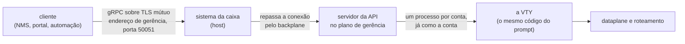

# API de gerência (gRPC) — para quem integra

O que a API de gerência da caixa oferece a um sistema externo — um NMS, um portal, uma automação —, como ela é ligada, quem pode chamar o quê, e como ela se comporta numa atualização. Para quem vai escrever o cliente; a configuração passo a passo do lado da caixa está em [Roteamento, SSH, usuários e SNMP](/s/wiki/doc/roteamento-ssh-usuarios-e-snmp-LoibxwFM5m).

# O que ela é

Uma API gRPC, pacote `prisma.v1`, servida pela própria caixa sobre **TLS mútuo**, só na rede de gerência, **desligada por padrão**.

Ela **não é um segundo sistema de configuração**. Toda chamada de configuração é a VTY trabalhando: o `configure`, as linhas que um operador digitaria, o `commit check`, o `commit`, o `commit confirmed`, o `rollback` e o `save`, executados pelo código da VTY e como a conta que o certificado do cliente nomeia. Por isso:

* uma recusa pela API é a recusa da VTY, com as mesmas palavras;
* uma mudança feita pela API aparece no `show running-config` do prompt, e no histórico de revisões em nome da conta;
* o que a VTY não deixa uma conta fazer, a API também não deixa.

| Uso típico | O que a API dá |
|------------|----------------|
| NMS, painel de NOC | leituras tipadas (interfaces, pools, assinantes, BGP, OSPF, IS-IS, BFD, VRRP, transceivers), um fluxo de contadores e eventos, 24 horas de histórico e o health check padrão do gRPC |
| Portal, interface web | a configuração inteira lida em campos e escrita como linhas da VTY num candidato, com o mesmo `commit` do prompt |
| Automação  | candidato, validação, `commit confirmed` e confirmação; as ações de sistema (reiniciar, atualizar) para uma conta autorizada |



O host escuta no endereço de gerência e entrega cada conexão, sem abri-la, ao servidor que roda no container de gerência. O TLS termina no servidor; o host não vê o conteúdo.

# Ligar na VTY

Três coisas: os certificados no disco da caixa, a conta que o cliente vai ser, e o bloco `api` na configuração.

## O bloco `api`

| Comando | Padrão | O que faz |
|---------|--------|-----------|
| `api enabled yes` | `no`   | serve a API. Sem `listen-address`, o commit recusa |
| `api listen-address <endereço> [<endereço> ...]` | nenhum | o endereço de gerência onde escutar; aceita uma lista, IPv4 e IPv6 juntos, desde a 0.151.8 |
| `api port <1-65535>` | `50051` | a porta TCP |
| `no api enabled` | —      | desliga   |
| `no api listen-address` | —      | tira o endereço |
| `no api port` | —      | volta a 50051 |

```
configure
api enabled yes
api listen-address 192.0.2.10 2001:db8:6::10
commit
```

Ligar sem endereço é recusado no commit:

```
error: api enabled yes needs 'api listen-address <management address>'
```

O `listen-address` completa com `?` os endereços da própria caixa; use os de gerência, porque a API pertence à rede de gerência. Com a gerência numa VRF própria (desde a 0.152.4), a API continua alcançável pelo gateway da gerência.

## Os certificados

Não há token nem senha na API: **a identidade é o certificado do cliente**.

| Arquivo na caixa, em `/etc/prisma-routing/api/` | O que é |
|-----------------------------------------------|---------|
| `server.key`, `server.crt`                    | o certificado da caixa. O nome que o cliente confere precisa estar nele (o `subjectAltName` com o endereço discado, ou o nome que o cliente passa como autoridade) |
| `clients-ca.crt`                              | a CA que assina os certificados de cliente. Só quem apresentar um certificado assinado por ela é atendido |

O servidor não sobe sem os três arquivos, e recusa o handshake de um cliente sem certificado — inclusive para o health check. A chave da CA fica **fora** da caixa. Os comandos `openssl` para gerar a CA, o certificado da caixa e um de cliente estão em [Roteamento, SSH, usuários e SNMP](/s/wiki/doc/roteamento-ssh-usuarios-e-snmp-LoibxwFM5m).

## A conta

O **Common Name (CN)** do certificado do cliente é o nome de uma conta da caixa, e cada chamada roda **como essa conta**: num processo próprio que já assumiu o uid e os grupos dela antes de abrir a VTY. Crie uma conta dedicada para cada sistema que integra (`user <nome>` na VTY), com o papel de que ele precisa e nada mais.

| Situação | O que acontece |
|----------|----------------|
| CN que não é um nome de conta válido, ou mais de um CN | a chamada é recusada com `UNAUTHENTICATED` |
| papel ou `operator` dado ou tirado da conta | vale já na chamada seguinte; um candidato aberto antes da mudança passa a ler como expirado, para nenhum commit rodar com direitos que a conta não tem mais |
| um sistema que deve perder o acesso | a caixa não consulta lista de revogação: o certificado vale enquanto a CA o assinar e não expirar. Para cortar, remova a conta da caixa, ou tire o papel dela para deixá-la só de leitura |

# Papéis: quem pode chamar o quê

Os papéis são os da VTY, sem tradução. A API nunca dá a uma conta algo que a sessão dela na VTY não teria.

| Conta | Grupo do sistema | O que pode pela API |
|-------|------------------|---------------------|
| `role administrator` | `prisma-admin`   | tudo o que se configura: roteamento, CGNAT, interfaces, contas, sistema, PPPoE; os `clear` de interface e de roteamento; encerrar sessões PPPoE |
| `role cgnat-operator` | `prisma-cgnat`   | só a configuração de CGNAT; encerrar as sessões de um assinante do CGNAT |
| sem papel | —                | **só leitura**: todas as leituras, o `Show`, a telemetria, a tabela de rotas, o histórico, o `WhoAmI`. Não abre candidato: o `configure` é recusado, como no prompt |
| `operator` (ao lado de qualquer papel) | `prisma-operator` | além do papel: `Reboot`, `Shutdown`, `RestartDataplane` e `Upgrade`. Nada mais do que é do root |

* Um `administrator` **não** reinicia nem atualiza a caixa só por ser administrador: precisa de `operator`. Uma conta só de leitura de um NOC **pode** ter `operator`.
* Perguntar qual é a versão mais nova publicada (`Upgrade` com a versão vazia) não muda nada, e qualquer conta pode.
* Uma chamada sem o papel volta `PERMISSION_DENIED`, com o mesmo motivo que a VTY daria.
* `SessionService.WhoAmI` responde, sem abrir nada, qual conta o certificado é, o papel (`administrator`, `cgnat-operator` ou `read-only`) e se ela configura, configura o CGNAT e opera (`can_operate`). É a primeira chamada útil de um cliente novo.

# Os serviços

| Serviço | O que alcança |
|---------|---------------|
| `ConfigService` | a configuração: candidato, edição, comparação, validação, commit, confirmação, rollback, save; a configuração lida e escrita em campos; a gramática inteira da VTY |
| `OperationalService` | as leituras tipadas por trás dos `show`, qualquer `show` como texto, os `clear`, o registro de eventos da caixa, `ping`, `traceroute` e `mtr` em fluxo |
| `TelemetryService` | o fluxo de contadores e eventos, 24 horas de histórico, e os registros do CGNAT ao vivo |
| `RouteService` | a tabela de rotas, em campos e paginada, e o resumo por VRF e protocolo |
| `SessionService` | quem o cliente é para a caixa |
| `SystemService` | reiniciar, desligar, reiniciar o dataplane, atualizar |
| `grpc.health.v1.Health` | o health check padrão do gRPC |

## Configuração, com a semântica do commit

A configuração **viaja como o texto da VTY**: um candidato é editado com as linhas que um operador digita, num caminho da hierarquia (por exemplo `nat` > `cgnat` > `pool P` e a linha `block-size 256`), e lido de volta como o texto que o `show running-config` imprime. As operações e as leituras é que são tipadas.

| Chamada | O que a VTY faz |
|---------|-----------------|
| `OpenCandidate` | `configure` (ou a partir de uma revisão) |
| `Edit`  | as linhas, digitadas no caminho dado |
| `ShowCandidate`, `Compare` | o texto do candidato; `show configuration compare` |
| `Check` | `commit check`. Achar problema não é erro: responder isso é o trabalho dela |
| `Commit` | `commit`, com `confirmed <minutos>` e `comment <texto>` opcionais, e o reconhecimento dos avisos que a VTY exige confirmar |
| `Confirm` | o `commit` dentro da janela do `commit confirmed` |
| `GetPendingConfirm` | a janela de confirmação que a caixa mantém: prazo, quem e por quê |
| `Rollback`, `ListRevisions`, `GetRunning` | `rollback <n>` no candidato; as revisões; a configuração em vigor |
| `Save`  | `save`: o que a caixa carrega no próximo boot |
| `GetConfig`, `SetConfig`, `DeleteConfig` | a configuração em campos (interfaces, pools, exportação de registros, rotas estáticas, BGP, OSPF, IS-IS, BFD, sistema, contas, PPPoE...). A escrita vira as linhas da VTY no candidato e devolve quais foram |
| `GetSchema` | a gramática inteira, como o `?` do prompt a conhece, versionada pela versão da caixa e por um digest |
| `ValidateLines` | linhas conferidas pela VTY num candidato descartável: cada uma aceita ou recusada com o motivo. Nada é aplicado |
| `ListCandidates`, `CloseCandidate` | os candidatos abertos da conta, com prazo de expiração; fechar um |

As regras que um cliente precisa respeitar:

* **Um candidato é uma sessão.** Ele vive num processo da conta, como um `configure` na VTY, até ser fechado ou ficar **30 minutos** sem uso. Depois disso a chamada volta `NOT_FOUND` com o motivo "expirado", e o cliente abre outro. O prazo vem nas respostas (`idle_seconds`, `expires_at`); leia, não suponha.
* **O commit não passa por cima de ninguém.** Se a configuração em vigor mudou depois que o candidato foi aberto — outro cliente, um operador no prompt —, o commit é recusado com a diferença e a revisão atual. O cliente abre um candidato novo e aplica as linhas de novo.
* `**commit**` **aplica;** `**save**` **grava para o boot.** Como no prompt. `Reboot` e `Shutdown` são recusados enquanto há algo não salvo ou dentro de uma janela de `commit confirmed`, a menos que o cliente force.
* **Escrita parcial nomeia os campos.** Num `SetConfig`, `fields` diz o que mudar; vazio quer dizer **todos**, então um objeto enviado pela metade apaga o que não foi enviado. Nomeie os campos.
* **Segredos nunca são lidos.** Senhas, chaves, comunidades SNMP e segredos de RADIUS voltam só como "definido ou não"; as linhas devolvidas mascaram o valor, como o `show running-config`.

Uma recusa é um status gRPC — `INVALID_ARGUMENT` para uma linha que a VTY recusa, `FAILED_PRECONDITION` para um commit recusado ou uma base que mudou, `PERMISSION_DENIED` para quem não tem o papel, `NOT_FOUND` para um candidato que não existe, `UNAVAILABLE` quando a caixa não consegue responder — e traz, nos metadados finais `prisma-diagnostics-bin`, a explicação da VTY e um **código de motivo** em que o cliente pode decidir (base desatualizada, permissão, candidato expirado, limite de tamanho, um dos avisos que exigem reconhecimento, gramática, validação, falha ao aplicar). A frase da VTY continua sendo a mensagem para a pessoa.

## Leituras operacionais

Cada leitura tipada usa o mesmo leitor do `show` correspondente, e a maioria traz junto, num campo `text`, a tela exatamente como o terminal a mostra — é a mesma leitura, então os campos e a tela não discordam.

| O que se lê | Exemplos de chamada |
|-------------|---------------------|
| a caixa     | `GetVersion`, `GetSystem` (memória, carga de cada worker, CPUs, por que o dataplane e o roteamento partiram pela última vez), `GetHardware`, `GetTuningAdvice` |
| interfaces  | `ListInterfaces`, `ListBundles`, `ListTransceivers` (temperatura, potência óptica e os limiares do módulo) |
| CGNAT       | `ListPools`, `GetSubscriber`, `LookupTranslation` (quem estava atrás de um endereço público e uma porta), `ListTop`, `GetDrops`, `ListBlocks`, `GetCgnatMemory`, `GetLogging` |
| roteamento  | `ListBgpNeighbors`, `ListOspfNeighbors`, `ListIsisAdjacencies`, `ListBfdSessions`, `ListVrrp`, `ListPolicies`, `TestPolicy` |
| PPPoE       | `ListPppoeSessions`, `GetPppoeSession`, `GetPppoeSummary`, `ListPppoeHistory` |
| o registro de eventos | `ListEvents` (o `show log`, com os mesmos filtros) e `WatchEvents`, ao vivo |
| ações       | `Clear` (contadores, sessões de um assinante, BGP, OSPF, IS-IS, PPPoE); `Ping`, `Traceroute`, `Mtr`, linha a linha enquanto rodam |

`**Show**`**, o repasse.** Qualquer `show`, `ping`, `traceroute` ou `mtr`, com os filtros `| include`, `| exclude` e `| count`, volta como texto. Só leitura: um comando que não começa por uma dessas palavras é recusado com `INVALID_ARGUMENT`. O `monitor` não passa (ele redesenha um terminal, e uma chamada não tem terminal); a visão ao vivo da API é a telemetria. Para um NMS, prefira a chamada tipada quando ela existe: o texto de uma tela pode mudar de uma versão para outra, os campos não.

## Telemetria

| Chamada | O que entrega |
|---------|---------------|
| `Subscribe` | um fluxo, até o cliente cancelar: os contadores das interfaces no intervalo pedido, os totais do CGNAT e um evento a cada commit, com a revisão que ele deixou e o comentário — para o cliente saber quais commits foram dele |
| `GetHistory` | os contadores que o servidor amostrou, um por minuto, nas últimas 24 horas: interfaces (até 256), totais do CGNAT, carga dos workers, memória e, se pedido, cada CPU |
| `WatchLogging` | o `monitor cgnat logging`: cada alocação e liberação de bloco que a caixa exporta, à medida que exporta, e a cada 10 segundos o que cada destino entregou |

Os contadores são os totais do dataplane, como o `show` os mostra: o cliente calcula as diferenças, e um total menor que o anterior é um dataplane que reiniciou.

## A tabela de rotas

`RouteService.ListRoutes` foi feito para a tabela cheia: lê a RIB do FRR em páginas (1000 por padrão, até 5000), filtrando por VRF, família, prefixo e protocolo, de **uma fotografia só** — a tabela mudar no meio da paginação não gera rota repetida nem faltando. A primeira página chega enquanto o resto ainda está sendo lido. Uma fotografia que ninguém pagina por 10 minutos é descartada, e o cliente recomeça. Se o roteamento parar de responder no meio, as rotas lidas são entregues e a chamada seguinte diz `UNAVAILABLE`: uma tabela incompleta nunca é passada como inteira.

# Limites que um cliente encontra

| Limite | Valor | O que fazer |
|--------|-------|-------------|
| uma chamada sem resposta | 300 segundos | volta `UNAVAILABLE`; a próxima chamada é atendida |
| candidato parado | 30 minutos | abrir outro |
| uma chamada por vez em cada processo da conta | cada candidato, as leituras, o `Show` e as rotas têm processos separados | um `ping` longo não atrasa uma leitura de status; dois `Show` da mesma conta rodam um depois do outro |
| `commit confirmed` | 1 a 60 minutos | fora disso, a chamada é recusada |
| a revisão num evento | lida como a conta que assina o fluxo | uma conta que vê menos da configuração (uma só de leitura não vê os pools) lê outro identificador para a mesma configuração |

O contrato só cresce dentro de `prisma.v1`: campos, chamadas e valores são **apenas acrescentados**, com números nunca usados antes; nada é renumerado nem reaproveitado. Um cliente feito para uma versão mais antiga continua funcionando numa caixa mais nova e simplesmente não vê o que não conhece. Uma mudança incompatível seria um pacote `prisma.v2`, servido ao lado do `v1`.


:::info
O contrato — o arquivo `.proto` do pacote `prisma.v1`, mais o `grpc.health.v1` padrão — não é publicado nesta wiki: peça-o junto com a versão que as suas caixas rodam. O servidor não oferece reflexão do gRPC, então ferramentas como o `grpcurl` precisam do arquivo. A gramática da configuração, essa, a própria caixa responde por `GetSchema`.

:::

# Numa atualização e num reinício

| Evento | O que o cliente vê |
|--------|--------------------|
| `system upgrade` (pela VTY ou pela API) | o container de gerência é recriado: a API fica fora por **cerca de um minuto**, e todo fluxo, todo candidato aberto e todo processo de conta terminam. Reconecte e abra de novo |
| `Upgrade` pela API | um fluxo de fases (download com progresso, verificação, instalação) que termina **antes** de a API reiniciar, com quantos segundos ela vai ficar fora. Depois, reconecte e leia `GetVersion`; `GetUpgradeStatus` lê a última execução de volta, qualquer que tenha sido a conexão que a pediu |
| o histórico de 24 horas | sobrevive a um reinício da API e do container (a atualização faz os dois): os gráficos continuam. Um reboot o esvazia, como zera os contadores do dataplane |
| `RestartDataplane` | a resposta vem quando o reinício terminou. Enquanto o dataplane está fora, as leituras que dependem dele respondem `UNAVAILABLE` e o health check marca `OperationalService` e `TelemetryService` como `NOT_SERVING` |
| `Reboot`, `Shutdown` | a resposta vem antes de a caixa cair |


:::warning
`RestartDataplane` para o encaminhamento e descarta o bloco de portas e as sessões de **todos** os assinantes, como o `system dataplane restart` no prompt. Uma automação que chama isso precisa da mesma janela que um operador pediria.

:::

# Health check

É o `grpc.health.v1` padrão, então `grpc_health_probe`, o cliente de health de qualquer biblioteca gRPC ou um balanceador funcionam sem nada específico. Precisa de um certificado de cliente assinado pela CA, mesmo que ele não nomeie uma conta.

| Nome do serviço | `SERVING` quando | `NOT_SERVING` quando |
|-----------------|----------------|--------------------|
| `""` (o servidor), `prisma.v1.ConfigService`, `prisma.v1.RouteService`, `prisma.v1.SessionService`, `prisma.v1.SystemService` | o servidor está no ar | —                  |
| `prisma.v1.OperationalService`, `prisma.v1.TelemetryService` | o dataplane responde às leituras de estatística | o dataplane não responde (parado, reiniciando) |
| `prisma.v1.LogExport` | todo destino de registros configurado está entregando | um destino configurado não entrega nada há 60 segundos, tendo o que enviar |
| `prisma.v1.Configuration` | a configuração salva foi aplicada inteira no boot | parte dela espera uma placa que a caixa não tinha no boot (`GetPendingConfiguration` diz qual) |

Um serviço que a caixa não serve volta `NOT_FOUND`. O destino de registros parado tem nome próprio de propósito: um coletor fora do ar não é uma caixa que não responde, e um cliente que parasse de chamar `OperationalService` deixaria de ler justamente o estado que diz o que está errado.

```
grpc_health_probe -tls -tls-ca-cert ca.crt -tls-client-cert nms.crt \
  -tls-client-key nms.key -tls-server-name prisma-api \
  -addr 192.0.2.10:50051 -service prisma.v1.LogExport
```

# O rastro do que a API fez

* Cada commit fica no histórico de revisões em nome da conta do certificado, e na trilha de auditoria com `via api`.
* O registro de eventos da caixa separa quem agiu: `show log source api` lista o que veio pela API.
* Um commit feito pela API aparece no `show running-config` do prompt no mesmo instante, e no `Subscribe` de todo cliente conectado.

# Ver também

* [Roteamento, SSH, usuários e SNMP](/s/wiki/doc/roteamento-ssh-usuarios-e-snmp-LoibxwFM5m) — ligar a API passo a passo, com os certificados
* [Acesso, login e papéis](/s/wiki/doc/acesso-login-e-papeis-VcE7gIbI1U) — os papéis e o `operator`, que a API herda
* [Commit, rollback e save](/s/wiki/doc/commit-rollback-e-save-jqCB7kxPuA) — o ciclo de configuração que a API percorre
* [Comandos show](/s/wiki/doc/comandos-show-YlNji1X5W4) — as telas que o `Show` repassa, e o `show log`
* [Monitoramento e SNMP](/s/wiki/doc/monitoramento-e-snmp-YGn85RpUAb) — a outra porta de um NMS, somente leitura
* [Levar a caixa para uma versão nova](/s/wiki/doc/levar-a-caixa-para-uma-versao-nova-C09kO2kU8X) — o que uma atualização faz com a caixa
* [O que roda na caixa](/s/wiki/doc/o-que-roda-na-caixa-NjlUyDUlZD) — o container de gerência e o backplane por onde a API passa
