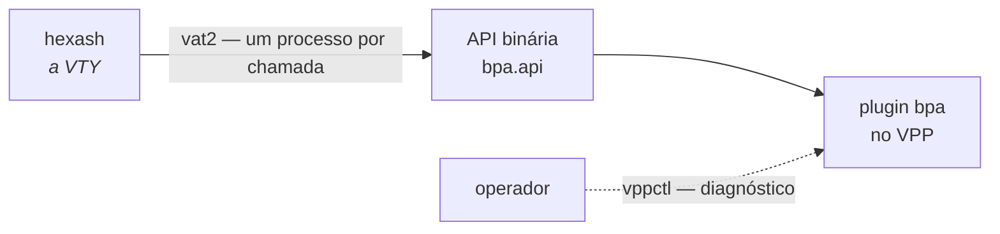

# Dataplane — comandos vppctl e API

Os comandos abaixo são do plugin `bpa` no prompt do VPP (`vppctl`). **Na operação normal você não precisa deles** — a VTY faz tudo e tira as respostas do mesmo lugar. Eles existem para diagnóstico profundo e para entender o que a VTY está mandando.


:::warning
`**vppctl**` **sai com código 0 mesmo quando falha.** Não use o código de retorno dele como evidência de que um comando funcionou. Esse é o motivo pelo qual a VTY fala com o dataplane pela API binária (vat2), que tem código de retorno de verdade.

:::



## Configuração de pool

```
bpa pool <nome> inside <pfx>/<len> [inside <pfx>/<len> ...]
              outside <pfx>/<len> [outside <pfx>/<len> ...]
              [block <n>] [ports <min>-<max>]
              [policy interleaved|blocked]
              [mode deterministic|dynamic]
```

## Interface

```
set interface bpa <in2out|out2in> <interface> [del]
```

`in2out` é o lado interno (assinantes), `out2in` o lado externo (internet).

## Ajustes por pool

| Comando | Uso |
|---------|-----|
| `bpa bypass <pool> <destination\|source> <pfx>/<len> [...]` | prefixos que saem sem tradução |
| `bpa bypass <pool> ... none` | limpa a lista |
| `bpa limits <pool> [max-sessions <n>] [max-session-rate <n>]` | limites por assinante |
| `bpa limits <pool> none` | remove os limites |
| `bpa tcp-mss <pool> <bytes\|auto\|off>` | clamp de MSS |
| `bpa filter <pool> <endpoint-independent\|address-dependent>` | comportamento de filtragem |
| `bpa alg <pool> <ftp\|rtsp\|pptp> <on\|off>` | liga/desliga um ALG |
| `bpa forward <pool> <tcp\|udp> <porta-pública> to <ip-privado> <porta-privada> [check]` | encaminhamento de porta |
| `bpa forward <pool> <tcp\|udp> <porta-pública> del` | remove um encaminhamento |

## Ajustes globais

| Comando | Uso |
|---------|-----|
| `bpa timeouts [udp <s>] [icmp <s>] [tcp-syn <s>] [tcp-transitory <s>] [tcp-established <s>] [gre <s>] [port-holddown <s>] [alg-expect <s>]` | timeouts |
| `bpa block-holddown [<segundos>]` | quanto tempo um bloco fica reservado depois de ocioso |
| `bpa session-table [buckets <n> memory <MB>]` | dimensionamento da tabela de sessões |
| `bpa logging <enable\|disable>` | exportação IPFIX por UDP |
| `bpa logging tcp <coletor> [port <n>]` | exportação por TCP |
| `bpa logging tcp disable` | desliga a exportação TCP |

## Comandos `show`

| Comando | Mostra |
|---------|--------|
| `show bpa pool` | pools configurados |
| `show bpa config` | a configuração corrente do plugin |
| `show bpa subscriber <endereço-interno>` | tudo sobre um assinante |
| `show bpa translation <endereço-público> <porta>` | quem estava atrás daquele par |
| `show bpa top [<n>]` | assinantes mais próximos de esgotar o bloco |
| `show bpa drops` | por que pacotes foram descartados |
| `show bpa session` | sessões ativas |
| `show bpa blocks` | blocos alocados em modo dinâmico |
| `show bpa timeouts` | timeouts em vigor |
| `show bpa alg` | estado dos ALGs |
| `show bpa forward [<pool>]` | encaminhamentos de porta |
| `show bpa urpf` | estado do uRPF |
| `show bpa logging` | estado da exportação IPFIX |

## A API binária

O que a VTY realmente usa. Definida em `src/plugins/bpa/bpa.api`:

| Mensagem | Para quê |
|----------|----------|
| `bpa_pool_add_del` | criar/remover pool |
| `bpa_pool_settings_set` | ajustes do pool aplicados no lugar |
| `bpa_bypass_set` | listas de bypass |
| `bpa_limits_set` | limites por assinante |
| `bpa_forward_add_del` | encaminhamento de porta |
| `bpa_interface_add_del_feature` | habilitar/desabilitar numa interface |
| `bpa_pool_dump` / `bpa_pool_details` | listar pools |

A VTY chama isso por **vat2, um processo por chamada** — não é conexão persistente. Essa decisão tem uma consequência que aparece em outros lugares: como não há conexão à qual amarrar uma identidade, a identidade precisa viajar **dentro de cada mensagem**, e o transporte (memória compartilhada) não carrega credencial de par que o plugin pudesse conferir.

# Ver também

* [VTY hexash — guia de uso](/doc/vty-hexash-guia-de-uso-h6sDAK8Dsh) — a interface que você deve usar no dia a dia
* [Comandos show](/doc/comandos-show-YlNji1X5W4) — as mesmas respostas, pela VTY
