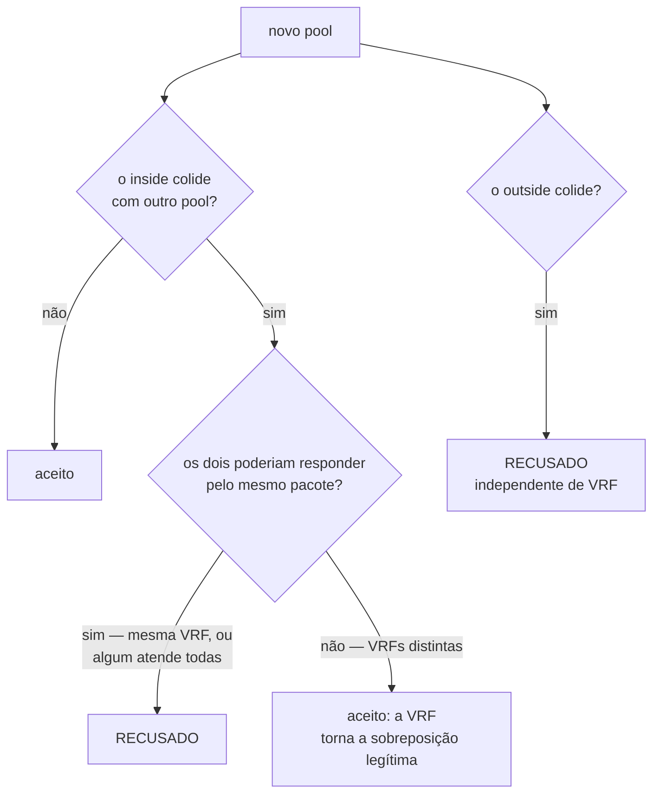

# Multi-tenant com VRF

Como atender dois clientes que usam a **mesma faixa de endereços privados** na mesma caixa. Para quem faz atacado, revenda ou opera CGNAT para mais de um cliente.

# O problema

Um provedor não escolhe quais endereços privados o CPE dos clientes dele entrega. Dois clientes na mesma caixa vão usar `100.64.0.0/22`.

Antes de um pool poder nomear uma VRF, não havia nada que dissesse a qual dos dois um pacote pertencia: a busca devolvia o **primeiro** pool que reivindicasse o endereço. Um cliente era traduzido pelo pool do outro, e o segundo pool não traduzia nada.

# Como resolver

Cada cliente chega por uma interface sua, e essa interface fica na VRF do cliente e do lado de dentro do CGNAT:

```
configure
 interface enp5s0
  vrf 1
  cgnat inside
  exit
 interface enp6s0
  vrf 2
  cgnat inside
  exit
 commit
```

Depois, um pool por cliente, cada um nomeando a VRF que atende:

```
configure
 nat
  cgnat
   pool cliente-a
    prefix-inside 100.64.0.0/22
    prefix-outside 200.150.0.16/30
    vrf 1
    exit
   pool cliente-b
    prefix-inside 100.64.0.0/22
    prefix-outside 200.150.0.32/30
    vrf 2
    exit
   exit
  exit
 commit
```

| Campo | O que define |
|-------|--------------|
| `vrf <n>` | a VRF cujos assinantes este pool atende |
| `outside-vrf <n>` | a VRF por onde o tráfego traduzido sai, quando difere da do assinante |


:::info
**A VRF precisa existir antes do pool que a nomeia.** O dataplane recusa um pool com `vrf` ou `outside-vrf` de uma tabela que ele ainda não tem. Uma VRF passa a existir quando uma interface é colocada nela — por isso a interface vem primeiro, num `commit` próprio.

:::


:::warning
`vrf` é campo de **mapeamento**: mudá-lo reconstrói o pool e derruba todas as sessões dele. Defina na criação, não depois.

:::


:::info
**Ausente, o pool atende todas as VRFs** — que é o que significa toda configuração escrita antes de isso existir, e é uma resposta diferente de `vrf 0`.

:::

# Por onde a resposta volta

A sessão carrega a VRF em que o tráfego do assinante chegou, e a resposta é encaminhada nela.

Sem isso, a resposta seria consultada na FIB da interface por onde chegou — a externa — e numa caixa em que interna e externa são VRFs diferentes ela seria descartada por falta de rota. O sintoma se lê como "o CGNAT não traduziu", quando na verdade foi consulta na tabela errada.

O `outside-vrf` fica guardado **na sessão**, não é lido do pool a cada pacote: a resposta não pode mudar durante a vida de uma sessão.

# Sobreposição é recusada, não resolvida

Dois pools reivindicando o mesmo endereço interno não é algo que o caminho de dados consiga resolver, então é **recusado na criação do pool**, nomeando o pool com que colide.



**A VRF é o que torna uma sobreposição legítima**, então a recusa só se aplica quando os dois pools poderiam responder pelo mesmo pacote: quando pelo menos um atende todas as VRFs, ou quando ambos nomeiam a mesma.

Endereços **públicos** são comparados independentemente de VRF. O caminho de volta encontra o pool pelo endereço público e não tem VRF para separar duas respostas — então dois pools dividindo um endereço público são recusados de saída.

# Como conferir

```
show cgnat pool
```

Cada pool aparece com a linha `vrf` que o separa do outro. Depois, com tráfego dos dois clientes, pegue um endereço público e uma porta de cada pool e pergunte quem estava atrás:

```
show cgnat translation 200.150.0.16 1024
show cgnat translation 200.150.0.32 1024
```

Como endereços públicos nunca são compartilhados entre pools, cada resposta sai do pool certo.


:::info
`show cgnat subscriber <endereço>` recebe só o endereço interno, sem VRF. Com o mesmo endereço em duas VRFs, ele responde por **um** dos pools, não pelos dois — não use essa tela para conferir a separação.

:::


:::success
Dois pools listados, cada um com a sua VRF, e as consultas pelo endereço público de cada pool chegando ao assinante do cliente certo: os clientes estão separados de verdade.

:::

# Ver também

* [Configuração de pool](/s/wiki/doc/configuracao-de-pool-btyS572Ih6) — `vrf` e `outside-vrf` entre os campos de mapeamento
* [Ampliar capacidade sem derrubar assinantes](/s/wiki/doc/ampliar-capacidade-sem-derrubar-assinantes-rWQkaj9r1u) — VRF resolve tenancy, não capacidade
* [Determinístico e BPA — conceitos e mapeamento](/s/wiki/doc/deterministico-e-bpa-conceitos-e-mapeamento-uh9nF6sRaa) — por que o índice do assinante é por pool
