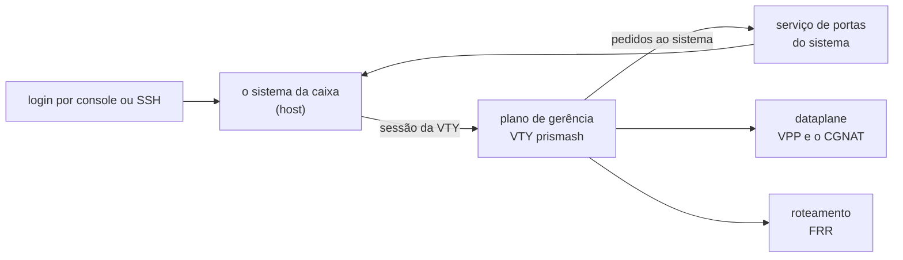

# O que roda na caixa

As partes de uma caixa instalada — os três containers, a rede interna entre eles, o serviço do sistema que executa o que a VTY pede, e o kernel — com o que cada uma guarda e o que divide com o sistema. Para quem precisa saber onde algo está antes de diagnosticar, ou quer entender o que um comando da VTY realmente toca.



# Os containers

Desde a versão 0.117 uma caixa instalada roda o dataplane e o roteamento como containers, e desde a 0.138 a VTY roda num terceiro. Os três são iniciados juntos, a cada boot, pelo serviço `prisma-routing-containers`.

## Dataplane

|     |     |
|-----|-----|
| O que guarda | o VPP, o DPDK e o CGNAT: as placas pegas, os pools, as sessões e os blocos de portas de cada assinante |
| Rede | a do próprio sistema: as placas do dataplane são espelhadas no Linux com o mesmo nome, e o roteamento precisa vê-las |
| O que divide com o sistema | as hugepages, a configuração do dataplane (só leitura), o socket da sua linha de comando e o diretório de logs `/var/log/prisma-routing` |
| Privilégios | não roda privilegiado: recebe só as capacidades que foram medidas como necessárias, e o nó de dispositivo da placa que o boot escolheu |
| Quando para | fecha no log de retenção os blocos que está segurando **antes** de o VPP receber o sinal de parada; o prazo de parada é de 30 segundos |
| Quando desiste | depois de cinco tentativas o container fica parado; a caixa devolve as placas ao Linux e grava o motivo em `/var/log/prisma-routing/why-the-dataplane-stopped`, que sobrevive a um reboot |

## Roteamento (FRR)

|     |     |
|-----|-----|
| O que guarda | os daemons do FRR: BGP, OSPF, IS-IS, rotas estáticas |
| Rede | a do próprio sistema, pelo mesmo motivo: o FRR roteia pelas interfaces que o dataplane espelha no Linux |
| O que divide com o sistema | `/etc/frr`, a configuração de roteamento, e o diretório dos sockets do FRR |
| Reinício | volta sozinho se cair, a menos que alguém o tenha parado |

## Plano de gerência (a VTY)

|     |     |
|-----|-----|
| O que guarda | a VTY `prismash` e os clientes que ela usa para falar com o dataplane e com o FRR. Não roda nenhum daemon |
| Rede | **nenhuma**, além de uma única ligação ao backplane (abaixo), em 128.0.0.2. Não alcança a internet nem a rede de gerência |
| O que divide com o sistema | a configuração da caixa e as suas revisões (`/etc/prisma-routing`), os sockets do dataplane e do FRR, `/var/log/prisma-routing`, e as contas do sistema, **só para leitura** |
| O que lê do sistema | placas, barramento PCI, processadores, memória, rotas e o arquivo de ajuste do dataplane, tudo **só para leitura**. Por isso `show hardware`, `show interface` e `show system cpu` respondem ali o mesmo que no sistema |
| Como você entra | cada login cai ali **como a própria conta**, com o mesmo papel que teria no sistema: uma conta só de leitura continua só de leitura |

`ping`, `traceroute` e `mtr` digitados na VTY saem pelo sistema, não pelo container, porque a rede do container termina no backplane. `install`, `system upgrade` e `system dataplane restart` também rodam no sistema, com a VTY do sistema no seu terminal.

# O backplane: 128.0.0.0/8

Os containers que precisam de rede própria falam com o sistema por uma rede interna, o **backplane**, em 128.0.0.0/8 — o mesmo prefixo que a Juniper usa entre o motor de roteamento e as placas de linha.

|     |     |
|-----|-----|
| Onde fica | na VRF `prisma-bp` (tabela 128), **nunca** na tabela principal |
| O sistema | 128\.0.0.1/8 |
| O plano de gerência | 128\.0.0.2 |
| A tabela 128 termina em | uma rota padrão inalcançável |

**Por que numa VRF.** 128.0.0.0/8 é espaço público de verdade. Na tabela principal, a própria caixa perderia os servidores reais nesse prefixo: medido, um servidor em 128.66.0.10 deixou de responder à caixa. Numa VRF, a caixa e os assinantes continuam alcançando esses endereços normalmente.

**Por que a rota inalcançável.** Sem ela, o que a VRF não sabe responder cai na tabela principal, e pacotes com origem no backplane saem da caixa. Medido: sem a rota, dois pacotes de 128.0.0.2 chegaram ao outro lado; com ela, nenhum.

O autoteste de boot confere o backplane. Quando está certo, diz:

```
  [ ok ] backplane: 128.0.0.0/8 in VRF prisma-bp, out of the main table
```

Quando não está, a linha é um `[FAIL]` que nomeia o vazamento: uma rota pela bridge do backplane na tabela principal, a bridge fora da VRF, ou a tabela sem a rota inalcançável.

# O serviço de portas do sistema

De dentro de um container a VTY não pode — e não deve poder — mexer no sistema. O que ela precisa fazer ali ela **pede** a um serviço do sistema, `prisma-routing-doors`, que executa uma lista fechada de ações e confere cada argumento.

| O que a VTY pede | Comando da VTY que leva a isso |
|------------------|--------------------------------|
| criar, alterar e remover contas, seus papéis e senhas | `user <nome>`, `role`, `password` |
| chaves SSH de uma conta; conferir e recarregar o SSH | `ssh-key` dentro de `user`; `ssh ...` |
| ligar e desligar o SNMP, e os arquivos dele | `snmp ...`, `snmp-user <nome>` |
| resolvedores DNS | `dns server <endereço>`        |
| o lado Linux de uma interface do dataplane: ligar, desligar, MTU, descrição | `interface`, `shutdown`, `mtu`, `description` |
| devolver a rota padrão de gerência depois que uma placa trocou de dono | acontece sozinho               |
| gravar o ajuste de boot depois de mudar `cpu` ou `memory` dentro de `system` | `commit`                       |
| reiniciar e desligar a caixa | `system reboot`, `system shutdown` |

| Regra | O que isso garante |
|-------|--------------------|
| só age para **root** | o serviço lê do kernel quem está pedindo, o que não se falsifica; é a mesma regra que a caixa já tinha antes de o serviço existir |
| não é um jeito de rodar comando | um nome de conta nunca é lido como opção ou caminho, `root` é recusado onde a VTY nunca o envia, e os arquivos vão só para um conjunto fixo de caminhos |
| cada pedido é uma linha no journal | com o comando, quem pediu e o resultado — **nunca** a senha, cujo hash passa por ali |
| sem o serviço no ar | a VTY executa o comando ela mesma, então a caixa continua funcionando enquanto o serviço reinicia |

Para ler o que foi pedido, num shell do sistema:

```
journalctl -u prisma-routing-doors
```

# `start shell`

|     |     |
|-----|-----|
| Onde cai | **no sistema**, nunca dentro de um container. Quem abre o shell é o processo que segura o seu terminal, não a VTY |
| Quem pode | `root` e contas do grupo `prisma-admin`. A VTY confere o papel, e o sistema confere de novo pelos próprios grupos antes de abrir; qualquer outra conta é recusada pelo nome do papel |
| Como volta | `exit` no shell volta para a VTY, com a configuração candidata intacta |

# Quando o plano de gerência não está no ar

Uma caixa cujo container de gerência caiu **continua acessível**: o login cai na VTY do próprio sistema, como antes da versão 0.138. O mesmo acontece quando o serviço de portas não está rodando.

| Situação | Onde o login cai |
|----------|------------------|
| normal   | na VTY do container de gerência, como a própria conta |
| container de gerência parado, ou serviço de portas fora do ar | na VTY do sistema |
| o arquivo `/etc/prisma-routing/vty-on-host` existe | na VTY do sistema, sempre |

Para pôr os logins de uma caixa de volta na VTY do sistema, num shell do sistema:

```
touch /etc/prisma-routing/vty-on-host
```

Apagar o arquivo devolve os logins ao container de gerência no login seguinte.

# Voltar às unidades do systemd

Os containers substituem as unidades `vpp.service` e `frr.service`, que continuam instaladas: as três não podem rodar juntas, porque usam as mesmas placas, as mesmas hugepages e os mesmos sockets. O caminho de volta são dois comandos, num shell do sistema:

```
systemctl disable --now prisma-routing-containers.service
systemctl enable --now vpp.service frr.service
```

Uma caixa de volta às unidades continua respondendo pela placa que o dataplane segura, a configuração salva continua sendo aplicada no boot, e o autoteste deixa de falar em container.


:::warning
Os dois comandos param o dataplane: o encaminhamento para e o bloco de portas e as sessões de todos os assinantes são descartados. Faça numa janela.

:::

# O kernel

O kernel da caixa é **o do Debian, recompilado pelo Prisma Routing**: o mesmo código-fonte, com os patches e a configuração do Debian. Muda o nome e saem os módulos que um roteador não usa.

|     |     |
|-----|-----|
| Base | o pacote-fonte `linux` do Debian 12 (6.1.187 na versão atual) |
| Como aparece | `uname -r` termina em `-prisma` |
| O que fica de fora | som, Wi-Fi, Bluetooth, NFC, captura de vídeo e TV, joysticks, mesas digitalizadoras, telas de toque, radioamador, CAN, 802.15.4, modems celulares, FireWire, sensores industriais, placas de vídeo dedicadas AMD e NVIDIA, e os drivers em estágio experimental |
| O que **sempre** fica | todo driver de placa de rede, de armazenamento, virtio, vfio, uio, InfiniBand/RDMA e de hipervisor. A compilação se recusa a terminar se faltar qualquer módulo desses que o Debian traz |

Para ler a versão, num shell do sistema:

```
uname -r
```

A resposta é a versão do kernel seguida de `-prisma`, por exemplo `6.1.187-prisma`.


:::info
**Um kernel novo só chega com uma instalação nova.** O pacote de atualização (`system upgrade`) não traz kernel: a caixa atualizada continua com o kernel da mídia de onde foi instalada. As correções de segurança do kernel do Debian chegam quando uma mídia nova as traz, e a própria liberação de uma versão é recusada se o kernel dela já foi substituído pelo Debian. O `apt` não traz o kernel do Debian de volta ao lado deste.

:::

# Ver também

* [Acesso, login e papéis](/s/wiki/doc/acesso-login-e-papeis-VcE7gIbI1U) — onde cada conta cai e o que cada papel alcança
* [Roteamento, SSH, usuários e SNMP](/s/wiki/doc/roteamento-ssh-usuarios-e-snmp-LoibxwFM5m) — os comandos que o serviço de portas executa
* [Instalação da appliance](/s/wiki/doc/instalacao-da-appliance-06NmxvBDb5) — a mídia que traz o kernel
* [Levar a caixa para uma versão nova](/s/wiki/doc/levar-a-caixa-para-uma-versao-nova-C09kO2kU8X) — o que o pacote de atualização traz e o que não traz
* [Operação e diagnóstico](/s/wiki/doc/operacao-e-diagnostico-A4fcKDVwZt) — o autoteste de boot
