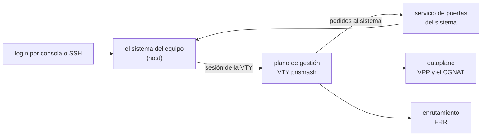

# Qué se ejecuta en el equipo

Las partes de un equipo instalado (los tres contenedores, la red interna entre ellos, el servicio del sistema que ejecuta lo que pide la VTY, y el kernel), con lo que cada una almacena y lo que comparte con el sistema. Para quien necesita saber dónde está algo antes de diagnosticar, o quiere entender qué toca realmente un comando de la VTY.



# Los contenedores

Desde la versión 0.117 un equipo instalado ejecuta el dataplane y el enrutamiento como contenedores, y desde la 0.138 la VTY se ejecuta en un tercero. Los tres se inician juntos, en cada arranque, mediante el servicio `prisma-routing-containers`.

## Dataplane

|     |     |
|-----|-----|
| Qué almacena | VPP, DPDK y el CGNAT: las placas tomadas, los pools, las sesiones y los bloques de puertos de cada suscriptor |
| Red | la del propio sistema: las placas del dataplane se reflejan en Linux con el mismo nombre, y el enrutamiento necesita verlas |
| Qué comparte con el sistema | las hugepages, la configuración del dataplane (solo lectura), el socket de su línea de comandos y el directorio de logs `/var/log/prisma-routing` |
| Privilegios | no se ejecuta como privilegiado: recibe solo las capacidades que se midieron como necesarias, y el nodo de dispositivo de la placa que eligió el arranque |
| Cuando se detiene | cierra en el log de retención los bloques que está reteniendo **antes** de que VPP reciba la señal de parada; el plazo de parada es de 30 segundos |
| Cuando desiste | después de cinco intentos el contenedor queda detenido; el equipo devuelve las placas a Linux y graba el motivo en `/var/log/prisma-routing/why-the-dataplane-stopped`, que sobrevive a un reboot |

## Enrutamiento (FRR)

|     |     |
|-----|-----|
| Qué almacena | los daemons de FRR: BGP, OSPF, IS-IS, rutas estáticas |
| Red | la del propio sistema, por el mismo motivo: FRR enruta por las interfaces que el dataplane refleja en Linux |
| Qué comparte con el sistema | `/etc/frr`, la configuración de enrutamiento, y el directorio de los sockets de FRR |
| Reinicio | vuelve solo si se cae, a menos que alguien lo haya detenido |

## Plano de gestión (la VTY)

|     |     |
|-----|-----|
| Qué almacena | la VTY `prismash` y los clientes que usa para hablar con el dataplane y con FRR. No ejecuta ningún daemon |
| Red | **ninguna**, además de un único enlace al backplane (abajo), en 128.0.0.2. No alcanza internet ni la red de gestión |
| Qué comparte con el sistema | la configuración del equipo y sus revisiones (`/etc/prisma-routing`), los sockets del dataplane y de FRR, `/var/log/prisma-routing`, y las cuentas del sistema, **solo para lectura** |
| Qué lee del sistema | placas, bus PCI, procesadores, memoria, rutas y el archivo de ajuste del dataplane, todo **solo para lectura**. Por eso `show hardware`, `show interface` y `show system cpu` responden allí lo mismo que en el sistema |
| Cómo entra usted | cada login llega allí **como la propia cuenta**, con el mismo rol que tendría en el sistema: una cuenta de solo lectura sigue siendo de solo lectura |

`ping`, `traceroute` y `mtr` escritos en la VTY salen por el sistema, no por el contenedor, porque la red del contenedor termina en el backplane. `install`, `system upgrade` y `system dataplane restart` también se ejecutan en el sistema, con la VTY del sistema en su terminal.

# El backplane: 128.0.0.0/8

Los contenedores que necesitan red propia hablan con el sistema por una red interna, el **backplane**, en 128.0.0.0/8, el mismo prefijo que Juniper usa entre el motor de enrutamiento y las placas de línea.

|     |     |
|-----|-----|
| Dónde está | en la VRF `prisma-bp` (tabla 128), **nunca** en la tabla principal |
| El sistema | 128\.0.0.1/8 |
| El plano de gestión | 128\.0.0.2 |
| La tabla 128 termina en | una ruta predeterminada inalcanzable |

**Por qué en una VRF.** 128.0.0.0/8 es espacio público real. En la tabla principal, el propio equipo perdería los servidores reales en ese prefijo: medido, un servidor en 128.66.0.10 dejó de responderle al equipo. En una VRF, el equipo y los suscriptores siguen alcanzando esas direcciones normalmente.

**Por qué la ruta inalcanzable.** Sin ella, lo que la VRF no sabe responder cae en la tabla principal, y los paquetes con origen en el backplane salen del equipo. Medido: sin la ruta, dos paquetes de 128.0.0.2 llegaron al otro lado; con ella, ninguno.

El autotest de arranque verifica el backplane. Cuando está correcto, dice:

```
  [ ok ] backplane: 128.0.0.0/8 in VRF prisma-bp, out of the main table
```

Cuando no lo está, la línea es un `[FAIL]` que nombra la fuga: una ruta por el bridge del backplane en la tabla principal, el bridge fuera de la VRF, o la tabla sin la ruta inalcanzable.

# El servicio de puertas del sistema

Desde dentro de un contenedor la VTY no puede (ni debe poder) modificar el sistema. Lo que necesita hacer allí lo **pide** a un servicio del sistema, `prisma-routing-doors`, que ejecuta una lista cerrada de acciones y verifica cada argumento.

| Qué pide la VTY | Comando de la VTY que lo origina |
|-----------------|----------------------------------|
| crear, modificar y eliminar cuentas, sus roles y contraseñas | `user <nombre>`, `role`, `password` |
| claves SSH de una cuenta; verificar y recargar SSH | `ssh-key` dentro de `user`; `ssh ...` |
| activar y desactivar SNMP, y sus archivos | `snmp ...`, `snmp-user <nombre>` |
| resolvedores DNS | `dns server <dirección>`         |
| el lado Linux de una interfaz del dataplane: activar, desactivar, MTU, descripción | `interface`, `shutdown`, `mtu`, `description` |
| devolver la ruta predeterminada de gestión después de que una placa cambió de dueño | sucede solo                      |
| grabar el ajuste de arranque después de cambiar `cpu` o `memory` dentro de `system` | `commit`                         |
| reiniciar y apagar el equipo | `system reboot`, `system shutdown` |

| Regla | Qué garantiza |
|-------|---------------|
| solo actúa para **root** | el servicio lee del kernel quién lo pide, lo que no se puede falsificar; es la misma regla que el equipo ya tenía antes de que existiera el servicio |
| no es una forma de ejecutar comandos | un nombre de cuenta nunca se lee como opción o ruta, `root` se rechaza donde la VTY nunca lo envía, y los archivos van solo a un conjunto fijo de rutas |
| cada pedido es una línea en el journal | con el comando, quién lo pidió y el resultado; **nunca** la contraseña, cuyo hash pasa por allí |
| sin el servicio activo | la VTY ejecuta el comando por sí misma, así que el equipo sigue funcionando mientras el servicio se reinicia |

Para leer lo que se pidió, en un shell del sistema:

```
journalctl -u prisma-routing-doors
```

# `start shell`

|     |     |
|-----|-----|
| Dónde llega | **al sistema**, nunca dentro de un contenedor. Quien abre el shell es el proceso que sostiene su terminal, no la VTY |
| Quién puede | `root` y las cuentas del grupo `prisma-admin`. La VTY verifica el rol, y el sistema vuelve a verificarlo por sus propios grupos antes de abrir; cualquier otra cuenta se rechaza por el nombre del rol |
| Cómo se vuelve | `exit` en el shell vuelve a la VTY, con la configuración candidata intacta |

# Cuando el plano de gestión no está activo

Un equipo cuyo contenedor de gestión se cayó **sigue siendo accesible**: el login llega a la VTY del propio sistema, como antes de la versión 0.138. Lo mismo sucede cuando el servicio de puertas no está en ejecución.

| Situación | Adónde llega el login |
|-----------|-----------------------|
| normal    | a la VTY del contenedor de gestión, como la propia cuenta |
| contenedor de gestión detenido, o servicio de puertas inactivo | a la VTY del sistema  |
| existe el archivo `/etc/prisma-routing/vty-on-host` | a la VTY del sistema, siempre |

Para devolver los logins de un equipo a la VTY del sistema, en un shell del sistema:

```
touch /etc/prisma-routing/vty-on-host
```

Borrar el archivo devuelve los logins al contenedor de gestión en el login siguiente.

# Volver a las unidades de systemd

Los contenedores reemplazan las unidades `vpp.service` y `frr.service`, que siguen instaladas: las tres no pueden ejecutarse juntas, porque usan las mismas placas, las mismas hugepages y los mismos sockets. El camino de vuelta son dos comandos, en un shell del sistema:

```
systemctl disable --now prisma-routing-containers.service
systemctl enable --now vpp.service frr.service
```

Un equipo de vuelta en las unidades sigue respondiendo por la placa que retiene el dataplane, la configuración guardada se sigue aplicando en el arranque, y el autotest deja de hablar de contenedores.


:::warning
Los dos comandos detienen el dataplane: el reenvío se detiene y se descartan el bloque de puertos y las sesiones de todos los suscriptores. Hágalo en una ventana.

:::

# El kernel

El kernel del equipo es **el de Debian, recompilado por Prisma Routing**: el mismo código fuente, con los parches y la configuración de Debian. Cambia el nombre y se quitan los módulos que un router no usa.

|     |     |
|-----|-----|
| Base | el paquete fuente `linux` de Debian 12 (6.1.187 en la versión actual) |
| Cómo aparece | `uname -r` termina en `-prisma` |
| Qué queda fuera | sonido, Wi-Fi, Bluetooth, NFC, captura de video y TV, joysticks, tabletas digitalizadoras, pantallas táctiles, radioaficionados, CAN, 802.15.4, módems celulares, FireWire, sensores industriales, tarjetas de video dedicadas AMD y NVIDIA, y los drivers en etapa experimental |
| Qué queda **siempre** | todo driver de placa de red, de almacenamiento, virtio, vfio, uio, InfiniBand/RDMA y de hipervisor. La compilación se niega a terminar si falta cualquiera de esos módulos que trae Debian |

Para leer la versión, en un shell del sistema:

```
uname -r
```

La respuesta es la versión del kernel seguida de `-prisma`, por ejemplo `6.1.187-prisma`.


:::info
**Un kernel nuevo solo llega con una instalación nueva.** El paquete de actualización (`system upgrade`) no trae kernel: el equipo actualizado sigue con el kernel del medio de instalación desde el que se instaló. Las correcciones de seguridad del kernel de Debian llegan cuando un medio nuevo las trae, y la propia liberación de una versión se rechaza si su kernel ya fue reemplazado por Debian. `apt` no vuelve a traer el kernel de Debian junto a este.

:::

# Vea también

* [Acceso, login y roles](/s/wiki-es/doc/acceso-login-y-roles-ZiA9s69LH4): adónde llega cada cuenta y qué alcanza cada rol
* [Enrutamiento, SSH, usuarios y SNMP](/s/wiki-es/doc/enrutamiento-ssh-usuarios-y-snmp-aAKbYtvEg3): los comandos que ejecuta el servicio de puertas
* [Instalación del appliance](/s/wiki-es/doc/instalacion-del-appliance-MgWUcARKzM): el medio que trae el kernel
* [Llevar el equipo a una versión nueva](/s/wiki-es/doc/llevar-el-equipo-a-una-version-nueva-m1PIajBXEF): qué trae y qué no trae el paquete de actualización
* [Operación y diagnóstico](/s/wiki-es/doc/operacion-y-diagnostico-iHMcBJQ91I): el autotest de arranque
