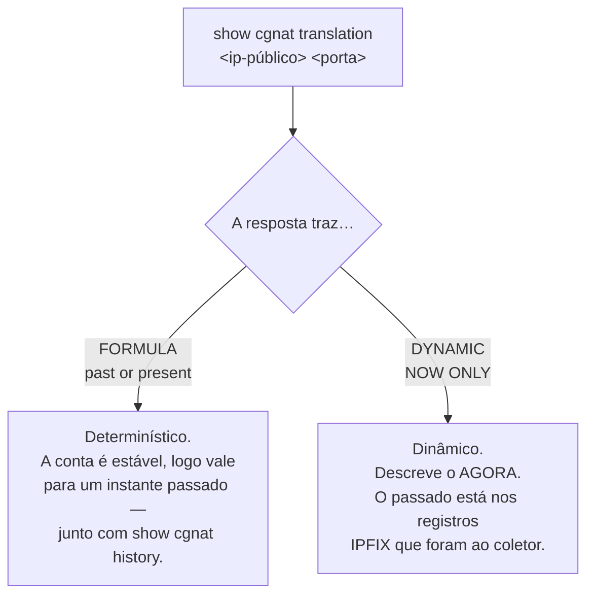

# Comandos show

# Comandos show

# Comandos show

Os comandos `show` funcionam nos modos operacional **e** de configuração.

## `show cgnat`

As quatro primeiras respondem a pergunta de um operador em vez de reportar um contador. Todas tiram a resposta do **dataplane**, então funcionam pela VTY tão bem quanto pelo `vppctl` — um operador que precisa descer para a CLI do dataplane para diagnosticar é um operador para quem esta VTY é decoração.

| Comando | Argumento | Responde |
|---------|-----------|----------|
| `show cgnat subscriber` | `<endereço-interno>` | tudo sobre um assinante |
| `show cgnat translation` | `<endereço-público> <porta>` | quem estava atrás de um endereço público e porta |
| `show cgnat top` | `[<n>]`   | assinantes mais próximos de esgotar seus blocos |
| `show cgnat drops` |           | por que pacotes não passaram |
| `show cgnat pool` |           | pools de CGNAT configurados |
| `show cgnat session` |           | sessões ativas por thread |
| `show cgnat blocks` |           | blocos alocados em modo dinâmico |
| `show cgnat logging` |           | estado da exportação IPFIX |
| `show cgnat history` |           | trilha datada de configuração |

`show cgnat translation` é o comando que responde uma ordem judicial: dado um IP público, uma porta e um instante, quem era o assinante.

`show cgnat history` é o outro lado disso no modo determinístico — qual configuração estava em vigor naquela data, e quem a colocou lá.

## `show route` — a tabela que encaminha

| Comando | Mostra |
|---------|--------|
| `show route` | a tabela de encaminhamento do VPP: o que esta caixa realmente faz com um pacote |
| `show route verbose` | a FIB do VPP e a RIB do FRR lado a lado, **marcando onde discordam** |
| `show route <prefixo>` | o mesmo, para um destino |

```
hexarouting> show route
  Destination          Next hop          Interface      Kind
  0.0.0.0/0            200.150.0.1       TenGig0/8/0    forward
  200.150.0.0/24       connected         TenGig0/8/0    connected

  2 entries carrying traffic
```


:::warning
`show ip route` responde pela tabela do **FRR**, não pela que encaminha. Numa caixa que está descartando o tráfego, a rota aparece presente e correta ali.

Quando o tráfego não passa e a rota parece certa, `show route verbose` é o comando: ele compara as duas tabelas e diz qual prefixo está numa e não na outra.

:::

## `show interface` — as do dataplane

```
hexarouting> show interface
  Interface                  State  MTU    Address             Linux
  GigabitEthernet0/12/0      up     9000   203.0.113.1/24      tap0
  TenGigabitEthernet0/8/0    up     1500   -                   -
  local0                     down   0      -                   -
```

Responde pelo **dataplane**, com estado, MTU, endereços e o par do `linux_cp`. Esse último porque é o nome que o FRR e o `ip` usam, e quem transita entre as duas ferramentas precisa dos dois lado a lado.


:::warning
Este comando já foi repassado ao `vtysh`, que enxerga apenas o que o `linux_cp` espelhou. Numa caixa com uma `GigabitEthernet0/12/0` configurada, a resposta era `lo` — a lista sem as interfaces que carregam o tráfego.

É a mesma armadilha do `show ip route`: a pergunta respondida pelo lado errado.

:::

`local0` é o loopback interno do VPP. Aparece na lista — esconder o que o dataplane reporta seria o comando decidindo o que você pode ver — mas não é oferecido na completação, porque não configura nada.

Pedir `description` diz por que não existe essa coluna, em vez de deixar alguém procurando uma que nunca vem. A visão do FRR continua em `show ip interface`.

## `show this` — o que há na hierarquia em que estou

Dentro de um bloco de configuração, mostra o que aquele bloco tem e nada acima dele:

```
hexarouting# [edit cgnat pool residential] show this
cgnat pool residential
 inside 100.64.0.0/22
 outside 200.150.0.16/30
 block-size 512
 tcp-mss 1400
 exit
```

Mostra a **candidata**, não a configuração em vigor: quem está no meio de uma edição pergunta sobre o que está construindo.

O prompt nomeia onde você está, inclusive qual pool ou qual interface — `[edit interface TenGigabitEthernet0/8/0]` — para que a próxima declaração não caia no bloco errado.

## `show` — restante

| Comando | Mostra |
|---------|--------|
| `show configuration` | a configuração candidata |
| `show configuration compare` | diferenças da candidata contra a configuração em vigor |
| `show running-config` | a configuração em efeito, CGNAT e roteamento |
| `show rollback` | revisões commitadas disponíveis |
| `show version` | versões do HexaRouting, do VPP e do FRR |
| `show ip ...` | informação de IP (repassado ao FRR) |
| `show bgp ...` | informação de BGP (FRR) |
| `show isis ...` | informação de IS-IS (FRR) |
| `show interface` | interfaces (FRR) |
| `show logging` | log do sistema (FRR) |

Os `show` de roteamento são repassados ao `vtysh` do FRR, então a sintaxe completa do FRR vale depois da primeira palavra.

## O que olhar primeiro

| Sintoma | Comando |
|---------|---------|
| "assinante sem internet" | `show cgnat subscriber <ip-interno>` |
| "pacotes sumindo" | `show cgnat drops` |
| "a rota está lá e o tráfego não passa" | `show route verbose` |
| "de quem era esse IP:porta?" | `show cgnat translation <ip> <porta>` |
| "o pool vai encher?" | `show cgnat top` |
| "o coletor está recebendo?" | `show cgnat logging` |
| "o que mudou aqui?" | `show cgnat history` |
| "o que eu estou prestes a aplicar?" | `show configuration compare` |

## Como ler a resposta de `show cgnat translation`

Este é o comando que responde uma ordem judicial, e a resposta dele **diz quanto vale como prova**. Não são a mesma coisa:



Uma resposta dinâmica **nunca** afirma `FORMULA`. Essa recusa é deliberada: tratar uma alocação sob demanda como se fosse aritmética estável seria apresentar como prova algo que não sustenta a afirmação.

## O que cada resposta traz

| Comando | Na resposta você encontra |
|---------|---------------------------|
| `show cgnat subscriber <ip>` | o endereço público, a faixa de portas e `sessions N` |
| `show cgnat subscriber` de um IP fora dos pools | `not inside any configured pool` — é resposta, não erro |
| `show cgnat translation` | o assinante, mais `FORMULA`/`past or present` ou `DYNAMIC`/`NOW ONLY` |
| `show cgnat top` | os assinantes mais carregados, com as portas que seguram (ex.: `3/512`) |
| `show cgnat drops` | seção *packets that did not get through* com o motivo, por exemplo `no pool for source address` |


:::info
`**show cgnat drops**` **não mistura sucesso com falha.** Pacotes traduzidos aparecem sob o próprio cabeçalho, fora da seção de descartes. O VPP conta as duas coisas como se fossem iguais; durante um incidente elas não são.

:::

# Ver também

* [Operação e diagnóstico](/doc/operacao-e-diagnostico-A4fcKDVwZt) — estes comandos aplicados a um problema real
* [Logging IPFIX e trilha de auditoria](/doc/logging-ipfix-e-trilha-de-auditoria-lREEjJu1Bq) — o que responde pelo passado
