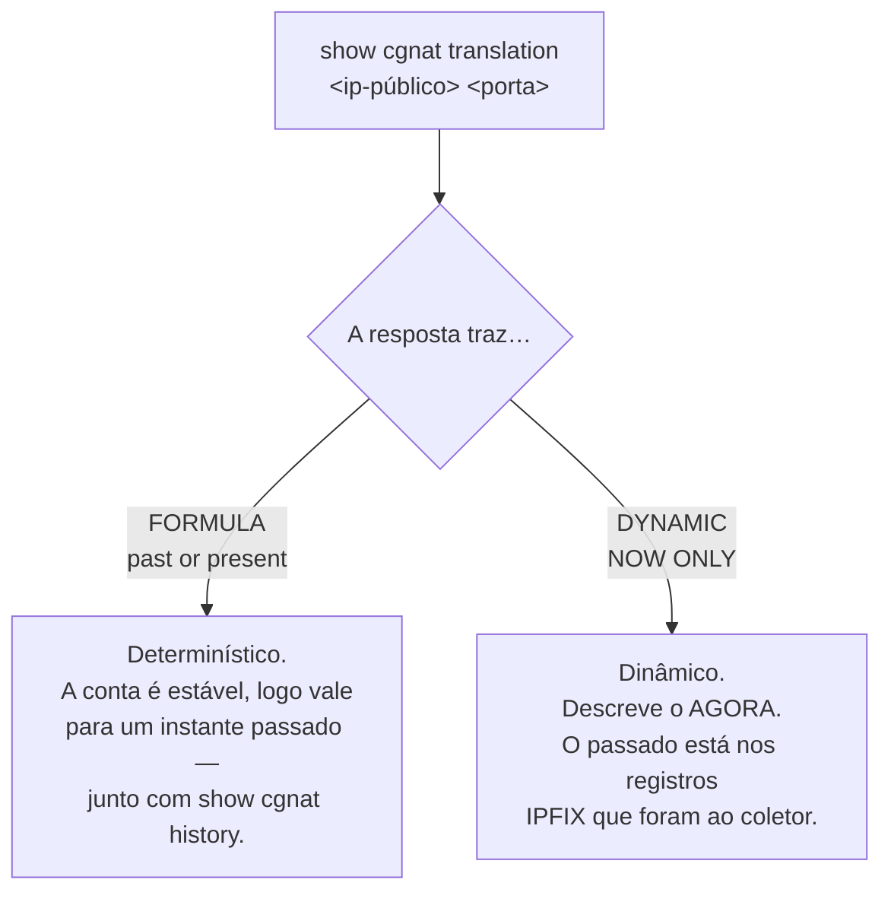

# Comandos show

Os comandos `show` funcionam nos modos operacional **e** de configuração.

## `show cgnat`

As quatro primeiras respondem a pergunta de um operador em vez de reportar um contador. Todas tiram a resposta do **dataplane**, e todas são respondidas aqui: um operador que precisasse descer até a linha de comando do dataplane para diagnosticar seria um operador para quem esta VTY é decoração.

| Comando | Argumento | Responde |
|---------|-----------|----------|
| `show cgnat subscriber` | `<endereço-interno>` | tudo sobre um assinante |
| `show cgnat translation` | `<endereço-público> <porta>` | quem estava atrás de um endereço público e porta |
| `show cgnat top` | `[<n>]`   | assinantes mais próximos de esgotar seus blocos |
| `show cgnat drops` |           | por que pacotes não passaram |
| `show cgnat pool` |           | pools configurados, a capacidade de cada um e a distribuição de quanto os assinantes usam do próprio bloco |
| `show cgnat session` |           | sessões ativas por thread |
| `show cgnat blocks` |           | blocos alocados em modo dinâmico, e quantos um encaminhamento de porta prende |
| `show cgnat logging` |           | estado da exportação IPFIX |
| `show cgnat history` |           | trilha datada de configuração |

`show cgnat translation` é o comando que responde uma ordem judicial: dado um IP público, uma porta e um instante, quem era o assinante.

`show cgnat history` é o outro lado disso no modo determinístico — qual configuração estava em vigor naquela data, e quem a colocou lá.

### `show cgnat alg` e `show cgnat forward`: o que o dataplane tem, não o que o arquivo diz

As duas respondem uma pergunta diferente da que o `show configuration` responde. O arquivo diz o que foi pedido; estas dizem o que a caixa está fazendo, e as duas coisas se separam em silêncio.

```
hexarouting> show cgnat alg
provider-a
  ftp    on   FTP PORT/EPRT and the 227/229 replies
  rtsp   off  RTSP Transport client_port, and the media pair it needs
  pptp   on   PPTP control channel and its GRE data channel
  esp    on   IPsec ESP passthrough, bound to the peer gateway
  sip    on   SIP over UDP: Via, Contact, SDP, and the RTP pair it needs
```

São os **cinco** ALGs do produto, um por linha, com a descrição que a caixa imprime em inglês. É a tela para "as transferências FTP deste cliente travam": ela diz se o ALG está ligado **no dataplane**, que não é a mesma pergunta que se ele está no arquivo.

```
hexarouting> show cgnat forward
pool provider-a
  tcp 200.150.0.17:8080 -> 100.64.0.5:80
```

E esta é a primeira coisa a estabelecer quando alguém liga dizendo que o encaminhamento de porta não funciona: se a caixa tem o encaminhamento. Aceita o nome de um pool para filtrar: `show cgnat forward provider-a`.

## `show route` — a tabela que encaminha

| Comando | Mostra |
|---------|--------|
| `show route` | a tabela de encaminhamento do VPP: o que esta caixa realmente faz com um pacote |
| `show route verbose` | a FIB do VPP e a RIB do FRR lado a lado, **marcando onde discordam** |
| `show route <prefixo>` | o mesmo, para um destino |

```
hexarouting> show route
  Destination          Next hop          Interface    Kind
  0.0.0.0/0            200.150.0.1       ens19        forward
  200.150.0.0/24       connected         ens19        connected

  2 entries carrying traffic
```


:::warning
`show ip route` responde pela tabela do **FRR**, não pela que encaminha. Numa caixa que está descartando o tráfego, a rota aparece presente e correta ali.

Quando o tráfego não passa e a rota parece certa, `show route verbose` é o comando: ele compara as duas tabelas e diz qual prefixo está numa e não na outra.

:::

## `show interface` — as do dataplane

```
hexarouting> show interface
  Interface                  State  MTU    Address             Linux
  ens18                      up     9000   203.0.113.1/24      tap0 ens18
  ens19                      up     1500   -                   -
  local0                     down   0      -                   -
  tap0                       up     9000   -                   ens18

  3 interface(s) on the dataplane can forward
  local0 is listed above but not counted: it is the dataplane's own null interface and forwards nothing
```

Responde pelo **dataplane**, com estado, MTU, endereços e o par do `linux_cp`. Esse último porque é o nome que o FRR e o `ip` usam, e quem transita entre as duas ferramentas precisa dos dois lado a lado.

**A placa aparece com o nome que o Linux dava a ela.** A caixa reivindica as placas sozinha e batiza cada uma, no dataplane, com o nome que ela tinha no Linux: a `ens18` continua sendo `ens18`, e é assim que ela aparece aqui, no prompt e no roteamento. Uma placa com bloco `interface` entra no Linux com esse mesmo nome, e é ele que a coluna **Linux** mostra, ao lado do `tap` interno que o par usa - `linux-name` só é preciso para escolher outro. Uma porta cujo nome tem barras é uma placa que ninguém nomeou; o roteamento recusa nomes acima de 16 caracteres, e o `commit` diz isso antes de tentar.


:::warning
Este comando já foi repassado ao `vtysh`, que enxerga apenas o que o `linux_cp` espelhou. Numa caixa com uma `GigabitEthernet0/12/0` configurada, a resposta era `lo` — a lista sem as interfaces que carregam o tráfego.

É a mesma armadilha do `show ip route`: a pergunta respondida pelo lado errado.

:::

`local0` é o loopback interno do VPP. Aparece na lista — esconder o que o dataplane reporta seria o comando decidindo o que você pode ver — mas não é oferecido na completação, porque não configura nada.

**E não entra na conta.** O número no fim da lista é o de interfaces que encaminham, que é o número a comparar com as placas que você instalou. Contando o `local0`, uma caixa com duas placas dizia três, e uma caixa sem placa nenhuma dizia *uma* logo abaixo da frase que avisava que ela não tinha interface para encaminhar. A linha seguinte ao número diz o que ficou de fora.

A visão do FRR continua em `show ip interface`.

### `show interface terse` — administrativo e enlace, separados

Uma linha por interface, com **duas** colunas de estado:

```
hexarouting> show interface terse
  Interface                  Admin  Link   Proto  Local
  ens18                      up     up     inet   203.0.113.1/24
  ens19                      up     down   -      -
  local0                     down   down   -      -

  2 interface(s) on the dataplane can forward
  local0 is listed above but not counted: it is the dataplane's own null interface and forwards nothing
  ens19: configured up, link down - that is the wire or the far end, not this configuration
```

| `Admin` | `Link` | O que é |
|-------|------|---------|
| `up`  | `up` | normal  |
| `up`  | `down` | **é o cabo, o transceiver ou o outro lado** — a configuração está de pé |
| `down` | `down` | alguém digitou `shutdown` |

São duas colunas porque são dois fatos, e a diferença entre eles é o defeito. Uma coluna só de "estado" não distingue *alguém aplicou* `shutdown` de *a fibra foi cortada* — e essa é justamente a listagem que se abre quando algo está errado. Por isso a caixa também nomeia, no fim, as interfaces configuradas up cujo enlace está down: é a conclusão da tabela, dita sem precisar ser procurada.

Uma sub-interface não é hardware e o dataplane não reporta enlace para ela. O enlace dela é o **do pai**, e é isso que a coluna mostra — as portas de assinante de um provedor são todas sub-interfaces, e uma coluna vazia justamente nelas não serviria para nada.

Um endereço por linha: uma interface com IPv4 e IPv6 aparece em duas linhas, com `inet` e `inet6` na coluna `Proto` e o nome escrito uma vez só.

### `show interface description` — para que cada porta serve

```
hexarouting> show interface description
  Interface                  Admin  Link   Description
  ens18                      up     up     ASSINANTES PON-3
  ens19                      up     down   TRANSITO Vivo AS26599
  local0                     down   down   

  2 of 2 interface(s) described
  local0 is listed above but not counted: it is the dataplane's own null interface and forwards nothing
```

A descrição fica guardada como a **etiqueta da interface no próprio dataplane**, com espaços e tudo: ela sobrevive a um restart da VTY e diz a mesma coisa a quem consultar o dataplane por outro caminho. Escreve-se com `description <texto>` dentro de `interface <nome>`.

A coluna vem ao lado de `Admin` e `Link` de propósito: a pergunta *"o que é essa porta?"* quase nunca vem sozinha — vem junto de *"e ela está funcionando?"*.

### `show interface utilization` — quanto está passando agora

```
show interface utilization [<nome>] [interval <segundos>] [count <n>]
```

`show interface` mostra **contador**, que é um total desde o boot. Ninguém quer o total: quer saber se o enlace está cheio **agora**. Para isso são necessárias duas leituras e a divisão pelo tempo entre elas — então este comando **demora**, e diz de quanto é a demora antes de começar:

```
hexarouting> show interface utilization
  sampling every 2s, 5 time(s) - 10s in total; Ctrl-C stops early

  Interface                             rx            tx  rx history tx history
  ens19                      675.56 Mbit/s   1.24 Gbit/s  ▃▄▄▅▄      ▆▇▇█▇
  ens18                        8.40 Mbit/s   3.10 Mbit/s  ▁▁▁▂▁      ▁▁▁▁▁

  bars are each interface's share of its own line rate
    ens19                     12.4% of 10.00 Gbit/s
    ens18                      0.8% of 1.00 Gbit/s
```

| Argumento | Efeito |
|-----------|--------|
| `<nome>`  | só as interfaces cujo nome começa assim |
| `interval <segundos>` | tempo entre amostras; padrão 2, entre 0,1 e 60 |
| `count <n>` | quantas amostras; padrão 5, entre 1 e 120 |

O que vale saber para ler o gráfico:

* **A taxa é em bit/s**, no múltiplo em que um operador diria o número.
* **O tempo decorrido é medido, não suposto.** Numa caixa carregada — a única em que a pergunta interessa — dois segundos de espera não são dois segundos, e uma taxa calculada pelo intervalo nominal estaria errada exatamente ali.
* **Quando o dataplane informa a velocidade do enlace**, a barra é a fatia daquela interface da própria taxa de linha, e a porcentagem é real.
* **Quando não informa** — interface virtual, por exemplo — a barra é escalada para a maior amostra daquela execução, e a caixa **diz isso** em vez de apresentar porcentagem de uma capacidade que não conhece.
* Tráfego que arredondaria para nada é desenhado no nível mais baixo, não no traço de base: *um fio de tráfego* e *silêncio* são respostas diferentes.
* `Ctrl-C` encerra antes do fim e o gráfico sai com o que já foi amostrado. Interrompido antes da segunda leitura, não há taxa nenhuma a mostrar, e a caixa diz isso em vez de imprimir zeros.
* Pacotes descartados durante a amostragem, e um contador que andou para trás porque alguém limpou as interfaces no meio, são reportados no fim.

## `show hardware` — as placas de rede que a caixa tem

`show interface` responde pelo **dataplane**. Numa caixa recém-instalada o dataplane não recebeu placa nenhuma, então essa tela vem vazia — justamente no momento em que é preciso ver quais placas existem para escolher uma. `show hardware` responde a outra pergunta: **quais placas físicas o Linux enxerga nesta caixa**, com o que basta para decidir.

```
hexarouting> show hardware
  the dataplane has no interface to forward on: no interface was named, so VPP
  was given no NIC.
  Name it here: 'configure', then 'dataplane interface <name>',
  then 'commit'. A name this box has not got is refused, and the
  refusal says which ones it has.
  'show hardware' is where the names come from: it lists this box's cards as
  Linux has them, and marks the one carrying the default route.

  Interface     PCI            Driver           Link           Speed
  eno1          0000:03:00.0   ixgbe            up             1000Mb/s
    3c:ec:ef:1a:2b:3c  ixgbe, a kernel driver
      DPDK cannot take the card through it as it is; when this card is given to
      the dataplane the box moves it to vfio-pci
    *** carries the DEFAULT ROUTE ***
  ens1f0        0000:5e:00.0   ixgbe            down           -
    b4:96:91:0d:1e:2f  ixgbe, a kernel driver
      DPDK cannot take the card through it as it is; when this card is given to
      the dataplane the box moves it to vfio-pci

  2 NIC(s) on this box, as Linux has them
  'eno1' carries the default route: it is how this box is reached, and giving
  it to the dataplane would take the box off the network. It is refused as a
  dataplane interface for that reason.
```

| Coluna | O que é |
|--------|---------|
| `Interface` | o nome que o Linux dá à placa |
| `PCI`  | o endereço PCI, que é por onde o dataplane reclama o dispositivo |
| `Driver` | o driver que está com a placa **agora** |
| `Link` | o enlace, como o kernel o reporta |
| `Speed` | a velocidade, quando o kernel informa; `-` quando o enlace está caído e não há velocidade a informar |

A coluna `Link` é larga porque os valores que o kernel escreve ali não são só `up` e `down`: quando o estado não pode ser lido ele vira `unknown`, e existem `lowerlayerdown`, `notpresent`, `dormant` e `testing`. Por um tempo a coluna tinha a largura exata de `up`, e num estado mais comprido o estado e a velocidade saíam colados - `unknown-`, `unknown1000Mb/s` -, que é uma tela que o operador lê errado sem perceber que leu.

Embaixo de cada placa vêm o **MAC**, inteiro numa linha só — é o que se compara com a etiqueta da porta ou com a reserva no DHCP —, o driver que está com ela, e o que acontece com esse driver quando a placa for entregue ao dataplane.

Essa última linha importa mais do que parece. Toda caixa recém-instalada está com todas as placas em driver de kernel: dizer só *"o DPDK não pega uma placa por esse driver"* é verdade e lê-se como *"esta placa não serve"* — ainda mais numa VM de uma placa só, onde é a única coisa dita sobre a única placa. Dizer **para qual driver a caixa move a placa** transforma um beco sem saída num passo. O nome do driver ali não é chute: é o mesmo que a caixa vai usar de verdade, perguntado a quem decide, e numa caixa sem IOMMU ele sai `uio_pci_generic` em vez de `vfio-pci`.

### A marca `*** carries the DEFAULT ROUTE ***`

É a metade mais importante da tela. A placa que carrega a rota padrão é por onde esta caixa é alcançada: entregá-la ao dataplane não degrada a caixa, **tira a caixa da rede** — sem SSH, sem ping, nada além de um console até onde alguém precisa caminhar.

Numa caixa que tem outra placa, ela **recusa** essa por esse motivo. A recusa acontece depois da escolha, o que é tarde demais para ensinar alguma coisa; a marca aparece antes, para que a escolha não seja essa.

Numa caixa que tem **só essa** placa, a marca não é uma recusa: é um aviso do que a entrega envolve. Ali a placa pode ir para o dataplane, e o endereço de gerência vai junto, para a interface que o dataplane mantém emparelhada com a porta. A própria tela diz o que digitar e o que isso custa:

```
  1 NIC(s) on this box, as Linux has them
  This box has one NIC, 'ens18', and it carries the default route, so giving it
  to the dataplane is also giving away the path this box is reached on.
  It can still be done, and the address goes with it: name it with 'configure',
  'dataplane interface ens18', 'commit', and the box keeps that address on the
  linux_cp pair the dataplane holds for the card.
  The commit is a confirmed one whether or not you ask: restart the box, log
  back in and type 'commit' to keep it, and if nobody does the box puts the
  card back on its own.
```

O passo a passo dessa entrega está em [Primeiros passos](../../comecar-aqui/primeiros-passos.md).

Numa caixa sem rota padrão nenhuma, a tela diz isso em vez de simplesmente não marcar nada:

```
  no interface carries a default route on this box, so none of them is the
  management path by that test.
```

E quando a rota padrão está numa coisa que esta lista não comporta — uma ponte, um *bond*, uma VLAN, uma placa sem endereço PCI —, a caixa **nomeia** essa coisa, em vez de deixar a ausência da marca falar:

```
  1 NIC(s) on this box, as Linux has them
  none of these carries the default route. It is on 'br0', which is not a PCI
  NIC, and that is still the path this box is reached over.
```

Uma lista sem marca nenhuma seria lida como *"nenhuma destas é o caminho de gerência"*, e é exatamente essa leitura que custa a caixa.

### O veredito do driver, e o que a caixa faz com ele

O dataplane não consegue tomar uma placa que está presa a um driver do kernel. São três vereditos, e dois deles vêm com a segunda linha que diz o que a caixa fará:

| Veredito | O que significa | Segunda linha |
|----------|-----------------|---------------|
| `<driver>, a kernel driver` | a placa está com o driver do kernel (`ixgbe`, `i40e`, `virtio-pci`, …) | `DPDK cannot take the card through it as it is; when this card is given to the dataplane the box moves it to <driver de DPDK>` |
| `<driver> is a driver DPDK can use` | a placa já está preparada para o dataplane — `vfio-pci`, `uio_pci_generic` ou `igb_uio` | nenhuma: não há nada a mover |
| `no driver is bound to it at all` | nenhum driver está com o dispositivo | `DPDK needs a driver bound to the card; when this card is given to the dataplane the box moves it to <driver de DPDK>` |

```
  Interface     PCI            Driver           Link           Speed
  eno1          0000:03:00.0   ixgbe            up             1000Mb/s
    3c:ec:ef:1a:2b:3c  ixgbe, a kernel driver
      DPDK cannot take the card through it as it is; when this card is given to
      the dataplane the box moves it to vfio-pci
    *** carries the DEFAULT ROUTE ***
  ens1f0        0000:5e:00.0   vfio-pci         up             10000Mb/s
    b4:96:91:0d:1e:2f  vfio-pci is a driver DPDK can use
  ens1f1        0000:5e:00.1   (none)           down           -
    b4:96:91:0d:1e:30  no driver is bound to it at all
      DPDK needs a driver bound to the card; when this card is given to the
      dataplane the box moves it to vfio-pci
```

O nome do driver de DPDK na segunda linha **é o desta caixa**, e não um nome genérico: numa caixa com IOMMU ligado ele sai `vfio-pci`, e numa sem IOMMU sai `uio_pci_generic`. A tela não recalcula essa escolha — ela pergunta a quem a faz de verdade na hora de entregar a placa, para que uma tela não possa prometer um driver e a entrega usar outro.

Uma placa sem driver nenhum aparece com `(none)` na coluna `Driver`. É um estado normal e não um defeito: acontece com a placa que já esteve com o dataplane e foi devolvida, e com a que o kernel não conseguiu reivindicar.

O `mlx5` da Mellanox é a exceção: é um driver bifurcado e o dataplane trabalha com ele sem trocar de driver.

### A primeira linha diz o que o dataplane já tem

Sempre, e antes da lista. Uma placa que o **dataplane já tomou** desaparece da listagem do Linux — ela não está mais lá para ser listada. Sem essa linha, uma placa entregue ao dataplane e uma placa que nunca existiu na caixa ficariam com a mesma cara, e uma dessas duas é defeito de hardware.

```
hexarouting> show hardware
  the dataplane holds ens19. A NIC VPP owns is no longer listed by Linux, so it
  is not in the list below.
```

Quando o dataplane não tem interface nenhuma, a linha é o **mesmo diagnóstico** que o `show interface` e o autoteste de boot dão, lido das mesmas fontes: dois diagnósticos do mesmo fato que discordam entre si são piores que um.

E uma caixa onde o Linux não enxerga placa PCI nenhuma recebe uma frase, não uma tabela vazia:

```
  no PCI NIC is visible to Linux on this box: either the dataplane already owns
  every one of them, or none of them resolves to a PCI address, which is what a
  virtio guest looks like. DPDK cannot be given a device that has no PCI
  address, so there is nothing here to choose from.
```

*"Não há nada a mostrar"* e *"não há nada errado"* têm a mesma aparência numa tela, e esta tela é lida numa caixa que não encaminha nada.

## `show this` — o que há na hierarquia em que estou

Dentro de um bloco de configuração, mostra o que aquele bloco tem e nada acima dele:

```
hexarouting# [edit cgnat pool residential] show this
cgnat pool residential
 inside 100.64.0.0/22
 outside 200.150.0.16/30
 block-size 512
 policy interleaved
 mode deterministic
 tcp-mss 1400
 exit
```

Mostra a **candidata**, não a configuração em vigor: quem está no meio de uma edição pergunta sobre o que está construindo.

Repare que `policy` e `mode` aparecem sem você ter digitado. Não é a tela acrescentando nada: são os três campos que todo pool tem por construção — `block-size`, `policy` e `mode` —, e um pool sem eles não existe. Se a tela os omitisse quando estão no valor padrão, ela deixaria de dizer o que o pool está fazendo enquanto o pool continua fazendo. É a mesma razão pela qual `no policy` é recusado.

Dentro de um pool, o bloco sai na forma curta — `cgnat pool residential`, sem o `nat` na frente — que é como o prompt também o nomeia. `show configuration` e `show running-config`, que mostram a caixa inteira, saem na hierarquia nova: `nat cgnat pool ...` e as rotas estáticas num bloco `router static`. As duas grafias são aceitas na entrada, então copiar qualquer uma das telas para um arquivo e carregá-lo de volta funciona.

Na caixa inteira, **os ajustes globais de CGNAT também saem com o** `**nat**` na frente — `nat cgnat timeout udp 300`, `nat cgnat block-holddown 90` — e não só os blocos de pool. Por um tempo os pools saíam na hierarquia nova e os globais na antiga, no mesmo arquivo: quem procurasse um timeout por `nat cgnat timeout` não achava. Agora o arquivo inteiro fala uma língua só.

O prompt nomeia onde você está, inclusive qual pool ou qual interface — `[edit interface ens19]` — para que a próxima declaração não caia no bloco errado.

## O que a caixa conferiu, e o que ela apenas repassou

O `hexash` conhece parte das sentenças de roteamento e repassa o resto ao roteamento sem ler. As duas coisas apareciam iguais na tela. Agora não:

```
hexarouting# [edit] show configuration
...
! routing
router bgp 65000
neighbor 10.0.0.2 remote-as 65001
coalesce-time 1000  <- not checked
neighbor 10.0.0.2 soft-reconfiguration inbound  <- not checked
exit
! hexash: 2 statement(s) above are marked '<- not checked': this VTY has no
! hexash: grammar for them and handed them to FRR word for word
```

A marca `<- not checked` quer dizer: **esta caixa não tem gramática para esta linha e a entregou ao roteamento exatamente como foi digitada.** Não quer dizer que a linha esteja errada - muita configuração correta de FRR passa por aqui. Quer dizer que quem conferiu foi o roteamento, no `commit`, e não o `hexash`, no prompt.

O que decide a marca é a mesma lista que o `?` oferece naquele bloco. Por isso a **mesma** sentença pode sair marcada num lugar e não sair em outro: `soft-reconfiguration inbound` é conhecida dentro de `address-family` e não é conhecida direto dentro de `router bgp`.

A marcação aparece em `show configuration`, `show running-config` e `show this`. A mais útil é a do `show this`, porque é a que aparece **enquanto você ainda está digitando**, e não depois.

Num bloco que a caixa não modela de jeito nenhum, a marca vem já no cabeçalho - a notícia ali é que nada daquele bloco foi lido:

```
hexarouting# [edit vrf red] show this
vrf red  <- not checked
 ip route 10.9.0.0/16 10.0.0.9  <- not checked
```

A marca é **só de tela**. Ela não entra no arquivo que o `save` grava, não vai para o roteamento no `commit` e não aparece nas revisões de rollback: o arquivo que a caixa lê no boot precisa ser um arquivo que o roteamento aceita. Copiar a tela marcada para um arquivo e carregá-la de volta funciona - a caixa tira a marca e a linha final na leitura.

A linha final só aparece quando há alguma coisa marcada. Um aviso que aparece sempre é um aviso que ninguém lê.

## `show bgp summary`, `show ospf` e `show isis` — a adjacência, e o que dela chegou a encaminhar

São cinco comandos — `show bgp summary`, `show ospf neighbor`, `show ospf interface`, `show isis adjacency` e `show isis interface` — e o que eles acrescentam ao que o roteamento já responde é a **última linha**: quantos prefixos daquele protocolo estão na tabela que de fato encaminha. Uma rota que o roteamento tem e o dataplane nunca recebeu é invisível em qualquer comando que responda pelo roteamento, e as duas metades ficam com cara de saudáveis olhadas separadamente.

`show bgp summary` traz uma linha por sessão — vizinho, AS, estado, prefixos recebidos e há quanto tempo está de pé —, depois a contagem de sessões estabelecidas e então a mesma última linha sobre a tabela que encaminha. O resto de `show bgp` é repassado ao roteamento sem alteração.

```
hexarouting> show ospf neighbor
  Neighbour         Interface      State            Dead       Up
  10.0.0.2          vppwan0        Full/DR          38         00:12:41

  1 adjacency(ies), 1 full
  all 3 OSPF prefix(es) are in the forwarding table
```

Quando alguma não chegou, a linha diz **quantas** e nomeia até cinco:

```
  2 of 7 OSPF prefix(es) are NOT in the forwarding table
    10.20.0.0/24
    10.20.1.0/24
    'show route verbose' compares the two tables in full
```

### A adjacência que para em Exchange

`show ospf neighbor` é onde a caixa diz uma coisa que o roteamento não diz: uma adjacência que não sai de `Exchange` quase sempre é MTU. O OSPF leva o MTU da interface dentro dos pacotes de descrição da base, e quem recebe descarta os que anunciam um MTU maior que o seu **sem registrar nada, nos dois lados**. É a falha que custa uma tarde em vez de um minuto.

A caixa não tem como saber o MTU do outro lado, mas sabe o que **ela** está anunciando - e é esse o número a comparar. Nesta caixa quem anuncia é a interface do lado do sistema, que começa em 9000, então ela está errada mais vezes do que certa.

### `show ospf interface` e `show isis interface`

O que cada protocolo acredita sobre cada interface, ao lado do que o dataplane tem. No IS-IS essa tela responde uma pergunta específica: um circuito `Up` com **zero** vizinhos, e por quê.

```
hexarouting> show isis interface
  Interface      Area       Circuit   State      Level   Metric   Neighbours
  vppwan0        CORE       0x1       Up         L2      10       0
```

Zero vizinhos num circuito que está `Up` é o sintoma do IS-IS não estar sendo entregue ao sistema: os quadros de IS-IS não andam sobre IP, andam direto sobre o enlace, e precisam ser entregues explicitamente. Sem isso a caixa dá boot, commita limpo, o processo de IS-IS sobe, a configuração lê de volta certa **e a adjacência nunca forma**. A tela diz isso em vez de deixar o operador com um contador.

`show isis adjacency` é a mesma leitura por vizinho, com a mesma última linha sobre a tabela que encaminha.

## `show version` — as versões da caixa e quais daemons estão de pé

Quando um `show bgp`, um `show ospf` ou um `show isis` não responde, e quando um `commit` recusa uma instância de roteamento, a caixa manda você para cá. Esta tela responde: ela nomeia os daemons rodando e os parados, um por um.

```
hexarouting> show version
HexaRouting 0.67.0 (a1b2c3d)
  dataplane: 26.06
  plugin:    0.67.0 (a1b2c3d)
  routing:   FRRouting 10.7.1
  daemons:   running  bgpd mgmtd ospfd staticd zebra
             stopped  isisd ospf6d
             a stopped daemon takes the configuration that needs it and reaches
             nothing; enable it in /etc/frr/daemons and restart frr
```

A última linha diz o que fazer: um daemon parado recebe a configuração que depende dele e não chega a lugar nenhum. Habilite em `/etc/frr/daemons` e reinicie o `frr`. Se quem estiver parado for um dos que o próprio FRR sobe sozinho, a mensagem é outra — nesse caso o FRR não terminou de subir, e editar `/etc/frr/daemons` não muda nada.

Os parados aparecem **por nome**, e não como ausência na lista dos que rodam. Quem chega aqui veio de uma mensagem que citou **um** daemon, e procurar por uma palavra que não está lá é exatamente como se tira a conclusão errada.

Se o FRR não responder, a tela diz isso, e não "nenhum daemon rodando":

```
  daemons:   FRR is not answering, so which daemons are running is not known
             this box's routing control plane is down rather than idle:
             'systemctl status frr' and its journal say why
```

São falhas diferentes com correções diferentes: um FRR que não responde é o plano de controle fora do ar, e a correção é levantar o FRR; um FRR que responde sem nada de pé é uma caixa cujos daemons nunca foram habilitados, e a correção está em `/etc/frr/daemons`. Ler a primeira como a segunda manda o operador editar um arquivo numa caixa que não o teria lido.

### Qual build está encaminhando de verdade

A linha `plugin:` é a versão do **dataplane que está carregado agora**, lida da própria caixa. A primeira linha, `HexaRouting`, é a versão do que está instalado em disco. Na imensa maioria das vezes as duas são iguais e a caixa não diz mais nada a respeito.

Elas se separam num momento previsível: **entre uma atualização e o próximo boot**. Atualizar troca o dataplane em disco e **não reinicia** o dataplane que está rodando — de propósito, porque reiniciá-lo derruba todas as sessões da caixa. Até o reboot, portanto, a VTY, o autoteste e o coletor já são a versão nova e quem traduz pacotes ainda é a antiga. A tela passa a dizer isso:

```
hexarouting> show version
HexaRouting 0.68.0 (9f8e7d6)
  dataplane: 26.06
  plugin:    0.67.0 (a1b2c3d)
             this is the build the dataplane was loaded with at the last boot,
             and it is not the HexaRouting build above. An upgrade replaces
             bpa_plugin.so on disk and does not restart the dataplane, so until
             this box is rebooted, or 'systemctl restart vpp' is run, it goes
             on translating with the old one - and both of those end every
             session it is carrying.
```

Não é um defeito, é um estado — e é um estado que **você escolhe quando encerrar**. Reiniciar o dataplane, por reboot ou pelo comando que a própria mensagem cita, carrega a versão nova e derruba todas as sessões traduzidas no momento em que o comando é dado. Por isso a caixa informa e não age sozinha: essa é uma janela de manutenção, não uma tarefa de rotina.

O sufixo entre parênteses identifica a árvore de onde aquele build saiu. Se ele terminar em `-dirty`, aquele build **não** é uma versão publicada: saiu de uma árvore com alterações não commitadas, e isso precisa aparecer antes de qualquer investigação começar pelo caminho errado.

Se o dataplane não responder, a linha diz isso — e não "sem plugin":

```
  plugin:    the dataplane is not answering, so its build is not known
             this box is not forwarding at all rather than forwarding with an
             old build: 'systemctl status vpp' and its journal say why the
             dataplane is silent
```

E se ele responder estando de pé **sem o plugin de CGNAT carregado**, a mensagem é outra, porque a correção é outra: aí a caixa encaminha e não traduz nada.

### O que esta tela não confere

A comparação acima é entre **dois** arquivos: o que está em disco e o que o dataplane carregou. A linha `HexaRouting` é uma frase sobre cerca de trinta, e os outros vinte e oito não são conferidos aqui, de propósito: `show version` é rodado o tempo todo enquanto se trabalha, e refazer a conta a cada vez sairia caro para dizer que está tudo certo.

Quem confere todos é o **autoteste de boot**, uma vez por boot, contra a lista que a instalação deixou na caixa. Se algum arquivo não for da versão que a caixa informa, é lá que aparece, com o nome do arquivo. A página **Operação e diagnóstico** descreve essa linha e o que fazer com ela.

## `show` — restante

| Comando | Mostra |
|---------|--------|
| `show configuration` | a configuração candidata |
| `show configuration compare` | diferenças da candidata contra a configuração em vigor |
| `show running-config` | a configuração em efeito, CGNAT e roteamento |
| `show rollback` | revisões commitadas disponíveis |
| `show hardware` | as placas de rede físicas da caixa, com endereço PCI, driver, enlace e **qual delas carrega a rota padrão** |
| `show version` | versões do HexaRouting, do VPP e do FRR, **qual build o dataplane carregado é** e **quais daemons de roteamento estão rodando** |
| `show ip ...` | informação de IP (repassado ao FRR) |
| `show bgp summary` | uma linha por sessão BGP, com o que chegou à tabela que encaminha |
| `show bgp ...` | o restante do BGP (repassado ao FRR) |
| `show isis ...` | informação de IS-IS (FRR) |
| `show ip interface` | interfaces como o FRR as enxerga |
| `show logging` | log do sistema (FRR) |

Os `show` de roteamento são repassados ao `vtysh` do FRR, então a sintaxe completa do FRR vale depois da primeira palavra.

## Filtrando a saída com `|`

Qualquer `show` aceita filtros depois de uma barra vertical, e eles podem ser encadeados:

```
show running-config | section interface
show running-config | include timeout | count
show logging | exclude bgpd | last 20
```

| Filtro | O que faz |
|--------|-----------|
| `include <texto>` | mantém as linhas que contêm o texto |
| `match <texto>` | o mesmo que `include`, para quem digita assim |
| `exclude <texto>` | descarta as linhas que contêm o texto |
| `section <texto>` | mantém o bloco que a linha casada abre, até a próxima linha que começa na coluna 0 |
| `count` | quantas linhas, em vez das linhas |
| `first <n>` | as primeiras n linhas |
| `last <n>` | as últimas n linhas |

O argumento pode ter espaços: `include mode deterministic` procura essas duas palavras juntas. Um par de aspas **em volta do argumento inteiro** é retirado antes da busca — `section "interface Gi"` procura `interface Gi` —, porque é assim que um pipe se escreve em qualquer shell e ninguém digitaria diferente. Uma aspa no meio do texto continua sendo um caractere procurado.

Um filtro que a caixa não conhece é **recusado**, com a lista do que existe — não ignorado. Ignorar responderia a pergunta que ninguém fez, sem nada na tela dizendo que foi isso que aconteceu. `first` e `last` sem número, ou com algo que não é número, também são recusados (`needs a number, not 'x'`).

`section` serve à forma desta configuração: um bloco é uma linha na coluna 0 mais tudo que está indentado embaixo dela. É como se pede a configuração de uma interface, ou de um pool, sem ler a caixa inteira.


:::info
**O filtro roda sobre o texto que o comando já produziu, depois das ocultações.** É isso que faz `show running-config | include password` ser seguro: o que o filtro enxerga é `<set, not shown>`, a mesma linha que você veria sem filtro nenhum. Nenhum filtro alcança o valor por trás dela.

A barra vertical só é filtro depois de um `show`. Numa declaração de configuração ela é um caractere de expressão regular ou de descrição — uma lista de AS-path é cheia delas — e tratá-la como filtro cortaria uma política em silêncio.

:::

## O que olhar primeiro

| Sintoma | Comando |
|---------|---------|
| "assinante sem internet" | `show cgnat subscriber <ip-interno>` |
| "pacotes sumindo" | `show cgnat drops` |
| "a rota está lá e o tráfego não passa" | `show route verbose` |
| "de quem era esse IP:porta?" | `show cgnat translation <ip> <porta>` |
| "o pool vai encher?" | `show cgnat top` |
| "o coletor está recebendo?" | `show cgnat logging` |
| "o que mudou aqui?" | `show cgnat history` |
| "o que eu estou prestes a aplicar?" | `show configuration compare` |
| "essa porta caiu ou alguém deu shutdown?" | `show interface terse` |
| "para que serve essa porta?" | `show interface description` |
| "o dataplane não tem interface nenhuma" | `show hardware` |
| "o enlace está cheio?" | `show interface utilization <nome>` |

## Como ler a resposta de `show cgnat translation`

Este é o comando que responde uma ordem judicial, e a resposta dele **diz quanto vale como prova**. Não são a mesma coisa:



Uma resposta dinâmica **nunca** afirma `FORMULA`. Essa recusa é deliberada: tratar uma alocação sob demanda como se fosse aritmética estável seria apresentar como prova algo que não sustenta a afirmação.

## O que cada resposta traz

| Comando | Na resposta você encontra |
|---------|---------------------------|
| `show cgnat subscriber <ip>` | o endereço público, a faixa de portas e `sessions N` |
| `show cgnat subscriber` de um IP fora dos pools | `not inside any configured pool` — é resposta, não erro |
| `show cgnat translation` | o assinante, mais `FORMULA`/`past or present` ou `DYNAMIC`/`NOW ONLY` |
| `show cgnat top` | os assinantes mais carregados, com as portas que seguram (ex.: `3/512`) |
| `show cgnat drops` | seção *packets that did not get through* com o motivo, por exemplo `no pool for source address` |


:::info
`**show cgnat drops**` **não mistura sucesso com falha.** Pacotes traduzidos aparecem sob o próprio cabeçalho, fora da seção de descartes. O VPP conta as duas coisas como se fossem iguais; durante um incidente elas não são.

:::

# Ver também

* [Operação e diagnóstico](/doc/operacao-e-diagnostico-A4fcKDVwZt) — estes comandos aplicados a um problema real
* [Logging IPFIX e trilha de auditoria](/doc/logging-ipfix-e-trilha-de-auditoria-lREEjJu1Bq) — o que responde pelo passado
