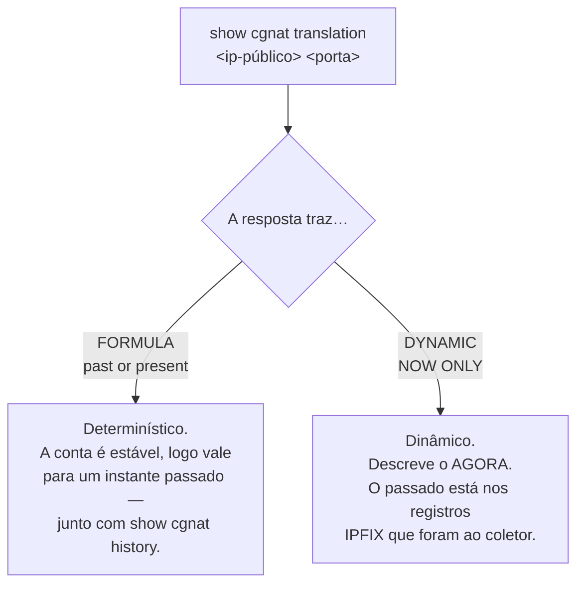

# Comandos show

Os comandos `show` funcionam nos modos operacional **e** de configuração.

## `show cgnat`

As quatro primeiras respondem a pergunta de um operador em vez de reportar um contador. Todas tiram a resposta do **dataplane**, então funcionam pela VTY tão bem quanto pelo `vppctl` — um operador que precisa descer para a CLI do dataplane para diagnosticar é um operador para quem esta VTY é decoração.

| Comando | Argumento | Responde |
|---------|-----------|----------|
| `show cgnat subscriber` | `<endereço-interno>` | tudo sobre um assinante |
| `show cgnat translation` | `<endereço-público> <porta>` | quem estava atrás de um endereço público e porta |
| `show cgnat top` | `[<n>]`   | assinantes mais próximos de esgotar seus blocos |
| `show cgnat drops` |           | por que pacotes não passaram |
| `show cgnat pool` |           | pools de CGNAT configurados |
| `show cgnat session` |           | sessões ativas por thread |
| `show cgnat blocks` |           | blocos alocados em modo dinâmico |
| `show cgnat logging` |           | estado da exportação IPFIX |
| `show cgnat history` |           | trilha datada de configuração |

`show cgnat translation` é o comando que responde uma ordem judicial: dado um IP público, uma porta e um instante, quem era o assinante.

`show cgnat history` é o outro lado disso no modo determinístico — qual configuração estava em vigor naquela data, e quem a colocou lá.

### `show cgnat alg` e `show cgnat forward`: o que o dataplane tem, não o que o arquivo diz

As duas respondem uma pergunta diferente da que o `show configuration` responde. O arquivo diz o que foi pedido; estas dizem o que a caixa está fazendo, e as duas coisas se separam em silêncio.

```
hexarouting> show cgnat alg
provider-a
  ftp    on   FTP: PORT e PASV no controle
  rtsp   off  RTSP: Transport
  pptp   on   PPTP: Call ID
  sip    on   SIP sobre UDP
```

É a tela para "as transferências FTP deste cliente travam": ela diz se o ALG está ligado **no dataplane**, que não é a mesma pergunta que se ele está no arquivo.

```
hexarouting> show cgnat forward
provider-a
  tcp 200.150.0.17:8080 -> 100.64.0.5:80
```

E esta é a primeira coisa a estabelecer quando alguém liga dizendo que o encaminhamento de porta não funciona: se a caixa tem o encaminhamento. Aceita o nome de um pool para filtrar: `show cgnat forward provider-a`.

## `show route` — a tabela que encaminha

| Comando | Mostra |
|---------|--------|
| `show route` | a tabela de encaminhamento do VPP: o que esta caixa realmente faz com um pacote |
| `show route verbose` | a FIB do VPP e a RIB do FRR lado a lado, **marcando onde discordam** |
| `show route <prefixo>` | o mesmo, para um destino |

```
hexarouting> show route
  Destination          Next hop          Interface      Kind
  0.0.0.0/0            200.150.0.1       TenGig0/8/0    forward
  200.150.0.0/24       connected         TenGig0/8/0    connected

  2 entries carrying traffic
```


:::warning
`show ip route` responde pela tabela do **FRR**, não pela que encaminha. Numa caixa que está descartando o tráfego, a rota aparece presente e correta ali.

Quando o tráfego não passa e a rota parece certa, `show route verbose` é o comando: ele compara as duas tabelas e diz qual prefixo está numa e não na outra.

:::

## `show interface` — as do dataplane

```
hexarouting> show interface
  Interface                  State  MTU    Address             Linux
  GigabitEthernet0/12/0      up     9000   203.0.113.1/24      tap0
  TenGigabitEthernet0/8/0    up     1500   -                   -
  local0                     down   0      -                   -
```

Responde pelo **dataplane**, com estado, MTU, endereços e o par do `linux_cp`. Esse último porque é o nome que o FRR e o `ip` usam, e quem transita entre as duas ferramentas precisa dos dois lado a lado.


:::warning
Este comando já foi repassado ao `vtysh`, que enxerga apenas o que o `linux_cp` espelhou. Numa caixa com uma `GigabitEthernet0/12/0` configurada, a resposta era `lo` — a lista sem as interfaces que carregam o tráfego.

É a mesma armadilha do `show ip route`: a pergunta respondida pelo lado errado.

:::

`local0` é o loopback interno do VPP. Aparece na lista — esconder o que o dataplane reporta seria o comando decidindo o que você pode ver — mas não é oferecido na completação, porque não configura nada.

A visão do FRR continua em `show ip interface`.

### `show interface terse` — administrativo e enlace, separados

Uma linha por interface, com **duas** colunas de estado:

```
hexarouting> show interface terse
  Interface                  Admin  Link   Proto  Local
  GigabitEthernet0/12/0      up     up     inet   203.0.113.1/24
  TenGigabitEthernet0/8/0    up     down   -      -
  local0                     down   down   -      -

  3 interface(s) on the dataplane
  TenGigabitEthernet0/8/0: configured up, link down - that is the wire or the far end, not this configuration
```

| `Admin` | `Link` | O que é |
|---------|--------|---------|
| `up`    | `up`   | normal |
| `up`    | `down` | **é o cabo, o transceiver ou o outro lado** — a configuração está de pé |
| `down`  | `down` | alguém digitou `shutdown` |

São duas colunas porque são dois fatos, e a diferença entre eles é o defeito. Uma coluna só de "estado" não distingue *alguém aplicou* `shutdown` de *a fibra foi cortada* — e essa é justamente a listagem que se abre quando algo está errado. Por isso a caixa também nomeia, no fim, as interfaces configuradas up cujo enlace está down: é a conclusão da tabela, dita sem precisar ser procurada.

Uma sub-interface não é hardware e o dataplane não reporta enlace para ela. O enlace dela é o **do pai**, e é isso que a coluna mostra — as portas de assinante de um provedor são todas sub-interfaces, e uma coluna vazia justamente nelas não serviria para nada.

Um endereço por linha: uma interface com IPv4 e IPv6 aparece em duas linhas, com `inet` e `inet6` na coluna `Proto` e o nome escrito uma vez só.

### `show interface description` — para que cada porta serve

```
hexarouting> show interface description
  Interface                  Admin  Link   Description
  GigabitEthernet0/12/0      up     up     ASSINANTES PON-3
  TenGigabitEthernet0/8/0    up     down   TRANSITO Vivo AS26599
  local0                     down   down   

  2 of 3 interface(s) described
  set one with 'description <text>' inside 'interface <name>'
```

A descrição fica guardada como a **etiqueta da interface no próprio dataplane**, com espaços e tudo: ela sobrevive a um restart da VTY e diz a mesma coisa a quem consultar o dataplane por outro caminho. Escreve-se com `description <texto>` dentro de `interface <nome>`.

A coluna vem ao lado de `Admin` e `Link` de propósito: a pergunta *"o que é essa porta?"* quase nunca vem sozinha — vem junto de *"e ela está funcionando?"*.

### `show interface utilization` — quanto está passando agora

```
show interface utilization [<nome>] [interval <segundos>] [count <n>]
```

`show interface` mostra **contador**, que é um total desde o boot. Ninguém quer o total: quer saber se o enlace está cheio **agora**. Para isso são necessárias duas leituras e a divisão pelo tempo entre elas — então este comando **demora**, e diz de quanto é a demora antes de começar:

```
hexarouting> show interface utilization
  sampling every 2s, 5 time(s) - 10s in total; Ctrl-C stops early

  Interface                             rx            tx  rx history tx history
  TenGigabitEthernet0/8/0    675.56 Mbit/s   1.24 Gbit/s  ▃▄▄▅▄      ▆▇▇█▇
  GigabitEthernet0/12/0        8.40 Mbit/s   3.10 Mbit/s  ▁▁▁▂▁      ▁▁▁▁▁

  bars are each interface's share of its own line rate
    TenGigabitEthernet0/8/0   12.4% of 10.00 Gbit/s
    GigabitEthernet0/12/0      0.8% of 1.00 Gbit/s
```

| Argumento | Efeito |
|-----------|--------|
| `<nome>`  | só as interfaces cujo nome começa assim |
| `interval <segundos>` | tempo entre amostras; padrão 2, entre 0,1 e 60 |
| `count <n>` | quantas amostras; padrão 5, entre 1 e 120 |

O que vale saber para ler o gráfico:

* **A taxa é em bit/s**, no múltiplo em que um operador diria o número.
* **O tempo decorrido é medido, não suposto.** Numa caixa carregada — a única em que a pergunta interessa — dois segundos de espera não são dois segundos, e uma taxa calculada pelo intervalo nominal estaria errada exatamente ali.
* **Quando o dataplane informa a velocidade do enlace**, a barra é a fatia daquela interface da própria taxa de linha, e a porcentagem é real.
* **Quando não informa** — interface virtual, por exemplo — a barra é escalada para a maior amostra daquela execução, e a caixa **diz isso** em vez de apresentar porcentagem de uma capacidade que não conhece.
* Tráfego que arredondaria para nada é desenhado no nível mais baixo, não no traço de base: *um fio de tráfego* e *silêncio* são respostas diferentes.
* `Ctrl-C` encerra antes do fim e o gráfico sai com o que já foi amostrado. Interrompido antes da segunda leitura, não há taxa nenhuma a mostrar, e a caixa diz isso em vez de imprimir zeros.
* Pacotes descartados durante a amostragem, e um contador que andou para trás porque alguém limpou as interfaces no meio, são reportados no fim.

## `show this` — o que há na hierarquia em que estou

Dentro de um bloco de configuração, mostra o que aquele bloco tem e nada acima dele:

```
hexarouting# [edit cgnat pool residential] show this
cgnat pool residential
 inside 100.64.0.0/22
 outside 200.150.0.16/30
 block-size 512
 tcp-mss 1400
 exit
```

Mostra a **candidata**, não a configuração em vigor: quem está no meio de uma edição pergunta sobre o que está construindo.

Dentro de um pool, o bloco sai na forma curta — `cgnat pool residential`, sem o `nat` na frente — que é como o prompt também o nomeia. `show configuration` e `show running-config`, que mostram a caixa inteira, saem na hierarquia nova: `nat cgnat pool ...` e as rotas estáticas num bloco `router static`. As duas grafias são aceitas na entrada, então copiar qualquer uma das telas para um arquivo e carregá-lo de volta funciona.

O prompt nomeia onde você está, inclusive qual pool ou qual interface — `[edit interface TenGigabitEthernet0/8/0]` — para que a próxima declaração não caia no bloco errado.

## O que a caixa conferiu, e o que ela apenas repassou

O `hexash` conhece parte das sentenças de roteamento e repassa o resto ao roteamento sem ler. As duas coisas apareciam iguais na tela. Agora não:

```
hexarouting# [edit] show configuration
...
! routing
router bgp 65000
neighbor 10.0.0.2 remote-as 65001
coalesce-time 1000  <- not checked
neighbor 10.0.0.2 soft-reconfiguration inbound  <- not checked
exit
! hexash: 2 statement(s) above are marked '<- not checked': this VTY has no
! hexash: grammar for them and handed them to FRR word for word
```

A marca `<- not checked` quer dizer: **esta caixa não tem gramática para esta linha e a entregou ao roteamento exatamente como foi digitada.** Não quer dizer que a linha esteja errada - muita configuração correta de FRR passa por aqui. Quer dizer que quem conferiu foi o roteamento, no `commit`, e não o `hexash`, no prompt.

O que decide a marca é a mesma lista que o `?` oferece naquele bloco. Por isso a **mesma** sentença pode sair marcada num lugar e não sair em outro: `soft-reconfiguration inbound` é conhecida dentro de `address-family` e não é conhecida direto dentro de `router bgp`.

A marcação aparece em `show configuration`, `show running-config` e `show this`. A mais útil é a do `show this`, porque é a que aparece **enquanto você ainda está digitando**, e não depois.

Num bloco que a caixa não modela de jeito nenhum, a marca vem já no cabeçalho - a notícia ali é que nada daquele bloco foi lido:

```
hexarouting# [edit vrf red] show this
vrf red  <- not checked
 ip route 10.9.0.0/16 10.0.0.9  <- not checked
```

A marca é **só de tela**. Ela não entra no arquivo que o `save` grava, não vai para o roteamento no `commit` e não aparece nas revisões de rollback: o arquivo que a caixa lê no boot precisa ser um arquivo que o roteamento aceita. Copiar a tela marcada para um arquivo e carregá-la de volta funciona - a caixa tira a marca e a linha final na leitura.

A linha final só aparece quando há alguma coisa marcada. Um aviso que aparece sempre é um aviso que ninguém lê.

## `show ospf` e `show isis` — a adjacência, e o que dela chegou a encaminhar

São quatro comandos, e o que eles acrescentam ao que o roteamento já responde é a **última linha**: quantos prefixos daquele protocolo estão na tabela que de fato encaminha. Uma rota que o roteamento tem e o dataplane nunca recebeu é invisível em qualquer comando que responda pelo roteamento, e as duas metades ficam com cara de saudáveis olhadas separadamente.

```
hexarouting> show ospf neighbor
  Neighbour         Interface      State            Dead       Up
  10.0.0.2          vppwan0        Full/DR          38         00:12:41

  1 adjacency(ies), 1 full
  all 3 OSPF prefix(es) are in the forwarding table
```

Quando alguma não chegou, a linha diz **quantas** e nomeia até cinco:

```
  2 of 7 OSPF prefix(es) are NOT in the forwarding table
    10.20.0.0/24
    10.20.1.0/24
    'show route verbose' compares the two tables in full
```

### A adjacência que para em Exchange

`show ospf neighbor` é onde a caixa diz uma coisa que o roteamento não diz: uma adjacência que não sai de `Exchange` quase sempre é MTU. O OSPF leva o MTU da interface dentro dos pacotes de descrição da base, e quem recebe descarta os que anunciam um MTU maior que o seu **sem registrar nada, nos dois lados**. É a falha que custa uma tarde em vez de um minuto.

A caixa não tem como saber o MTU do outro lado, mas sabe o que **ela** está anunciando - e é esse o número a comparar. Nesta caixa quem anuncia é a interface do lado do sistema, que começa em 9000, então ela está errada mais vezes do que certa.

### `show ospf interface` e `show isis interface`

O que cada protocolo acredita sobre cada interface, ao lado do que o dataplane tem. No IS-IS essa tela responde uma pergunta específica: um circuito `Up` com **zero** vizinhos, e por quê.

```
hexarouting> show isis interface
  Interface      Area       Circuit   State      Level   Metric   Neighbours
  vppwan0        CORE       0x1       Up         L2      10       0
```

Zero vizinhos num circuito que está `Up` é o sintoma do IS-IS não estar sendo entregue ao sistema: os quadros de IS-IS não andam sobre IP, andam direto sobre o enlace, e precisam ser entregues explicitamente. Sem isso a caixa dá boot, commita limpo, o processo de IS-IS sobe, a configuração lê de volta certa **e a adjacência nunca forma**. A tela diz isso em vez de deixar o operador com um contador.

`show isis adjacency` é a mesma leitura por vizinho, com a mesma última linha sobre a tabela que encaminha.

## `show version` — e quais daemons estão de pé

Quando um `show bgp`, um `show ospf` ou um `show isis` não responde, e quando um
`commit` recusa uma instância de roteamento, a caixa manda você para cá. Esta
tela responde: ela nomeia os daemons rodando e os parados, um por um.

```
hexarouting> show version
HexaRouting 0.67.0
  dataplane: 26.06
  routing:   FRRouting 10.7.1
  daemons:   running  bgpd mgmtd ospfd staticd zebra
             stopped  isisd ospf6d
             a stopped daemon takes the configuration that needs it and reaches
             nothing; enable it in /etc/frr/daemons and restart frr
```

A última linha diz o que fazer: um daemon parado recebe a configuração que
depende dele e não chega a lugar nenhum. Habilite em `/etc/frr/daemons` e
reinicie o `frr`. Se quem estiver parado for um dos que o próprio FRR sobe
sozinho, a mensagem é outra — nesse caso o FRR não terminou de subir, e editar
`/etc/frr/daemons` não muda nada.

Os parados aparecem **por nome**, e não como ausência na lista dos que rodam.
Quem chega aqui veio de uma mensagem que citou **um** daemon, e procurar por
uma palavra que não está lá é exatamente como se tira a conclusão errada.

Se o FRR não responder, a tela diz isso, e não "nenhum daemon rodando":

```
  daemons:   FRR is not answering, so which daemons are running is not known
             this box's routing control plane is down rather than idle:
             'systemctl status frr' and its journal say why
```

São falhas diferentes com correções diferentes: um FRR que não responde é o plano
de controle fora do ar, e a correção é levantar o FRR; um FRR que responde sem
nada de pé é uma caixa cujos daemons nunca foram habilitados, e a correção está
em `/etc/frr/daemons`. Ler a primeira como a segunda manda o operador editar um
arquivo numa caixa que não o teria lido.

## `show` — restante

| Comando | Mostra |
|---------|--------|
| `show configuration` | a configuração candidata |
| `show configuration compare` | diferenças da candidata contra a configuração em vigor |
| `show running-config` | a configuração em efeito, CGNAT e roteamento |
| `show rollback` | revisões commitadas disponíveis |
| `show version` | versões do HexaRouting, do VPP e do FRR, e **quais daemons de roteamento estão rodando** |
| `show ip ...` | informação de IP (repassado ao FRR) |
| `show bgp ...` | informação de BGP (FRR) |
| `show isis ...` | informação de IS-IS (FRR) |
| `show ip interface` | interfaces como o FRR as enxerga |
| `show logging` | log do sistema (FRR) |

Os `show` de roteamento são repassados ao `vtysh` do FRR, então a sintaxe completa do FRR vale depois da primeira palavra.

## Filtrando a saída com `|`

Qualquer `show` aceita filtros depois de uma barra vertical, e eles podem ser encadeados:

```
show running-config | section interface
show running-config | include timeout | count
show logging | exclude bgpd | last 20
```

| Filtro | O que faz |
|--------|-----------|
| `include <texto>` | mantém as linhas que contêm o texto |
| `match <texto>` | o mesmo que `include`, para quem digita assim |
| `exclude <texto>` | descarta as linhas que contêm o texto |
| `section <texto>` | mantém o bloco que a linha casada abre, até a próxima linha que começa na coluna 0 |
| `count` | quantas linhas, em vez das linhas |
| `first <n>` | as primeiras n linhas |
| `last <n>` | as últimas n linhas |

O argumento vai **sem aspas**, e pode ter espaços: `include mode deterministic` procura essas duas palavras juntas. Aspas digitadas viram parte do texto procurado e a busca não casa nada.

Um filtro que a caixa não conhece é **recusado**, com a lista do que existe — não ignorado. Ignorar responderia a pergunta que ninguém fez, sem nada na tela dizendo que foi isso que aconteceu. `first` e `last` sem número, ou com algo que não é número, também são recusados (`needs a number, not 'x'`).

`section` serve à forma desta configuração: um bloco é uma linha na coluna 0 mais tudo que está indentado embaixo dela. É como se pede a configuração de uma interface, ou de um pool, sem ler a caixa inteira.


:::info
**O filtro roda sobre o texto que o comando já produziu, depois das ocultações.** É isso que faz `show running-config | include password` ser seguro: o que o filtro enxerga é `<set, not shown>`, a mesma linha que você veria sem filtro nenhum. Nenhum filtro alcança o valor por trás dela.

A barra vertical só é filtro depois de um `show`. Numa declaração de configuração ela é um caractere de expressão regular ou de descrição — uma lista de AS-path é cheia delas — e tratá-la como filtro cortaria uma política em silêncio.

:::

## O que olhar primeiro

| Sintoma | Comando |
|---------|---------|
| "assinante sem internet" | `show cgnat subscriber <ip-interno>` |
| "pacotes sumindo" | `show cgnat drops` |
| "a rota está lá e o tráfego não passa" | `show route verbose` |
| "de quem era esse IP:porta?" | `show cgnat translation <ip> <porta>` |
| "o pool vai encher?" | `show cgnat top` |
| "o coletor está recebendo?" | `show cgnat logging` |
| "o que mudou aqui?" | `show cgnat history` |
| "o que eu estou prestes a aplicar?" | `show configuration compare` |
| "essa porta caiu ou alguém deu shutdown?" | `show interface terse` |
| "para que serve essa porta?" | `show interface description` |
| "o enlace está cheio?" | `show interface utilization <nome>` |

## Como ler a resposta de `show cgnat translation`

Este é o comando que responde uma ordem judicial, e a resposta dele **diz quanto vale como prova**. Não são a mesma coisa:



Uma resposta dinâmica **nunca** afirma `FORMULA`. Essa recusa é deliberada: tratar uma alocação sob demanda como se fosse aritmética estável seria apresentar como prova algo que não sustenta a afirmação.

## O que cada resposta traz

| Comando | Na resposta você encontra |
|---------|---------------------------|
| `show cgnat subscriber <ip>` | o endereço público, a faixa de portas e `sessions N` |
| `show cgnat subscriber` de um IP fora dos pools | `not inside any configured pool` — é resposta, não erro |
| `show cgnat translation` | o assinante, mais `FORMULA`/`past or present` ou `DYNAMIC`/`NOW ONLY` |
| `show cgnat top` | os assinantes mais carregados, com as portas que seguram (ex.: `3/512`) |
| `show cgnat drops` | seção *packets that did not get through* com o motivo, por exemplo `no pool for source address` |


:::info
`**show cgnat drops**` **não mistura sucesso com falha.** Pacotes traduzidos aparecem sob o próprio cabeçalho, fora da seção de descartes. O VPP conta as duas coisas como se fossem iguais; durante um incidente elas não são.

:::

# Ver também

* [Operação e diagnóstico](/doc/operacao-e-diagnostico-A4fcKDVwZt) — estes comandos aplicados a um problema real
* [Logging IPFIX e trilha de auditoria](/doc/logging-ipfix-e-trilha-de-auditoria-lREEjJu1Bq) — o que responde pelo passado
