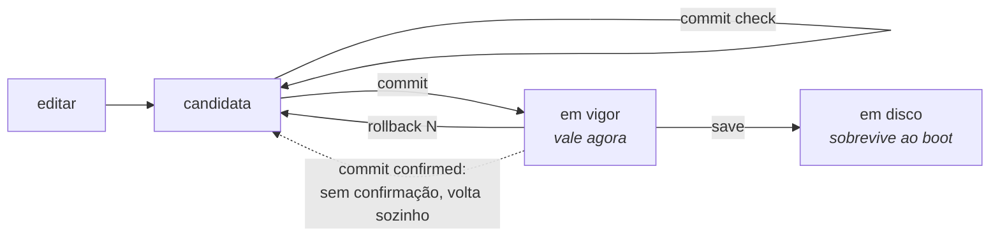

# commit, rollback e save

O modelo é o do Juniper: você edita uma **configuração candidata**, revisa, e só então aplica. Nada do que você digita chega ao equipamento antes do `commit`.



## `commit` e suas variantes

| Comando | Argumento | O que faz |
|---------|-----------|-----------|
| `commit` |           | aplica a candidata |
| `commit check` |           | valida sem aplicar, e reporta **quais assinantes uma mudança re-mapearia** |
| `commit remap` |           | aplica uma mudança que move assinantes existentes para novos endereços públicos e blocos |
| `commit confirmed <1-60>` | minutos   | aplica, e desfaz sozinho a menos que seja confirmado |
| `commit comment "<texto>"` |           | registra uma nota junto com este commit |

### `commit check` antes de qualquer coisa

É o comando que responde *"o que isso vai quebrar?"* antes de quebrar. Ele valida a candidata e, o que mais importa, informa quantos e quais assinantes seriam re-mapeados.

### `commit remap` — a trava contra o desastre silencioso

Um `commit` comum **recusa** mudanças que alterem o mapeamento de assinantes existentes. Elas precisam ser pedidas pelo nome, com `commit remap`.

O motivo é que esse é o pior tipo de falha possível neste equipamento: acrescentar um prefixo público derruba **toda** a base de assinantes ao mesmo tempo, e a máquina não reporta nada de anormal — porque, do ponto de vista dela, nada de anormal aconteceu. A recusa transforma um acidente silencioso numa decisão explícita.

### `commit confirmed` — a rede de segurança para mudar remoto

```
hexarouting# [edit] commit confirmed 5
```

Aplica agora, e desfaz automaticamente em 5 minutos a menos que você confirme. É o que permite mexer em roteamento numa máquina remota: se a mudança cortar seu próprio acesso, a máquina se recupera sozinha.

## `rollback`

```
rollback <0-19>
```

Carrega uma revisão commitada na candidata. **Ela não é aplicada** — vira a sua candidata, que você revisa e aplica com `commit`, como qualquer outra edição.

* `rollback 0` é a última configuração commitada.
* São mantidas as **20 revisões** mais recentes, em `/etc/hexarouting/rollback/`.
* `show rollback` lista as disponíveis.

Funciona nos modos operacional e de configuração.

## `save` — o segundo passo que as pessoas esquecem

`commit` faz a configuração passar a valer. `save` grava em `/etc/hexarouting/hexarouting.conf` para que ela sobreviva ao reboot.

**São coisas diferentes e nenhuma implica a outra.** Uma configuração commitada e não salva desaparece no próximo boot. Uma configuração salva mas com a candidata ainda modificada não é o que está valendo.

A separação é proposital: *"passe a valer agora"* e *"continue valendo depois de reiniciar"* são duas decisões, e o `commit confirmed` só faz sentido se a segunda não for automática.

## Inspecionando antes de aplicar

```
show configuration            a candidata inteira
show configuration compare    só o que muda em relação ao que está valendo
commit check                  valida, e diz quem seria re-mapeado
```

## No boot

A `hexarouting.service` roda `hexash --load /etc/hexarouting/hexarouting.conf` depois que o VPP aceita comandos.

O `--load` **recusa o arquivo inteiro** se houver uma linha que a VTY não consiga interpretar, em vez de aplicar o resto. Isso é deliberado: rodando sem ninguém olhando, aplicar um arquivo *menos uma linha* deixaria a configuração em disco e a em execução diferentes, e alguém descobriria isso lendo as duas muito depois.

# Ver também

* [Configuração de pool](/doc/configuracao-de-pool-btyS572Ih6) — quais mudanças exigem `commit remap`
* [Operação e diagnóstico](/doc/operacao-e-diagnostico-A4fcKDVwZt) — a ordem de boot que aplica o que foi salvo
