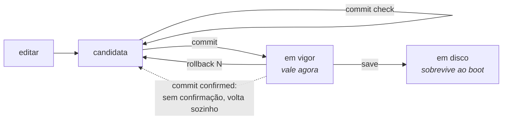

# commit, rollback e save

O modelo é o do Juniper: você edita uma **configuração candidata**, revisa, e só então aplica. Nada do que você digita chega ao equipamento antes do `commit`.



## `commit` e suas variantes

| Comando | Argumento | O que faz |
|---------|-----------|-----------|
| `commit` |           | aplica a candidata |
| `commit check` |           | valida sem aplicar, e reporta **quais assinantes uma mudança re-mapearia** |
| `commit remap` |           | aplica uma mudança que move assinantes existentes para novos endereços públicos e blocos |
| `commit confirmed <1-60>` | minutos   | aplica, e desfaz sozinho a menos que seja confirmado |
| `commit comment "<texto>"` |           | registra uma nota junto com este commit |

### `commit check` antes de qualquer coisa

É o comando que responde *"o que isso vai quebrar?"* antes de quebrar. Ele valida a candidata e, o que mais importa, informa quantos e quais assinantes seriam re-mapeados.

Ele também diz **o que não verificou**:

```
configuration check succeeds for CGNAT and the box's own configuration
  routing statements are checked for structure only; FRR validates them
  at commit, and can still refuse one
```


:::warning
Statements de roteamento — prefix-list, route-map, vizinhos BGP — são conferidos apenas na forma. Quem valida o conteúdo é o roteamento, e só no `commit`.

Isso significa que um `commit check` aprovado **não garante** que o `commit` seguinte vai passar. Se ele recusar, nada é aplicado: a caixa volta ao estado anterior inteira, inclusive os statements válidos que estavam na mesma mudança.

:::

Antes esse comando dizia apenas *"configuration check succeeds"*, o que prometia mais do que ele tinha conferido — e numa janela de manutenção é essa frase que decide se a pessoa segue em frente.

### `commit remap` — a trava contra o desastre silencioso

Um `commit` comum **recusa** mudanças que alterem o mapeamento de assinantes existentes. Elas precisam ser pedidas pelo nome, com `commit remap`.

O motivo é que esse é o pior tipo de falha possível neste equipamento: acrescentar um prefixo público derruba **toda** a base de assinantes ao mesmo tempo, e a máquina não reporta nada de anormal — porque, do ponto de vista dela, nada de anormal aconteceu. A recusa transforma um acidente silencioso numa decisão explícita.

### `commit confirmed` — a rede de segurança para mudar remoto

```
hexarouting# [edit] commit confirmed 5
```

Aplica agora, e desfaz automaticamente em 5 minutos a menos que você confirme. É o que permite mexer em roteamento numa máquina remota: se a mudança cortar seu próprio acesso, a máquina se recupera sozinha.

A caixa responde dizendo onde o desfazer está armado:

```
rollback at 2026-02-11T14:32:07Z, in 5 minute(s), unless you type 'commit' to confirm
    the revert is armed on the box, not in this session: logging out, losing this
    session or rebooting does not cancel it, and confirming does
```

**Quem desfaz é a máquina, não a sua sessão.** O prazo fica gravado no equipamento. Sair da VTY, perder o SSH, fechar o console serial ou reiniciar a máquina **não** cancela nada — só `commit` cancela. Isso é o que torna o comando útil: a falha contra a qual ele protege é exatamente a que derruba a sessão em que você está digitando.

#### Confirmar

Qualquer `commit` confirma a janela aberta:

```
hexarouting# [edit] commit
confirmed: the box will not roll this change back
```

Enquanto a janela estiver aberta, quem entrar na VTY é avisado logo no banner:

```
A 'commit confirmed' is waiting: this box rolls the last change back at 2026-02-11T14:32:07Z
unless you type 'commit' to confirm it.
```

#### Reboot dentro da janela

* Reiniciou **depois** de confirmar: nada é desfeito. A confirmação é registrada no momento em que você a dá, não no fim da janela.
* Reiniciou **antes** do prazo: o prazo continua valendo, e é um horário — não uma contagem que recomeça. Uma caixa que ficou desligada além do próprio prazo volta e desfaz na hora, porque ninguém confirmou.

:::warning
A máquina não distingue "reiniciei porque a mudança deu errado" de "reiniciei no meio da manutenção". Nos dois casos ela desfaz. É o lado seguro: confirmar custa uma palavra, e recuperar uma caixa inalcançável não custa palavra nenhuma — custa uma viagem.
:::

#### Mudanças de SSH e de contas

Qualquer mudança em `ssh` ou em `user` vira `commit confirmed 10` **mesmo que você não peça**, e a caixa diz por quê:

```
this commit changes SSH or accounts, which can cut off the session you are using
applying it as 'commit confirmed 10' rather than as a plain commit
```

#### Quando a promessa não pode ser feita

Se o equipamento não conseguir gravar o prazo — disco cheio, permissão negada em `/etc/hexarouting` —, ele **não** finge:

```
warning: the revert could NOT be armed on the box: /etc/hexarouting: Permission denied
    it will run in 10 minute(s) IF THIS SESSION LASTS THAT LONG, and not otherwise
    which is not the case it exists for: keep a second session open, and use
    'rollback 1' there if this one stops answering
```

Nesse estado o desfazer vale só enquanto a sessão durar. Abra uma segunda sessão antes de mexer.

## `rollback`

```
rollback <0-19>
```

Carrega uma revisão commitada na candidata. **Ela não é aplicada** — vira a sua candidata, que você revisa e aplica com `commit`, como qualquer outra edição.

* `rollback 0` é a última configuração commitada.
* São mantidas as **20 revisões** mais recentes, em `/etc/hexarouting/rollback/`.
* `show rollback` lista as disponíveis.

Funciona nos modos operacional e de configuração.

## `save` — o segundo passo que as pessoas esquecem

`commit` faz a configuração passar a valer. `save` grava em `/etc/hexarouting/hexarouting.conf` para que ela sobreviva ao reboot.

**São coisas diferentes e nenhuma implica a outra.** Uma configuração commitada e não salva desaparece no próximo boot. Uma configuração salva mas com a candidata ainda modificada não é o que está valendo.

A separação é proposital: *"passe a valer agora"* e *"continue valendo depois de reiniciar"* são duas decisões, e o `commit confirmed` só faz sentido se a segunda não for automática.

:::warning
`save` dentro de uma janela de `commit confirmed` grava no disco uma mudança que ainda não foi confirmada. O desfazer devolve o que está **valendo** e não reescreve o arquivo — então a caixa desfaria agora e traria a mudança de volta no próximo boot. Por isso o `save` avisa:

```
warning: what you just saved has NOT been confirmed
    this box rolls the running configuration back at 2026-02-11T14:32:07Z, and does not
    touch the file you just wrote - so a reboot after that would bring the
    unconfirmed change back. Type 'commit' to confirm, then 'save' again
```

Confirme primeiro, salve depois.
:::

## Inspecionando antes de aplicar

```
show configuration            a candidata inteira
show configuration compare    só o que muda em relação ao que está valendo
commit check                  valida, e diz quem seria re-mapeado
```

## No boot

A `hexarouting.service` roda `hexash --load /etc/hexarouting/hexarouting.conf` depois que o VPP aceita comandos.

O `--load` **recusa o arquivo inteiro** se houver uma linha que a VTY não consiga interpretar, em vez de aplicar o resto. Isso é deliberado: rodando sem ninguém olhando, aplicar um arquivo *menos uma linha* deixaria a configuração em disco e a em execução diferentes, e alguém descobriria isso lendo as duas muito depois.

# Ver também

* [Configuração de pool](/doc/configuracao-de-pool-btyS572Ih6) — quais mudanças exigem `commit remap`
* [Operação e diagnóstico](/doc/operacao-e-diagnostico-A4fcKDVwZt) — a ordem de boot que aplica o que foi salvo
