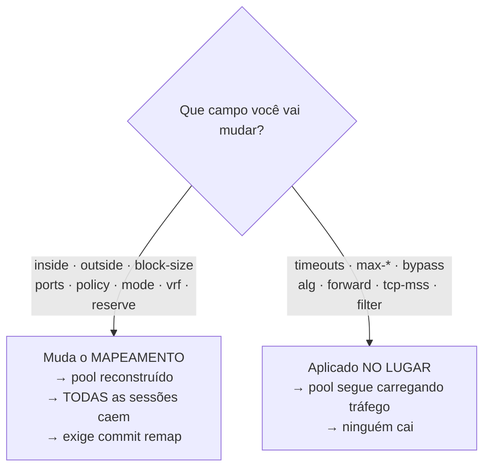

# Configuração de pool

Entra-se com `nat cgnat pool <nome>` dentro de `configure`. O prompt vira `hexarouting# [edit cgnat pool residencial] ` — ele nomeia o pool, e mantém a grafia curta `cgnat pool`, sem o `nat`. Sai-se com `exit`.


:::info
Procurando **como fazer uma tarefa** (abrir porta, limitar um host, ampliar o pool)? Comece pelas **Receitas do dia a dia**. Esta página é a referência campo a campo.

:::

# A divisão que importa antes de tudo

Alguns campos **reconstroem o pool**, e todas as sessões nele morrem no instante da aplicação. Outros são aplicados **no lugar**, num pool que está carregando tráfego.

| Reconstroem o pool — derrubam todas as sessões | Aplicados no lugar — sem impacto nas sessões |
|------------------------------------------------|----------------------------------------------|
| `inside`                                       | `timeout ...`                                |
| `outside`                                      | `max-blocks`                                 |
| `reserve`                                      | `block-stride`                               |
| `block-size`                                   | `bypass ...`                                 |
| `ports`                                        | `utilisation-alarm`                          |
| `policy`                                       | `max-sessions`                               |
| `mode`                                         | `max-session-rate`                           |
| `vrf`                                          | `tcp-mss`                                    |
| `outside-vrf`                                  | `filter`                                     |
|                                                | `alg ...`                                    |
|                                                | `forward ...`                                |



A regra por trás: os da esquerda mudam o **mapeamento** — qual endereço público e qual bloco de portas cada assinante recebe. Mudou o mapeamento, toda sessão existente virou inválida.

Errar essa classificação é ruim nos dois sentidos: um campo de mapeamento tratado como no-lugar nunca chega ao dataplane; um campo no-lugar tratado como mapeamento **desconecta a base inteira de assinantes para desligar um ALG**.


:::warning
**Cuidado com** `**inside**` **e** `**outside**` O mapeamento é **aritmético, não uma tabela**. O endereço público e o bloco de portas de um assinante são *calculados* a partir da definição do pool. Não existe registro de alocação para consultar — e isso significa que **mudar a definição muda a função**. Acrescentar um prefixo público move **todos** os assinantes naquele instante e encerra todas as sessões do pool. Nada é corrompido e respostas passadas continuam resolvíveis, mas todos os clientes caem de uma vez e a máquina não reporta nada de anormal — porque nada de anormal aconteceu. Por isso o `commit` **recusa** uma mudança dessas até que ela seja pedida pelo nome, com `commit remap`.

:::

# Campos de mapeamento

| Comando | Argumento | O que define |
|---------|-----------|--------------|
| `inside <prefixo>` | `<A.B.C.D/M>` | prefixo interno; pode repetir |
| `outside <prefixo>` | `<A.B.C.D/M>` | prefixo público; pode repetir |
| `block-size <n>` | `<64-32768>` | portas por bloco, potência de dois |
| `ports <min> <max>` |           | faixa de portas utilizável |
| `policy interleaved` |           | vizinhos em endereços públicos distintos |
| `policy blocked` |           | vizinhos no mesmo endereço público |
| `mode deterministic` |           | por fórmula, sem log de alocação |
| `mode dynamic` |           | sob demanda, com log de alocação |
| `vrf <n>` | `<0-4294967295>` | a VRF cujos assinantes este pool atende; ausente = todas |
| `outside-vrf <n>` | `<0-4294967295>` | a VRF por onde o tráfego traduzido sai; ausente = deixa onde estava |
| `reserve <n>` | `<0-65535>` | blocos de **cada** endereço público guardados fora da fórmula, para dar a quem encher o seu; `0` = nenhum |

`**policy interleaved**` **vs** `**blocked**` — `interleaved` espalha vizinhos por endereços públicos distintos, o que dilui o impacto de um bloqueio de reputação em um IP. `blocked` mantém vizinhos no mesmo endereço público.

# Timeouts do pool

`timeout <tipo> <segundos>`, de `1` a `4294967295`. Ausente, herda o global.
Zero não é um timeout: é o valor que a caixa lê como "não mexa neste", e por
isso é recusado na hora em que você digita, e não silenciosamente ignorado.

| Tipo | O que expira |
|------|--------------|
| `udp` | sessões UDP  |
| `icmp` | sessões ICMP |
| `tcp-syn` | TCP meio-aberto |
| `tcp-transitory` | TCP em transição |
| `tcp-established` | TCP estabelecido |
| `gre` | o mapeamento GRE de uma chamada PPTP |
| `port-holddown` | quanto tempo uma porta liberada espera antes de ser reusada |
| `alg-expect` | quanto tempo uma porta de mídia anunciada espera |

`port-holddown` não é detalhe: reusar uma porta imediatamente faz o registro de quem a usava se sobrepor ao próximo dono.

# Limites por assinante

| Comando | Argumento | O que limita |
|---------|-----------|--------------|
| `max-blocks <n>` | `<1-255>` | quantos blocos um assinante pode segurar |
| `block-stride <n>` | `<0-65535>` | distância entre os blocos de um mesmo assinante; `0` deixa o pool escolher |
| `max-sessions <n>` | `<0-4294967295>` | máximo de sessões simultâneas por assinante; `0` = ilimitado |
| `max-session-rate <n>` | `<0-4294967295>` | máximo de sessões novas por segundo, por assinante; `0` = ilimitado |
| `utilisation-alarm <pct>` | `<1-100>` | loga uma vez quando o bloco de um assinante atinge essa porcentagem |

`max-sessions` e `max-session-rate` são a defesa contra uma máquina infectada consumindo o pool inteiro. `utilisation-alarm` avisa **antes** do esgotamento, não depois.

# A faixa de portas que um assinante pode chegar a ter

`block-size` e `max-blocks` juntos **já são uma faixa**, e é assim que um pool
atende um medidor inteligente e uma casa pesada ao mesmo tempo:

```
block-size 64
max-blocks 8
```

Um assinante **começa com 64 portas**. Só recebe um segundo bloco quando enche
o primeiro, e só então um terceiro - até 8 blocos, 512 portas. O medidor nunca
pede o segundo e custa 64 portas ao pool; a casa pesada chega às 512 sozinha,
sem ninguém configurar nada para ela.

`show cgnat pool` mostra a faixa em portas, que é a unidade em que se vende:

```
  per sub      64-512 ports (1-8 blocks, grown one at a time as each fills)
```

O preço de um bloco pequeno é o **volume de registro**: cada bloco entregue a
um assinante vira um registro próprio no log de blocos. Uma casa que chega a 8
blocos gera 8 registros; com `block-size 512` e um bloco só, gera 1. Escolha o
menor bloco que ainda deixe a maioria dos assinantes dentro de **um** bloco, e
use `max-blocks` para a minoria que precisa de mais.

# O bloco de reserva de um pool determinístico

Num pool `mode deterministic` **não existe bloco sobrando**: a fórmula entrega
todos os blocos a algum assinante. Quem enche o seu bloco é derrubado - a
internet do cliente para com a caixa saudável - porque qualquer bloco entregue
como extra seria o bloco de outra pessoa, e o mapeamento dela quebraria em
silêncio.

`reserve <n>` guarda **n blocos de cada endereço público** fora da fórmula. São
esses, e só esses, os blocos que um pool determinístico tem para dar.

```
reserve 1
```

A conta muda junto, e é o preço:

```
blocos por endereço      = portas por endereço / block-size
blocos que a fórmula usa = blocos por endereço - reserve
capacidade               = endereços públicos x blocos que a fórmula usa
```

:::warning
**Ligar ou mudar o** `**reserve**` **remapeia assinantes.** Ele sai da
capacidade, e capacidade é mapeamento: o pool é reconstruído, todas as sessões
nele caem, e o `commit` recusa a mudança até ela ser pedida pelo nome com
`commit remap` - igual a acrescentar um prefixo público.

Quanto ele move depende da **política**, e as duas respostas não se parecem:

| Política | O que acontece com `reserve 1` |
|----------|--------------------------------|
| `interleaved` | **nenhum** assinante que continua cabendo muda de endereço ou de bloco. O pool só encolhe pelo fim: os que estavam acima da nova capacidade ficam sem bloco nenhum, e são `endereços públicos x reserve` deles |
| `blocked` | o divisor **é** o número de blocos que a fórmula usa, então quase todo mundo muda de lugar, além dos que o encolhimento deixou de fora |

`commit check` diz o número exato antes de qualquer coisa acontecer.

:::

`show cgnat pool` mostra as duas contas lado a lado, e a capacidade já vem
descontada:

```
  reserve      1 block(s) per public IP -> 3 mapped, 1 held for extensions
  capacity     3 subscribers (usable 3)
```

Cada bloco entregue da reserva vira **um registro próprio** no log de blocos, e
a devolução dele também. É a única coisa que o modo determinístico registra por
assinante, e tem de ser: é o único bloco que a fórmula não produz, então a
configuração datada não responde por ele sozinha.

`show cgnat blocks` mostra a reserva e conta as recusas:

```
  reserve exhausted 3 time(s): a subscriber filled its block, was under
  max-blocks 2, and the reserve had nothing left
```

Essa contagem é **separada** de um assinante bater no `max-blocks`, porque a
ação é outra: contra uma, aumentar a reserva ou acrescentar endereços públicos;
contra a outra, aumentar o limite por assinante.

Três coisas que vale saber antes de escolher o número:

* **Uma reserva menor que o número de workers deixa workers sem nada.** A caixa
  avisa na criação do pool e cria o pool assim mesmo - recusar faria um pool
  aceito hoje não subir depois de a máquina ganhar workers, o que derruba todo
  mundo.
* **A caixa prefere um bloco do próprio endereço público do assinante**, para
  que quem está do outro lado continue vendo um host só. É preferência, não
  garantia: se não houver um livre na fatia daquele worker, ela entrega outro
  em vez de recusar.
* **`reserve` não vale em** `**mode dynamic**` e é recusado lá. Um pool dinâmico
  já tem blocos sobrando - a lista de livres é exatamente de onde sai o bloco
  extra - então uma reserva tiraria blocos da própria lista de onde eles vêm.

# Onde ficam os blocos extras de um assinante

`block-stride <n>` decide a distância entre os blocos que um mesmo assinante
segura. Vale só em `mode dynamic`: num pool determinístico o bloco extra vem da
reserva, que é um conjunto à parte, e a distância não se aplica a ele.

| Valor | O que acontece |
|-------|----------------|
| `0` (padrão) | o bloco extra vai para onde o pool tiver um livre - comportamento de sempre |
| `1` | os blocos ficam **colados**: o segundo começa onde o primeiro termina |
| `n` | os blocos ficam `n × block-size` portas afastados, no mesmo endereço público |

**Colado (`1`)** deixa o assinante com uma faixa contínua de portas. É a opção
para quem atende ofício e investigação: uma faixa em vez de várias, e o técnico
que olha um horário não precisa cruzar três intervalos separados.

**Afastado (`n` maior)** espalha o assinante pela faixa de portas do próprio
endereço público. É a opção para quem quer que observar um intervalo de portas
de fora diga o mínimo possível sobre um cliente.

Nenhuma das duas é obviamente certa - por isso é um ajuste, e por isso o padrão
é o comportamento antigo: uma configuração escrita antes de o `stride` existir
se comporta igual quando a caixa passa a rodar uma versão nova.

:::info
**O `stride` nunca custa tráfego a um cliente.** Se o bloco que a distância
aponta já estiver com outro assinante, ou se o assinante estiver no fim da
faixa de portas do seu endereço público, a caixa entrega **outro bloco
qualquer** em vez de recusar. O cliente continua funcionando; o que muda é só
onde o bloco caiu.

:::

`show cgnat blocks` conta os dois casos, e é onde se confere se o ajuste está
valendo de fato:

```
  stride 1: 412 extensions placed where it says, 7 fell back to the free list
```

Só zeros na primeira coluna com números na segunda quer dizer que a distância
escolhida **não cabe** nesta caixa. Isso acontece quando a máquina roda com
vários workers: os blocos são divididos entre eles, e um assinante só pode
receber blocos da fatia do seu próprio worker. A caixa avisa no momento em que
o pool é criado e diz qual distância serve:

```
warning: block-stride 1 on pool residencial cannot be honoured: blocks are
         sharded 4 ways and a stride step moves by 2, so every block the
         stride names belongs to another worker
         the nearest stride that can be: 2
         the setting is applied and extensions fall back to the free list;
         this is a warning, not a refusal
```

É um aviso e não uma recusa de propósito: o número de workers é ajuste de
inicialização, e uma configuração recusada por causa dele deixaria o pool
**sem subir** depois de um reinício - o que derruba todo mundo, para atender a
uma preferência de arrumação.

# Bypass — o que não é traduzido

| Comando | Argumento | Efeito |
|---------|-----------|--------|
| `bypass source <prefixo>` | `<A.B.C.D/M>` | origem que precisa manter o próprio endereço |
| `bypass destination <prefixo>` | `<A.B.C.D/M>` | destino que precisa enxergar a origem real |

Tráfego em bypass sai **sem tradução e sem alocar nada**.

# Encaminhamento de porta

```
forward tcp <porta-pública> to <ip-privado> <porta-privada>
forward udp <porta-pública> to <ip-privado> <porta-privada>
```

Fixa uma porta de entrada num assinante. **O endereço público é o do próprio assinante** — não um IP avulso do pool.

# Comportamento NAT

| Comando | Efeito |
|---------|--------|
| `filter endpoint-independent` | qualquer um alcança um mapeamento aberto (*full cone*) — **padrão** |
| `filter address-dependent` | só o remoto que o assinante contatou (*restricted cone*) |

Corresponde ao REQ-8 da RFC 4787.

# MSS clamping

```
tcp-mss <bytes>
tcp-mss auto
```

Rebaixa o MSS dos handshakes para que os segmentos caibam no caminho. `auto` deriva o valor das MTUs das interfaces de CGNAT.

Vale notar o modo de falha que isso corrige: sem clamp, o par descarta o segmento e a conexão trava — silenciosamente, com um contador afirmando que tudo foi aplicado.

# ALGs

```
alg ftp  <on|off>
alg rtsp <on|off>
alg pptp <on|off>
alg esp  <on|off>
alg sip  <on|off>
```

| ALG | O que reescreve |
|-----|-----------------|
| `ftp` | PORT/EPRT e as respostas 227/229 |
| `rtsp` | o `client_port` do cabeçalho Transport |
| `pptp` | o canal de controle e o canal de dados GRE |
| `esp` | nada do payload: amarra o túnel IPsec ao gateway remoto |
| `sip` | `Via`, `Contact` e o SDP do SIP sobre UDP, e abre o par RTP/RTCP |

São os protocolos que carregam um endereço dentro do payload — ou, no caso do `esp`, que não têm porta nenhuma para o CGNAT usar. Sem o ALG correspondente, eles anunciam o endereço privado para o outro lado e a conexão de dados nunca se estabelece.

Os cinco vêm **ligados**. `alg <nome> off` é a exceção escrita no pool, e `no alg <nome>` devolve o ALG ao padrão do equipamento em vez de fixá-lo num valor.

# Removendo um ajuste: `no`

Dentro do bloco, `no <ajuste>` tira o ajuste. `no ?` lista o que pode ser tirado, e `?` depois da palavra continua oferecendo o argumento:

```
hexarouting# [edit cgnat pool residencial] no ?
  alg                stop choosing for one ALG; the pool takes the device default again
  block-stride       let the pool place a subscriber's extra blocks wherever it has one free
  bypass             stop excluding a prefix from translation
  filter             go back to endpoint-independent filtering
  forward            remove one inbound port forward
  inside             remove one inside prefix
  max-blocks         go back to one block per subscriber
  max-session-rate   no per-subscriber session rate cap
  max-sessions       no per-subscriber session cap
  outside            remove one public prefix
  outside-vrf        leave translated traffic where it was
  ports              go back to the device's own port range
  reserve            give the reserved blocks back to the formula; this too re-maps subscribers
  tcp-mss            stop clamping the MSS
  timeout            stop overriding one timeout; the pool inherits the global again
  utilisation-alarm  stop alarming on block utilisation
  vrf                serve every VRF again
```

Tirar um timeout, um ALG ou um limite **não é o mesmo que ajustá-lo para o valor padrão**: o pool volta a **herdar** o global, e a linha desaparece da configuração em vez de aparecer nela com um número dentro. Um `timeout udp 300` global mudado depois passa a valer para o pool de novo.

## Três ajustes não podem ser removidos, e a caixa diz isso

`block-size`, `policy` e `mode` **sempre têm um valor**. Não existe pool sem tamanho de bloco, sem política e sem modo - então `no block-size 512` não teria o que significar: tirar a linha não tiraria o ajuste, só faria a configuração parar de dizer o que o pool está fazendo, enquanto o pool continua fazendo. A caixa recusa e diz o que digitar no lugar:

Digitar `no block-size 512` dentro do pool é recusado, e a recusa diz o que fazer no lugar:

```
error: block-size cannot be removed: every pool has one, so there is no state
without it. Set the value you want instead: block-size <64-32768>
```

Sai numa **linha só**, mais larga que o console - quem quebra é o terminal.
`policy` e `mode` respondem com a mesma frase, trocando o nome do campo e o
que digitar no lugar: `policy interleaved|blocked` e `mode
deterministic|dynamic`.

Para mudar qualquer um dos três, digite o valor que você quer. São campos de mapeamento: a mudança reconstrói o pool e exige `commit remap`.

## `ports`, `vrf` e `outside-vrf` têm um estado "não dito"

Estes três aceitam `no`, e o estado para onde eles voltam não é um valor - é a **ausência** dele, que significa outra coisa:

| Comando | Para onde volta |
|---------|-----------------|
| `no ports` | a faixa de portas do próprio equipamento |
| `no vrf` | atende **todas** as VRFs, que não é a mesma resposta que `vrf 0` |
| `no outside-vrf` | deixa o tráfego traduzido onde ele já estava |

Os três também são campos de mapeamento: removê-los reconstrói o pool.

## Remover algo que não está lá é recusado

`no inside 10.0.0.0/8` num pool que não tem esse prefixo é recusado, com o prefixo escrito de volta. O pool continua com o prefixo que você queria, e quase sempre o que aconteceu foi um erro de digitação:

```
error: the pool has no inside 10.0.0.0/8
```

Já `no timeout udp` num pool que não sobrescreve o timeout de UDP é aceito em silêncio: o estado depois é exatamente o estado pedido - este pool não sobrescreve nada.

# Exemplo completo

```
configure
 nat cgnat pool residencial
  inside 100.64.0.0/10
  outside 203.0.113.0/24
  block-size 512
  ports 1024 65535
  policy interleaved
  mode deterministic
  timeout udp 300
  timeout tcp-established 7440
  max-sessions 2000
  max-session-rate 200
  utilisation-alarm 85
  tcp-mss auto
  alg ftp on
  alg pptp on
  bypass destination 198.51.100.0/24
  exit
 nat cgnat interface TenGigabitEthernet0/0/0 inside
 nat cgnat interface TenGigabitEthernet0/0/1 outside
 show configuration compare
 commit check
 commit comment "pool residencial inicial"
 exit
save
```

Uma configuração salva antes de o CGNAT passar para baixo de `nat` abre o pool com `cgnat pool residencial`, sem o `nat` na frente. **Ela continua sendo aceita** — a caixa relê o próprio arquivo a cada boot — e os campos de dentro do bloco não mudaram. O primeiro `save` depois desta versão reescreve o arquivo já com `nat cgnat pool`.

# Ver também

* [Receitas do dia a dia](/doc/receitas-do-dia-a-dia-IcocgdbXW2) — estes campos aplicados a tarefas reais
* [BPA — conceitos e mapeamento](/doc/bpa-conceitos-e-mapeamento-uh9nF6sRaa) — por que alguns campos derrubam sessão
