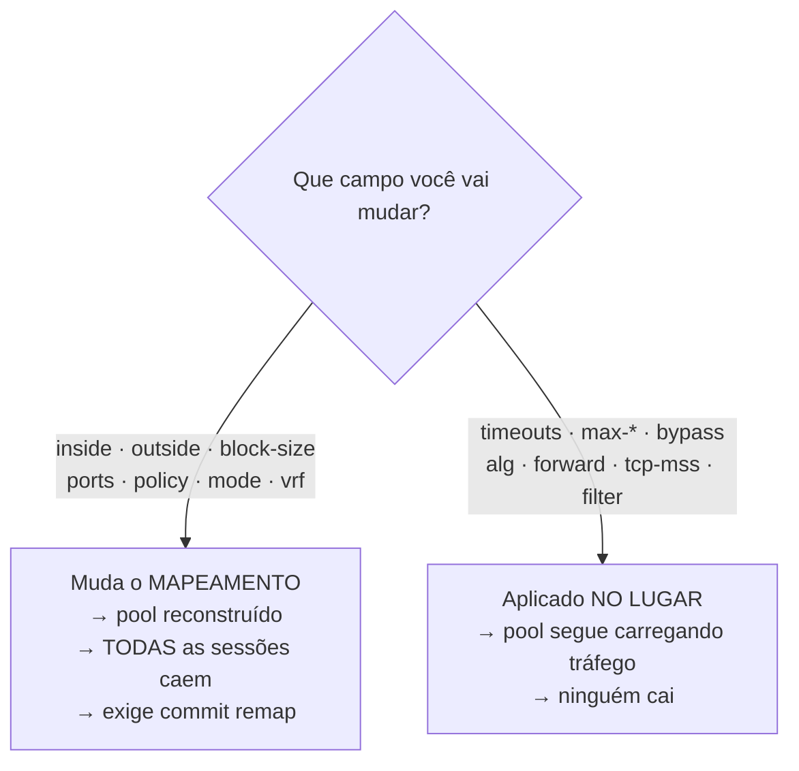

# Configuração de pool

Entra-se com `cgnat pool <nome>` dentro de `configure`. O prompt vira `hexarouting# [edit cgnat pool] `. Sai-se com `exit`.


:::info
Procurando **como fazer uma tarefa** (abrir porta, limitar um host, ampliar o pool)? Comece pelas **Receitas do dia a dia**. Esta página é a referência campo a campo.

:::

# A divisão que importa antes de tudo

Alguns campos **reconstroem o pool**, e todas as sessões nele morrem no instante da aplicação. Outros são aplicados **no lugar**, num pool que está carregando tráfego.

| Reconstroem o pool — derrubam todas as sessões | Aplicados no lugar — sem impacto nas sessões |
|------------------------------------------------|----------------------------------------------|
| `inside`                                       | `timeout ...`                                |
| `outside`                                      | `max-blocks`                                 |
| `block-size`                                   | `bypass ...`                                 |
| `ports`                                        | `utilisation-alarm`                          |
| `policy`                                       | `max-sessions`                               |
| `mode`                                         | `max-session-rate`                           |
| `vrf`                                          | `tcp-mss`                                    |
| `outside-vrf`                                  | `filter`                                     |
|                                                | `alg ...`                                    |
|                                                | `forward ...`                                |



A regra por trás: os da esquerda mudam o **mapeamento** — qual endereço público e qual bloco de portas cada assinante recebe. Mudou o mapeamento, toda sessão existente virou inválida.

Errar essa classificação é ruim nos dois sentidos: um campo de mapeamento tratado como no-lugar nunca chega ao dataplane; um campo no-lugar tratado como mapeamento **desconecta a base inteira de assinantes para desligar um ALG**.


:::warning
**Cuidado com** `**inside**` **e** `**outside**` O mapeamento é **aritmético, não uma tabela**. O endereço público e o bloco de portas de um assinante são *calculados* a partir da definição do pool. Não existe registro de alocação para consultar — e isso significa que **mudar a definição muda a função**. Acrescentar um prefixo público move **todos** os assinantes naquele instante e encerra todas as sessões do pool. Nada é corrompido e respostas passadas continuam resolvíveis, mas todos os clientes caem de uma vez e a máquina não reporta nada de anormal — porque nada de anormal aconteceu. Por isso o `commit` **recusa** uma mudança dessas até que ela seja pedida pelo nome, com `commit remap`.

:::

# Campos de mapeamento

| Comando | Argumento | O que define |
|---------|-----------|--------------|
| `inside <prefixo>` | `<A.B.C.D/M>` | prefixo interno; pode repetir |
| `outside <prefixo>` | `<A.B.C.D/M>` | prefixo público; pode repetir |
| `block-size <n>` | `<64-65536>` | portas por bloco, potência de dois |
| `ports <min> <max>` |           | faixa de portas utilizável |
| `policy interleaved` |           | vizinhos em endereços públicos distintos |
| `policy blocked` |           | vizinhos no mesmo endereço público |
| `mode deterministic` |           | por fórmula, sem log de alocação |
| `mode dynamic` |           | sob demanda, com log de alocação |
| `vrf <n>` | `<1-65535>` | a VRF cujos assinantes este pool atende; ausente = todas |
| `outside-vrf <n>` | `<1-65535>` | a VRF por onde o tráfego traduzido sai; ausente = deixa onde estava |

`**policy interleaved**` **vs** `**blocked**` — `interleaved` espalha vizinhos por endereços públicos distintos, o que dilui o impacto de um bloqueio de reputação em um IP. `blocked` mantém vizinhos no mesmo endereço público.

# Timeouts do pool

`timeout <tipo> <segundos>`. Ausente, herda o global.

| Tipo | O que expira |
|------|--------------|
| `udp` | sessões UDP  |
| `icmp` | sessões ICMP |
| `tcp-syn` | TCP meio-aberto |
| `tcp-transitory` | TCP em transição |
| `tcp-established` | TCP estabelecido |
| `gre` | o mapeamento GRE de uma chamada PPTP |
| `port-holddown` | quanto tempo uma porta liberada espera antes de ser reusada |
| `alg-expect` | quanto tempo uma porta de mídia anunciada espera |

`port-holddown` não é detalhe: reusar uma porta imediatamente faz o registro de quem a usava se sobrepor ao próximo dono.

# Limites por assinante

| Comando | Argumento | O que limita |
|---------|-----------|--------------|
| `max-blocks <n>` | `<1-65535>` | quantos blocos um assinante pode segurar |
| `max-sessions <n>` | `<1-65535>` | máximo de sessões simultâneas por assinante; `0` = ilimitado |
| `max-session-rate <n>` | `<1-65535>` | máximo de sessões novas por segundo, por assinante; `0` = ilimitado |
| `utilisation-alarm <pct>` | `<1-100>` | loga uma vez quando o bloco de um assinante atinge essa porcentagem |

`max-sessions` e `max-session-rate` são a defesa contra uma máquina infectada consumindo o pool inteiro. `utilisation-alarm` avisa **antes** do esgotamento, não depois.

# Bypass — o que não é traduzido

| Comando | Argumento | Efeito |
|---------|-----------|--------|
| `bypass source <prefixo>` | `<A.B.C.D/M>` | origem que precisa manter o próprio endereço |
| `bypass destination <prefixo>` | `<A.B.C.D/M>` | destino que precisa enxergar a origem real |

Tráfego em bypass sai **sem tradução e sem alocar nada**.

# Encaminhamento de porta

```
forward tcp <porta-pública> to <ip-privado> <porta-privada>
forward udp <porta-pública> to <ip-privado> <porta-privada>
```

Fixa uma porta de entrada num assinante. **O endereço público é o do próprio assinante** — não um IP avulso do pool.

# Comportamento NAT

| Comando | Efeito |
|---------|--------|
| `filter endpoint-independent` | qualquer um alcança um mapeamento aberto (*full cone*) — **padrão** |
| `filter address-dependent` | só o remoto que o assinante contatou (*restricted cone*) |

Corresponde ao REQ-8 da RFC 4787.

# MSS clamping

```
tcp-mss <bytes>
tcp-mss auto
```

Rebaixa o MSS dos handshakes para que os segmentos caibam no caminho. `auto` deriva o valor das MTUs das interfaces de CGNAT.

Vale notar o modo de falha que isso corrige: sem clamp, o par descarta o segmento e a conexão trava — silenciosamente, com um contador afirmando que tudo foi aplicado.

# ALGs

```
alg ftp  <on|off>
alg rtsp <on|off>
alg pptp <on|off>
```

| ALG | O que reescreve |
|-----|-----------------|
| `ftp` | PORT/EPRT e as respostas 227/229 |
| `rtsp` | o `client_port` do cabeçalho Transport |
| `pptp` | o canal de controle e o canal de dados GRE |

São os protocolos que carregam um endereço dentro do payload. Sem o ALG correspondente, eles anunciam o endereço privado para o outro lado e a conexão de dados nunca se estabelece.

# Exemplo completo

```
configure
 cgnat pool residencial
  inside 100.64.0.0/10
  outside 203.0.113.0/24
  block-size 512
  ports 1024 65535
  policy interleaved
  mode deterministic
  timeout udp 300
  timeout tcp-established 7440
  max-sessions 2000
  max-session-rate 200
  utilisation-alarm 85
  tcp-mss auto
  alg ftp on
  alg pptp on
  bypass destination 198.51.100.0/24
  exit
 cgnat interface TenGigabitEthernet0/0/0 inside
 cgnat interface TenGigabitEthernet0/0/1 outside
 show configuration compare
 commit check
 commit comment "pool residencial inicial"
 exit
save
```

# Ver também

* [Receitas do dia a dia](/doc/receitas-do-dia-a-dia-IcocgdbXW2) — estes campos aplicados a tarefas reais
* [BPA — conceitos e mapeamento](/doc/bpa-conceitos-e-mapeamento-uh9nF6sRaa) — por que alguns campos derrubam sessão
