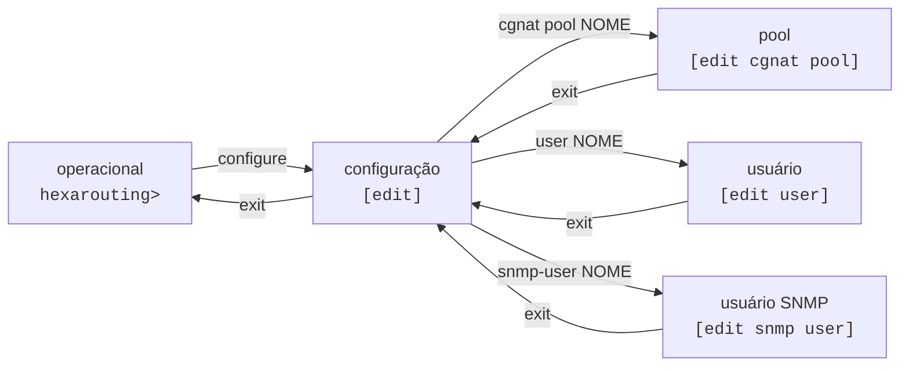

# VTY hexash — guia de uso

`hexash` é a VTY única do HexaRouting: configura CGNAT **e** roteamento pela mesma interface, com modelo de configuração candidata no estilo Juniper — você edita, revisa e só então aplica com `commit`.



## Modos e prompts

| Modo | Prompt | Como entrar | Como sair |
|------|--------|-------------|-----------|
| Operacional | `hexarouting> ` | é onde a sessão começa | `exit` encerra a sessão |
| Configuração | `hexarouting# [edit] ` | `configure` | `exit`    |
| Pool | `hexarouting# [edit cgnat pool residencial] ` | `cgnat pool <nome>` | `exit`    |
| Interface | `hexarouting# [edit interface GigabitEthernet0/12/0] ` | `interface <nome>` | `exit`    |
| Usuário | `hexarouting# [edit user joao] ` | `user <nome>` | `exit`    |
| Usuário SNMP | `hexarouting# [edit snmp user nms] ` | `snmp-user <nome>` | `exit`    |
| Bloco do FRR | `hexarouting# [edit router bgp 65000] ` | `router bgp <AS>` | `exit`    |

**O prompt nomeia o assunto, não só o tipo de bloco.** `[edit cgnat pool]` seria o mesmo prompt numa caixa com vinte pools: diria que você está *num* pool sem dizer em qual, que é justamente a pergunta que você tem.

Blocos aninhados aparecem com o mais interno por último, separados por `/`, para que dê para ver o que contém o quê. Um prompt longo demais é truncado pelo começo — o fim é onde a próxima linha vai cair, e é a metade que vale o espaço.


:::warning
Entrar numa interface **também** mexe no prompt. Antes disso não mexia, e nada na tela dizia que a próxima linha ia cair na `GigabitEthernet0/12/0` — um `mtu 1500` digitado um bloco depois do pretendido ia para a interface errada, sem aviso.

:::

## Onde eu estou, e o que já digitei aqui

```
show this
```

Mostra a configuração da hierarquia em que você está — dentro de um pool, o pool; dentro de uma interface, a MTU e o uRPF dela; no topo do modo de configuração, a candidata inteira.

## Descobrindo comandos

Duas ferramentas, sempre disponíveis:

* **TAB** completa o comando ou lista as opções possíveis no ponto em que você está.
* `**?**` mostra as opções válidas naquele ponto, cada uma com sua descrição.

E onde a árvore espera um **nome**, os dois completam com o que a caixa realmente tem:

```
hexarouting# [edit] interface ?
  host-veth-vpp             interface (up)
  pg0                       interface (up)
  tap4096                   interface (up)
```

Interfaces vêm do dataplane, com o estado. Pools, contas e usuários SNMP vêm da **candidata** — então completam o que você está editando, não só o que já foi commitado.

Uma fonte que não consegue responder simplesmente não oferece nada e deixa a dica no lugar: uma VTY que fica inútil quando o dataplane cai é uma VTY que não serve para consertá-lo.

Ambas são contextuais: dentro de um pool, `?` lista os campos do pool, não os comandos globais.

## O ciclo de trabalho

```
configure                    entra em configuração
  ... edições ...            alteram a candidata, não a máquina
show configuration compare   o que mudaria
commit check                 valida sem aplicar
commit                       aplica
exit                         volta ao operacional
save                         grava em disco para sobreviver ao boot
```

**Nada do que você edita chega ao equipamento antes do** `**commit**`**.** Editar é seguro; aplicar é o passo consciente.

E `commit` **não** grava em disco — quem faz isso é `save`. Uma configuração commitada mas não salva desaparece no próximo boot. São dois passos porque são duas decisões diferentes: *"passe a valer agora"* e *"continue valendo depois de reiniciar"*.

## Comandos do modo operacional

| Comando | O que faz |
|---------|-----------|
| `configure` | entra no modo de configuração |
| `show ...` | exibe informação (ver a página de comandos `show`) |
| `rollback <0-19>` | carrega uma revisão commitada na candidata |
| `save`  | grava a configuração em vigor em disco |
| `install` | instala o HexaRouting num disco desta máquina — **só existe rodando a partir da ISO** |
| `exit`  | encerra a sessão |

## Comandos do modo de configuração

| Comando | O que faz |
|---------|-----------|
| `cgnat ...` | configuração de CGNAT |
| `no cgnat pool <nome>` | remove um pool |
| `no cgnat interface <nome>` | desabilita CGNAT numa interface |
| `router bgp <AS>` / `router ospf` / `router isis <nome>` | protocolos de roteamento (FRR) |
| `interface <nome>` | entra na configuração de uma interface |
| `ssh ...` | daemon SSH |
| `user <nome>` | uma conta que pode logar |
| `snmp ...` | agente SNMP, somente leitura por construção |
| `snmp-user <nome>` | um usuário SNMPv3 |
| `commit ...` | aplica a candidata |
| `rollback <0-19>` | carrega uma revisão commitada na candidata |
| `show ...` | exibe informação |
| `exit`  | sai do modo de configuração |

## Bloco de interface

Dentro de `interface <nome>`:

| Comando | Argumento | O que faz |
|---------|-----------|-----------|
| `mtu`   | `<576-9216>` | MTU, na interface do dataplane **e** no TAP dela |
| `urpf strict` |           | a origem **precisa** rotear de volta por esta interface |
| `urpf loose` |           | a origem precisa ter rota em algum lugar |
| `urpf off` |           | sem checagem (padrão) |
| `exit`  |           | sai da interface |


:::info
O `mtu` aqui existe porque um operador que não descobre `mtu` com `?` herda os 9000 do TAP e passa uma tarde com adjacência OSPF travada em Exchange.

:::

# Ver também

* [Primeiros passos](/doc/primeiros-passos-TAWDdSrYG7) — a VTY aplicada do começo ao fim
* [Receitas do dia a dia](/doc/receitas-do-dia-a-dia-IcocgdbXW2) — tarefas prontas, sem precisar montar do zero
