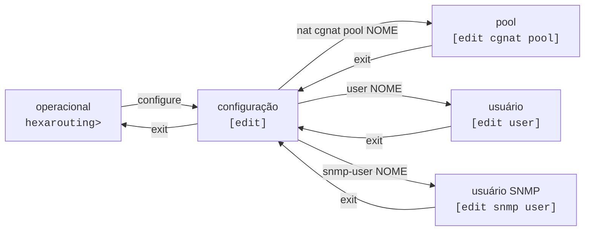

# VTY hexash — guia de uso

`hexash` é a VTY única do HexaRouting: configura CGNAT **e** roteamento pela mesma interface, com modelo de configuração candidata no estilo Juniper — você edita, revisa e só então aplica com `commit`.



## Modos e prompts

| Modo | Prompt | Como entrar | Como sair |
|------|--------|-------------|-----------|
| Operacional | `hexarouting> ` | é onde a sessão começa | `exit` encerra a sessão |
| Configuração | `hexarouting# [edit] ` | `configure` | `exit`    |
| Pool | `hexarouting# [edit cgnat pool residencial] ` | `nat cgnat pool <nome>` | `exit`    |
| Interface | `hexarouting# [edit interface GigabitEthernet0/12/0] ` | `interface <nome>` | `exit`    |
| Usuário | `hexarouting# [edit user joao] ` | `user <nome>` | `exit`    |
| Usuário SNMP | `hexarouting# [edit snmp user nms] ` | `snmp-user <nome>` | `exit`    |
| Rotas estáticas | `hexarouting# [edit router static] ` | `router static` | `exit`    |
| Bloco do FRR | `hexarouting# [edit router bgp 65000] ` | `router bgp <AS>` | `exit`    |

**O prompt nomeia o assunto, não só o tipo de bloco.** `[edit cgnat pool]` seria o mesmo prompt numa caixa com vinte pools: diria que você está *num* pool sem dizer em qual, que é justamente a pergunta que você tem.

Blocos aninhados aparecem com o mais interno por último, separados por `/`, para que dê para ver o que contém o quê. Um prompt longo demais é truncado pelo começo — o fim é onde a próxima linha vai cair, e é a metade que vale o espaço.


:::warning
Entrar numa interface **também** mexe no prompt. Antes disso não mexia, e nada na tela dizia que a próxima linha ia cair na `GigabitEthernet0/12/0` — um `mtu 1500` digitado um bloco depois do pretendido ia para a interface errada, sem aviso.

:::

## Onde eu estou, e o que já digitei aqui

```
show this
```

Mostra a configuração da hierarquia em que você está — dentro de um pool, o pool; dentro de uma interface, a MTU e o uRPF dela; no topo do modo de configuração, a candidata inteira.

## Descobrindo comandos

Duas ferramentas, sempre disponíveis:

* **TAB** completa o comando ou lista as opções possíveis no ponto em que você está.
* `**?**` mostra as opções válidas naquele ponto, cada uma com sua descrição.

E onde a árvore espera um **nome**, os dois completam com o que a caixa realmente tem:

```
hexarouting# [edit] interface ?
  host-veth-vpp             interface (up)
  pg0                       interface (up)
  tap4096                   interface (up)
```

Interfaces vêm do dataplane, com o estado. Pools, contas e usuários SNMP vêm da **candidata** — então completam o que você está editando, não só o que já foi commitado.

Uma fonte que não consegue responder simplesmente não oferece nada e deixa a dica no lugar: uma VTY que fica inútil quando o dataplane cai é uma VTY que não serve para consertá-lo.

Ambas são contextuais: dentro de um pool, `?` lista os campos do pool, não os comandos globais.

## O ciclo de trabalho

```
configure                    entra em configuração
  ... edições ...            alteram a candidata, não a máquina
show configuration compare   o que mudaria
commit check                 valida sem aplicar
commit                       aplica
exit                         volta ao operacional
save                         grava em disco para sobreviver ao boot
```

**Nada do que você edita chega ao equipamento antes do** `**commit**`**.** Editar é seguro; aplicar é o passo consciente.

E `commit` **não** grava em disco — quem faz isso é `save`. Uma configuração commitada mas não salva desaparece no próximo boot. São dois passos porque são duas decisões diferentes: *"passe a valer agora"* e *"continue valendo depois de reiniciar"*.

## Comandos do modo operacional

| Comando | O que faz |
|---------|-----------|
| `configure` | entra no modo de configuração |
| `show ...` | exibe informação (ver a página de comandos `show`) |
| `start shell` | abre um shell como processo filho; `exit` volta para a VTY. **Só administradores** — um shell nesta caixa é toda a capacidade de uma vez |
| `rollback <0-19>` | carrega uma revisão commitada na candidata |
| `save`  | grava a configuração em vigor em disco |
| `install` | instala o HexaRouting num disco desta máquina — **só existe rodando a partir da ISO** |
| `exit`  | encerra a sessão |

## Comandos do modo de configuração

| Comando | O que faz |
|---------|-----------|
| `nat cgnat ...` | configuração de CGNAT |
| `no nat cgnat pool <nome>` | remove um pool |
| `no nat cgnat interface <nome>` | desabilita CGNAT numa interface |
| `router static` | entra no bloco das rotas estáticas |
| `router bgp <AS>` / `router ospf` / `router isis <nome>` | protocolos de roteamento (FRR) |
| `interface <nome>` | entra na configuração de uma interface |
| `ssh ...` | daemon SSH |
| `user <nome>` | uma conta que pode logar |
| `snmp ...` | agente SNMP, somente leitura por construção |
| `snmp-user <nome>` | um usuário SNMPv3 |
| `commit ...` | aplica a candidata |
| `rollback <0-19>` | carrega uma revisão commitada na candidata |
| `show ...` | exibe informação |
| `exit`  | sai do modo de configuração |


:::info
**Duas hierarquias mudaram de lugar.** O CGNAT ficou embaixo de `nat` (`nat cgnat pool ...`, `nat cgnat interface ...`) e as rotas estáticas viraram um bloco embaixo de `router` (`router static`, com `route <prefixo> <próximo-salto>` dentro). É onde o operador procura por elas.

As grafias antigas — `cgnat ...` no topo do modo de configuração e `ip route ...` — **continuam aceitas**, digitadas ou lidas de um arquivo salvo, para que nenhuma caixa em serviço perca a própria configuração. Só as novas são oferecidas por TAB e `?`, e é nelas que a caixa escreve o que mostra e o que salva.

:::

## Bloco de interface

Dentro de `interface <nome>`:

| Comando | Argumento | O que faz |
|---------|-----------|-----------|
| `mtu`   | `<576-9216>` | MTU, na interface do dataplane **e** no TAP dela |
| `urpf strict` |           | a origem **precisa** rotear de volta por esta interface |
| `urpf loose` |           | a origem precisa ter rota em algum lugar |
| `urpf off` |           | sem checagem (padrão) |
| `exit`  |           | sai da interface |


:::info
O `mtu` aqui existe porque um operador que não descobre `mtu` com `?` herda os 9000 do TAP e passa uma tarde com adjacência OSPF travada em Exchange.

:::

## Um nome de interface que não existe é recusado

```
error: interface Ten0: this box has no such interface
    it has: GigabitEthernet0/12/0, TenGigabitEthernet0/8/0, local0
    (a linux_cp pair answers to both its dataplane name and its Linux one)
    the statement would commit and do nothing
```

`interface Ten0` — um erro de digitação de `TenGigabitEthernet0/8/0` — commitava limpo, aparecia na configuração em vigor e não fazia nada. A recusa **lista o que a caixa tem**, porque ela já sabe: é a mesma fonte de onde vem a completação, e quem recebe só um "não" tem de ir procurar.

Vale para as quatro formas de nomear uma interface: o bloco do FRR, o `nat cgnat interface`, e as declarações `mtu` e `urpf`.

A exceção é o **loopback**: `interface loop<n>` num nome que a caixa ainda não tem é o que **cria** o loopback, porque não há mais nada de onde criá-lo. Está na página de configuração de interface.


:::info
Uma interface do `linux_cp` atende por **mais de um nome** — o do dataplane (`GigabitEthernet0/12/0`) e o do Linux (`vppwan0`). Os dois são aceitos, porque os dois são reais e o FRR usa o segundo.

:::


:::warning
`hexash --load` recusa o **arquivo inteiro**, e não statement a statement. Ele roda no boot, sem ninguém olhando, e aplicar metade de um arquivo deixa a caixa segurando metade dele.

Com o dataplane inalcançável a checagem é **pulada, não reprovada**: uma VTY que não consegue commitar enquanto o dataplane está fora é uma VTY que não serve para consertá-lo.

:::

## Configuração de interface

O bloco BGP tem página própria também: [Configuração de BGP](/doc/configuracao-de-bgp-9wJnuicEDZ) — vizinho, peer group, família de endereço, e o que o equipamento recusa antes de mandar para o roteamento.

O bloco de interface tem onze declarações — endereços IPv4 e IPv6, VLAN, VRF, MTU, MAC, `linux-name`, estado administrativo, descrição, anúncio de roteador IPv6 e uRPF — e ganhou página própria: [Configuração de interface](/doc/configuracao-de-interface-j1q58jKWTQ). É lá que está o `linux-name`, sem o qual o roteamento não enxerga a porta, e a criação de loopbacks.

# Ver também

* [Primeiros passos](/doc/primeiros-passos-TAWDdSrYG7) — a VTY aplicada do começo ao fim
* [Configuração de interface](/doc/configuracao-de-interface-j1q58jKWTQ) — endereços, VLAN, VRF e o resto do bloco de interface
* [Configuração de BGP](/doc/configuracao-de-bgp-9wJnuicEDZ) — vizinhos, peer groups, famílias de endereço e a senha que não é impressa
* [Receitas do dia a dia](/doc/receitas-do-dia-a-dia-IcocgdbXW2) — tarefas prontas, sem precisar montar do zero

## O que o `?` oferece

Dentro de um bloco, apenas o que vale ali:

```
hexarouting# [edit interface GigabitEthernet0/12/0] ?
  exit   leave the interface
  mtu    MTU, on both the dataplane interface and its TAP
  show   display information
  urpf   drop packets whose source does not route back this way
```

Um bloco do FRR oferece `exit` e `show` e nada mais — este VTY não modela as declarações do FRR, e oferecer algumas seria um palpite apresentado como gramática. Depois disso, vale a sintaxe do FRR.

Onde a árvore espera um **nome**, quem responde é a caixa: interfaces vêm do dataplane com o estado, e pools, contas e usuários SNMP vêm da **candidata** — completam o que está sendo editado, não só o que já foi commitado.

A completação **ignora maiúsculas e minúsculas** e insere sempre a grafia da máquina: `ten`, `TEN` e `TenGig` completam todos para `TenGigabitEthernet0/8/0`.


:::info
Uma fonte que não responde — o dataplane fora, por exemplo — não oferece nada e deixa a dica `<interface>` no lugar. Um VTY que fica inutilizável quando o dataplane cai é um VTY que não serve para consertá-lo.

:::

O prompt nomeia onde você está, inclusive qual pool ou qual interface: `[edit interface TenGigabitEthernet0/8/0]`. Sem isso, uma declaração digitada um bloco depois do pretendido cai na interface errada, sem aviso.
