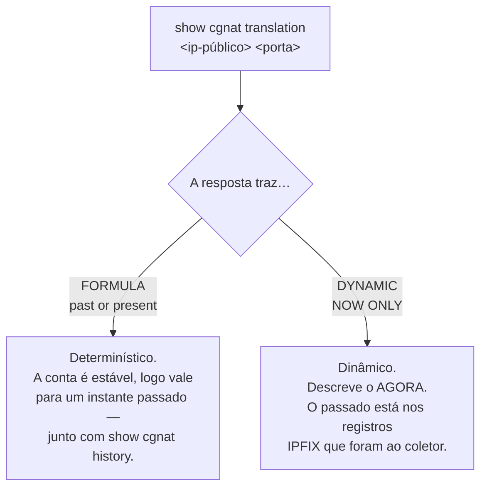

# Comandos show

O que cada `show` do `prismash` responde, como filtrar a saída e como ler as telas que mais importam numa investigação. Para quem opera a caixa e precisa saber qual comando responde a pergunta que tem na mão.

Os comandos `show` funcionam nos modos operacional **e** de configuração, em qualquer nível.

## `show cgnat`

As quatro primeiras respondem a pergunta de um operador em vez de reportar um contador. Todas tiram a resposta do **dataplane**, e todas são respondidas aqui: um operador que precisasse descer até a linha de comando do dataplane para diagnosticar seria um operador para quem esta VTY é decoração.

| Comando | Argumento | Responde |
|---------|-----------|----------|
| `show cgnat subscriber` | `<endereço-interno>` | tudo sobre um assinante |
| `show cgnat translation` | `<endereço-público> <porta>` | quem estava atrás de um endereço público e porta |
| `show cgnat top` | `[<n>]`   | assinantes mais próximos de esgotar seus blocos |
| `show cgnat drops` |           | por que pacotes não passaram |
| `show cgnat pool` |           | pools configurados, a capacidade de cada um e a distribuição de quanto os assinantes usam do próprio bloco |
| `show cgnat session` |           | sessões ativas por thread |
| `show cgnat memory` |           | a memória do CGNAT: quanto o heap tem, quanto está em uso, quantas sessões ainda cabem e o valor dado |
| `show cgnat blocks` |           | blocos alocados em modo dinâmico, e quantos um encaminhamento de porta prende |
| `show cgnat logging` |           | estado da exportação dos eventos de bloco: UDP, TCP e syslog |
| `show cgnat identity` |           | quantas identidades de assinante a caixa tem e quando as leu — nunca uma identidade em si |
| `show cgnat history` |           | trilha datada de configuração |
| `show cgnat history verify` |           | confere o encadeamento de hashes da trilha e nomeia a primeira entrada que não bate |
| `show cgnat alg` |           | quais ALGs o dataplane tem ligados, por pool |
| `show cgnat forward` | `[<pool>]` | os encaminhamentos de porta que o dataplane tem |
| `show cgnat ha` | `[peer <arquivo>]` | se esta caixa e o par mapeiam os assinantes do mesmo jeito; sem `peer`, compara com a cópia da configuração do par guardada na caixa |

`show cgnat translation` é o comando que responde uma ordem judicial: dado um IP público, uma porta e um instante, quem era o assinante.

`show cgnat history` é o outro lado disso no modo determinístico — qual configuração estava em vigor naquela data, e quem a colocou lá. `show cgnat history verify` é o que prova que essa trilha não foi alterada depois: é a conferência a rodar antes de entregar uma resposta, e antes de apagar o disco de uma caixa.

### `show cgnat alg` e `show cgnat forward`: o que o dataplane tem, não o que o arquivo diz

As duas respondem uma pergunta diferente da que o `show configuration` responde. O arquivo diz o que foi pedido; estas dizem o que a caixa está fazendo, e as duas coisas se separam em silêncio.

```
prisma> show cgnat alg
provider-a
  ftp    on   FTP PORT/EPRT and the 227/229 replies
  rtsp   off  RTSP Transport client_port, and the media pair it needs
  pptp   on   PPTP control channel and its GRE data channel
  esp    on   IPsec ESP passthrough, bound to the peer gateway
  sip    on   SIP over UDP: Via, Contact, SDP, and the RTP pair it needs
```

São os **cinco** ALGs do produto, um por linha, com a descrição que a caixa imprime em inglês. É a tela para "as transferências FTP deste cliente travam": ela diz se o ALG está ligado **no dataplane**, que não é a mesma pergunta que se ele está no arquivo.

```
prisma> show cgnat forward
pool provider-a
  tcp 200.150.0.17:8080 -> 100.64.0.5:80
```

E esta é a primeira coisa a estabelecer quando alguém liga dizendo que o encaminhamento de porta não funciona: se a caixa tem o encaminhamento. Aceita o nome de um pool para filtrar: `show cgnat forward provider-a`.

## `show route` — a tabela que encaminha

| Comando | Mostra |
|---------|--------|
| `show route` | a tabela de encaminhamento do VPP: o que esta caixa realmente faz com um pacote |
| `show route verbose` | a FIB do VPP e a RIB do FRR lado a lado, **marcando onde discordam** |
| `show route <prefixo>` | o mesmo, para um destino |

```
prisma> show route
  Destination          Next hop          Interface    Kind
  0.0.0.0/0            200.150.0.1       ens19        forward
  200.150.0.0/24       connected         ens19        connected

  2 entries carrying traffic
```


:::warning
`show ip route` responde pela tabela do **FRR**, não pela que encaminha. Numa caixa que está descartando o tráfego, a rota aparece presente e correta ali.

Quando o tráfego não passa e a rota parece certa, `show route verbose` é o comando: ele compara as duas tabelas e diz qual prefixo está numa e não na outra.

:::

## `show interface` — as do dataplane

```
prisma> show interface
  Interface                  State  MTU    Address             Linux
  ens18                      up     9000   203.0.113.1/24      tap0 ens18
  ens19                      up     1500   -                   -

  2 interface(s) on the dataplane can forward
```

Responde pelo **dataplane**, com estado, MTU, endereços e o par do `linux_cp`. Esse último porque é o nome que o FRR e o `ip` usam, e quem transita entre as duas ferramentas precisa dos dois lado a lado.

**A placa aparece com o nome que o Linux dava a ela.** A caixa reivindica as placas sozinha e batiza cada uma, no dataplane, com o nome que ela tinha no Linux: a `ens18` continua sendo `ens18`, e é assim que ela aparece aqui, no prompt e no roteamento. Uma placa com bloco `interface` entra no Linux com esse mesmo nome, e é ele que a coluna **Linux** mostra, ao lado do `tap` interno que o par usa - `linux-name` só é preciso para escolher outro. Uma porta cujo nome tem barras é uma placa que ninguém nomeou; o roteamento recusa nomes acima de 16 caracteres, e o `commit` diz isso antes de tentar.


:::warning
Este comando já foi repassado ao `vtysh`, que enxerga apenas o que o `linux_cp` espelhou. Numa caixa com uma `GigabitEthernet0/12/0` configurada, a resposta era `lo` — a lista sem as interfaces que carregam o tráfego.

É a mesma armadilha do `show ip route`: a pergunta respondida pelo lado errado.

:::

**A lista é do que você configurou**: placas, sub-interfaces de VLAN e loopbacks. O `local0` não aparece — é a interface nula do VPP e não configura nada — e o `tap` do par `linux_cp` também não: ele é criado e destruído por este produto, e o nome dele já está na coluna **Linux** da interface a que pertence.

Os dois apareciam até a 0.103.0, com o argumento de que esconder o que o dataplane reporta seria o comando decidindo o que você pode ver. O argumento vale para interfaces que a caixa tem; não vale para um artefato do VPP nem para a metade de um par — e o preço de mantê-los era uma conta errada pelo número de placas, cada uma contada duas vezes, uma como ela mesma e outra como o `tap` dela. A metade do argumento que era sobre diagnóstico continua de pé: um `tap` **nomeado explicitamente** ainda responde, então `show interface tap4096` mostra o que existe numa caixa com o par quebrado.

**O número no fim da lista** é o de interfaces que encaminham, que é o número a comparar com as placas que você instalou.

A visão do FRR continua em `show ip interface`.

### `show interface terse` — administrativo e enlace, separados

Uma linha por interface, com **duas** colunas de estado:

```
prisma> show interface terse
  Interface                  Admin  Link   Proto  Local
  ens18                      up     up     inet   203.0.113.1/24
  ens19                      up     down   -      -

  2 interface(s) on the dataplane can forward
  ens19: configured up, link down - that is the wire or the far end, not this configuration
```

| `Admin` | `Link` | O que é |
|-------|------|---------|
| `up`  | `up` | normal  |
| `up`  | `down` | **é o cabo, o transceiver ou o outro lado** — a configuração está de pé |
| `down` | `down` | alguém digitou `shutdown` |

São duas colunas porque são dois fatos, e a diferença entre eles é o defeito. Uma coluna só de "estado" não distingue *alguém aplicou* `shutdown` de *a fibra foi cortada* — e essa é justamente a listagem que se abre quando algo está errado. Por isso a caixa também nomeia, no fim, as interfaces configuradas up cujo enlace está down: é a conclusão da tabela, dita sem precisar ser procurada.

Uma sub-interface não é hardware e o dataplane não reporta enlace para ela. O enlace dela é o **do pai**, e é isso que a coluna mostra — as portas de assinante de um provedor são todas sub-interfaces, e uma coluna vazia justamente nelas não serviria para nada.

Um endereço por linha: uma interface com IPv4 e IPv6 aparece em duas linhas, com `inet` e `inet6` na coluna `Proto` e o nome escrito uma vez só.

### `show interface description` — para que cada porta serve

```
prisma> show interface description
  Interface                  Admin  Link   Description
  ens18                      up     up     ASSINANTES PON-3
  ens19                      up     down   TRANSITO Vivo AS26599

  2 of 2 interface(s) described
```

A descrição fica guardada como a **etiqueta da interface no próprio dataplane**, com espaços e tudo: ela sobrevive a um restart da VTY e diz a mesma coisa a quem consultar o dataplane por outro caminho. Escreve-se com `description <texto>` dentro de `interface <nome>`.

A coluna vem ao lado de `Admin` e `Link` de propósito: a pergunta *"o que é essa porta?"* quase nunca vem sozinha — vem junto de *"e ela está funcionando?"*.

### `show interface utilization` — quanto está passando agora

```
show interface utilization [<nome>] [interval <segundos>] [count <n>]
```

`show interface` mostra **contador**, que é um total desde o boot. Ninguém quer o total: quer saber se o enlace está cheio **agora**. Para isso são necessárias duas leituras e a divisão pelo tempo entre elas — então este comando **demora**, e diz de quanto é a demora antes de começar:

```
prisma> show interface utilization
  sampling every 2s, 5 time(s) - 10s in total; Ctrl-C stops early

  Interface                             rx            tx  rx history tx history
  ens19                      675.56 Mbit/s   1.24 Gbit/s  ▃▄▄▅▄      ▆▇▇█▇
  ens18                        8.40 Mbit/s   3.10 Mbit/s  ▁▁▁▂▁      ▁▁▁▁▁

  bars are each interface's share of its own line rate
    ens19                     12.4% of 10.00 Gbit/s
    ens18                      0.8% of 1.00 Gbit/s
```

| Argumento | Efeito |
|-----------|--------|
| `<nome>`  | só as interfaces cujo nome começa assim |
| `interval <segundos>` | tempo entre amostras; padrão 2, entre 0,1 e 60 |
| `count <n>` | quantas amostras; padrão 5, entre 1 e 120 |

O que vale saber para ler o gráfico:

* **A taxa é em bit/s**, no múltiplo em que um operador diria o número.
* **O tempo decorrido é medido, não suposto.** Numa caixa carregada — a única em que a pergunta interessa — dois segundos de espera não são dois segundos, e uma taxa calculada pelo intervalo nominal estaria errada exatamente ali.
* **Quando o dataplane informa a velocidade do enlace**, a barra é a fatia daquela interface da própria taxa de linha, e a porcentagem é real.
* **Quando não informa** — interface virtual, por exemplo — a barra é escalada para a maior amostra daquela execução, e a caixa **diz isso** em vez de apresentar porcentagem de uma capacidade que não conhece.
* Tráfego que arredondaria para nada é desenhado no nível mais baixo, não no traço de base: *um fio de tráfego* e *silêncio* são respostas diferentes.
* `Ctrl-C` encerra antes do fim e o gráfico sai com o que já foi amostrado. Interrompido antes da segunda leitura, não há taxa nenhuma a mostrar, e a caixa diz isso em vez de imprimir zeros.
* Pacotes descartados durante a amostragem, e um contador que andou para trás porque alguém limpou as interfaces no meio, são reportados no fim.

### `monitor interface` — o mesmo, ao vivo

```
monitor interface [<nome>...] [interval <segundos>]
```

`show interface utilization` responde por alguns segundos e termina. `monitor interface` é a tela que **fica**: redesenhada no lugar a cada amostra até `q` ou `Ctrl-C`, com um gráfico por interface para cada sentido. Esta é a tela de uma porta recebendo um fluxo de 800 kbit/s:

```
monitor interface   every 1s   page 1/1   q quit  l scale  n/p page    07:17:26
pg0   scale 1.00 Mbit/s, auto
  1.00 Mbit/s┤                                      ▂ ▂▂ rx 822.98 kbit/s
             │                                      █▄██    1029 pps
             │                                      ████
            0┤                                      ████ errors 0
  1.00 Mbit/s┤                                           tx 0 bit/s
             │                                              0 pps
             │
            0┤                                      ···· drops 0
```

| Tecla | Efeito |
|-------|--------|
| `q` ou `Ctrl-C` | sai, e devolve o terminal exatamente como estava |
| `l`   | troca a escala de todos os gráficos entre a própria e a taxa de linha |
| `n`, espaço, seta para a direita ou para baixo, Page Down | próxima página |
| `p`, `b`, seta para a esquerda ou para cima, Page Up | página anterior |

| Argumento | Efeito |
|-----------|--------|
| `<nome>`  | essa interface; uma palavra que não é o nome de nenhuma vale para todas que começam assim. Sem nome, todas menos `local0` |
| `interval <segundos>` | tempo entre amostras; padrão 1, entre 0,5 e 60 |

O que vale saber para ler a tela:

* **A escala está sempre escrita.** Por padrão cada interface usa a própria, arredondada para 1, 2 ou 5 vezes uma potência de dez — assim um fio de 10 Mbit/s numa porta de 10G aparece. Com `l` o gráfico passa a ser a fatia da taxa de linha, e o título diz, por exemplo, `line rate 10.00 Gbit/s: rx 12.4% tx 0.1%`. Uma interface cuja velocidade o dataplane não informa diz `no line rate known` e fica na própria escala.
* **Ao lado de cada gráfico**: a taxa mais recente em bit/s e em pacotes por segundo, e os erros e descartes somados sobre as amostras da tela. Antes da segunda leitura não há taxa, e a coluna diz `--` — nunca 0.
* **A janela anda**: tantas amostras quanto o terminal tem de largura, a mais nova à direita. Interfaces que não cabem na altura vão para as páginas seguintes, nunca são cortadas. Cabe num console serial de 80 colunas, e num console que responde em ASCII o gráfico é desenhado em ASCII.
* **Mesma amostragem de** `**show interface utilization**`, então os dois não discordam de uma taxa. Se o dataplane parar de responder a tela não fecha: o gráfico segura a última amostra e a linha de baixo diz desde quando.
* **Não é para script.** Em `prismash -c`, num pipe ou num arquivo o comando se recusa e indica `show interface utilization`, sem escrever nenhuma sequência de controle.
* **O custo foi medido antes do padrão de 1 segundo**: com 201 interfaces e tráfego, cada leitura levou 4 ms e ocupou 2,2 ms da thread principal do VPP — menos de 1% de um núcleo a uma leitura por segundo.

## `show hardware` — as placas de rede que a caixa tem

`show interface` responde pelo **dataplane**. Numa caixa recém-instalada o dataplane não recebeu placa nenhuma, então essa tela vem vazia — justamente no momento em que é preciso ver quais placas existem para escolher uma. `show hardware` responde a outra pergunta: **quais placas físicas o Linux enxerga nesta caixa**, com o que basta para decidir.

```
  Interface     PCI            Driver           Link           Speed
  eno1          0000:03:00.0   ixgbe            up             1000Mb/s
    3c:ec:ef:1a:2b:3c  ixgbe, a kernel driver
      DPDK cannot take the card through it as it is; when this card is given to
      the dataplane the box moves it to vfio-pci
    *** carries the DEFAULT ROUTE ***
  ens1f0        0000:5e:00.0   ixgbe            down           -
    b4:96:91:0d:1e:2f  ixgbe, a kernel driver
      DPDK cannot take the card through it as it is; when this card is given to
      the dataplane the box moves it to vfio-pci
```

Acima da lista vem uma linha sobre o que o dataplane já tem; abaixo dela, a contagem de placas e **o que a caixa vai fazer com cada uma** — as duas partes estão descritas mais abaixo.

| Coluna | O que é |
|--------|---------|
| `Interface` | o nome que o Linux dá à placa |
| `PCI`  | o endereço PCI, que é por onde o dataplane reclama o dispositivo |
| `Driver` | o driver que está com a placa **agora** |
| `Link` | o enlace, como o kernel o reporta |
| `Speed` | a velocidade, quando o kernel informa; `-` quando o enlace está caído e não há velocidade a informar |

A coluna `Link` é larga porque os valores que o kernel escreve ali não são só `up` e `down`: quando o estado não pode ser lido ele vira `unknown`, e existem `lowerlayerdown`, `notpresent`, `dormant` e `testing`. Por um tempo a coluna tinha a largura exata de `up`, e num estado mais comprido o estado e a velocidade saíam colados - `unknown-`, `unknown1000Mb/s` -, que é uma tela que o operador lê errado sem perceber que leu.

Embaixo de cada placa vêm o **MAC**, inteiro numa linha só — é o que se compara com a etiqueta da porta ou com a reserva no DHCP —, o driver que está com ela, e o que acontece com esse driver quando a placa for entregue ao dataplane.

Essa última linha importa mais do que parece. Toda caixa recém-instalada está com todas as placas em driver de kernel: dizer só *"o DPDK não pega uma placa por esse driver"* é verdade e lê-se como *"esta placa não serve"* — ainda mais numa VM de uma placa só, onde é a única coisa dita sobre a única placa. Dizer **para qual driver a caixa move a placa** transforma um beco sem saída num passo. O nome do driver ali não é chute: é o mesmo que a caixa vai usar de verdade, perguntado a quem decide, e numa caixa sem IOMMU ele sai `uio_pci_generic` em vez de `vfio-pci`.

### A marca `*** carries the DEFAULT ROUTE ***`

É a metade mais importante da tela. A placa que carrega a rota padrão é por onde esta caixa é alcançada, e é a pergunta a fazer antes de decidir qualquer coisa sobre placas.

A caixa não espera que alguém nomeie a placa do dataplane: ela reivindica **todas as placas que tem, menos uma reservada para o Linux** — a da rede de gerência gravada na instalação — **e nunca a última**. Embaixo da lista a tela diz isso sobre esta caixa, com os nomes, e diz o que acontece com a placa da rota padrão se o dataplane ficar com ela:

```
  2 NIC(s) on this box, as Linux has them
  The dataplane claims 1 of them. It claims every card this box has except one
  reserved for Linux, and never the last one.
  Reserved for Linux:
    eno1
  It is the management network this box was installed with.
  'interface <name>' under 'system', 'dataplane' claims that card alone
  instead.
  'eno1' carries the default route: it is how this box is reached. If the
  dataplane takes it, named or claimed, its address moves onto the linux_cp
  pair the dataplane keeps for it, and this box is then reached through the
  dataplane rather than beside it.
```

`interface <placa>` em `system` > `dataplane` é uma **escolha explícita**: a caixa passa a reivindicar aquela placa e nenhuma outra, e a tela diz isso no lugar da regra. `no interface`, no mesmo nível, devolve a escolha à caixa.

Quando a rota padrão está numa placa que **não** é a reservada na instalação, a tela avisa que a caixa vai reivindicá-la no próximo início do dataplane — é aqui que se descobre que a reserva não foi feita.

Numa caixa que tem **só essa** placa, ela vai para o dataplane de qualquer jeito, porque a reserva nunca fica com a última, e o endereço de gerência vai junto para o par que o dataplane mantém: a caixa passa a ser alcançada **através** do dataplane. A placa mantém o MAC, então nada do lado de fora precisa aprender um endereço novo. A tela diz isso e fecha com:

```
  Nothing is armed and nothing has to be confirmed.
```

Não há `commit confirmed` nem reinício a confirmar nessa entrega. O passo a passo está em [Primeiros passos](/doc/primeiros-passos-TAWDdSrYG7).

Numa caixa sem rota padrão nenhuma, a tela diz isso em vez de simplesmente não marcar nada:

```
  no interface carries a default route on this box, so none of them is the
  management path by that test.
```

E quando a rota padrão está numa coisa que esta lista não comporta — uma ponte, um *bond*, uma VLAN, uma placa sem endereço PCI —, a caixa **nomeia** essa coisa, em vez de deixar a ausência da marca falar:

```
  none of these carries the default route. It is on 'br0', which is not a PCI
  NIC, and that is still the path this box is reached over.
```

Uma lista sem marca nenhuma seria lida como *"nenhuma destas é o caminho de gerência"*, e é exatamente essa leitura que custa a caixa.

Uma placa que o Linux enxerga e o dataplane **ainda não** tem — uma placa instalada com a caixa ligada, por exemplo — é nomeada embaixo da lista: a caixa diz que o dataplane não a tem ainda e que `system reboot` resolve, dizendo antes o que o reinício custa.

### O veredito do driver, e o que a caixa faz com ele

O dataplane não consegue tomar uma placa que está presa a um driver do kernel. São três vereditos, e dois deles vêm com a segunda linha que diz o que a caixa fará:

| Veredito | O que significa | Segunda linha |
|----------|-----------------|---------------|
| `<driver>, a kernel driver` | a placa está com o driver do kernel (`ixgbe`, `i40e`, `virtio-pci`, …) | `DPDK cannot take the card through it as it is; when this card is given to the dataplane the box moves it to <driver de DPDK>` |
| `<driver> is a driver DPDK can use` | a placa já está preparada para o dataplane — `vfio-pci`, `uio_pci_generic` ou `igb_uio` | nenhuma: não há nada a mover |
| `no driver is bound to it at all` | nenhum driver está com o dispositivo | `DPDK needs a driver bound to the card; when this card is given to the dataplane the box moves it to <driver de DPDK>` |

```
  Interface     PCI            Driver           Link           Speed
  eno1          0000:03:00.0   ixgbe            up             1000Mb/s
    3c:ec:ef:1a:2b:3c  ixgbe, a kernel driver
      DPDK cannot take the card through it as it is; when this card is given to
      the dataplane the box moves it to vfio-pci
    *** carries the DEFAULT ROUTE ***
  ens1f0        0000:5e:00.0   vfio-pci         up             10000Mb/s
    b4:96:91:0d:1e:2f  vfio-pci is a driver DPDK can use
  ens1f1        0000:5e:00.1   (none)           down           -
    b4:96:91:0d:1e:30  no driver is bound to it at all
      DPDK needs a driver bound to the card; when this card is given to the
      dataplane the box moves it to vfio-pci
```

O nome do driver de DPDK na segunda linha **é o desta caixa**, e não um nome genérico: numa caixa com IOMMU ligado ele sai `vfio-pci`, e numa sem IOMMU sai `uio_pci_generic`. A tela não recalcula essa escolha — ela pergunta a quem a faz de verdade na hora de entregar a placa, para que uma tela não possa prometer um driver e a entrega usar outro.

Uma placa sem driver nenhum aparece com `(none)` na coluna `Driver`. É um estado normal e não um defeito: acontece com a placa que já esteve com o dataplane e foi devolvida, e com a que o kernel não conseguiu reivindicar.

O `mlx5` da Mellanox é a exceção: é um driver bifurcado e o dataplane trabalha com ele sem trocar de driver.

### A primeira linha diz o que o dataplane já tem

Sempre, e antes da lista. Uma placa que o **dataplane já tomou** desaparece da listagem do Linux — ela não está mais lá para ser listada. Sem essa linha, uma placa entregue ao dataplane e uma placa que nunca existiu na caixa ficariam com a mesma cara, e uma dessas duas é defeito de hardware.

```
prisma> show hardware
  the dataplane holds ens19. A NIC VPP owns is no longer listed by Linux, so it
  is not in the list below.
```

Quando o dataplane não tem interface nenhuma, a linha é o **mesmo diagnóstico** que o `show interface` e o autoteste de boot dão, lido das mesmas fontes: dois diagnósticos do mesmo fato que discordam entre si são piores que um.

E uma caixa onde o Linux não enxerga placa PCI nenhuma recebe uma frase, não uma tabela vazia. A frase separa os três casos, que têm a mesma cara numa tabela: o dataplane já tem todas as placas (a linha de cima diz quais), o dataplane não pôde ser consultado (e aí `systemctl status vpp` diz qual dos dois é), ou não há placa nenhuma em lugar nenhum. Uma placa virtio numa máquina virtual tem endereço PCI e serve: se ela não aparece aqui, também não está no Linux.

*"Não há nada a mostrar"* e *"não há nada errado"* têm a mesma aparência numa tela, e esta tela é lida numa caixa que não encaminha nada.

## `show this` — o que há na hierarquia em que estou

Dentro de um bloco de configuração, mostra o que aquele bloco tem e nada acima dele:

```
prisma# [edit nat / cgnat / pool residential] show this
pool residential
 prefix-inside 100.64.0.0/22
 prefix-outside 200.150.0.16/30
 block-size 512
 policy interleaved
 mode deterministic
 tcp-mss 1400
 exit
```

Mostra a **candidata**, não a configuração em vigor: quem está no meio de uma edição pergunta sobre o que está construindo.

Repare que `policy` e `mode` aparecem sem você ter digitado. Não é a tela acrescentando nada: são os três campos que todo pool tem por construção — `block-size`, `policy` e `mode` —, e um pool sem eles não existe. Se a tela os omitisse quando estão no valor padrão, ela deixaria de dizer o que o pool está fazendo enquanto o pool continua fazendo. É a mesma razão pela qual `no policy` é recusado.

Dentro de um pool, o bloco sai como se digita ali: `pool residential` e os campos. Em `cgnat`, `show this` mostra o que o nível tem; em `nat`, o bloco inteiro; em `system` e nos níveis abaixo dele, o que aquele nível tem. `show configuration` e `show running-config`, que mostram a caixa inteira, trazem o CGNAT como o bloco `nat` > `cgnat` — pools e ajustes globais, na ordem em que se digita —, o lado de CGNAT de cada interface (`cgnat inside` ou `cgnat outside`) dentro do bloco da própria interface, e as rotas estáticas num bloco `router static`. É também como o `save` grava, então copiar a tela para um arquivo e carregá-lo de volta funciona.

O prompt nomeia onde você está, inclusive qual pool ou qual interface — `[edit interface ens19]` — para que a próxima declaração não caia no bloco errado.

## O que a caixa conferiu, e o que ela apenas repassou

O `prismash` conhece parte das sentenças de roteamento e repassa o resto ao roteamento sem ler. As duas coisas apareciam iguais na tela. Agora não:

```
prisma# [edit] show configuration
...
! routing
router bgp 65000
neighbor 10.0.0.2 remote-as 65001
coalesce-time 1000  <- not checked
neighbor 10.0.0.2 soft-reconfiguration inbound  <- not checked
exit
! prismash: 2 statement(s) above are marked '<- not checked': this VTY has no
! prismash: grammar for them and handed them to FRR word for word
```

A marca `<- not checked` quer dizer: **esta caixa não tem gramática para esta linha e a entregou ao roteamento exatamente como foi digitada.** Não quer dizer que a linha esteja errada - muita configuração correta de FRR passa por aqui. Quer dizer que quem conferiu foi o roteamento, no `commit`, e não o `prismash`, no prompt.

O que decide a marca é a mesma lista que o `?` oferece naquele bloco. Por isso a **mesma** sentença pode sair marcada num lugar e não sair em outro: `soft-reconfiguration inbound` é conhecida dentro de `address-family` e não é conhecida direto dentro de `router bgp`.

A marcação aparece em `show configuration`, `show running-config` e `show this`. A mais útil é a do `show this`, porque é a que aparece **enquanto você ainda está digitando**, e não depois.

Num bloco que a caixa não modela de jeito nenhum, a marca vem já no cabeçalho - a notícia ali é que nada daquele bloco foi lido:

```
prisma# [edit vrf red] show this
vrf red  <- not checked
 ip route 10.9.0.0/16 10.0.0.9  <- not checked
```

A marca é **só de tela**. Ela não entra no arquivo que o `save` grava, não vai para o roteamento no `commit` e não aparece nas revisões de rollback: o arquivo que a caixa lê no boot precisa ser um arquivo que o roteamento aceita. Copiar a tela marcada para um arquivo e carregá-la de volta funciona - a caixa tira a marca e a linha final na leitura.

A linha final só aparece quando há alguma coisa marcada. Um aviso que aparece sempre é um aviso que ninguém lê.

## `show bgp summary`, `show ospf` e `show isis` — a adjacência, e o que dela chegou a encaminhar

São cinco comandos — `show bgp summary`, `show ospf neighbor`, `show ospf interface`, `show isis adjacency` e `show isis interface` — e o que eles acrescentam ao que o roteamento já responde é a **última linha**: quantos prefixos daquele protocolo estão na tabela que de fato encaminha. Uma rota que o roteamento tem e o dataplane nunca recebeu é invisível em qualquer comando que responda pelo roteamento, e as duas metades ficam com cara de saudáveis olhadas separadamente.

`show bgp summary` traz uma linha por sessão — vizinho, AS, estado, prefixos recebidos e há quanto tempo está de pé —, depois a contagem de sessões estabelecidas e então a mesma última linha sobre a tabela que encaminha. O resto de `show bgp` é repassado ao roteamento sem alteração.

```
prisma> show ospf neighbor
  Neighbour         Interface      State            Dead       Up
  10.0.0.2          vppwan0        Full/DR          38         00:12:41

  1 adjacency(ies), 1 full
  all 3 OSPF prefix(es) are in the forwarding table
```

Quando alguma não chegou, a linha diz **quantas** e nomeia até cinco:

```
  2 of 7 OSPF prefix(es) are NOT in the forwarding table
    10.20.0.0/24
    10.20.1.0/24
    'show route verbose' compares the two tables in full
```

### A adjacência que para em Exchange

`show ospf neighbor` é onde a caixa diz uma coisa que o roteamento não diz: uma adjacência que não sai de `Exchange` quase sempre é MTU. O OSPF leva o MTU da interface dentro dos pacotes de descrição da base, e quem recebe descarta os que anunciam um MTU maior que o seu **sem registrar nada, nos dois lados**. É a falha que custa uma tarde em vez de um minuto.

A caixa não tem como saber o MTU do outro lado, mas sabe o que **ela** está anunciando - e é esse o número a comparar. Nesta caixa quem anuncia é a interface do lado do sistema, que começa em 9000, então ela está errada mais vezes do que certa.

### `show ospf interface` e `show isis interface`

O que cada protocolo acredita sobre cada interface, ao lado do que o dataplane tem. No IS-IS essa tela responde uma pergunta específica: um circuito `Up` com **zero** vizinhos, e por quê.

```
prisma> show isis interface
  Interface      Area       Circuit   State      Level   Metric   Neighbours
  vppwan0        CORE       0x1       Up         L2      10       0
```

Zero vizinhos num circuito que está `Up` é o sintoma do IS-IS não estar sendo entregue ao sistema: os quadros de IS-IS não andam sobre IP, andam direto sobre o enlace, e precisam ser entregues explicitamente. Sem isso a caixa dá boot, commita limpo, o processo de IS-IS sobe, a configuração lê de volta certa **e a adjacência nunca forma**. A tela diz isso em vez de deixar o operador com um contador.

`show isis adjacency` é a mesma leitura por vizinho, com a mesma última linha sobre a tabela que encaminha.

## `show version` — as versões da caixa e quais daemons estão de pé

Quando um `show bgp`, um `show ospf` ou um `show isis` não responde, e quando um `commit` recusa uma instância de roteamento, a caixa manda você para cá. Esta tela responde: ela nomeia os daemons rodando e os parados, um por um.

```
prisma> show version
Prisma Routing 0.67.0 (a1b2c3d)
  dataplane: 26.06
  plugin:    0.67.0 (a1b2c3d)
  routing:   FRRouting 10.7.1
  daemons:   running  bgpd mgmtd ospfd staticd zebra
             stopped  isisd ospf6d
             a stopped daemon takes the configuration that needs it and reaches
             nothing; enable it in /etc/frr/daemons and restart frr
```

A última linha diz o que fazer: um daemon parado recebe a configuração que depende dele e não chega a lugar nenhum. Habilite em `/etc/frr/daemons` e reinicie o `frr`. Se quem estiver parado for um dos que o próprio FRR sobe sozinho, a mensagem é outra — nesse caso o FRR não terminou de subir, e editar `/etc/frr/daemons` não muda nada.

Os parados aparecem **por nome**, e não como ausência na lista dos que rodam. Quem chega aqui veio de uma mensagem que citou **um** daemon, e procurar por uma palavra que não está lá é exatamente como se tira a conclusão errada.

Se o FRR não responder, a tela diz isso, e não "nenhum daemon rodando":

```
  daemons:   FRR is not answering, so which daemons are running is not known
             this box's routing control plane is down rather than idle:
             'systemctl status frr' and its journal say why
```

São falhas diferentes com correções diferentes: um FRR que não responde é o plano de controle fora do ar, e a correção é levantar o FRR; um FRR que responde sem nada de pé é uma caixa cujos daemons nunca foram habilitados, e a correção está em `/etc/frr/daemons`. Ler a primeira como a segunda manda o operador editar um arquivo numa caixa que não o teria lido.

### Qual build está encaminhando de verdade

A linha `plugin:` é a versão do **dataplane que está carregado agora**, lida da própria caixa. A primeira linha, `Prisma Routing`, é a versão do que está instalado em disco. Na imensa maioria das vezes as duas são iguais e a caixa não diz mais nada a respeito.

Elas se separam num momento previsível: **entre uma atualização e o próximo boot**. Atualizar troca o dataplane em disco e **não reinicia** o dataplane que está rodando — de propósito, porque reiniciá-lo derruba todas as sessões da caixa. Até o reboot, portanto, a VTY, o autoteste e o coletor já são a versão nova e quem traduz pacotes ainda é a antiga. A tela passa a dizer isso:

```
prisma> show version
Prisma Routing 0.68.0 (9f8e7d6)
  dataplane: 26.06
  plugin:    0.67.0 (a1b2c3d)
             this is the build the dataplane was loaded with at the last boot,
             and it is not the Prisma Routing build above. An upgrade replaces
             bpa_plugin.so on disk and does not restart the dataplane, so until
             this box is rebooted, or 'systemctl restart vpp' is run, it goes
             on translating with the old one - and both of those end every
             session it is carrying.
```

Não é um defeito, é um estado — e é um estado que **você escolhe quando encerrar**. Reiniciar o dataplane, por reboot ou pelo comando que a própria mensagem cita, carrega a versão nova e derruba todas as sessões traduzidas no momento em que o comando é dado. Por isso a caixa informa e não age sozinha: essa é uma janela de manutenção, não uma tarefa de rotina.

O sufixo entre parênteses identifica a árvore de onde aquele build saiu. Se ele terminar em `-dirty`, aquele build **não** é uma versão publicada: saiu de uma árvore com alterações não commitadas, e isso precisa aparecer antes de qualquer investigação começar pelo caminho errado.

Se o dataplane não responder, a linha diz isso — e não "sem plugin":

```
  plugin:    the dataplane is not answering, so its build is not known
             this box is not forwarding at all rather than forwarding with an
             old build: 'systemctl status vpp' and its journal say why the
             dataplane is silent
```

E se ele responder estando de pé **sem o plugin de CGNAT carregado**, a mensagem é outra, porque a correção é outra: aí a caixa encaminha e não traduz nada.

### O que esta tela não confere

A comparação acima é entre **dois** arquivos: o que está em disco e o que o dataplane carregou. A linha `Prisma Routing` é uma frase sobre cerca de trinta, e os outros vinte e oito não são conferidos aqui, de propósito: `show version` é rodado o tempo todo enquanto se trabalha, e refazer a conta a cada vez sairia caro para dizer que está tudo certo.

Quem confere todos é o **autoteste de boot**, uma vez por boot, contra a lista que a instalação deixou na caixa. Se algum arquivo não for da versão que a caixa informa, é lá que aparece, com o nome do arquivo. A página **Operação e diagnóstico** descreve essa linha e o que fazer com ela.

## `show` — restante

| Comando | Mostra |
|---------|--------|
| `show configuration` | a configuração candidata; no modo operacional, onde não há candidata, a que está em vigor |
| `show configuration compare` | diferenças da candidata contra a configuração em vigor, ou `no differences` |
| `show running-config` (ou `show run`) | a configuração em efeito, CGNAT e roteamento |
| `show this` | a configuração do nível em que você está (acima) |
| `show rollback` | revisões commitadas disponíveis, com data e comentário |
| `show interface [<nome>]` (ou `show interfaces`) | as interfaces do dataplane; com o nome, uma interface em detalhe, com os contadores |
| `show interface terse`, `description`, `utilization` | as três leituras de interface descritas acima |
| `show hardware` | as placas de rede físicas da caixa, com endereço PCI, driver, enlace e **qual delas carrega a rota padrão** |
| `show lacp` | os bundles LACP: cada membro e se ele está no bundle |
| `show system cpu` | quais núcleos fazem o quê: o configurado e o que está em vigor |
| `show system memory` | a RAM por papel: o configurado e o que está em vigor |
| `show system uptime` | desde quando a caixa, o dataplane (VPP) e o roteamento (FRR) estão no ar, o motivo do último boot quando foi registrado (`system reboot by <conta>`; senão `not recorded`) e quando a versão foi instalada. Um dataplane mais novo que a caixa aparece como `restarted after the boot`, e desde a 0.151.14 a linha `started by:` diz **por quê**, como a caixa registrou: o boot, um `system dataplane restart`, uma atualização, ou `nothing recorded: unexpected` quando nada na caixa pediu |
| `show version` | versões do Prisma Routing, do VPP e do FRR, **qual build o dataplane carregado é**, **quais daemons de roteamento estão rodando** e uma linha `uptime` com o tempo da caixa e do dataplane |
| `show route [verbose] [<prefixo>]` | a tabela que encaminha (acima) |
| `show bgp summary` | uma linha por sessão BGP, com o que chegou à tabela que encaminha |
| `show bgp neighbor <vizinho>` | uma sessão em detalhe; com `received-routes`, o que o vizinho mandou antes da política de entrada |
| `show bgp ...` | o restante do BGP (repassado ao FRR) |
| `show ospf neighbor`, `show ospf interface` | as adjacências OSPF e o que cada interface acredita (acima); `show ip ospf ...` chega ao mesmo lugar |
| `show isis adjacency`, `show isis interface` | o mesmo para o IS-IS |
| `show policy [<política>]` | as políticas de roteamento, os terms de cada uma e onde estão aplicadas |
| `show ip ...` | informação de IP (repassado ao FRR) |
| `show ip interface` | interfaces como o FRR as enxerga |
| `show log [last <n>] [since <tempo>] [severity <nível>] [source <origem>]` | **o que aconteceu na caixa**, o mais novo por último: commits, rollbacks, `commit confirmed` vencido, atualização, reboot e reinício pedidos (por quem e de onde), e cada partida do dataplane e do roteamento com a causa. Veja abaixo |
| `show logging` | a configuração de log de cada daemon de roteamento, como o FRR a informa — não o que aconteceu; isso é `show log` |

O que não é respondido pela própria caixa é repassado ao `vtysh` do FRR, então a sintaxe completa do FRR vale depois da primeira palavra.

## O que aconteceu na caixa: `show log`

Um registro só, da caixa inteira, escrito por quem age — a VTY, a API, o host — e nunca copiado do journal. Por isso as linhas de rotina que enchem o journal (`door: uid 1000: hostname -> 0` a cada 2 s, o timer do `commit confirmed` que não tem nada a fazer) não aparecem aqui. Fica em `/var/log/prisma-routing/events.log`, no volume de registros: sobrevive a reboot e a atualização, e tem tamanho limitado (dois arquivos de 256 KiB, o mais antigo sai).

```
prisma> show log
prisma> show log last 20
prisma> show log since 2h
prisma> show log since 2026-10-05
prisma> show log severity warning
prisma> show log source dataplane
prisma> show log since 1d source vty | match rollback
```

Sem `last` nem `since`, os últimos 50. `since` aceita `30m`, `1h`, `2d`, `1w` ou uma data ISO (`2026-10-05`, `2026-10-05T14:00`; sem fuso é o fuso da caixa). `severity` é `error`, `warning`, `notice` ou `info` e mostra aquele nível e os mais graves. `source` é `vty`, `api`, `host`, `dataplane` ou `routing`. Um evento mais largo que o console dobra, com a continuação recuada, como toda linha que a VTY imprime: a primeira linha leva a hora, o nível, a origem e o começo da frase, e é por ela que o `| match` acha o evento. `source` e `severity` escolhem eventos inteiros.

O que ele registra hoje:

| Evento | Exemplo |
|--------|---------|
| commit, com comentário e janela de confirmação | `configuration committed: first pool (by ana, from ssh 192.0.2.7)` |
| rollback aplicado | `rollback to revision 1 committed (by ana, from ssh 192.0.2.7)` |
| `commit confirmed` confirmado ou vencido | `a commit confirmed 1 was not confirmed in time: the configuration before it was put back (from the box)` |
| reinício, atualização, reboot e desligamento pedidos | `system dataplane restart asked (by ana, from ssh 192.0.2.7)` |
| atualização concluída | `upgraded from 0.151.13 to 0.151.14 (from the box)` |
| o boot | `the box booted; the reason recorded: system reboot by ana` |
| cada partida do dataplane e do roteamento, **com a causa** | `the dataplane started again: system dataplane restart asked by ana from ssh 192.0.2.7` |

**A causa de um reinício é registrada antes do reinício.** Quem pede (`system dataplane restart`, `system upgrade`, `system reboot`, pela VTY ou pela API) escreve o pedido primeiro; quando a caixa vê o dataplane ou o roteamento de pé de novo, ela procura o pedido mais recente antes daquela partida. Sem pedido, e longe do boot, a partida sai como `unexpected`, em nível `warning`: **ninguém pediu**, e é isso que vale investigar (`/var/log/prisma-routing/why-the-dataplane-stopped` costuma dizer o resto). Uma caixa que acabou de chegar à 0.151.14 não sabe a causa das partidas anteriores a ela, e não inventa.

O `show logging` continua sendo o do FRR: a configuração de log de cada daemon de roteamento. O que vem a seguir — enlace e SFP, sessões BGP e BFD com o motivo, esgotamento de pool, logins, `system logging` em termos da caixa, um `monitor log` — está planejado e ainda não existe.

## Filtrando a saída com `|`

Qualquer `show` aceita filtros depois de uma barra vertical, e eles podem ser encadeados:

```
show running-config | section interface
show running-config | include timeout | count
show log | exclude vty | last 20
```

| Filtro | O que faz |
|--------|-----------|
| `include <texto>` | mantém as linhas que contêm o texto |
| `match <texto>` | o mesmo que `include`, para quem digita assim |
| `exclude <texto>` | descarta as linhas que contêm o texto |
| `section <texto>` | mantém o bloco que a linha casada abre, até a próxima linha que começa na coluna 0 |
| `count` | quantas linhas, em vez das linhas |
| `first <n>` | as primeiras n linhas |
| `last <n>` | as últimas n linhas |
| `no-more` | tudo de uma vez, sem parar no `--More--` |

O argumento pode ter espaços: `include mode deterministic` procura essas duas palavras juntas. Um par de aspas **em volta do argumento inteiro** é retirado antes da busca — `section "interface Gi"` procura `interface Gi` —, porque é assim que um pipe se escreve em qualquer shell e ninguém digitaria diferente. Uma aspa no meio do texto continua sendo um caractere procurado.

Um filtro que a caixa não conhece é **recusado**, com a lista do que existe — não ignorado. Ignorar responderia a pergunta que ninguém fez, sem nada na tela dizendo que foi isso que aconteceu. `first` e `last` sem número, ou com algo que não é número, também são recusados (`needs a number, not 'x'`).

## Saída maior que a tela: `--More--`

Numa sessão interativa, um `show` cuja saída passa da altura da tela para no `--More--`, com a linha `--More-- (space: next page, enter: next line, q: stop)`. A paginação é automática: não existe um filtro `| more` para pedi-la, e digitá-lo é recusado como qualquer filtro que a caixa não conhece.

| Tecla | O que faz |
|-------|-----------|
| espaço (ou qualquer outra tecla) | a próxima tela |
| Enter | a próxima linha |
| `q` ou Ctrl-C | para aqui; o resto não é mostrado e a sessão continua |

`| no-more` desliga a paginação para um comando: `show running-config | no-more`. Os filtros continuam valendo e a paginação vale para o que sobra deles, então `show running-config | include interface` só para se o resultado filtrado não couber.

**Não pagina**: `prismash -c`, `ssh <conta>@<caixa> "<comando>"` e qualquer saída que não vai para um terminal. Um script nunca fica esperando uma tecla.

O paginador é da própria VTY, e não o `more` ou o `less` do sistema. Os dois têm um atalho para abrir um shell (`!comando`), e entregar a saída a um deles daria shell a uma conta somente-leitura, que é justamente o que a caixa não dá.

`section` serve à forma desta configuração: um bloco é uma linha na coluna 0 mais tudo que está indentado embaixo dela. É como se pede a configuração de uma interface, ou de um pool, sem ler a caixa inteira.


:::info
**O filtro roda sobre o texto que o comando já produziu, depois das ocultações.** É isso que faz `show running-config | include password` ser seguro: o que o filtro enxerga é `<set, not shown>`, a mesma linha que você veria sem filtro nenhum. Nenhum filtro alcança o valor por trás dela.

A barra vertical só é filtro depois de um `show`. Numa declaração de configuração ela é um caractere de expressão regular ou de descrição — uma lista de AS-path é cheia delas — e tratá-la como filtro cortaria uma política em silêncio.

:::

## O que olhar primeiro

| Sintoma | Comando |
|---------|---------|
| "assinante sem internet" | `show cgnat subscriber <ip-interno>` |
| "pacotes sumindo" | `show cgnat drops` |
| "a rota está lá e o tráfego não passa" | `show route verbose` |
| "de quem era esse IP:porta?" | `show cgnat translation <ip> <porta>` |
| "o pool vai encher?" | `show cgnat top` |
| "o coletor está recebendo?" | `show cgnat logging` |
| "o que mudou aqui?" | `show cgnat history` |
| "o que eu estou prestes a aplicar?" | `show configuration compare` |
| "essa porta caiu ou alguém deu shutdown?" | `show interface terse` |
| "para que serve essa porta?" | `show interface description` |
| "o dataplane não tem interface nenhuma" | `show hardware` |
| "o enlace está cheio?" | `show interface utilization <nome>` |

## Como ler a resposta de `show cgnat translation`

Este é o comando que responde uma ordem judicial, e a resposta dele **diz quanto vale como prova**. Não são a mesma coisa:



Uma resposta dinâmica **nunca** afirma `FORMULA`. Essa recusa é deliberada: tratar uma alocação sob demanda como se fosse aritmética estável seria apresentar como prova algo que não sustenta a afirmação.

## O que cada resposta traz

| Comando | Na resposta você encontra |
|---------|---------------------------|
| `show cgnat subscriber <ip>` | o endereço público, a faixa de portas e `sessions N` |
| `show cgnat subscriber` de um IP fora dos pools | `not inside any configured pool` — é resposta, não erro |
| `show cgnat translation` | o assinante, mais `FORMULA`/`past or present` ou `DYNAMIC`/`NOW ONLY` |
| `show cgnat top` | os assinantes mais carregados, com as portas que seguram (ex.: `3/512`) |
| `show cgnat drops` | seção *packets that did not get through* com o motivo, por exemplo `no pool for source address` |


:::info
`**show cgnat drops**` **não mistura sucesso com falha.** Pacotes traduzidos aparecem sob o próprio cabeçalho, fora da seção de descartes. O VPP conta as duas coisas como se fossem iguais; durante um incidente elas não são.

:::

# Ver também

* [Operação e diagnóstico](/doc/operacao-e-diagnostico-A4fcKDVwZt) — estes comandos aplicados a um problema real
* [Logging IPFIX e trilha de auditoria](/doc/logging-ipfix-e-trilha-de-auditoria-lREEjJu1Bq) — o que responde pelo passado
