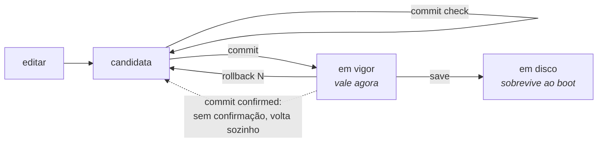

# commit, rollback e save

O modelo é o do Juniper: você edita uma **configuração candidata**, revisa, e só então aplica. Nada do que você digita chega ao equipamento antes do `commit`.



## `commit` e suas variantes

| Comando | Argumento | O que faz |
|---------|-----------|-----------|
| `commit` |           | aplica a candidata |
| `commit check` |           | valida sem aplicar |
| `commit remap` |           | aplica uma mudança que move assinantes existentes para novos endereços públicos e blocos |
| `commit cutoff` |           | aplica uma mudança que deixa de anunciar o prefixo por onde esta sessão chegou |
| `commit diverge` |           | aplica uma mudança que mapeia assinantes de forma diferente do par com quem esta caixa divide um endereço de serviço |
| `commit confirmed <1-60>` | minutos   | aplica, e desfaz sozinho a menos que seja confirmado |
| `commit comment "<texto>"` |           | registra uma nota junto com este commit |

`remap`, `cutoff`, `diverge`, `confirmed` e `comment` combinam entre si, em qualquer ordem: uma mudança com duas consequências a reconhecer não custa a chance de registrar por quê.

### `commit check` antes de qualquer coisa

É o comando que responde *"isso passa na validação?"* antes de aplicar. Ele confere a candidata inteira sem tocar no equipamento — só comandos de leitura vão para o dataplane.

**Ele diz quem seria re-mapeado**, que é a razão de existir de perguntar antes:

```
configuration check succeeds
  this change RE-MAPS subscribers that already have mappings
    194 of 256 subscribers move
    100.64.0.1 -> 200.150.0.9 port 1536-2047
    100.64.0.2 -> 200.150.0.10 port 1024-1535
  'commit' refuses this until it is asked for by name, with 'commit remap'
```

A conta não é estimativa: quem faz é o dataplane, com as duas definições e a mesma aritmética que rodaria depois. Não é recusa — o `check` não aplicou nada, então não há o que recusar; é o aviso que o comando existe para dar. Quem recusa é o `commit` comum, descrito em `*commit remap*`, logo abaixo.

Uma mudança que não move ninguém não imprime nada disso. Aviso que aparece sempre é aviso que ninguém lê.

### `commit diverge`, quando a caixa faz par com outra

Numa caixa que **sustenta um endereço de serviço com um par** — quer dizer, que tem `vrrp` numa interface — o `commit` confere a candidata contra a configuração do par, aquela que você copiou para `/etc/prisma-routing/peer.conf`, e **recusa** uma mudança que faria as duas mapearem assinantes de formas diferentes:

```
error: this change maps subscribers differently from the peer
    this box stands for a service address with another one, so a takeover would
    translate them there
error: pool 'business' is on this box and not on the peer, so after a failover
    its subscribers are translated by nothing at all
    cgnat pool business
    a takeover would put subscribers on blocks the other box never used, and
    neither box would log anything unusual, because nothing unusual happened to
    either of them
    if that is what you mean, type: commit diverge
```

**Por que isso é uma recusa e não um aviso.** Em modo determinístico o mapeamento é função da configuração: duas caixas com o mesmo pool concordam sem trocar um byte, e duas caixas com pools diferentes **falham em silêncio** — o failover passa a mapear assinantes para blocos que a outra caixa nunca usou, e as duas registram um dia perfeitamente normal. Não existe sintoma para notar depois.

**Por que existe a palavra que passa por cima.** Duas caixas não se commitam no mesmo instante. Toda ampliação de capacidade correta diverge o par entre o primeiro commit e o segundo, então uma recusa sem saída dispararia em todo procedimento certo — e a saída viraria "parar de copiar a configuração do par", que remove a conferência em vez da divergência. `commit diverge` é você dizendo que sabe, e o commit segue.

**Numa caixa que não faz par, nada disso acontece.** Sem `vrrp` em interface nenhuma, um `peer.conf` ali é material de comparação e nada mais: a caixa **avisa** sobre a diferença e aplica, como sempre fez. Nenhum arquivo em `/etc` cria um relacionamento que a configuração não declara.

Ele também diz **o que não verificou**:

```
configuration check succeeds for CGNAT and the box's own configuration
  2 routing statement(s) have no grammar in this VTY and were not read at all
    'show configuration' marks them; they go to FRR exactly as typed
  routing statements are checked for structure only; FRR validates them at
  commit, and can still refuse one
```

A contagem é das sentenças que a caixa repassou ao roteamento sem ler. `show configuration` e `show this` mostram **quais** são, marcadas com `<- not checked`. O `commit` comum não diz nada sobre isso, de propósito: repassar sentença é o caso normal aqui, e um aviso em todo commit vira um aviso que ninguém lê - inclusive o aviso que importa, o de que o roteamento não guardou o que foi aplicado.


:::warning
Statements de roteamento — prefix-list, route-map, vizinhos BGP — são conferidos apenas na forma. Quem valida o conteúdo é o roteamento, e só no `commit`.

Isso significa que um `commit check` aprovado **não garante** que o `commit` seguinte vai passar.

E as recusas não são todas iguais. A maioria é decidida **antes** de qualquer coisa ser aplicada — o travamento de SSH, um route-map que não existe, um pool que o dataplane recusaria — e nessas nada é aplicado: a caixa fica inteira como estava e a candidata também.

A recusa de leitura de volta é a exceção, e é a que importa aqui. Ela só pode ser decidida **depois** que o roteamento já recebeu a configuração, porque é exatamente a descoberta de que ele recebeu e não guardou. Nessa **o resto do commit está em efeito** — o CGNAT e a configuração da própria caixa — e a volta é `rollback 1`. A própria mensagem diz isso.

:::

Antes esse comando dizia apenas *"configuration check succeeds"*, o que prometia mais do que ele tinha conferido — e numa janela de manutenção é essa frase que decide se a pessoa segue em frente.

### `commit remap` — a trava contra o desastre silencioso

Um `commit` comum **recusa** mudanças que alterem o mapeamento de assinantes existentes. Elas precisam ser pedidas pelo nome, com `commit remap`.

O motivo é que esse é o pior tipo de falha possível neste equipamento: acrescentar um prefixo público derruba **toda** a base de assinantes ao mesmo tempo, e a máquina não reporta nada de anormal — porque, do ponto de vista dela, nada de anormal aconteceu. A recusa transforma um acidente silencioso numa decisão explícita.

**É nessa recusa que aparecem os números.** O dataplane segura as duas definições e roda a mesma aritmética que rodaria depois, então a conta é exata e não uma estimativa — e vem com dois assinantes de exemplo, de onde para onde:

```
error: this change re-maps subscribers that already have mappings
    1024 of 1024 subscribers change public address or port block; 512 hold live
    state right now
    100.64.0.5 moves from 200.150.0.17:1536-2047 to 200.150.0.33:2048-2559
    100.64.0.9 moves from 200.150.0.17:2048-2559 to 200.150.0.34:1536-2047
    every session on this pool ends when it is applied. Past answers stay
    resolvable - the configuration trail records which definition was in force
    - but the subscribers do not.
    if that is what you mean, type: commit remap
```

Registre esse primeiro número no chamado de mudança: é quantos clientes vão ligar.

### `commit cutoff` — a mesma trava para o prefixo que carrega a sua sessão

A outra mudança que o equipamento não aplica sem ouvir a palavra: a que deixa de anunciar o prefixo por onde a **sua própria sessão** chegou. Retirar um prefixo de propósito é rotina — uma drenagem de manutenção, um cliente que saiu —, e a caixa não distingue isso de um erro de política. Então ela não recusa para sempre: ela pede o nome.

Duas formas, conforme o que a mudança faz:

```
error: 200.150.0.0/24: this change stops originating it, and it covers 200.150.0.7 - the address this session arrived on
    nothing here would advertise a route back to this box's end of your own session
    if that is what you mean, type: commit cutoff
```

```
error: 200.150.0.0/24: no neighbour would be sent it after this change, and it covers 200.150.0.7 - the address this session arrived on
    the outbound policy denies it to every neighbour that has one, so nothing would advertise a route back to this box's end of your own session
    if that is what you mean, type: commit cutoff
```

Ela **se cala** quando não consegue ter certeza: quando esta caixa não origina hoje um prefixo que cubra o endereço, quando nada o anunciaria de qualquer jeito, quando a política de saída de algum vizinho não pode ser lida até o fim, ou quando há `redistribute` e `aggregate-address` no meio. Numa sessão de console serial não há endereço contra o que conferir, e a caixa diz isso em vez de deixar você acreditar que a checagem rodou.

E `commit cutoff` **não** é uma licença para se trancar do lado de fora: ele é aplicado como `commit confirmed 10` — veja logo abaixo.

### `commit confirmed` — a rede de segurança para mudar remoto

```
prisma# [edit] commit confirmed 5
```

Aplica agora, e desfaz automaticamente em 5 minutos a menos que você confirme. É o que permite mexer em roteamento numa máquina remota: se a mudança cortar seu próprio acesso, a máquina se recupera sozinha.

A caixa responde dizendo onde o desfazer está armado:

```
rollback at 2026-02-11T14:32:07Z, in 5 minute(s)
    unless you type 'commit' to confirm
    the revert is armed on the box, not in this session: logging out, losing
    this session or rebooting does not cancel it, and confirming does
```

**Quem desfaz é a máquina, não a sua sessão.** O prazo fica gravado no equipamento. Sair da VTY, perder o SSH, fechar o console serial ou reiniciar a máquina **não** cancela nada — só `commit` cancela. Isso é o que torna o comando útil: a falha contra a qual ele protege é exatamente a que derruba a sessão em que você está digitando.

#### Confirmar

Qualquer `commit` confirma a janela aberta:

```
prisma# [edit] commit
confirmed: the box will not roll this change back
```

Enquanto a janela estiver aberta, quem entrar na VTY é avisado logo no banner:

```
A 'commit confirmed' is waiting: this box rolls the last change back at 2026-02-11T14:32:07Z
unless you type 'commit' to confirm it.
```

#### Reboot dentro da janela

* Reiniciou **depois** de confirmar: nada é desfeito. A confirmação é registrada no momento em que você a dá, não no fim da janela.
* Reiniciou **antes** do prazo: o prazo continua valendo, e é um horário — não uma contagem que recomeça. Uma caixa que ficou desligada além do próprio prazo volta e desfaz na hora, porque ninguém confirmou.


:::warning
A máquina não distingue "reiniciei porque a mudança deu errado" de "reiniciei no meio da manutenção". Nos dois casos ela desfaz. É o lado seguro: confirmar custa uma palavra, e recuperar uma caixa inalcançável não custa palavra nenhuma — custa uma viagem.

:::

#### As mudanças que viram `commit confirmed` sozinhas

Três casos viram `commit confirmed 10` **mesmo que você não peça**: qualquer mudança em `ssh`, qualquer mudança em `user`, e o `commit cutoff` que você acabou de digitar. Os três podem cortar a sessão em que você está digitando, e a caixa diz por quê:

```
this commit can cut off the session you are using
    it changes SSH or accounts, or stops advertising the prefix this session
    runs over
    applying it as 'commit confirmed 10' rather than as a plain commit
```

São **três**, e não quatro. Entregar ao dataplane a placa por onde a caixa é alcançada já foi o quarto caso, com uma janela de trinta minutos e um `commit` de confirmação depois do reinício. Deixou de ser: a caixa reivindica a própria placa ao iniciar, e o estado que aquele desfazer produzia — o ajuste vazio, numa caixa de uma placa só — é exatamente o estado que reivindica aquela placa. Quem confirmava e quem não fazia nada terminavam no mesmo lugar, e o segundo pagava um reinício para chegar lá.


:::warning
**Se você tem procedimento escrito dizendo "reinicie, entre de novo e digite** `**commit**` **para manter a placa", apague esse passo.** Não existe janela para confirmar. O `commit` é inofensivo e não faz nada, e nenhum desfazer reinicia a caixa. `commit confirmed <minutos>` continua igual para qualquer mudança em que você queira uma janela.

:::

#### Quando a promessa não pode ser feita

Se o equipamento não conseguir gravar o prazo — disco cheio, permissão negada em `/etc/prisma-routing` —, ele **não** finge:

```
warning: the revert could NOT be armed on the box
    /etc/prisma-routing: Permission denied
    it will run in 10 minute(s) IF THIS SESSION LASTS THAT LONG, and not
    otherwise
    which is not the case it exists for: keep a second session open, and use
    'rollback 1' there if this one stops answering
```

Nesse estado o desfazer vale só enquanto a sessão durar. Abra uma segunda sessão antes de mexer.

## O que o `commit` recusa, e o que fazer

Recusar é a coisa mais forte que este equipamento faz: ele conhece o estado da caixa e a mudança ao mesmo tempo, e há casos em que aplicar significa perder a caixa.

Nas recusas desta seção **nada é aplicado** - a candidata fica como está e você continua na sessão. Todas elas são decididas antes de a caixa tocar em qualquer coisa.

Há **uma** recusa que não funciona assim, e ela está mais abaixo: a de leitura de volta do roteamento. Essa é descoberta depois que o roteamento já recebeu a configuração, e nela o resto do commit está aplicado. Antes de sair de uma recusa acreditando que a caixa está intocada, leia a mensagem: ela diz qual das duas você tem na tela.

As mensagens aparecem em inglês, porque é o que a caixa imprime. Elas estão aqui para você achar a sua.

### `this change locks everybody out`

Depois dessa mudança nenhuma conta entraria por SSH: ou nenhuma tem chave autorizada, ou a autenticação por senha ficaria desligada para todas as que têm senha. Dê uma chave a alguma conta, ou volte a permitir senha para uma que tenha.

### `this change leaves nobody able to configure the box`

Alguém ainda entra, mas ninguém que entre tem o papel de administrador. Um operador de CGNAT não concede papel, então a volta seria por um shell de root que talvez ninguém tenha. Dê `role administrator` a outra conta antes, ou permita o root por SSH.

### `cgnat logging enable: UDP export has no collector`

O log está ligado e não há para onde mandar. Uma caixa nesse estado parece registrar tudo e não entrega nada - e o registro é justamente o que precisa existir um ano depois. Acrescente `nat cgnat logging udp <coletor> src <origem>`, ou exporte por TCP com `nat cgnat logging tcp <coletor>`.

Vale notar onde isso é recusado: **aqui**, e não no dataplane. Recusado lá, o resto da mudança já teria sido aplicado.

### `routing is configured and FRR is not answering`

Há configuração de roteamento na candidata e o roteamento não responde. Aplicar agora significaria perder silenciosamente tudo o que é de roteamento. A recusa vem em três linhas, e a segunda e a terceira dizem para onde **não** olhar:

```
error: routing is configured and FRR is not answering
    'systemctl status frr' and its journal say why; blaming the configuration
    for a daemon that is not running sends somebody to debug the wrong thing
```

A configuração não é o problema. Um daemon que não está de pé não recusa nada, não responde nada e não deixa log nenhum na candidata - quem for procurar o erro na configuração vai procurar muito tempo.

### `pool '<nome>': inside and outside required`

Um pool sem um dos dois lados não traduz nada. Não é um ajuste que se completa depois: um pool assim aceito seria um pool que existe e não serve.

### `pool '<nome>' would be refused`

O dataplane olhou a definição inteira - tamanho de bloco, sobreposição de prefixo, capacidade, e se a faixa pública colide com um endereço local - e disse que não. A linha seguinte traz o motivo dele, nas palavras dele.

### `block-stride applies to dynamic pools only, not to pool <nome>`

O `block-stride` diz a que distância fica o **segundo** bloco de um assinante que encheu o primeiro, contada ao longo dos blocos **mapeados** do endereço público dele. Num pool `deterministic` o bloco a mais não sai dali: sai da **reserva**, que é um conjunto à parte com regra própria de escolha - um bloco livre da reserva no próprio endereço do assinante, se a fatia daquele worker tiver um; senão, qualquer bloco livre que a fatia daquele worker tenha na reserva, em qualquer endereço, como descreve a página de [configuração de pool](/doc/configuracao-de-pool-btyS572Ih6). Esse caminho nunca passa pelos blocos mapeados, e por isso o `block-stride` nunca é lido ali - em nenhum tamanho, e em nenhuma máquina.

A recusa mostra as duas linhas em conflito, o `mode` e o `block-stride`, porque qualquer uma das duas resolve e qual delas mudar é decisão sua: tire o `block-stride`, ou ponha o pool em `mode dynamic`.

É a mesma simetria da `reserve`, que só existe em pool determinístico: cada um dos dois ajustes pertence a um modo só, e o equipamento prefere dizer isso a guardar um ajuste que nunca teria efeito. Um pool que **era** dinâmico, tinha `block-stride` e passa a `deterministic` cai exatamente aqui - e essa é a hora de ficar sabendo o que ele está perdendo, não meses depois, olhando uma tela que promete uma distribuição que a caixa não faz.

**Um arquivo salvo por uma versão anterior** pode ter os dois no mesmo pool, porque a combinação era aceita e o `block-stride` simplesmente nunca valia ali. No boot a caixa **não recusa** esse arquivo: sobe o pool sem o `block-stride`, exatamente como ele já rodava, e deixa no log do boot a linha `note: block-stride <n> dropped from pool <nome>`. O próximo `save` grava o arquivo sem a linha. Um `rollback` para uma revisão que ainda tem os dois carrega a revisão na candidata e não aplica nada, como qualquer `rollback`; é o `commit` seguinte que cai na recusa acima. Numa caixa que subiu por esse caminho o pool já está rodando **sem** o `block-stride`, então o que esse `commit` recusa é a linha acrescentada a um pool que fica onde está - e não um pool novo. A diferença entre o boot e o prompt é deliberada: no boot ninguém está olhando, e uma caixa que sobe sem pool nenhum por causa de um ajuste que nunca teve efeito é um preço que ninguém pediu para pagar.

### `this box has no interface <nome>` e `interface <nome>: this box has no such interface`

Um statement nomeia uma interface que não existe aqui. A primeira forma vem de uma linha de roteamento ou de CGNAT que aponta para ela; a segunda, de entrar num bloco `interface` que a caixa não tem. `show interface` lista os nomes que ela tem, e é dali que o nome deve sair - inventar um é como o problema começa.

### `this next hop is on no connected network: <próximo salto>`

Uma rota estática cujo próximo salto não está em nenhuma rede conectada desta caixa. Ela seria aceita e nunca encaminharia nada, porque não há interface por onde alcançar aquele endereço. Confira o endereço, ou configure a interface que deveria carregá-lo.

### `cannot reach the dataplane: <motivo>`

A VTY não conseguiu falar com o dataplane, então ela não pode nem aplicar nem conferir. Não é uma recusa sobre a sua mudança: é a caixa dizendo que metade dela não está respondendo. `show version` diz quais serviços estão de pé.

### `FRR accepted <n> statement(s) of this commit and did not keep them`

**Esta é a recusa diferente.** Ela não é decidida antes de aplicar: a caixa entregou a configuração ao roteamento, leu de volta o que ele guardou, e descobriu que parte não está lá. A descoberta só existe depois de aplicar.

```
error: FRR accepted 1 statement(s) of this commit and did not keep them
    router static / route 203.0.113.0/24 blackhole
    this commit is NOT in effect as written, and nothing was rolled back: the
    rest of it is applied. 'rollback 1' puts the box back
    the configuration this box holds and the one FRR is running are not the
    same; 'show configuration' is this box's, 'start shell' then 'vtysh -c
    "show running-config"' is FRR's
```

Leia a segunda frase com cuidado, porque ela contradiz o que vale para todas as outras recusas: **nada foi desfeito, e o resto do commit está em efeito**. O CGNAT e a configuração da própria caixa estão aplicados. Quem sair daqui achando que a caixa está como estava vai diagnosticar a caixa errada.

`rollback 1` é a volta: ele carrega a revisão anterior na candidata, e você a aplica com `commit` como qualquer outra.

As sentenças recusadas aparecem uma por linha, com o bloco a que pertencem. As marcadas com `<- not checked` são as que esta caixa repassou sem ler: não têm gramática aqui, foram para o roteamento palavra por palavra, e são as que o roteamento tem mais chance de ter descartado.

A última frase é o que fazer em seguida. As duas configurações divergiram, e há um comando para ler cada uma: `show configuration` mostra a desta caixa.

### E as duas que não são recusa, e sim pedido explícito

`commit remap` e `commit cutoff` existem porque re-mapear assinantes e retirar o prefixo que carrega a sua sessão são as duas piores coisas que se faz aqui sem querer. Estão descritas acima, e a diferença é que essas mudanças **podem** ser feitas: elas só não podem ser feitas por acidente.

São palavras diferentes de propósito: uma move os assinantes, a outra custa a sessão em que você está digitando, e quem reconheceu uma não foi avisado da outra.

## `rollback`

```
rollback <0-19>
```

Carrega uma revisão commitada na candidata. **Ela não é aplicada** — vira a sua candidata, que você revisa e aplica com `commit`, como qualquer outra edição.

* `rollback 0` é a última configuração commitada.
* São mantidas as **20 revisões** mais recentes, em `/etc/prisma-routing/rollback/`.
* `show rollback` lista as disponíveis.

Funciona nos modos operacional e de configuração.

## `save` — o segundo passo que as pessoas esquecem

`commit` faz a configuração passar a valer. `save` grava em `/etc/prisma-routing/prisma-routing.conf` para que ela sobreviva ao reboot.

**São coisas diferentes e nenhuma implica a outra.** Uma configuração commitada e não salva desaparece no próximo boot. Uma configuração salva mas com a candidata ainda modificada não é o que está valendo.

A separação é proposital: *"passe a valer agora"* e *"continue valendo depois de reiniciar"* são duas decisões, e o `commit confirmed` só faz sentido se a segunda não for automática.


:::warning
`save` dentro de uma janela de `commit confirmed` grava no disco uma mudança que ainda não foi confirmada. O desfazer devolve o que está **valendo** e não reescreve o arquivo — então a caixa desfaria agora e traria a mudança de volta no próximo boot. Por isso o `save` avisa:

```
warning: what you just saved has NOT been confirmed
    this box rolls the running configuration back at 2026-02-11T14:32:07Z, and
    does not touch the file you just wrote - so a reboot after that would bring
    the unconfirmed change back. Type 'commit' to confirm, then 'save' again
```

Confirme primeiro, salve depois.

:::

## Inspecionando antes de aplicar

```
show configuration            a candidata inteira
show configuration compare    só o que muda em relação ao que está valendo
commit check                  valida sem tocar no equipamento
```

Quem seria re-mapeado sai do `commit` comum, na recusa que pede `commit remap`.

## No boot

A `prisma-routing.service` roda `prismash --load /etc/prisma-routing/prisma-routing.conf` depois que o VPP aceita comandos.

O `--load` **recusa o arquivo inteiro** se houver uma linha que a VTY não consiga interpretar, em vez de aplicar o resto. Isso é deliberado: rodando sem ninguém olhando, aplicar um arquivo *menos uma linha* deixaria a configuração em disco e a em execução diferentes, e alguém descobriria isso lendo as duas muito depois.

Há uma linha, e só uma, que o `--load` deixa de fora em vez de recusar o arquivo: o `block-stride` de um pool `deterministic`, que nunca teve efeito ali. O pool sobe como já rodava, o log do boot diz `note: block-stride <n> dropped from pool <nome>`, e até o próximo `save` o arquivo em disco e a configuração em execução diferem por essa linha. A recusa `block-stride applies to dynamic pools only`, acima, explica por quê.

A recusa é lida no boot, num console de 80 colunas, então ela é quebrada em partes que cabem: o caminho do arquivo e a linha recusada saem **inteiros**, cada um na sua própria linha, para você conseguir copiar e procurar; o motivo vem em texto corrido embaixo.

```
error: refusing to load this file, these lines are not understood:
    /etc/prisma-routing/prisma-routing.conf
    line 2: password 6$Xq7kPz2r$4Pv3cJ9sQm2WdT1hRfLb8XkY6nAeUoZgC5iMt...
        (password: expected a crypt hash such as $y$... or $6$... (openssl
        passwd -6), not a plaintext password)
```

O mesmo vale quando o desfazer automático de um `commit confirmed` encontra uma linha assim no que ia voltar, e quando `rollback` não consegue ler uma revisão: o caminho e a linha ficam inteiros, o motivo é quebrado.

# Ver também

* [Configuração de pool](/doc/configuracao-de-pool-btyS572Ih6) — quais mudanças exigem `commit remap`
* [Operação e diagnóstico](/doc/operacao-e-diagnostico-A4fcKDVwZt) — a ordem de boot que aplica o que foi salvo
