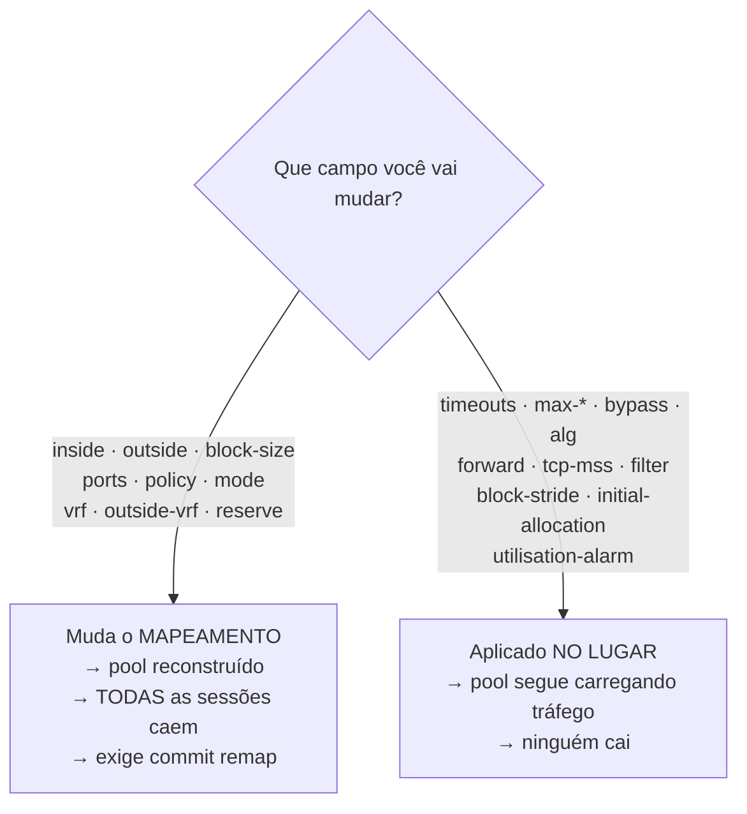

# Configuração de pool

Cada campo que um pool de CGNAT aceita, com o argumento, a faixa, o padrão e se a mudança derruba sessões. Para quem está criando um pool ou mexendo num que carrega assinantes.

Entra-se em `nat`, depois em `cgnat`, e ali `pool <nome>` — o nome tem até 63 caracteres. O prompt vira `prisma# [edit nat / cgnat / pool residencial] ` — ele nomeia o pool e os níveis em que ele está. `exit` volta para `cgnat`; `top` vai direto ao topo. A página [Configuração de CGNAT](/s/wiki/doc/configuracao-de-cgnat-EIWRFS6OnJ) explica os níveis. `commit` funciona de dentro do pool, e depois dele você continua no pool.

Mudar um pool exige a capacidade de CGNAT: uma conta `cgnat-operator` ou de administrador.


:::info
Procurando **como fazer uma tarefa** (abrir porta, limitar um host, ampliar o pool)? Comece pelas **Receitas do dia a dia**. Esta página é a referência campo a campo.

:::

# A divisão que importa antes de tudo

Alguns campos **reconstroem o pool**, e todas as sessões nele morrem no instante da aplicação. Outros são aplicados **no lugar**, num pool que está carregando tráfego.

| Reconstroem o pool — derrubam todas as sessões | Aplicados no lugar — sem impacto nas sessões |
|------------------------------------------------|----------------------------------------------|
| `inside`                                       | `timeout ...`                                |
| `outside`                                      | `max-blocks`                                 |
| `reserve`                                      | `block-stride`                               |
| `block-size`                                   | `bypass ...`                                 |
| `ports`                                        | `utilisation-alarm`                          |
| `policy`                                       | `max-sessions`                               |
| `mode`                                         | `max-session-rate`                           |
| `vrf`                                          | `tcp-mss`                                    |
| `outside-vrf`                                  | `filter`                                     |
|                                                | `alg ...`                                    |
|                                                | `forward ...`                                |
|                                                | `initial-allocation`                         |



A regra por trás: os da esquerda mudam o **mapeamento** — qual endereço público e qual bloco de portas cada assinante recebe. Mudou o mapeamento, toda sessão existente virou inválida.

Errar essa classificação é ruim nos dois sentidos: um campo de mapeamento tratado como no-lugar nunca chega ao dataplane; um campo no-lugar tratado como mapeamento **desconecta a base inteira de assinantes para desligar um ALG**.


:::warning
**Cuidado com** `**inside**` **e** `**outside**`**.** Mudar qualquer um dos dois reconstrói o pool e encerra todas as sessões dele, nos dois modos. Num pool `mode deterministic` o custo é maior: o mapeamento é **aritmético, não uma tabela** — o endereço público e o bloco de portas de um assinante são *calculados* a partir da definição do pool —, então **mudar a definição muda a função**. Acrescentar um prefixo público move **todos** os assinantes naquele instante. Nada é corrompido, respostas passadas continuam resolvíveis pela configuração que estava em vigor, mas todos os clientes caem de uma vez e a máquina não reporta nada de anormal — porque nada de anormal aconteceu. Por isso o `commit` **recusa** uma mudança que remapeia assinantes até que ela seja pedida pelo nome, com `commit remap`.

:::

# Campos de mapeamento

| Comando | Argumento | O que define |
|---------|-----------|--------------|
| `prefix-inside <prefixo>` | `<A.B.C.D/M\|X:X::X:X/M>` | prefixo interno (os assinantes); pode repetir. Obrigatório: o `commit` recusa um pool sem `prefix-inside` ou sem `prefix-outside`. IPv6 faz do pool um pool NAT64 (veja abaixo) |
| `prefix-outside <prefixo>` | `<A.B.C.D/M>` | prefixo público; pode repetir |
| `subscriber-length <n>` | `<32-128>` | só NAT64: o tamanho do prefixo IPv6 de **um** assinante — o prefixo delegado, por exemplo `56` |
| `nat64-prefix <prefixo>` | `<X:X::X:X/M>` | só NAT64: onde ficam os destinos IPv4 (RFC 6052); ausente, vale `64:ff9b::/96` |
| `block-size <n>` | `<64-32768>` | portas por bloco, potência de dois; padrão `512`. Um número que não é potência de dois é recusado com as duas potências mais próximas |
| `ports <min> <max>` | `<1-65535> <1-65535>` | faixa de portas utilizável; ausente, vale a faixa do próprio equipamento |
| `policy interleaved` |           | vizinhos em endereços públicos distintos; é o padrão |
| `policy blocked` |           | vizinhos no mesmo endereço público |
| `mode deterministic` |           | por fórmula, sem log de alocação: o assinante se acha pela configuração em vigor. É o padrão. Só o bloco entregue da reserva é registrado |
| `mode bpa` |           | BPA: blocos alocados sob demanda, cada alocação registrada. Sem exportação de logging configurada, `commit check` e `commit` avisam — nesse modo o registro é a única prova de quem usou uma porta |
| `vrf <n>` | `<0-4294967295>` | a VRF cujos assinantes este pool atende; ausente = todas |
| `outside-vrf <n>` | `<0-4294967295>` | a VRF por onde o tráfego traduzido sai; ausente = deixa onde estava |
| `reserve <n>` | `<0-65535>` | blocos de **cada** endereço público guardados fora da fórmula, para dar a quem encher o seu; `0` = nenhum |

Até a 0.148.2 essas duas instruções se chamavam `inside` e `outside`. Os nomes antigos continuam sendo lidos - de uma configuração salva, de uma revisão de rollback ou digitados -, mas a caixa só escreve os novos, e o `?` só oferece os novos. O papel de uma interface no CGNAT (`interface <nome> inside|outside`) não mudou.

**Os prefixos.** `prefix-outside` e `bypass` são IPv4; `prefix-inside` é IPv4 ou, num pool NAT64, IPv6 — nunca os dois no mesmo pool. Um prefixo com bits de host (`100.64.0.1/10`) é recusado dizendo qual rede ele nomeia (`100.64.0.0/10`), e um `/0` é recusado: todo endereço não é pool nem bypass.

`**policy interleaved**` **vs** `**blocked**` — `interleaved` espalha vizinhos por endereços públicos distintos, o que dilui o impacto de um bloqueio de reputação em um IP. `blocked` mantém vizinhos no mesmo endereço público.

# Lados dados por prefix-list

Um lado do pool pode vir de uma `ip prefix-list` em vez de prefixos digitados: a mesma lista do roteamento, com `seq`, `permit`/`deny`, `ge`/`le` e uma descrição por entrada.

| Comando | Argumento | O que define |
|---------|-----------|--------------|
| `prefix-list-inside <lista>` | `<prefix-list>` | os assinantes: origem que casa um `permit` é traduzida; origem que casa um `deny` **sai sem NAT**, com o próprio endereço; origem que não casa nada não é deste pool |
| `prefix-list-outside <lista>` | `<prefix-list>` | os endereços públicos: os `permit` **menos** os `deny` |

Cada lado é **um ou outro**: `prefix-inside` ou `prefix-list-inside`, `prefix-outside` ou `prefix-list-outside`. O `commit` recusa um pool com os dois no mesmo lado e diz qual pool e qual lado.

```
prisma# [edit] ip prefix-list CGN-IN seq 5 deny 100.64.1.0/24 description "faixa de gerência"
prisma# [edit] ip prefix-list CGN-IN seq 10 permit 100.64.0.0/22 le 32
prisma# [edit] ip prefix-list CGN-OUT seq 5 deny 203.0.113.129/32
prisma# [edit] ip prefix-list CGN-OUT seq 10 permit 203.0.113.128/28
prisma# [edit] nat
prisma# [edit nat] cgnat
prisma# [edit nat / cgnat] pool residencial
prisma# [edit nat / cgnat / pool residencial] prefix-list-inside CGN-IN
prisma# [edit nat / cgnat / pool residencial] prefix-list-outside CGN-OUT
```

Com isso o pool traduz `100.64.0.0/24` e `100.64.2.0/23`, deixa `100.64.1.0/24` passar sem tradução, e usa os quinze endereços de `203.0.113.128/28` que sobram tirando o `.129`.

**Como uma lista vira um conjunto de endereços.** No roteamento, uma entrada casa uma **rota** pelo tamanho: `permit 203.0.113.128/28` casa só a rota `/28`. Um pool lê a mesma lista como **endereços**, e por isso a regra aqui é outra:

* uma entrada sem `ge` nem `le` cobre **todos** os endereços do prefixo;
* com `ge` ou `le`, cada endereço conta como um `/32`, e a entrada cobre o prefixo quando 32 está na janela - `le 32` ou um `ge` sozinho cobrem tudo;
* uma entrada cuja janela deixa o `/32` de fora (`le 24`, por exemplo) não casa endereço nenhum, e o `commit` recusa o pool que usa a lista, nomeando a entrada.

Vale a primeira entrada que casar, na ordem do `seq`, como no roteamento. Onde a mesma lista é usada por um vizinho BGP ou por uma route-map, ela continua valendo pela regra de rotas: só o pool a lê como endereços.

**O que o** `**commit**` **recusa:** uma lista que não existe ou que não tem entrada; uma entrada que não casa endereço nenhum; uma `prefix-list-inside` que não traduz ninguém; um `deny` na `prefix-list-outside` que deixa o pool **sem endereço público**; um `deny` de origem que outro pool traduz (a origem é de um pool ou sai sem tradução, não as duas coisas); e uma lista que se desdobra em mais de 255 prefixos, o máximo que o dataplane recebe numa mensagem. Um pool NAT64 não aceita prefix-list.

**Mudar a lista reaplica o pool.** O conjunto que a lista dá é o mapeamento: se ele muda, o pool é reconstruído no `commit`, como se o prefixo tivesse sido digitado de novo - e, num pool determinístico, isso remapeia assinantes. O `show configuration compare` mostra a linha da lista que mudou e, embaixo do pool, o que ele passa a traduzir, em linhas `!`:

```
prisma# [edit] ip prefix-list CGN-OUT seq 10 permit 203.0.113.128/27
prisma# [edit] show configuration compare
```

Só o nome da lista e o que ela deixa de fora (as origens sem tradução, os públicos excluídos) mudam **no lugar**; trocar a lista por outra que dá os mesmos endereços não derruba ninguém.

**Mover entradas, como no Junos.** `ip prefix-list <lista> insert seq <n> before|after seq <m>` move a entrada `n` para antes ou depois da `m`; se não há número livre entre as duas, a lista inteira é renumerada de 10 em 10 na nova ordem, e a caixa avisa. `ip prefix-list <lista> resequence` renumera de 10 em 10. A descrição de cada entrada vai junto.

```
prisma# [edit] ip prefix-list CGN-IN insert seq 10 before seq 5
prisma# [edit] ip prefix-list CGN-IN resequence
```

**A descrição por entrada** é guardada pela própria caixa - o roteamento só tem descrição para a lista inteira - e aparece no `show configuration` no fim da linha da entrada. Uma entrada com descrição precisa de `seq`; digitada sem, a caixa dá a ela o `seq` que o roteamento daria.

**O que o pool usa de fato:** `show cgnat pool <nome>` mostra as linhas do dataplane para o pool e, embaixo, cada lado com a sua origem (`prefix-list CGN-IN` ou `typed`), o que ele traduz (`translated`, `public`) e o que as listas deixaram de fora (`untranslated`, `excluded`). A trilha datada (`show cgnat history`) registra os mesmos conjuntos e os nomes das listas, para que um mapeamento determinístico possa ser recalculado sabendo quais endereços ficaram fora.

```
prisma> show cgnat pool <nome>
```

## As duas pontas de `ports` são conferidas na hora, e a faixa no `commit`

Uma porta é um número de 16 bits dos dois lados: se `ports 70000 80000` fosse aceito, o que chegaria ao dataplane seria `4464-14464`, e a partir daí nenhuma recusa conseguiria nomear os 70000 - o número já não existiria. Então cada ponta é recusada onde você a digita, e a recusa diz **qual das duas**:

```
error: invalid argument: ports min 70000: expected 1-65535
```

```
error: invalid argument: ports max 70000: expected 1-65535
```

Algo que não é número responde por extenso, porque a ação é outra - não é escolher outro valor, é escrever um número:

```
error: invalid argument: ports min 'x': expected a number 1-65535
```

Duas portas legítimas na ordem errada são uma recusa diferente, e de propósito: a faixa não é o que está errado ali.

```
error: invalid argument: ports 9000 100: the max is below the min
```

A terceira coisa que pode estar errada só aparece no `commit`, e não na linha: uma faixa estreita demais para caber **um bloco**. Ela depende do `block-size`, que você pode digitar depois do `ports` - conferir na linha recusaria uma ordem de edição legítima. Então a pergunta é feita uma vez, do pool pronto:

```
error: pool 'residencial': block-size 512 exceeds the 177 usable ports
    ports 1024 1200
    block-size 512
    a pool whose port range is smaller than its block has no block to give
    anyone: widen the range, or make the block smaller
```

As duas sentenças saem inteiras, cada uma na sua linha, pelo mesmo motivo de sempre: é uma delas que você vai editar, e as duas carregam números que você vai comparar.

# Timeouts do pool

`timeout <tipo> <segundos>`, de `1` a `4294967295`. Ausente, herda o global. Zero não é um timeout: é o valor que a caixa lê como "não mexa neste", e por isso é recusado na hora em que você digita, e não silenciosamente ignorado.

| Tipo | O que expira |
|------|--------------|
| `udp` | sessões UDP  |
| `icmp` | sessões ICMP |
| `tcp-syn` | TCP meio-aberto |
| `tcp-transitory` | TCP em transição |
| `tcp-established` | TCP estabelecido |
| `gre` | o mapeamento GRE de uma chamada PPTP |
| `port-holddown` | quanto tempo uma porta liberada espera antes de ser reusada |
| `alg-expect` | quanto tempo uma porta de mídia anunciada espera |

`port-holddown` não é detalhe: reusar uma porta imediatamente faz o registro de quem a usava se sobrepor ao próximo dono.

# Limites por assinante

| Comando | Argumento | O que limita |
|---------|-----------|--------------|
| `max-blocks <n>` | `<1-255>` | quantos blocos um assinante pode segurar |
| `initial-allocation <portas>` | um número inteiro de blocos | quantas portas um assinante novo de um pool dinâmico recebe de uma vez |
| `block-stride <n>` | `<0-65535>` | distância entre os blocos de um mesmo assinante; `0` deixa o pool escolher |
| `max-sessions <n>` | `<0-4294967295>` | máximo de sessões simultâneas por assinante; `0` = ilimitado |
| `max-session-rate <n>` | `<0-4294967295>` | máximo de sessões novas por segundo, por assinante; `0` = ilimitado |
| `utilisation-alarm <pct>` | `<1-100>` | loga uma vez quando o bloco de um assinante atinge essa porcentagem |

`max-sessions` e `max-session-rate` são a defesa contra uma máquina infectada consumindo o pool inteiro. `utilisation-alarm` avisa **antes** do esgotamento, não depois.

# A faixa de portas que um assinante pode chegar a ter

`block-size` e `max-blocks` juntos **já são uma faixa**, e é assim que um pool atende um medidor inteligente e uma casa pesada ao mesmo tempo:

```
block-size 64
max-blocks 8
```

Um assinante **começa com 64 portas**. Só recebe um segundo bloco quando enche o primeiro, e só então um terceiro - até 8 blocos, 512 portas. O medidor nunca pede o segundo e custa 64 portas ao pool; a casa pesada chega às 512 sozinha, sem ninguém configurar nada para ela.

`show cgnat pool` mostra a faixa em portas, que é a unidade em que se vende:

```
  per sub      64-512 ports (1-8 blocks, grown one at a time as each fills)
```

## Uma primeira alocação maior que o degrau

Num pool `mode bpa`, a primeira alocação pode ser maior que o degrau em que o assinante cresce. Para começar com 512 portas e crescer de 256 em 256, até 2560:

```
block-size 256
max-blocks 10
initial-allocation 512
```

O bloco é de 256 portas, e é esse o degrau. `initial-allocation 512` faz o assinante novo receber **dois** blocos já no primeiro pacote. Dali em diante ele ganha um bloco de 256 cada vez que enche os que tem, até os 10 blocos do `max-blocks`. `show cgnat pool` mostra a faixa a partir da primeira alocação:

```
  per sub      512-2560 ports (starts at 2 blocks, grown one at a time to 10 as each fills)
```

O `commit` recusa três coisas, porque em nenhuma delas o número faria o que diz:

* **portas que não fecham um número inteiro de blocos** (`initial-allocation 300` com `block-size 256`);
* **mais do que o** `**max-blocks**` **permite** (`initial-allocation 4096` com 10 blocos de 256);
* **um pool** `**mode deterministic**`, em que o primeiro bloco do assinante é o da fórmula.

Cada bloco da primeira alocação vira um registro próprio no log de blocos, exatamente como se tivesse sido entregue um de cada vez. Mudar `initial-allocation` vale para os **próximos** assinantes novos e não mexe em quem já tem blocos, por isso é aplicado no lugar, sem derrubar sessão.

Um assinante que fica sem sessão nenhuma e volta antes de o bloco dele ser liberado recebe de volta o mesmo primeiro bloco, e cresce dali pelos degraus normais. A primeira alocação completa é para quem chega sem bloco nenhum.

O preço de um bloco pequeno é o **volume de registro**: cada bloco entregue a um assinante vira um registro próprio no log de blocos. Uma casa que chega a 8 blocos gera 8 registros; com `block-size 512` e um bloco só, gera 1. Escolha o menor bloco que ainda deixe a maioria dos assinantes dentro de **um** bloco, e use `max-blocks` para a minoria que precisa de mais.

# O bloco de reserva de um pool determinístico

Num pool `mode deterministic` **não existe bloco sobrando**: a fórmula entrega todos os blocos a algum assinante. Quem enche o seu bloco é derrubado - a internet do cliente para com a caixa saudável - porque qualquer bloco entregue como extra seria o bloco de outra pessoa, e o mapeamento dela quebraria em silêncio.

`reserve <n>` guarda **n blocos de cada endereço público** fora da fórmula. São esses, e só esses, os blocos que um pool determinístico tem para dar.

```
reserve 1
```

A conta muda junto, e é o preço:

```
blocos por endereço      = portas por endereço / block-size
blocos que a fórmula usa = blocos por endereço - reserve
capacidade               = endereços públicos x blocos que a fórmula usa
```

`show cgnat pool` mostra as duas contas lado a lado, e a capacidade já vem descontada:

```
  reserve      1 block(s) per public IP -> 3 mapped, 1 held for extensions
  capacity     3 subscribers (usable 3)
```

Cada bloco entregue da reserva vira **um registro próprio** no log de blocos, e a devolução dele também. É a única coisa que o modo determinístico registra por assinante, e tem de ser: é o único bloco que a fórmula não produz, então a configuração datada não responde por ele sozinha.

`show cgnat blocks` mostra a reserva e conta as recusas:

```
  reserve exhausted 3 time(s): a subscriber filled its block, was under
  max-blocks 2, and the reserve had nothing left
```

Essa contagem é **separada** de um assinante bater no `max-blocks`, porque a ação é outra: contra uma, aumentar a reserva ou acrescentar endereços públicos; contra a outra, aumentar o limite por assinante.

Três coisas que vale saber antes de escolher o número:

* **Uma reserva menor que o número de workers deixa workers sem nada.** A caixa avisa na criação do pool e cria o pool assim mesmo - recusar faria um pool aceito hoje não subir depois de a máquina ganhar workers, o que derruba todo mundo.
* **A caixa prefere um bloco do próprio endereço público do assinante**, para que quem está do outro lado continue vendo um host só. É preferência, não garantia: se não houver um livre na fatia daquele worker, ela entrega outro em vez de recusar.
* `**reserve**` **não vale em** `**mode bpa**` e é recusado lá. Um pool dinâmico já tem blocos sobrando - a lista de livres é exatamente de onde sai o bloco extra - então uma reserva tiraria blocos da própria lista de onde eles vêm.

# Onde ficam os blocos extras de um assinante

`block-stride <n>` decide a distância entre os blocos que um mesmo assinante segura. Vale só em `mode bpa`: num pool determinístico o bloco extra vem da reserva, que é um conjunto à parte, e a distância não se aplica a ele - e o `commit` recusa a combinação, em vez de guardar um ajuste que nunca teria efeito; a frase está em [commit, rollback e save](/s/wiki/doc/commit-rollback-e-save-jqCB7kxPuA).

| Valor | O que acontece |
|-------|----------------|
| `0` (padrão) | o bloco extra vai para onde o pool tiver um livre - comportamento de sempre |
| `1`   | os blocos ficam **colados**: o segundo começa onde o primeiro termina |
| `n`   | os blocos ficam `n × block-size` portas afastados, no mesmo endereço público |

**Colado (**`**1**`**)** deixa o assinante com uma faixa contínua de portas. É a opção para quem atende ofício e investigação: uma faixa em vez de várias, e o técnico que olha um horário não precisa cruzar três intervalos separados.

**Afastado (**`**n**` **maior)** espalha o assinante pela faixa de portas do próprio endereço público. É a opção para quem quer que observar um intervalo de portas de fora diga o mínimo possível sobre um cliente.

Nenhuma das duas é obviamente certa - por isso é um ajuste, e por isso o padrão é o comportamento antigo: uma configuração escrita antes de o `stride` existir se comporta igual quando a caixa passa a rodar uma versão nova.


:::info
**O** `**stride**` **nunca custa tráfego a um cliente.** Se o bloco que a distância aponta já estiver com outro assinante, ou se o assinante estiver no fim da faixa de portas do seu endereço público, a caixa entrega **outro bloco qualquer** em vez de recusar. O cliente continua funcionando; o que muda é só onde o bloco caiu.

:::

`show cgnat blocks` conta os dois casos, e é onde se confere se o ajuste está valendo de fato:

```
  stride 1: 412 extensions placed where it says, 7 fell back to the free list
```

Só zeros na primeira coluna com números na segunda quer dizer que a distância escolhida **não cabe** nesta caixa. Isso acontece quando a máquina roda com vários workers: os blocos são divididos entre eles, e um assinante só pode receber blocos da fatia do seu próprio worker. A caixa avisa no momento em que o pool é criado e diz qual distância serve:

```
warning: block-stride 1 on pool residencial cannot be honoured: blocks are sharded 4 ways and a stride step moves by 2, so every block the stride names belongs to another worker
         the nearest stride that can be: 2
         the setting is applied and extensions fall back to the free list; this is a warning, not a refusal
```

São **três** linhas, e o dataplane as escreve inteiras: a primeira passa de 170 colunas e a última de 100, então num console de 80 o terminal é que dobra. Quem procurar a frase inteira na tela procura o começo dela, não uma linha que termina onde a sua janela termina.

É um aviso e não uma recusa de propósito: o número de workers é ajuste de inicialização, e uma configuração recusada por causa dele deixaria o pool **sem subir** depois de um reinício - o que derruba todo mundo, para atender a uma preferência de arrumação.

# Bypass — o que não é traduzido

| Comando | Argumento | Efeito |
|---------|-----------|--------|
| `bypass source <prefixo>` | `<A.B.C.D/M>` | origem que precisa manter o próprio endereço |
| `bypass destination <prefixo>` | `<A.B.C.D/M>` | destino que precisa enxergar a origem real |

Tráfego em bypass sai **sem tradução e sem alocar nada**.

# Encaminhamento de porta

```
forward tcp <porta-pública> to <ip-privado> <porta-privada>
forward udp <porta-pública> to <ip-privado> <porta-privada>
```

Fixa uma porta de entrada num assinante. **O endereço público é o do próprio assinante** — não um IP avulso do pool.

# Comportamento NAT

| Comando | Efeito |
|---------|--------|
| `filter endpoint-independent` | qualquer um alcança um mapeamento aberto (*full cone*) — **padrão** |
| `filter address-dependent` | só o remoto que o assinante contatou (*restricted cone*) |

Corresponde ao REQ-8 da RFC 4787.

# MSS clamping

```
tcp-mss <536-9000>
tcp-mss auto
```

Rebaixa o MSS dos handshakes para que os segmentos caibam no caminho. `auto` deriva o valor das MTUs das interfaces com `cgnat inside` ou `cgnat outside` (a menor delas menos 40: com as interfaces no padrão da caixa, 1500, dá 1460); enquanto nenhuma interface estiver no CGNAT, ele não tem de onde derivar e não rebaixa nada. Abaixo de 536 (o MSS que todo host IPv4 aceita) o valor não serve para nada, e acima de 9000 não descreve caminho nenhum: os dois são recusados. `no tcp-mss` desliga.

Vale notar o modo de falha que isso corrige: sem clamp, o par descarta o segmento e a conexão trava — silenciosamente, com um contador afirmando que tudo foi aplicado.

# ALGs

```
alg ftp  <on|off>
alg rtsp <on|off>
alg pptp <on|off>
alg esp  <on|off>
alg sip  <on|off>
```

| ALG | O que reescreve |
|-----|-----------------|
| `ftp` | PORT/EPRT e as respostas 227/229 |
| `rtsp` | o `client_port` do cabeçalho Transport |
| `pptp` | o canal de controle e o canal de dados GRE |
| `esp` | nada do payload: amarra o túnel IPsec ao gateway remoto |
| `sip` | `Via`, `Contact` e o SDP do SIP sobre UDP, e abre o par RTP/RTCP |

São os protocolos que carregam um endereço dentro do payload — ou, no caso do `esp`, que não têm porta nenhuma para o CGNAT usar. Sem o ALG correspondente, eles anunciam o endereço privado para o outro lado e a conexão de dados nunca se estabelece.

Os cinco vêm **ligados**. `alg <nome> off` é a exceção escrita no pool, e `no alg <nome>` devolve o ALG ao padrão do equipamento em vez de fixá-lo num valor.

# Removendo um ajuste: `no`

Dentro do bloco, `no <ajuste>` tira o ajuste. `no ?` lista o que pode ser tirado, e `?` depois da palavra continua oferecendo o argumento:

```
prisma# [edit nat / cgnat / pool residencial] no ?
  alg                stop choosing for one ALG; the pool takes the device default again
  block-stride       let the pool place a subscriber's extra blocks wherever it has one free
  bypass             stop excluding a prefix from translation
  filter             go back to endpoint-independent filtering
  forward            remove one inbound port forward
  initial-allocation a new subscriber starts with one block again
  inside             remove one inside prefix
  max-blocks         go back to one block per subscriber
  max-session-rate   no per-subscriber session rate cap
  max-sessions       no per-subscriber session cap
  outside            remove one public prefix
  outside-vrf        leave translated traffic where it was
  ports              go back to the device's own port range
  reserve            give the reserved blocks back to the formula; this too re-maps subscribers
  tcp-mss            stop clamping the MSS
  timeout            stop overriding one timeout; the pool inherits the global again
  utilisation-alarm  stop alarming on block utilisation
  vrf                serve every VRF again
```

Tirar um timeout, um ALG ou um limite **não é o mesmo que ajustá-lo para o valor padrão**: o pool volta a **herdar** o global, e a linha desaparece da configuração em vez de aparecer nela com um número dentro. Um `timeout udp 300` global mudado depois passa a valer para o pool de novo.

## Pool NAT64: assinantes só IPv6 saindo pelo IPv4 público

Um pool com `prefix-inside` IPv6 é um pool NAT64 (RFC 6146): o assinante que só tem IPv6 alcança servidores IPv4 pelo mesmo pool público, repartido em blocos de portas como no CGNAT IPv4. O assinante é o **prefixo delegado**, não um endereço: um /128 dentro de um /64 muda com as extensões de privacidade, e o prefixo é o que o RADIUS atribui a uma pessoa.

```
nat
 nat64
  pool v6
   prefix-inside 2001:db8:1200::/40
   subscriber-length 56
   nat64-prefix 64:ff9b:1::/48
   prefix-outside 203.0.113.0/29
   block-size 2048
   exit
```

Cada /56 de `2001:db8:1200::/40` recebe um bloco de 2048 portas pela mesma fórmula do modo determinístico. O assinante fala com `64:ff9b:1:c000:2:200::` e o servidor `192.0.2.2` vê o endereço público e uma porta do bloco desse assinante. Com o prefixo bem conhecido `64:ff9b::/96` (o padrão), endereços IPv4 não globais — privados, de documentação, de laboratório — não são alcançáveis, como manda a RFC 6052.

`subscriber-length` e `nat64-prefix` são campos de **mapeamento**: mudar qualquer um reconstrói o pool.

**Atenção:** o pool NAT64 fica em `nat` > `nat64`, não em `cgnat`. Escrito dentro de `cgnat`, como nas versões 0.150.0 a 0.150.11, ele é recusado no `commit check` e ao carregar o arquivo salvo, com a forma nova na mensagem — reescreva o pool em `nat64` antes de atualizar a caixa. Em `nat64` só existem pools; interfaces, logging, timeouts e memória continuam em `cgnat`, valendo para os dois tipos de pool. Um nome de pool é um pool só, nos dois níveis. Para ver só o NAT64 há `show nat64 pool`, `show nat64 subscriber <IPv6>`, `show nat64 translation <público> <porta>` e `clear nat64 subscriber <IPv6>`; o `show cgnat` continua mostrando a caixa inteira, NAT44 e NAT64.

**Determinístico ou BPA.** Em `mode bpa`, com `max-blocks`, `initial-allocation` e `block-stride`, o pool NAT64 aloca blocos sob demanda como um pool IPv4, e cada alocação e liberação sai no log nomeando o assinante pelo prefixo delegado (veja [Logging IPFIX e trilha de auditoria](/s/wiki/doc/logging-ipfix-e-trilha-de-auditoria-lREEjJu1Bq)). Os outros ajustes do pool valem num pool NAT64 como num pool IPv4 — `reserve`, `tcp-mss`, `vrf` e `outside-vrf`, `max-sessions`, `max-session-rate`, `utilisation-alarm`, timeouts e `filter` —, com duas diferenças. O `tcp-mss auto` fica 20 bytes abaixo do de um pool IPv4, porque o cabeçalho IPv6 do lado do assinante é 20 bytes maior. E o `vrf` de um pool NAT64 é uma tabela IPv6: dois clientes podem ter o mesmo prefixo interno em VRFs diferentes, cada um com o seu pool.

**Encaminhamento de porta para um host IPv6.** Num pool NAT64 o `forward` aponta para um host do prefixo do assinante, e quem está na internet IPv4 alcança esse host pela porta pública:

```
forward tcp 12000 to 2001:db8:1200:ab00::10 8080
```

A porta pública tem de estar no bloco do próprio assinante, como num pool IPv4. Um segundo host do mesmo prefixo com a mesma porta privada é recusado.

**ALG num pool NAT64:** só o `ftp`, que traduz o `EPSV` e o `EPRT` de um cliente IPv6 para o `PASV` e o `PORT` de um servidor IPv4 (RFC 6384), e que num pool NAT64 vem **desligado** até você escrever `alg ftp on` (veja [Protocolos e ALGs](/s/wiki/doc/protocolos-e-algs-vZjaCcHaN7)).

**Recusados num pool NAT64:** `bypass`, para sempre — um pacote IPv6 para o prefixo NAT64 só chega ao IPv4 traduzido, então não existe caminho sem tradução —, e os ALGs `rtsp`, `sip`, `pptp` e `esp`, também para sempre, cada um pelo nome: não existe tradução deles entre IPv6 e IPv4 para fazer.

**IPv4 para o assinante só IPv6 (464XLAT).** O programa do assinante que só fala IPv4 passa pelo pool NAT64 através de um CLAT do lado dele, e o CLAT aprende o `nat64-prefix` pelos anúncios de roteador da interface dos assinantes: `ipv6 nd nat64 <prefixo>` naquela interface (veja [Configuração de interface](/s/wiki/doc/configuracao-de-interface-j1q58jKWTQ)). O `commit check` recusa anunciar um prefixo que nenhum pool NAT64 traduz.

**Rotas.** Um pool NAT64 deve ao roteamento dois prefixos: o `prefix-outside`, como qualquer pool, e o `nat64-prefix`, do lado IPv6 — é para ele que os assinantes mandam o tráfego para o IPv4. Com BGP configurado, o `commit check` avisa quando nada anuncia o `nat64-prefix` na família IPv6, e o aviso traz as duas linhas que resolvem: `ipv6 route <prefixo> blackhole` e `network <prefixo>`.

**Par de alta disponibilidade.** A comparação de mapeamento do par cobre o pool NAT64, e o failover leva o lado IPv6: um endereço IPv6 no `vrrp <vrid>` da interface dos assinantes (o link-local e o global, veja [Configuração de interface](/s/wiki/doc/configuracao-de-interface-j1q58jKWTQ)) faz o gateway IPv6 acompanhar o mestre. Num par de laboratório o serviço voltou entre 2,8 e 4,0 segundos nas três falhas medidas (cabo do uplink, dataplane parado, dataplane morto), no mesmo endereço público e no mesmo bloco; as conexões em curso caem, como no IPv4. O `commit check` só avisa sobre o pool NAT64 quando o par não tem nenhum roteador virtual IPv6.

Quem estava atrás de uma porta pública: `show cgnat translation 203.0.113.3 44100` responde com o prefixo IPv6 do assinante, pela fórmula. O inverso: `show cgnat subscriber 2001:db8:1200:ab00::10` dá o bloco do assinante, e `show cgnat top` lista os assinantes pelo prefixo.

## Três ajustes não podem ser removidos, e a caixa diz isso

`block-size`, `policy` e `mode` **sempre têm um valor**. Não existe pool sem tamanho de bloco, sem política e sem modo - então `no block-size 512` não teria o que significar: tirar a linha não tiraria o ajuste, só faria a configuração parar de dizer o que o pool está fazendo, enquanto o pool continua fazendo. A caixa recusa e diz o que digitar no lugar:

Digitar `no block-size 512` dentro do pool é recusado, e a recusa diz o que fazer no lugar:

```
error: block-size cannot be removed
    every pool has one, so there is no state without it
    set the value you want instead: block-size <64-32768>
```

`policy` e `mode` respondem do mesmo jeito, trocando o nome do campo e o que digitar no lugar: `policy interleaved|blocked` e `mode deterministic|dynamic`.

Para mudar qualquer um dos três, digite o valor que você quer. São campos de mapeamento: a mudança reconstrói o pool e exige `commit remap`.

## `ports`, `vrf` e `outside-vrf` têm um estado "não dito"

Estes três aceitam `no`, e o estado para onde eles voltam não é um valor - é a **ausência** dele, que significa outra coisa:

| Comando | Para onde volta |
|---------|-----------------|
| `no ports` | a faixa de portas do próprio equipamento |
| `no vrf` | atende **todas** as VRFs, que não é a mesma resposta que `vrf 0` |
| `no outside-vrf` | deixa o tráfego traduzido onde ele já estava |

Os três também são campos de mapeamento: removê-los reconstrói o pool.

## Remover algo que não está lá é recusado

`no prefix-inside 10.0.0.0/8` num pool que não tem esse prefixo é recusado, com o prefixo escrito de volta. O pool continua com o prefixo que você queria, e quase sempre o que aconteceu foi um erro de digitação:

```
error: the pool has no prefix-inside 10.0.0.0/8
```

Já `no timeout udp` num pool que não sobrescreve o timeout de UDP é aceito em silêncio: o estado depois é exatamente o estado pedido - este pool não sobrescreve nada.

# Exemplo completo

```
configure
 nat
  cgnat
   pool residencial
    prefix-inside 100.64.0.0/10
    prefix-outside 203.0.113.0/24
    block-size 512
    ports 1024 65535
    policy interleaved
    mode deterministic
    timeout udp 300
    timeout tcp-established 7440
    max-sessions 2000
    max-session-rate 200
    utilisation-alarm 85
    tcp-mss auto
    alg ftp on
    alg pptp on
    bypass destination 198.51.100.0/24
    exit
   exit
  exit
 interface ens18
  cgnat inside
  exit
 interface ens19
  cgnat outside
  exit
 show configuration compare
 commit check
 commit comment "pool residencial inicial"
 exit
save
```

Os campos de dentro do pool são os mesmos de sempre. O que mudou foi o caminho até ele: a forma de uma linha só (`nat cgnat pool residencial`, ou a mais antiga `cgnat pool residencial`) **não é mais aceita**, nem digitada nem num arquivo salvo. Depois de atualizar uma caixa, rode `save` antes de reiniciar: ele reescreve o arquivo já no bloco `nat` > `cgnat`, e o boot seguinte lê o arquivo inteiro.

# Ver também

* [Receitas do dia a dia](/s/wiki/doc/receitas-do-dia-a-dia-IcocgdbXW2) — estes campos aplicados a tarefas reais
* [Determinístico e BPA — conceitos e mapeamento](/s/wiki/doc/deterministico-e-bpa-conceitos-e-mapeamento-uh9nF6sRaa) — por que alguns campos derrubam sessão
