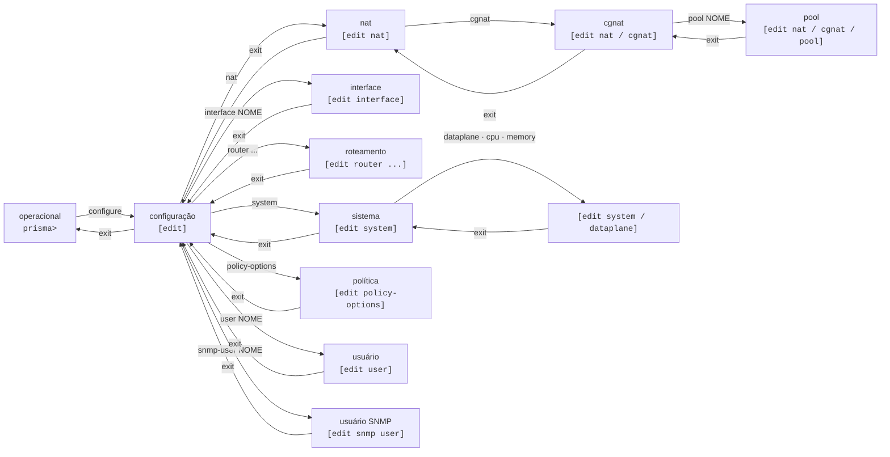

# VTY prismash — guia de uso

`prismash` é a VTY única do Prisma Routing: configura CGNAT **e** roteamento pela mesma interface, com modelo de configuração candidata no estilo Juniper — você edita, revisa e só então aplica com `commit`.



## Modos e prompts

| Modo | Prompt | Como entrar | Como sair |
|------|--------|-------------|-----------|
| Operacional | `prisma> ` | é onde a sessão começa | `exit` encerra a sessão |
| Configuração | `prisma# [edit] ` | `configure` | `exit`    |
| NAT  | `prisma# [edit nat] ` | `nat`       | `exit`, `up` ou `top` |
| CGNAT | `prisma# [edit nat / cgnat] ` | `cgnat`, dentro de `nat` | `exit`, `up` ou `top` |
| Pool | `prisma# [edit nat / cgnat / pool residencial] ` | `pool <nome>`, dentro de `cgnat` | `exit` volta para `cgnat`; `top` vai ao topo |
| Interface | `prisma# [edit interface ens18] ` | `interface <nome>` | `exit`, `up` ou `top` |
| Usuário | `prisma# [edit user joao] ` | `user <nome>` | `exit`, `up` ou `top` |
| Usuário SNMP | `prisma# [edit snmp user nms] ` | `snmp-user <nome>` | `exit`, `up` ou `top` |
| Rotas estáticas | `prisma# [edit router static] ` | `router static` | `exit`, `up` ou `top` |
| Bloco do FRR | `prisma# [edit router bgp 65000] ` | `router bgp <AS>`, `router ospf`, `router ospf6`, `router isis <nome>`, `route-map ...`, `rpki` | `exit`, `up` ou `top` |
| Sistema | `prisma# [edit system] ` | `system`    | `exit`, `up` ou `top` |
| Placa, núcleos e memória | `prisma# [edit system / dataplane] ` | `dataplane`, `cpu` ou `memory`, dentro de `system` | `exit` volta para `system` |
| Política de roteamento | `prisma# [edit policy-options] ` | `policy-options` | `exit`, `up` ou `top` |

**O prompt nomeia o assunto, não só o tipo de bloco.** `[edit nat / cgnat / pool]` seria o mesmo prompt numa caixa com vinte pools: diria que você está *num* pool sem dizer em qual, que é justamente a pergunta que você tem.

Blocos aninhados aparecem com o mais interno por último, separados por `/`, para que dê para ver o que contém o quê. Um prompt longo demais é truncado pelo começo — o fim é onde a próxima linha vai cair, e é a metade que vale o espaço.

**Ctrl-C nunca encerra a sessão.** No prompt, ele descarta a linha que estava sendo digitada e mostra um prompt novo. Durante um comando, ele interrompe o comando e devolve o prompt. A exceção é enquanto um `commit`, um `rollback` ou uma carga de configuração está sendo aplicado: ali o Ctrl-C é ignorado. A tela mostra `^C`, e o commit termina e diz o que fez, porque uma configuração aplicada pela metade é pior do que uma demorada. Para sair, `exit` ou Ctrl-D.

`**commit**` **vale em qualquer nível**, inclusive dentro de um pool, de uma conta e de um usuário SNMP. Depois dele você continua no mesmo bloco; se a candidata aplicada não tem mais aquele bloco, a caixa leva você de volta a `[edit]` e diz isso.

## Onde eu estou, e o que já digitei aqui

```
show this
```

Mostra a configuração da hierarquia em que você está, na **candidata** — dentro de um pool, o pool; dentro de uma interface, o bloco inteiro dela (endereços, MTU, VLAN, lado do CGNAT, VRRP e as linhas do roteamento); dentro de `system` ou de `dataplane`, aquele nível; no topo do modo de configuração, a candidata inteira.

## Andar na hierarquia: `top` e `up`

Duas palavras movem você **dentro** do modo de configuração, sem sair dele e sem mexer na candidata:

| Palavra | O que faz |
|---------|-----------|
| `top`   | vai para a raiz do modo de configuração, de qualquer profundidade |
| `up`    | sobe um nível |
| `up <n>` | sobe `n` níveis |

```
prisma# [edit] nat
prisma# [edit nat] cgnat
prisma# [edit nat / cgnat] pool residencial
prisma# [edit nat / cgnat / pool residencial] inside 100.64.0.0/10
prisma# [edit nat / cgnat / pool residencial] top
prisma# [edit] router bgp 65000
prisma# [edit router bgp 65000] address-family ipv4 unicast
prisma# [edit ...r bgp 65000 / address-family ipv4 unicast] up
prisma# [edit router bgp 65000] top
prisma# [edit]
```

**Nenhuma das duas sai do modo de configuração.** A candidata continua, o modo de configuração continua, e você fica onde disse. Um pool, uma interface, uma conta e um bloco do FRR contam **um nível cada** — e por isso `up` serve para todos.

**Subir mais níveis do que existem é recusado, não aparado.** Sair de mais níveis do que você pediu deixa você num lugar que não digitou, e a próxima declaração cai ali:

```
prisma# [edit router bgp 65000] up 2
error: up 2: there are only 1 level(s) below the top here
    'top' goes all the way up in one word
```

## Descobrindo comandos

Duas ferramentas, sempre disponíveis:

* **TAB** completa o comando ou lista as opções possíveis no ponto em que você está.
* `**?**` mostra as opções válidas naquele ponto, cada uma com sua descrição.

E onde a árvore espera um **nome**, os dois completam com o que a caixa realmente tem:

```
prisma# [edit] interface ?
  ens18  interface (up)
  ens19  interface (up)
  <interface>, or a name that creates one
```

Embaixo da dica vem uma nota dizendo quais nomes **criam** uma interface: `<pai>.<tag>` cria uma sub-interface VLAN, `loop<n>` um loopback e `ae<n>` um bundle LACP. Qualquer outro nome que a caixa não tem é recusado no `commit`.

Interfaces vêm do dataplane, com o estado. O `local0` e o TAP de cada par com o Linux ficam de fora da lista: não são interfaces que se configuram. Pools, contas e usuários SNMP vêm da **candidata** — então completam o que você está editando, não só o que já foi commitado.

Uma fonte que não consegue responder simplesmente não oferece nada e deixa a dica no lugar: uma VTY que fica inútil quando o dataplane cai é uma VTY que não serve para consertá-lo.

Ambas são contextuais: dentro de um pool, `?` lista os campos do pool, não os comandos globais.

## Abreviações

Você não precisa digitar a palavra inteira. **Qualquer abreviação que sirva a uma única declaração vale pela declaração inteira** — a caixa completa por você antes de ler a linha:

```
prisma# [edit] interf ens18
prisma# [edit interface ens18] no shut
prisma# [edit interface ens18] descr uplink da transito
prisma# [edit interface ens18] mt 9000
```

é exatamente o mesmo que `interface ens18`, `no shutdown`, `description uplink da transito` e `mtu 9000`. As palavras que valem são as mesmas que o `?` e o TAB oferecem naquele ponto, então o que a caixa aceita e o que ela oferece nunca discordam.

**O que fica guardado é sempre a grafia inteira.** `show this`, `show configuration` e o arquivo que o `save` grava nunca mostram `no shut`: `mt 9000` aparece como `mtu 9000`, e uma interface ligada com `no shut` simplesmente deixa de ter a linha `shutdown` - a caixa só escreve `shutdown` quando a interface está desligada. A abreviação existe para os seus dedos, não para o arquivo.

### Uma abreviação ambígua é recusada, com os candidatos

```
prisma# [edit interface ens18] i 1
error: an ambiguous abbreviation
    'i' begins 4 statements here: ip, ipv4, ipv6, isis
    type enough of one to tell them apart, or '?' to read what each does
```

A caixa não escolhe por você. `ipv address 10.0.0.1/24` também é recusada: são duas famílias de endereço, e adivinhar poria o endereço na errada.

### O que **não** se abrevia

* **Nomes que são seus**, e não da caixa: o nome de uma interface, de um pool, de uma conta. `show interface Te` procura uma interface chamada `Te`; não vira `show interface terse`.
* **As declarações do FRR** dentro de um bloco de roteamento (`router bgp`, `route-map`, `router ospf`). Ali vale a sintaxe do FRR inteira, e esta VTY modela só uma parte dela — abreviar contra um modelo parcial trocaria uma declaração que o roteamento ia executar por outra. Dentro de `interface`, ao contrário, a abreviação vale: `no shut` é `no shutdown`, e `bandwidth`, `link-detect` e as demais palavras do FRR seguem intactas para ele.
* **As declarações dentro de um pool, de uma conta (**`**user**`**) e de um usuário SNMP (**`**snmp-user**`**).** Nesses três blocos a palavra vai inteira.
* **Um arquivo de configuração** editado à mão. O arquivo é lido a cada boot, sem ninguém olhando, e uma abreviação lá é recusada com a lista do que a interface entende. Grave sempre a palavra inteira — é o que o `save` faz.

## O ciclo de trabalho

```
configure                    entra em configuração
  ... edições ...            alteram a candidata, não a máquina
show configuration compare   o que mudaria
commit check                 valida sem aplicar
commit                       aplica
exit                         volta ao operacional
save                         grava em disco para sobreviver ao boot
```

**Nada do que você edita chega ao equipamento antes do** `**commit**`**.** Editar é seguro; aplicar é o passo consciente.

E `commit` **não** grava em disco — quem faz isso é `save`. Uma configuração commitada mas não salva desaparece no próximo boot. São dois passos porque são duas decisões diferentes: *"passe a valer agora"* e *"continue valendo depois de reiniciar"*.

## Comandos do modo operacional

| Comando | O que faz |
|---------|-----------|
| `configure` | entra no modo de configuração |
| `show ...` | exibe informação (ver a página de comandos `show`) |
| `start shell` | abre um shell como processo filho; `exit` volta para a VTY. **Só administradores** — um shell nesta caixa é toda a capacidade de uma vez |
| `ping <host>` | manda echo requests e mostra o que voltou. Aceita `count <n>` e `source <endereço>` |
| `traceroute <host>` | o caminho até um host, uma linha por salto. Aceita `count <n>` (teto de saltos) e `source <endereço>` |
| `mtr <host>` | pinga todos os saltos do caminho e imprime um relatório. Aceita `count <n>` (ciclos) e `source <endereço>` |
| `test policy <política> <prefixo>` | passa uma rota para aquele prefixo pelos termos de uma política de `policy-options` e diz qual termo a decide, antes de a política ser aplicada em algum lugar |
| `clear bgp <vizinho> [soft [in\|out]]` | reinicia uma sessão BGP; `soft` reaplica a política sem derrubar a sessão. Só administradores |
| `clear ospf process` / `clear ospf neighbor <A.B.C.D>` | refaz o processo OSPF inteiro (toda adjacência cai junto) ou uma adjacência |
| `clear isis adjacency [<system-id>]` | refaz as adjacências IS-IS, todas ou uma |
| `rollback <0-19>` | carrega uma revisão commitada na candidata |
| `save`  | grava a configuração em vigor em disco |
| `system upgrade [<versão>]` | sem versão, diz qual versão a caixa roda e qual é a mais nova publicada, sem mudar nada; com versão, baixa o pacote, recusa se o `sha256` não conferir e roda a atualização mostrando o que ela diz. A versão em uso e as anteriores são recusadas. Na prática, só root, como o `system reboot` |
| `system dataplane restart` | para e sobe o dataplane de novo: **para de encaminhar e descarta o bloco de portas de todo assinante**. É o que leva para o DPDK uma placa adicionada com a caixa rodando. Diz o que custa antes de agir |
| `system reboot` | reinicia a caixa. **Só root, hoje.** Uma conta `prisma-admin` que não é root passa pela VTY e é recusada na hora de reiniciar, porque a appliance não concede isso a nenhuma conta além do root. Antes de agir, avisa o que custa: toda sessão nesta caixa termina; o dataplane para; **se há algo em vigor que o boot não repõe e não foi salvo, isso se perde no boot** (`save` o mantém; contas, SSH e SNMP ficam na caixa e não contam, então uma appliance recém-instalada, sem nada salvo, não é avisada); **se há um** `**commit confirmed**` **sem confirmar, a caixa volta revertida** (`commit` confirma). Os dois últimos são medidos na hora e só aparecem quando são verdade. Depois, a caixa volta sozinha assumindo a placa dela — nada precisa ser digitado no console dela |
| `system shutdown` | desliga a caixa. **Só root, hoje**, como o `system reboot`, e com os mesmos avisos — sessões, dataplane, o que não foi salvo, o que não foi confirmado. Uma diferença: ela fica desligada até alguém ligá-la de novo, e só então volta assumindo a placa sozinha |
| `install` | instala o Prisma Routing num disco desta máquina — **só existe rodando a partir da ISO** |
| `exit`  | encerra a sessão |

### Alcançabilidade: `ping`, `traceroute` e `mtr`

A primeira pergunta que alguém faz a um roteador é se ele alcança alguma coisa. As três respondem isso **de dentro da VTY**, e **qualquer conta pode rodá-las**, inclusive uma conta só de leitura: elas não mudam nada na caixa, e quem é chamado para dizer se a caixa alcança um destino nem sempre é quem pode configurá-la. Antes desta versão o único caminho era o `start shell`, que é só de administrador e entrega toda a capacidade de uma vez para responder uma pergunta sobre um pacote.

```
prisma> ping 8.8.8.8
PING 8.8.8.8 (8.8.8.8) 56(84) bytes of data.
64 bytes from 8.8.8.8: icmp_seq=1 ttl=117 time=8.44 ms
...
--- 8.8.8.8 ping statistics ---
5 packets transmitted, 5 received, 0% packet loss, time 4006ms

prisma> traceroute 8.8.8.8 source 200.0.113.10
prisma> mtr 8.8.8.8 count 10
```

**Toda sonda termina sozinha.** O padrão são 5 pacotes, o máximo que `count` aceita é 100, e existe um prazo de 300 segundos que interrompe a ferramenta que travar. Isso é deliberado: uma sonda que só para quando alguém interrompe, digitada no console serial de uma caixa no rack por quem depois foi embora, deixa aquele console inutilizável até alguém voltar. Ctrl-C também volta para o prompt, sem encerrar a sessão.

O `mtr` roda em **modo relatório**, não em tela cheia: uma tela curses num console serial a 115200 é ilegível.

**O que é recusado no prompt:**

| Você digitou | A caixa diz |
|--------------|-------------|
| `ping`       | `ping: no host`, com a forma de uso |
| `ping 1.1.1.1 count` | `not an option of this statement` — a opção veio sem valor |
| `ping x;rm`  | `not a host` — nome é letra, dígito e hífen em rótulos separados por ponto |
| `ping 1.1.1.1 count 0` | `count out of range` — é um inteiro de 1 a 100 |
| `traceroute 1.1.1.1 source nome` | `not a source address` — a origem é um endereço, não um nome |
| `mtr ...` numa caixa sem o `mtr` | `this box has no mtr`, dizendo o pacote que o traz |

Nada do que você digita chega a um shell: a caixa monta a lista de argumentos e executa o programa direto, sem shell nenhum no caminho.

## Comandos do modo de configuração

| Comando | O que faz |
|---------|-----------|
| `nat`   | entra na hierarquia de NAT; dentro dela, `cgnat` guarda pools, logging, timeouts e a memória do CGNAT |
| `interface <nome>` | entra na configuração de uma interface, ou cria uma sub-interface, um loopback ou um bundle LACP |
| `router static` | entra no bloco das rotas estáticas |
| `router bgp <AS>` / `router ospf [vrf <nome>]` / `router ospf6` / `router isis <nome>` | protocolos de roteamento (FRR) |
| `rpki`  | validação de origem: os caches que esta caixa consulta |
| `policy-options` | política de roteamento no formato do Junos: listas de prefixos, comunidades, AS-path e `policy-statement` |
| `ip prefix-list <nome> ...` / `ipv6 prefix-list <nome> ...` | uma lista de prefixos, na sintaxe do FRR, para casar em route-map |
| `bgp as-path access-list` / `bgp community-list` / `bgp large-community-list` | as listas que uma route-map consulta |
| `system` | a máquina: `dataplane` (a placa entregue ao dataplane), `cpu` (núcleos por papel) e `memory` (memória por papel) |
| `dns server <endereço>` / `no dns server <endereço>` | os resolvedores que a caixa consulta, até três |
| `ssh ...` | daemon SSH |
| `user <nome>` | uma conta que pode logar |
| `snmp ...` | agente SNMP, somente leitura por construção |
| `snmp-user <nome>` | um usuário SNMPv3 |
| `commit ...` | aplica a candidata; vale em qualquer nível |
| `rollback <0-19>` | carrega uma revisão commitada na candidata |
| `show ...` | exibe informação |
| `ping` / `traceroute` / `mtr <host>` | as mesmas sondas do modo operacional, em qualquer nível |
| `top` / `up [<n>]` | anda na hierarquia sem sair do modo de configuração |
| `exit`  | sai do nível atual; no topo, sai do modo de configuração |


:::info
**Algumas declarações mudaram de lugar.** O CGNAT virou os níveis `nat` > `cgnat`, em que se entra (`nat`, `cgnat`, `pool residencial`); as rotas estáticas viraram um bloco embaixo de `router` (`router static`, com `<prefixo> next-hop <próximo-salto>` dentro); a placa do dataplane foi para `system` > `dataplane`; e o lado do CGNAT de uma interface é escrito no bloco dela (`cgnat inside` ou `cgnat outside`). É onde o operador procura por elas.

A forma de uma linha só do CGNAT (`nat cgnat pool ...`, `cgnat ...`) é recusada, digitada ou lida de um arquivo salvo: depois de atualizar, rode `save` antes de reiniciar. `dataplane interface` no topo é recusado no prompt, dizendo para onde foi; um arquivo salvo com ele ainda é lido, e o próximo `save` o reescreve. `interface <nome> inside` dentro de `cgnat` ainda é aceito, com uma nota dizendo que vai aparecer no bloco da interface. `ip route ...` no topo continua indo para o roteamento. Dentro de `router static`, a única forma é `<prefixo> next-hop ...`: a forma `route ...` dentro do bloco foi retirada, e um arquivo salvo que ainda a tenha é recusado inteiro.

:::

## Blocos com página própria

Os blocos que têm muitas declarações estão documentados à parte, cada um com a tabela completa do que aceita:

| Bloco | Página |
|-------|--------|
| `interface <nome>` — endereços, VLAN, VRF, MTU, MAC, lado do CGNAT, VRRP, OSPF e IS-IS na interface, loopbacks, bundles | [Configuração de interface](/doc/configuracao-de-interface-j1q58jKWTQ) |
| `pool <nome>`, dentro de `nat` > `cgnat` | [Configuração de pool](/doc/configuracao-de-pool-btyS572Ih6) |
| o nível `cgnat` — logging, timeouts globais, memória | [Configuração de CGNAT](/doc/configuracao-de-cgnat-EIWRFS6OnJ) |
| `router bgp`, `rpki` | [Configuração de BGP](/doc/configuracao-de-bgp-9wJnuicEDZ) |
| `policy-options` — listas, `policy-statement` e termos, aplicados no BGP e na exportação de OSPF e IS-IS | [Política de roteamento (policy-options)](/doc/politica-de-roteamento-policy-options-DULDDxEALE) |
| `router static`, OSPF, IS-IS, route-maps, `ssh`, `user`, `snmp`, `dns` | [Roteamento, SSH, usuários e SNMP](/doc/roteamento-ssh-usuarios-e-snmp-LoibxwFM5m) |

## Um nome de interface que não existe é recusado

```
error: interface ens9: this box has no such interface
    it has: ens18, ens19
    (a linux_cp pair answers to both its dataplane name and its Linux one)
    the statement would commit and do nothing
```

`interface ens9` — um erro de digitação de `ens19` — commitaria limpo, apareceria na configuração em vigor e não faria nada. A recusa sai no `commit` e no `commit check`, e **lista o que a caixa tem**, porque ela já sabe: é a mesma fonte de onde vem a completação, e quem recebe só um "não" tem de ir procurar.

Vale para **qualquer** bloco `interface` com qualquer declaração dentro — endereço, MTU, descrição, lado do CGNAT, VRRP, uma linha do OSPF — e para o `interface <nome> inside|outside` que o nível `cgnat` ainda aceita.

Uma placa que o Linux tem e o dataplane ainda não pegou recebe outra recusa, porque o motivo é outro: `the dataplane does not hold this card`. A placa aparece em `show hardware`, e o dataplane só pega placas quando inicia — `system reboot` é o que a entrega.

As exceções são os nomes que **criam** uma interface: `interface loop<n>`, `interface ae<n>` e `interface <pai>.<tag>`, cujo pai precisa existir. Estão na página de configuração de interface.


:::info
Uma interface do `linux_cp` atende por **mais de um nome** quando o `linux-name` é outro — o do dataplane (`ens18`) e o do Linux (`vppwan0`). Os dois são aceitos, porque os dois são reais e o FRR usa o segundo. Uma placa sem `linux-name` chama-se `ens18` dos dois lados.

:::


:::warning
Um arquivo de configuração carregado inteiro — o que a caixa relê a cada boot — é recusado **inteiro**, e não declaração a declaração: aplicar metade de um arquivo deixa a caixa segurando metade dele.

Com o dataplane inalcançável a checagem de nomes é **pulada, não reprovada**: uma VTY que não consegue commitar enquanto o dataplane está fora é uma VTY que não serve para consertá-lo.

:::

## Uma linha do FRR é conferida na hora em que é digitada

Dentro de um bloco do roteamento, e no topo para as linhas que vão ao FRR, a linha é entregue ao próprio FRR para conferência **antes** de ir para a candidata. Uma linha que ele não aceita é recusada no prompt, com a resposta dele, e nada é guardado:

```
prisma# [edit router bgp 65000] netwrk 10.0.0.0/8
error: not a statement FRR accepts here; nothing staged
    FRR answered: % Unknown command: netwrk 10.0.0.0/8
    '?' lists what this level takes
```

É a gramática inteira do FRR, e funciona mesmo com o daemon do protocolo parado. Um bloco que o FRR recusa não é aberto. Se o FRR não pôde ser consultado, a linha é guardada e o prompt diz que ela não foi conferida; o `commit` confere de novo.

## O que o `?` oferece

Dentro de um bloco, apenas o que vale ali:

```
prisma# [edit interface ens18] ?
  cgnat        this interface's side of the CGNAT
  description  what this interface is for
  exit         leave the interface
  ip           routing-protocol settings FRR owns on this interface
  ipv4         IPv4 addressing
  ipv6         IPv6 addressing
  isis         IS-IS settings on this interface
  linux-name   another name for FRR and 'ip' to see this interface by; without one it is its own
  mac-address  the MAC this interface answers to
  mtr          ping every hop of the path, as a report
  mtu          MTU, on both the dataplane interface and its TAP
  no           remove a statement from this interface
  ping         send echo requests and say what came back
  show         display information
  shutdown     take the interface administratively down
  top          go to the top of the configuration
  traceroute   the path to a host, one row per hop
  up           go up one level, or <n> levels
  urpf         drop packets whose source does not route back this way
  vlan         VLAN tag, on a sub-interface
  vrf          the routing table this interface's addresses live in; 0 takes the interface back out of one
  vrrp         stand for a service address together with the peer (RFC 5798), on the dataplane interface where the packets are
```

Cinco dessas linhas não são declarações: `top`, `up`, `ping`, `traceroute` e `mtr` são **palavras que todo nível do modo de configuração tem**, e aparecem em todos eles. No topo do modo de configuração, `top` e `up` ficam de fora da lista — não há nível acima, e a caixa recusa as duas ali.

Numa porta, `member`, `lacp` e `load-balance` não aparecem: são declarações de um bundle `ae<n>`, e é só lá que o `?` as oferece.

Os blocos do roteamento que esta VTY modela — `router bgp` e sua família de endereço, `router ospf`, `router ospf6`, `router isis`, `route-map`, `rpki` e `router static` — oferecem as declarações modeladas, com os argumentos. Um bloco do FRR que ela não modela (`vrf`, `key chain` e outros) oferece `exit` e as palavras de todo nível; ali vale a sintaxe do FRR, conferida por ele na hora em que você digita.

Onde a árvore espera um **nome**, quem responde é a caixa: interfaces vêm do dataplane com o estado, e pools, contas, usuários SNMP, prefix-lists, route-maps, vizinhos e peer groups vêm da **candidata** — completam o que está sendo editado, não só o que já foi commitado.

A completação **ignora maiúsculas e minúsculas** e insere sempre a grafia da máquina: `ENS19` e `Ens19` completam para `ens19`.


:::info
Uma fonte que não responde — o dataplane fora, por exemplo — não oferece nada e deixa a dica `<interface>` no lugar. Um VTY que fica inutilizável quando o dataplane cai é um VTY que não serve para consertá-lo.

:::

O prompt nomeia onde você está, inclusive qual pool ou qual interface: `[edit interface ens19]`. Sem isso, uma declaração digitada um bloco depois do pretendido cai na interface errada, sem aviso.

# Ver também

* [Primeiros passos](/doc/primeiros-passos-TAWDdSrYG7) — a VTY aplicada do começo ao fim
* [Configuração de interface](/doc/configuracao-de-interface-j1q58jKWTQ) — endereços, VLAN, VRF e o resto do bloco de interface
* [Configuração de pool](/doc/configuracao-de-pool-btyS572Ih6) — campo a campo, e quais derrubam sessão
* [Configuração de BGP](/doc/configuracao-de-bgp-9wJnuicEDZ) — vizinhos, peer groups, famílias de endereço, política e RPKI
* [Roteamento, SSH, usuários e SNMP](/doc/roteamento-ssh-usuarios-e-snmp-LoibxwFM5m) — rotas estáticas, IGPs, contas e o agente SNMP
* [Commit, rollback e save](/doc/commit-rollback-e-save-jqCB7kxPuA) — aplicar, desfazer e gravar
* [Comandos show](/doc/comandos-show-YlNji1X5W4) — tudo que a caixa mostra
* [Receitas do dia a dia](/doc/receitas-do-dia-a-dia-IcocgdbXW2) — tarefas prontas, sem precisar montar do zero
