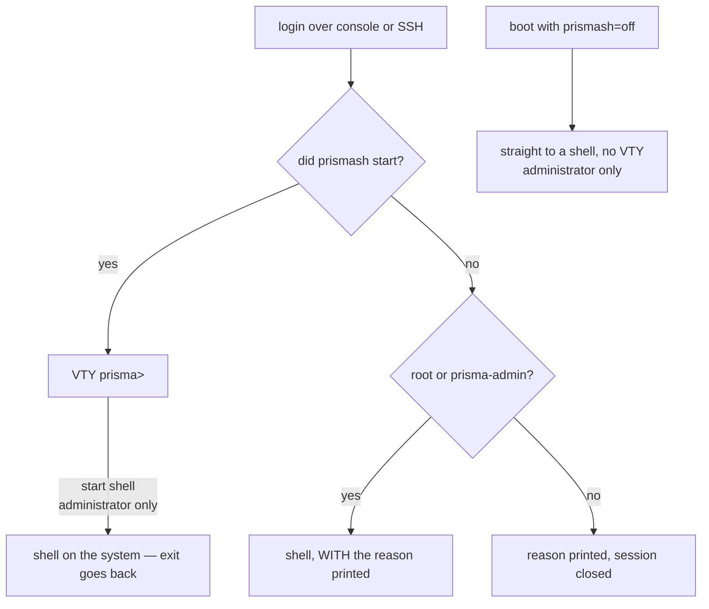

# Access, login and roles

Where an account lands when it logs into the box, over console or SSH, and what each role can change. For whoever is going to create operator accounts and needs to know what each one reaches.



## Where you land when you log in

| Situation | What happens |
|-----------|--------------|
| Login over console or SSH | Lands in `prismash` |
| `start shell` inside the VTY | Only `root` and `prisma-admin`: opens a shell on the system; `exit` goes back to the VTY |
| `ssh <account>@<box> "<command>"`, `scp`, `rsync` | `root` and `prisma-admin` reach a real shell. **Any other account** has the command run by the VTY, like a `prismash -c`, with its role; `scp` and `rsync` do not work for it |
| `prismash` fails to start | `root` and `prisma-admin` land in a shell **with the reason printed**. Any other account sees the reason and the session ends |
| Boot with `prismash=off` | Skips the VTY entirely, for `root` and `prisma-admin`; the ISO offers this as a menu entry |

On the **ISO** the console has autologin — the root account is locked, there is nothing to authenticate. On the **installed** machine there is no autologin and the password is the one set during installation.

Console autologin is done **only by the ISO**, and the installer removes it from the target. On an installed machine it would mean physical or IPMI access equals full access without a password — an operator decision, not a product default.

### `start shell`

It is in the command tree: TAB and `?` offer it. And it is **restricted to administrators** — a shell on this box is every capability at once, so whoever does not have `prisma-admin` is refused by the name of the role they have:

```
error: start shell: permission denied for a read-only account
    membership of prisma-cgnat allows CGNAT configuration, prisma-admin allows
    everything
```

```
error: start shell: permission denied for a cgnat-operator account
    this change needs prisma-admin
```

Hiding was never the boundary; the capability check is. And a command the administrator cannot find is a command they will ask someone for — that is why it is offered instead of hidden.

Whoever opens the shell is the **box's system**, not the VTY: the VTY checks the role and asks; the system checks again, through the account's groups, and its answer is the one that counts. If the system refuses, the VTY says `start shell: the host refused a shell for this account`. Leaving the shell goes back to the VTY, with the candidate configuration intact.

The limit applies to everything that gives a shell, not only to `start shell`. Every VTY account is a member of the groups that open the dataplane and routing, so a shell for an account that is not an administrator would be everything its role denies.

### Why there is an emergency exit

Pointing the login shell at an application creates a risk of total lockout: a `prismash` that failed to start would leave no one able to reach the machine, neither over console nor SSH. That is why there are **two independent exits**, and the second one (`prismash=off` at boot) does not depend on `prismash` working. Both are for administrators.

### The VTY runs in the management plane

The installed box runs in containers the dataplane, routing, the CGNAT records exporter and the **management plane**, where the VTY runs; a box with PPPoE configured runs one more, PPPoE's own. A login lands there **as itself** — with the same user and the same groups it has on the system —, so the role the VTY reads is the account's, and a read-only account inside the container can do exactly what it could outside it. What the VTY does on the system — creating accounts, touching SSH, SNMP and the DNS resolvers, adjusting the Linux side of an interface, rebooting the box — it asks the system to do, which checks who is asking through the kernel itself and only executes for `root`. It is the same rule as when the VTY ran those commands itself: what changed is where the command runs, not who can run it.

For the operator nothing changes in what is typed. Two practical consequences:

* **If the management container is not running, the VTY runs directly on the system**, as before. A box with that container stopped remains reachable.
* `install`, `system upgrade` and `system dataplane restart` are executed by the system, with its own VTY, in the same terminal. You do not need to do anything differently.
* A `system upgrade` recreates the management container at the end, and a login that arrives in those seconds **waits** up to 20 seconds, saying once that the VTY is restarting because of an upgrade. If the time runs out, the table at the top of this page applies: `root` and `prisma-admin` land in a shell with the reason printed, and other accounts see the reason and the session ends.


:::info
To make logins go back to using the system's VTY instead of the container's, create the file `/etc/prisma-routing/vty-on-host`. It is a way out for diagnostics, not an everyday configuration.

:::


:::info
`install.sh` does **not** change anyone's login shell, unless `PRISMA_VTY_LOGIN=1` is set. On an existing Debian the machine may have other roles, and silently changing root's shell is the kind of surprise the operator discovers at the worst moment.

:::

## Roles and permissions

Two capabilities, mapped to **system groups** — not to an account database of the appliance's own. An appliance that invents its own accounts is an appliance whose accounts nobody deprovisions when someone leaves the company.

| Group | Can change |
|-------|------------|
| `prisma-admin` | everything: routing, the machine's own configuration and CGNAT |
| `prisma-cgnat` | CGNAT configuration only |
| neither | read-only  |

`root` has both, because root talks to the dataplane socket directly and pretending otherwise would be theater.

One thing no role does: reboot or shut down the box, apply a new version or restart the dataplane. These four actions — `system reboot`, `system shutdown`, `system upgrade <version>` and `system dataplane restart` — belong to `root` and to whoever has `**operator**` (since 0.149.26). See [The operator: restart and upgrade without root](#the-operator-restart-and-upgrade-without-root).

### The operator: restart and upgrade without root

`operator` is a line in the account block, **alongside** the role, and not an extra role. It puts the account in the `prisma-operator` group, which unlocks exactly the four system actions and nothing more of what root does: no shell, no account management.

```
configure
 user prisma-web
  role administrator
  operator
  exit
 commit
```

* An `administrator` is **not** an operator just for being an administrator; a NOC read-only account **can** be the one that reboots the box.
* `no operator` removes it again. `root` does not accept the line: it can already do all of this by being root.
* It is a system group, like the roles: disabling the account on the system removes the permission with it.
* The `prisma-operator` group is created by the first commit that gives `operator` to someone. From 0.150.0 on, the installer already creates it.

Whoever does not have `operator` gets the refusal before anything happens, with the reason and the group that unlocks the action: `prisma-operator`.

The version **query** — `system upgrade` without a version, which only says which version the box runs and which is the newest published — changes nothing, so **any account** can run it. It is read by the box's system, because the VTY's network ends at the backplane and does not reach the releases site; up to 0.149.25 this query failed there for everyone.

In the API, `WhoAmI` says `can_operate`, and the accounts read by `GetConfig` carry `operator`.

The capabilities are read from group membership **at the moment the VTY starts**, and never from something the program stores: the answer needs to be the one the system would give, otherwise deprovisioning an account here does not actually deprovision it.

An account the system cannot describe gets **nothing**. Failing open here would mean a broken NSS turns into full configuration rights.

### A regular account needs to reach the dataplane

Roles are only worth something if someone who is not `root` can configure the box. If only `root` can, every operator becomes `root` — and then the roles are not loose, they are **decorative**, which is worse: the box advertises a limit it does not have.

On an appliance installed from **0.39.0** on this is solved, and the boot self-test checks it **by making the call** with an account that really exists — not by checking file permissions and not by faking group membership so it can answer yes.

On a freshly installed box there is no operator account yet, and it says so out loud instead of answering for accounts that do not exist:

```
[info] no operator account exists yet: only root can use this box
       create one with 'user <name>' and give it a role
```

The account is created in the VTY itself, with the `administrator` or `cgnat-operator` role (without a role, it is read-only):

```
prisma> configure
prisma# [edit] user <name>
prisma# [edit user <name>] role administrator
prisma# [edit user <name>] commit
```

The rest — password, SSH key, removing the account — is in [Routing, SSH, users and SNMP](/s/wiki-en/doc/routing-ssh-users-and-snmp-jjxcPssV72). After you create the account and give it a role, the same self-test starts **naming** the account that reaches the dataplane:

```
[ ok ] the binary API works for netadm, an account that really has the group
```

If `[FAIL]` shows up, the roles are not in effect on that box: everyone who needs to configure will need `root`. Two forms, and they call for different actions:

```
[FAIL] netadm has role administrator and is in none of: vpp frr frrvty
      the role cannot be exercised: VPP's sockets are group vpp
      and /etc/frr is group frr. Re-apply the role from the VTY:
      configure / user netadm / role administrator / commit
```

The account has rank and no reach: it got the role and was left out of the groups that open the dataplane and routing sockets, so **every command it issues fails on permissions** — including read commands, and the message looks like an authorization refusal without being one. Re-applying the role from the VTY, as the line itself says, redoes the memberships.

```
[FAIL] no account on this box is in group vpp: only root can use the API
```

No account on this box reaches the dataplane. Before handing out accounts by role, fix this — otherwise the roles exist on paper and not on the machine.


:::warning
Media earlier than **0.37.0** did not install the component that serves this call, and on 0.37.0 and 0.38.x it answered only for `root`. On a box installed with media earlier than 0.39.0, check this line before handing out accounts by role.

:::

### What each change requires

| Type of change | Required capability |
|----------------|---------------------|
| Pools, `cgnat inside`/`cgnat outside` on interfaces, timeouts, limits, bypass, forwards, logging | `prisma-cgnat`      |
| Everything else: routing, addresses and other interface settings, SSH, accounts, SNMP, DNS, PPPoE and RADIUS, `system` (cards, cores, memory) and CGNAT memory (`nat` > `cgnat` > `memory`), which is a machine setting | `prisma-admin`      |
| `start shell`, `install` | `prisma-admin`      |
| `system reboot`, `system shutdown`, `system upgrade <version>`, `system dataplane restart` | `root` or `operator` (`prisma-operator`), whatever the role |
| `system upgrade` without a version (the query) | any account, including read-only |
| `show`, `ping`, `traceroute`, `mtr` | any account, including read-only |

## Invoking prismash

```sh
prismash                       # interactive session
prismash -c "show cgnat pool"  # one command and exit
prismash -c "cmd1" -c "cmd2"   # several commands in sequence
prismash --load [file]         # applies a saved configuration file
```

`--load` without an argument uses `/etc/prisma-routing/prisma-routing.conf`. It is what runs at boot, through `prisma-routing.service`.

The exit code is **1** if any command failed, **0** otherwise - which lets you use `prismash -c` in a script without depending on matching text patterns in the output. `prismash -c`, `ssh <box> "<command>"` and output that does not go to a terminal never stop at `--More--`: paging only exists in an interactive session.

### A refused command refuses the `commit` of the same batch

If any command in the same `prismash -c` invocation is refused, that invocation's `commit` is refused with it: the box names the commands that did not go in and **applies nothing**. Either the whole batch goes in, or nothing does.

```
error: invalid argument: block-size 16: expected 64-32768
error: refusing to commit: 1 statement(s) in this batch were refused
    block-size 16
    NOTHING was applied and this box is unchanged: the candidate this batch
    built is not the configuration it asked for
```

The reason is the same as for `--load`, which refuses a whole file instead of applying it without the line it did not understand: a batch applied without one of its commands leaves your script and the box describing different configurations, and that difference only shows up later, to whoever reads both.

The batch keeps running to the end, on purpose: that way all refusals show up at once and you fix them all before running again. Nothing that comes afterwards reaches the box, because the box only changes at `commit` and the `commit` was refused.

This applies only to `prismash -c`. In an interactive session whoever is reading the refusal decides what to do with it, and a `commit` typed afterwards is applied normally. A `prismash -c` that only asks questions is not affected either: there is no `commit` in it.

### Paths

| Path | Content |
|------|---------|
| `/etc/prisma-routing/prisma-routing.conf` | saved configuration, applied at boot |
| `/etc/prisma-routing/rollback/` | committed revisions (the 20 most recent) |

The `PRISMA_CONFIG` and `PRISMA_ROLLBACK` environment variables override these paths.

In configuration files, `!` starts a comment — the rest of the line is ignored.

# See also

* [Getting started](/s/wiki-en/doc/getting-started-WksYlCtcGd) — the complete configuration sequence
* [Routing, SSH, users and SNMP](/s/wiki-en/doc/routing-ssh-users-and-snmp-jjxcPssV72) — how to create accounts and adjust SSH
