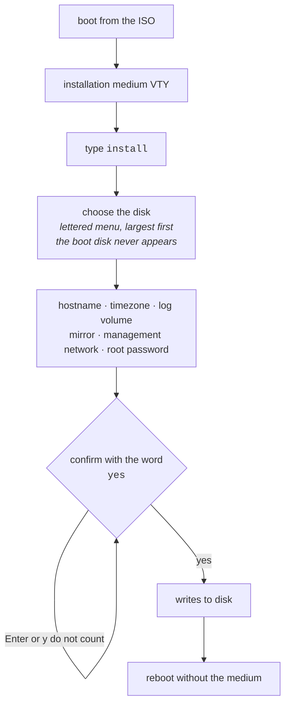

# Appliance installation

The ISO is an **installation medium**, not an appliance for direct use. It boots without any credential, runs the product for inspection, and offers a command that turns it into a machine with an owner.

The ISO is at <https://prismarouting.com.br/releases/>, in the version's folder, with the `sha256` next to it. Not every version ships an ISO: the ones that only ship the upgrade package are fixes applied on top of an already installed box. That is why the <https://prismarouting.com.br/releases/latest/> folder offers **two** things, each with its own `sha256`: the **newest ISO** (`prisma-routing-<version>.iso`), which is the one you write for a new machine, and the **newest upgrade package** (`prisma-routing-<version>-upgrade.tar.gz`), which is what you apply afterwards. After a fix-only version the two have different numbers, and that is expected: the ISO is from the last full version and the package is from the most recent fix.

For a new machine, download the ISO from `latest/` and verify it before writing it: `sha256sum -c prisma-routing-<version>.iso.sha256` has to answer `OK`. Once installed, take the box to the newest version from the VTY itself:

```
prisma> system upgrade
prisma> system upgrade <version>
```

Without a version, it only says which version the box runs and which is the newest published. With a version, it downloads the package from the public directory, refuses the package if it does not match the `sha256`, and applies it. The rest, including the `save` before the next reboot, is in [Taking the box to a new version](/s/wiki-en/doc/taking-the-box-to-a-new-version-spJOdnrvOD).




:::info
Not a single byte is written before **all** answers have been collected and are valid.

:::

## Installing

Boot from the ISO. The console drops straight into the VTY, right below the product name:

```
Prisma Routing VTY <version>
'?' for help, TAB to complete, 'configure' to edit, 'exit' to leave.

This is the installation medium: nothing here survives a reboot.
Type 'install' to install Prisma Routing onto a disk.

prisma> install
```

**Serial console or monitor, either one.** The GRUB menu appears on the video output and on the serial port (ttyS0, 115200 8N1), and every entry boots with `console=tty0 console=ttyS0,115200` - the same words the installed box receives. The self-test report and an unattended installation go out on the serial port; the monitor keeps showing the kernel messages and the VTY on tty1. Up to 0.152.x the medium had no `console=` at all, and a machine reached only over serial stayed silent until someone edited the GRUB line by hand.

**On a virtual machine, the hypervisor's agent is already installed.** Since 0.156.0 the medium installs `qemu-guest-agent`, because most boxes run as VMs on Proxmox or another KVM host: with the agent's channel enabled on the VM (`agent: 1` on Proxmox), the hypervisor can shut the box down through it, freeze the disk for a backup and show the box's addresses. The agent only starts when that channel exists, so nothing changes on a physical server. A box installed from an earlier medium and taken to the new version with `system upgrade` does **not** get it, because the upgrade package carries no system packages: install it with `apt-get install qemu-guest-agent` from an administrator's shell (`start shell`).

The `install` command exists in the VTY **only when the machine is running from the medium**. On an already installed appliance it is not in the command tree and the installer refuses to run — a command that overwrites the disk should not be one TAB away from `interface` on a production router.

## Choosing the disk

The disks appear in a lettered list, **largest first**, with size and model. The default (Enter) is the largest, because it is the disk someone put in the machine to hold the system — the 32 GB USB stick used for boot is not.

```
Disks on this machine:
  a) /dev/sdb         932G  WD Black 1TB   <- default, the largest
  b) /dev/sda          32G  KINGSTON SA400

Install onto which disk (letter, or a device path) [a]:
```

Two guarantees:

* **The medium the system booted from never appears in the list.** It is precisely the disk someone in a hurry picks, and overwriting it fails halfway, leaving both systems unusable.
* **A device path is still accepted.** Scripts have paths and people have habits.

The confirmation repeats the disk with size and model, and is answered with the word `yes`:

```
  About to ERASE /dev/sdb  932G WD Black 1TB
  Everything on it is lost. This cannot be undone.
  Type 'yes' to install:
```

An empty Enter is not an answer. Neither is `y`. **A disk cannot be destroyed by holding down the Enter key.**

## Management network

**An appliance that cannot be reached after rebooting is not an appliance.** The installer asks, together with the other questions and before any write, **on which card** the box is managed and **how it is addressed**:

```
  A NEW BOX IS CONFIGURED AT ITS CONSOLE, and that is the default
  here: every card this machine has goes to the dataplane, and none
  of them is kept back to be managed on. Answer with a card only if
  this box is reached over the network after it reboots; that card
  is then the one card the dataplane will not claim.

Network cards on this machine:
  a) enp1s0     up     virtio_net   192.0.2.10/24   <- this medium is reaching the network on this one
  b) enp2s0     down   virtio_net   none
  none) no management network   (this box is reached at its console)   <- default

Which card is this box managed on (letter, or a name) [none]:
```

The list uses the name Linux gives the card (`enp1s0`, `enp2s0`), which is also the name it shows up with in the VTY afterwards: the installed box keeps the Linux name for each card, including those the dataplane claims. The list shows **what each card is** - whether it is up, which driver runs it, which address it is carrying this minute - because `enp1s0` and `enp2s0` tell nobody which cable is in which. The card through which the medium itself is reaching the network right now is pointed out in the list, because it is the one the operator wants when they want one: it is no longer the default.


:::info
**The default is** `**none**`**.** Since 0.76.0 the box claims every card it has on its own, and a new box is configured at its console. Answering with a card is a decision: that card becomes the only one the dataplane will **not** claim. Whoever presses Enter gets the box this product describes, instead of a card set aside without anyone having decided that.

Before this version the default was the medium's own card, and an unattended installation took that card without anything being said - with nobody watching, which is exactly when the decision should not be made on its own.

:::

When you answer with a card, the installer next asks how it is addressed:

```
Address: 'dhcp', or one like 10.0.0.2/24 [dhcp]:
```


:::info
**The address default is** `**dhcp**`**.** A virtual machine on a lab network has a DHCP server and no reserved address; an appliance in the rack has a reserved address and often no DHCP. Only one of the two can be the default, and it is the first: whoever presses Enter needs to get a box that works. Whoever is setting up the rack already has the address written down in front of them and types it - it is an answer in both cases.

The price is stated: a box that answers `dhcp` where nobody answers waits for the client to give up before finishing boot, and then **says on the console** that it has no address.

:::

With a static address, the installer also asks for the gateway and the DNS servers. **A gateway outside the address's subnet is refused on the spot**, by arithmetic: `ifup` refuses that route when the interface comes up and carries on, so the box would come up with an address, no default route, reachable from its own subnet and from nowhere else. From afar that is indistinguishable from a box that did not boot.

`none` is also an answer, and it is **recorded**. Without the file, a box whose operator chose to have no management network and a box installed from a medium that never asked are the same box on disk - and one of the two needs to be shouted about at every boot while the other does not.


:::warning
**Answering** `**none**` **also decides who gets the cards.** The reservation that keeps the dataplane from taking a card **is** this answer: without it, nothing is reserved for Linux, and a card that nothing reserves is a card the dataplane claims at the next boot — all of them, including the one you are using to manage the box.

The box is not lost: the address moves to the pair the dataplane keeps for that card, and it becomes reachable **through** the dataplane instead of beside it. But it is a path change nobody asked for, and the self-test warns at every boot while this holds:

```
no management network was asked for, and this box is on one anyway
```

To keep a card for Linux later, write the stanza the installer would have written — in an administrator shell (`start shell`) — and reboot the box:

```
F=/etc/network/interfaces.d/prisma-routing
echo "auto enp2s0" >> $F
echo "iface enp2s0 inet dhcp" >> $F
```

A static address takes `inet static` and an `address` line. The other way, without a shell, is to name the subscriber card in the VTY under `system` > `dataplane` > `interface <card>`: the dataplane then claims only that one, and the rest stay with Linux. See [Getting started](/s/wiki-en/doc/getting-started-WksYlCtcGd).

:::

### What the box says afterwards

The boot self-test reads **the same file** back at every boot and reports what happened with it:

| Line in the self-test | Meaning |
|-----------------------|---------|
| `[ ok ] managed on enp1s0 (dhcp)` | with the address and route printed below |
| `[warn] enp1s0 is up with no default route` | it has an address, no default route, and no gateway was asked for |
| `[FAIL] ... has an address and no default route` | **the gateway answered did not take.** The line names the gateway that did not go in |
| `[FAIL] ... has no address` | DHCP with no reply, or `ifup` failed |
| `[FAIL] management network: this box has no card called enp1s0` | the installation card is no longer in the box. Lists the ones that are |
| `[FAIL] no management network: nothing was ever written for one` | medium up to 0.72.0. The line carries the commands that fix it from that console |
| `[info] no management network was asked for at install time` | answered `none`, and the box really is console-only |
| `[warn] no management network was asked for, and this box is on one anyway` | answered `none`, but Linux has a card with an address — and it is a card the dataplane claims at the next boot |


:::success
**The address is printed at every boot**, and that is half the reason DHCP can be the default: a box whose address nobody chose still tells whoever is standing in front of the serial console where to `ssh`.

:::

## Old media carry an SSH key, and the installation warns

Old media of this product came with the SSH host keys already made inside the image. Every box installed from one of those media answered with the same key, and its private half is on the medium itself.

Those keys do not go to disk: the installation deletes what came on the medium and generates a new pair, for this box. When the medium carries keys, it says so on the console:

```
==>   this medium carries ssh host keys; they are not going on the disk:
==>     ssh_host_ecdsa_key ssh_host_ed25519_key ssh_host_rsa_key
==>   every box installed from this medium answers with them
```


:::warning
**The freshly installed box is clean; the warning is about the medium.** The other boxes installed from that same medium keep answering with that key until someone generates new keys on each one. The procedure, and what it costs those who manage them, are in [Operations and troubleshooting](/s/wiki-en/doc/operations-and-troubleshooting-kql3GmIqmX), in the section about the self-test saying the SSH keys were not generated on the box.

:::

A new medium carries no key at all, and in that case the installation says nothing of the kind.

## Everything is asked before any write

| Question | Refused when |
|----------|--------------|
| Target disk | it is not a block device, or it is the medium the system booted from |
| Hostname | it contains characters a hostname cannot have |
| Timezone | there is no such zone in `/usr/share/zoneinfo` |
| Log volume gigabytes | not an integer, less than 1 GB, or would leave the system with less than 8 GB |
| Mirror disk | it is the target disk, the boot medium, a partition, or too small for the log volume |
| Management card | this machine has no card with that name |
| Management address | not `dhcp`, not `none` and not an address with a prefix between 1 and 32 |
| Gateway  | not an address, not in the address's subnet, or came together with `dhcp` |
| Root password | it is empty, or the two entries do not match |

Not a single byte is written to disk before all answers have been collected and are valid.

## Where the connection records live

The disk is split into **three** partitions, not two:

| Partition | Content |
|-----------|---------|
| ESP       | 512 MB  |
| root      | the rest, minus the records |
| `/var/log/prisma-routing` | what the operator asked for |

**This box does not keep connection records.** It **exports** them — IPFIX over UDP or TCP, or syslog — and keeps none: whoever keeps them for the year the Marco Civil (Brazil's Law 12.965/2014; retention requirements differ by country) requires is the collector. What stays on this volume is the **configuration trail**, which is small and is the dated proof of what the box was configured to do, and the **spill** the exporter writes while the collector is unreachable.

On the root filesystem, either of the two shares space with everything the box needs to work — a collector unreachable for a week stops the box from writing its own configuration. With its own filesystem, a full log volume is just a full log volume.

The default is arithmetic, not a guess:

```
  The configuration trail and the export spill go on their own
  filesystem, so that a full log cannot stop the box working. This box
  does not keep connection records: it exports them, and whoever keeps
  them for the year the law asks for is the collector. What this size
  buys is how long the box can spill while a collector is unreachable.
  The arithmetic is in
  /usr/share/doc/prisma-routing/logging.md once this box is installed.
  This disk is 240 GB; at most 231 GB can go to this volume.
Gigabytes for the trail and the export spill [30]:
```

30 GB give more than a year of *spill* at \~80 MB/day, which is the rate of 200 thousand subscribers in dynamic mode — far more than any outage anyone plans for. **Deterministic mode exports almost nothing** and needs almost none of this — that is why it is a question and not a constant. The root never gets less than 8 GB, and a size that would leave it with less is refused with the arithmetic, instead of accepted and discovered later.


:::info
The volume is mounted with `nofail`. A box that does not come up because this volume went missing is a box nobody can get into to find out why — it comes up and complains. That is why the boot self-test **reports where the volume is**: without that, a box whose volume did not mount goes back to writing on root silently.

:::

## Mirroring the log volume on two disks

With a single disk, a single hardware failure loses **what is on that volume**, and that is not the same as being down: an outage ends with a reinstall, and this loss does not end. The configuration trail is the dated proof of what the box was configured to do — in deterministic mode, half of the answer to a court order, the algorithm being the other half — and the spill is records the collector **has not received yet**, so a disk that takes them with it opens a hole in someone else's year of retention that nothing on this box can rebuild.

That is why, when the machine has a second disk, the installer asks:

```
  This machine has another disk. The log volume - the configuration
  trail, and the records the collector has not received yet - can be
  kept on BOTH, so that one disk failing does not take it with it,
  which is a loss no reinstall undoes.
  The system is NOT mirrored: a dead system disk is a reinstall, and
  what is on the survivor can still be read on another machine.
  EVERYTHING ON THE DISK YOU CHOOSE IS DESTROYED.
  a) /dev/sdc         932G  WD Black 1TB
  none) one disk, no mirror   <- default

Mirror the log volume onto which disk [none]:
```


:::info
**The default is** `**none**`**, and an empty Enter accepts the default.** A second disk inside the machine is not authorization to destroy what is on it. The final confirmation repeats **both** disks, because both are erased by the same `yes`.

:::

**It is this volume that is mirrored, not the system.** The asymmetry is the mirror's reason for existing, and both sides of it were measured on a box that was installed and then powered on with that disk removed:

| Disk that dies | What was observed |
|----------------|-------------------|
| the mirror     | the box comes up normally, the volume stays mounted on the array running on one leg, what was written before the failure is still there, and the self-test says `[FAIL] the records mirror is DEGRADED: 1 of 2 disks` without anyone logged in |
| the system     | the machine does not get to load anything: it stays in the firmware. It is a reinstall. **The content of the surviving disk was read on another machine**, with that box powered off |

A box with **a single disk** is not asked, gets no array at all, and its self-test does not mention a mirror. Nothing changes for those with one disk.

The second disk is refused when it is the target disk, when it is the boot medium, when it is a partition instead of a whole disk, or when it is smaller than the size requested for the log volume - a mirror is the size of its smallest disk.

### What the box says afterwards

The boot self-test reports the mirror state at **every** boot. A mirror nobody watches silently becomes one disk - and then none.

| Line in the self-test | Meaning |
|-----------------------|---------|
| `[ ok ] records mirrored on 2 disks (...)` | both disks, up to date |
| `[ ok ] ... synchronising 20.0%` | both disks, still copying. Already protected |
| `[warn] the records mirror is REBUILDING` | disk replaced, copy in progress |
| `[FAIL] the records mirror is DEGRADED` | **a disk died.** The next failure loses the year |
| `[FAIL] ... installed with a records mirror and is not using it` | the box was installed with a mirror and is not using any |

Right after installation the mirror is still synchronizing, in the background. The box can already be used: writes go to both disks from the first instant.

## Unattended installation

For lab, boot testing and PXE, the answers come from the kernel command line:

| Parameter | Effect |
|-----------|--------|
| `prisma-routing.install` | asks everything at the console |
| `prisma-routing.install=/dev/vda` | uses that disk, still asking the rest |
| `prisma-routing.hostname=<name>` | answers the hostname question |
| `prisma-routing.timezone=<zone>` | answers the timezone question |
| `prisma-routing.password=<password>` | answers the root password question |
| `prisma-routing.log-gb=<n>` | gigabytes for the connection records |
| `prisma-routing.mirror=<disk>` | mirrors the records onto that second disk |
| `prisma-routing.mgmt-interface=<card>` | card through which the box is managed |
| `prisma-routing.mgmt-address=<a>` | `dhcp`, `a.b.c.d/nn`, or `none` |
| `prisma-routing.mgmt-gateway=<ip>` | only with a static address |
| `prisma-routing.mgmt-dns=<ip>[,<ip>]` | only with a static address |
| `prisma-routing.answers[=<file>]` | reads the answers from a file (next section) |
| `prisma-routing.yes` | skips the confirmations and then **powers the machine off** |


:::warning
**Careful with** `prisma-routing.password`**:** the kernel command line stays readable by everyone in `/proc/cmdline` for the whole life of the booted system. It does not survive into the installed machine, but anyone logged in on the medium during installation can read it. For an in-person installation, leave it out and answer at the prompt. For an unattended installation, use the answers file.

:::

With `prisma-routing.yes`, the management network is `none` and the installer says so: an unattended installation that wants a management network passes `prisma-routing.mgmt-address=`, and then the installer uses the card through which the medium is reaching the network - or `prisma-routing.mgmt-interface=` to choose another.

With `prisma-routing.yes` and without `prisma-routing.log-gb`, the installer takes the default **and says that it did**. An unattended installation has no console to answer from, and a question nobody can answer is a hung installation.

The power-off at the end is not a convenience: without it the machine sits at a login prompt until someone turns it off, and the completion message comes out truncated.

### Answers in a file

This is the recommended way for an unattended installation: the same answers, the password among them, read from a file instead of published to every process on the medium.

```
disk     = /dev/sda
hostname = cgnat01
timezone = America/Sao_Paulo
log-gb   = 30
password = <this box's root password>
yes      = yes
```

`prisma-routing.answers` without a value reads `prisma-routing.answers` at the root of the medium; with a value, the given path. The keys are `disk`, `hostname`, `timezone`, `log-gb`, `mirror`, `password`, `mgmt-interface`, `mgmt-address`, `mgmt-gateway`, `mgmt-dns` and `yes`, with the same meaning as the parameters above.

| Rule | Why |
|------|-----|
| An unknown key is **refused**, not ignored | a mistyped `password` would be an installation stuck on a question with no console to answer it |
| A file that does not exist is refused | falling back to the questions is the same hang by another route |
| An answer given on the command line **wins** over the file | the line is typed for this boot; the file travels with the medium to every installation |
| `#` only starts a comment at the **beginning** of the line | a password can contain `#`, and cutting it there would install a box with a piece of the password |
| The password is never printed, not even in an error | a line that was not understood is cited by number, not by content |


:::warning
**The file is a credential.** It takes the password out of `/proc/cmdline` and puts it on the medium: whoever reads the medium reads the password, and the installation says so on the console. No published ISO carries an answers file; write yours on the medium you use and keep that medium the way you would keep the password. The file is not copied to the installed box.

:::

# How to check

After the first boot without the medium:

* the console shows the self-test report, **without any** `**[FAIL]**` **line**;
* among them, `binary API registered, so pools can be configured` — without it the box routes and answers, and no pool can be created;
* if you answered with a management card, a `managed on <card>` line with the address below it - that is how you reach the box without going back to the console; if you answered `none`, the `[info] no management network was asked for at install time` line;
* `the dataplane runs in a container on this box` and `backplane: 128.0.0.0/8 in VRF prisma-bp, out of the main table` — the installed box runs the dataplane, routing, the management plane (where the VTY lives) and the CGNAT records exporter in containers; the management plane talks to the system over an internal network on `128.0.0.0/8` that sits in its own routing table: real addresses in `128.x` remain reachable, by the box and by subscribers;
* `show version` answers with the version of Prisma Routing, the dataplane and routing;
* you can log in with the password set during installation.

Each version's medium is installed to disk and booted without the medium before being published: booting the live image proves it boots, not that it produces an appliance that works.


:::success
Self-test **without** `**[FAIL]**` and `show version` answering: the installation is valid. "Ready" alone is not enough: it is the binary API line that says a pool can be created. The next step is [Getting started](/s/wiki-en/doc/getting-started-WksYlCtcGd).

:::

# See also

* [Access, login and roles](/s/wiki-en/doc/access-login-and-roles-uVm2WUy5xB) — where you land when you log in, and who can do what
* [Sizing and requirements](/s/wiki-en/doc/sizing-and-requirements-IHPnUSMSom) — the machine and the disk before installing
* [Taking the box to a new version](/s/wiki-en/doc/taking-the-box-to-a-new-version-spJOdnrvOD) — after it is installed
