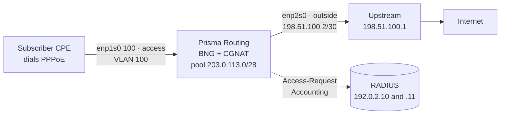

# Bring PPPoE subscribers online, step by step

From the access port to the first subscriber dialling in, authenticated against your RADIUS, held to a plan and leaving through the CGNAT, with Prisma Routing acting as the BNG. It is for whoever is putting the box in place of the PPPoE concentrator and wants an order that can be followed at the console. Every statement has its own row in [PPPoE configuration](/s/wiki-en/doc/pppoe-configuration-XpY0C0K81I); this page is only the path, in the order it is done.

The example uses a small topology, which you replace with your own numbers:



| What | In the example | In your case |
|------|----------------|--------------|
| Access port | `enp1s0`, VLAN 100 (`enp1s0.100`) | the card facing the OLT or the access switch |
| Egress port | `enp2s0`, with `198.51.100.2/30` | the card facing the upstream |
| The box's address on every session | `100.64.0.1` | an address in the subscribers' range |
| Session addresses | `100.64.0.10` to `100.64.3.250` | whatever RADIUS does not hand out comes from here |
| CGNAT pool | `100.64.0.0/22` to `203.0.113.0/28` | a `prefix-inside` that covers the session addresses |
| RADIUS servers | `192.0.2.10` and `192.0.2.11` | yours |
| IPv6 (optional) | WAN from `2001:db8:100::/40`, delegated from `2001:db8:200::/36` | your own prefixes |

# Before you start

**Who can do it.** The `pppoe` and `aaa` blocks are configuration of the whole box, not only of CGNAT: only a `prisma-admin` account (or `root`) changes them. See [Access, login and roles](/s/wiki-en/doc/access-login-and-roles-uVm2WUy5xB).

**What RADIUS needs to have.** The box registered as a client (NAS), with the shared secret you will type in step 3, and the users with their passwords. Each subscriber's address can come from RADIUS (`Framed-IP-Address`) or from the box's pool; the two coexist.

**A design limit.** All access interfaces are on the same physical card: as many of its VLANs as you like, one tag each. QinQ (two tags) and high availability of sessions do not exist in this release.


:::warning
**Every change to the** `**pppoe**` **block drops every PPPoE session**: the control plane restarts and the CPEs dial again. On a box already in production, make `pppoe` block changes in a maintenance window. Changes only under `aaa` > `radius` (one more server, another mode, another timer) drop nobody, except the first server configured and `dynamic-authorization`, which restart it too.

:::

# 1. Prepare the access port and the VLAN

The access port needs no IP address: subscribers speak PPPoE to it, not IP. It only has to be up and, if subscribers arrive tagged, to have the sub-interface with the tag:

```
prisma> configure
prisma# [edit] interface enp1s0
prisma# [edit interface enp1s0] description acesso-olt
prisma# [edit interface enp1s0] no shutdown
prisma# [edit interface enp1s0] exit
prisma# [edit] interface enp1s0.100
prisma# [edit interface enp1s0.100] vlan 100
prisma# [edit interface enp1s0.100] exit
```

| Line | What for |
|------|----------|
| `no shutdown` on `enp1s0` | brings the card up; the sub-interface comes up with it |
| `interface enp1s0.100` | typing a new name of the form `<parent>.<tag>` creates the sub-interface |
| `vlan 100` | the tag the CPEs send; only one per sub-interface |

If subscribers arrive untagged, use `enp1s0` itself as the access interface in step 4 and skip the sub-interface. Both can coexist on the same card. The sub-interface, field by field, is in [Interface configuration](/s/wiki-en/doc/interface-configuration-1Pq7NRieCn).

# 2. The egress and the CGNAT pool that will translate the sessions

Every PPPoE session becomes an interface in the dataplane, and the box attaches it to the CGNAT by itself as soon as the session gets an address: the session's address is translated by the pool whose `prefix-inside` contains it, exactly as a subscriber behind a `cgnat inside` port is. That is why the access port does **not** take `cgnat inside`. What is needed is the egress port and a pool that covers the addresses the sessions will get:

```
prisma# [edit] interface enp2s0
prisma# [edit interface enp2s0] description upstream
prisma# [edit interface enp2s0] ipv4 address 198.51.100.2/30
prisma# [edit interface enp2s0] cgnat outside
prisma# [edit interface enp2s0] no shutdown
prisma# [edit interface enp2s0] exit
prisma# [edit] router static
prisma# [edit router static] 0.0.0.0/0 next-hop 198.51.100.1 description upstream
prisma# [edit router static] exit
prisma# [edit] nat
prisma# [edit nat] cgnat
prisma# [edit nat / cgnat] pool assinantes-pppoe
prisma# [edit nat / cgnat / pool assinantes-pppoe] prefix-inside 100.64.0.0/22
prisma# [edit nat / cgnat / pool assinantes-pppoe] prefix-outside 203.0.113.0/28
prisma# [edit nat / cgnat / pool assinantes-pppoe] block-size 512
prisma# [edit nat / cgnat / pool assinantes-pppoe] ports 1024 65535
prisma# [edit nat / cgnat / pool assinantes-pppoe] mode deterministic
prisma# [edit nat / cgnat / pool assinantes-pppoe] top
```

The pool is a CGNAT pool like any other: the choice between deterministic and dynamic, the block size, announcing the public prefix in BGP and the IPFIX collector are those of [Configure CGNAT step by step](/s/wiki-en/doc/configure-cgnat-step-by-step-jU9hEJYMch), and apply here the same way.


:::info
**A session address outside every** `**prefix-inside**` **is not translated.** Nothing in `commit` compares the PPPoE `address-pool` (or your RADIUS's `Framed-IP-Address` values) with the CGNAT pools: check yourself that every range a session can receive is inside a `prefix-inside`.

:::

# 3. The RADIUS servers

RADIUS lives in a block of its own, `aaa` > `radius`, not inside `pppoe`:

```
prisma# [edit] aaa
prisma# [edit aaa] radius
prisma# [edit aaa / radius] server 192.0.2.10 secret <secret> priority 1
prisma# [edit aaa / radius] server 192.0.2.11 secret <secret> priority 2
prisma# [edit aaa / radius] mode failover
prisma# [edit aaa / radius] nas-identifier bng-centro
prisma# [edit aaa / radius] exit
prisma# [edit aaa] exit
```

Each server authenticates and receives accounting (ports 1812 and 1813) unless you say otherwise. To split the roles, `role auth` or `role acct` at the end of the server line; for other ports, `auth-port` and `acct-port`. Up to eight servers.

**Failover or round-robin:**

| `mode` | What happens | When to choose it |
|--------|--------------|-------------------|
| `failover` (the default) | every request goes to the server with the lowest `priority`; if it does not answer, the request moves to the next one and the silent one is left out for `dead-time` seconds | one main server and a backup |
| `round-robin` | each request goes to the next live server, in turn | equivalent servers, to share the load |

In both modes, one session's accounting is never split: its Interim and Stop go to the server that received its Start, as long as it answers. And a session is never dropped because accounting went unanswered.

The timers (`timeout` 3 s, `retries` 1, `dead-time` 30 s) are already the ones that make a dead server cost **one** subscriber seconds and the others nothing. Change them only with a reason.

The secret never appears on a screen: `show running-config` and `show configuration compare` show `<set, not shown>` in its place.

# 4. The `pppoe` block

```
prisma# [edit] pppoe
prisma# [edit pppoe] interface enp1s0.100
prisma# [edit pppoe] gateway 100.64.0.1
prisma# [edit pppoe] address-pool 100.64.0.10-100.64.3.250
prisma# [edit pppoe] dns 192.0.2.53
prisma# [edit pppoe] dns 192.0.2.54
prisma# [edit pppoe] tcp-mss 1452
```

| Line | What it decides |
|------|-----------------|
| `interface enp1s0.100` | where the box answers PPPoE. There can be several, all on the same card. On any other interface (the uplink, an `inside` port) a PADI is dropped and nobody answers |
| `gateway 100.64.0.1` | the box's address on every session. Mandatory |
| `address-pool ...` | addresses for those RADIUS sends no `Framed-IP-Address`; a prefix or a range, up to 16. It may be left out if RADIUS always sends the address |
| `dns ...` | the resolvers given to the CPE, up to 2 |
| `tcp-mss 1452` | clamps the TCP MSS on every session: PPPoE's 1492 MTU minus 40 bytes of headers. Avoids connections that open and then hang |

Whatever is left out takes its default: `mtu` 1492, all three authentication methods (PAP, CHAP, MS-CHAPv2), `session-limit` 16,000 sessions and `ac-name` `prisma-routing`. If the box will have more than 16,000 subscribers, set `session-limit` now and read its row in the reference: the ceiling the box accepts depends on its RAM and only really grows after saving and rebooting.

# 5. IPv6 on the sessions (optional)

With no `ipv6` line, a session is IPv4 only. With them, each session gets a WAN /64 by RA (the CPE builds its address by SLAAC) and, if the CPE asks, a prefix delegated by DHCPv6 for the customer's LAN:

```
prisma# [edit pppoe] ipv6 prefix-pool 2001:db8:100::/40
prisma# [edit pppoe] ipv6 delegated-pool 2001:db8:200::/36 length 56
prisma# [edit pppoe] ipv6 dns 2001:db8::53
```

| Line | What it hands out |
|------|-------------------|
| `ipv6 prefix-pool` | each session's WAN /64, when RADIUS sends no `Framed-IPv6-Prefix` |
| `ipv6 delegated-pool ... length 56` | a /56 for each customer's LAN, when RADIUS sends no `Delegated-IPv6-Prefix` |
| `ipv6 dns` | IPv6 resolvers, in the RA and in DHCPv6 |

If your RADIUS hands out everyone's prefixes, `ipv6 enable` turns IPv6 on with no pool at all. The subscriber's IPv6 is **routed**, it does not go through the CGNAT: the prefixes of both pools must be reachable from the internet, announced by this box or another one, like any network of yours.

# 6. The bandwidth plan

Each subscriber's plan comes from RADIUS, in the Access-Accept. Prisma's own attributes (vendor 67033) are the simplest:

| Attribute | What it is |
|-----------|------------|
| `Prisma-Rate-Limit-Down` | download, in kbit/s (`100000` is 100 Mbit/s) |
| `Prisma-Rate-Limit-Up` | upload, in kbit/s |

If your RADIUS already sends `Cisco-AVPair` (`rate-limit` or `sub-qos-policy`), it is read too; the accepted formats are in the reference. `Mikrotik-Rate-Limit` is not read.

The dictionary to install on the RADIUS server comes from the box itself:

```
prisma> show aaa radius dictionary
```

For those RADIUS sends no plan at all, a default plan in the `pppoe` block; without it, such a session has no limit:

```
prisma# [edit pppoe] rate-limit default 20M/10M
```

**How the limit is enforced.** The default is what suits most: the download goes through a queue per session (a shaper), which holds the excess and delivers it at the plan's pace, and the upload through dropping (a policer). With the shaper, a TCP speed test reaches the plan with few retransmissions and the traffic shared evenly between the subscriber's connections. To go back to dropping on the download, `rate-limit download policer`; the measured comparison of the two is in [PPPoE configuration](/s/wiki-en/doc/pppoe-configuration-XpY0C0K81I). The limit applies to IPv4 and IPv6 together.

# 7. Disconnect and CoA (optional)

For your RADIUS (or the management system behind it) to drop a session or change its plan without the subscriber dialling again, say on which of the box's addresses requests arrive and who may send them:

```
prisma# [edit pppoe] top
prisma# [edit] aaa
prisma# [edit aaa] radius
prisma# [edit aaa / radius] dynamic-authorization listen 198.51.100.2
prisma# [edit aaa / radius] dynamic-authorization client 192.0.2.10 secret <secret>
prisma# [edit aaa / radius] top
```

The port is 3799 unless you give another (`port <n>` at the end of `listen`). A request from an address that is not a `client`, or with the wrong secret, gets no answer. With that:

| Request | Effect |
|---------|--------|
| Disconnect-Request with `User-Name` or `Acct-Session-Id` | the session drops; the Stop goes out with `Acct-Terminate-Cause = Admin-Reset` |
| CoA-Request with `Prisma-Rate-Limit-Down` and/or `-Up` | the plan changes at once, on the live session |
| CoA-Request with `Session-Timeout` | the session drops when the time runs out |

A CoA carrying something the box does not apply is refused whole (CoA-NAK) and nothing changes.

# 8. Apply and save

Check what will go in, apply and save:

```
prisma# [edit] show configuration compare
prisma# [edit] commit comment "BNG: PPPoE na VLAN 100"
prisma# [edit] exit
prisma> save
```

In the `compare`, everything with `+` is what goes in, with the secrets blanked. `commit` checks the block before applying it and refuses, saying why, what would not work: no `interface` or no `gateway`, nobody to authenticate, nobody to give addresses, access interfaces on two cards, a sub-interface without `vlan`, an interface the dataplane does not have. Once accepted it prints a `pppoe:` line saying what the PPPoE control plane did; a change that only re-read RADIUS ends in `no session dropped`.

`commit` makes it take effect now; `save` writes it to disk. Without `save`, everything is gone at the next boot.

# 9. The first session

Connect a CPE on VLAN 100 with a user your RADIUS knows and check, in this order.

**The control plane and the configuration:**

```
prisma> show pppoe summary
```

| Line | What it should say |
|------|--------------------|
| `control plane` | `running`. `configured, NOT running` is a control plane that did not come up: see `show log kind exit` |
| `sessions` | how many sessions are active, starting and finishing |
| `session trail` | how many entries the session trail has written; `NOT written` is a session the box cannot answer for |
| `access interfaces` | `enp1s0.100` |
| `radius` and a line per server | the mode, the timers and each server with its role; `failed` beside a server that is not answering |
| `rate limit` | where the plan comes from and the default, and below it what enforces each direction (shaper or policer) |

**The sessions:**

```
prisma> show pppoe sessions
```

One line per session: the id (the same `Acct-Session-Id` RADIUS received), the user, the address it got, the plan as download/upload (`-` for no limit) and how long it has been up. A session still authenticating shows `start` in place of the time. With IPv6, the `ipv6` (WAN) and `delegated` (LAN prefix) lines come below it.

**One whole session**, by the id in the first column:

```
prisma> show pppoe session <id>
```

It shows the CPE's MAC, the IPv6 prefixes, the traffic and, for each limited direction, how much passed, how much waited in the queue and how much was dropped. It is the screen for when the subscriber says the plan is not being reached.

**Their traffic in the CGNAT**, by the address the session got:

```
prisma> show cgnat subscriber 100.64.0.10
```

Once the subscriber browses, their port block and sessions appear, as for any subscriber of the pool.

**On your RADIUS**, each session leaves an Accounting-Start, interim updates every 300 s (`interim-interval`) with its bytes and, when it drops, an Accounting-Stop.

To drop a test session, `clear pppoe session <id>` (or `user <name>`, `address <A.B.C.D>`, `all`): the CPE receives a PADT, RADIUS receives the Stop, and the CPE dials again.

# 10. Who had the address: the session history

With PPPoE, the inside address is handed out at dial-in, in order of arrival. The CGNAT says which inside address was behind a public IP and a port; who held that inside address at that instant is the box's session history, written at the start and end of every session whether or not RADIUS answers:

```
prisma> show pppoe history address 100.64.0.10 at 2026-10-13T02:51:00Z
prisma> show pppoe history user <name>
prisma> show pppoe history verify
```

`verify` checks the history's hash chain and, when it holds, says `chain intact` and gives the head of the chain. On a deterministic pool the two steps come out at once:

```
prisma> show cgnat translation 203.0.113.5 1029 at 2026-10-13T02:51:00Z
```


:::warning
**Without a syslog collector, the proof of the history stays inside the box.** The box sends the head of the chain out as a `trail` event, but it only leaves the box if a collector is configured under `system` > `logging`. Configure it before putting real subscribers on, together with the IPFIX collector if the pool is dynamic. See [IPFIX logging and audit trail](/s/wiki-en/doc/ipfix-logging-and-audit-trail-mrQPyuvc8g).

:::

# How to check

Before considering the BNG ready:

- [ ] `show pppoe summary` says `control plane` `running` and lists the right access interface
- [ ] every RADIUS server appears in the summary, none `failed`
- [ ] a test CPE appears in `show pppoe sessions` with an address and a plan, and does not stay at `start`
- [ ] `show pppoe session <id>` shows traffic in both directions
- [ ] `show cgnat subscriber <session-address>` shows a block and sessions once the CPE browses
- [ ] RADIUS received the test session's Accounting-Start
- [ ] with IPv6: the session has the `ipv6` and `delegated` lines, and the CPE browses over IPv6
- [ ] `show pppoe history verify` says `chain intact`
- [ ] `save` was run


:::success
With every item ticked, the subscriber dials, is authenticated against your RADIUS, gets the plan, goes out to the internet with the pool's public address, and any port they used can be traced back to the PPPoE user.

:::
