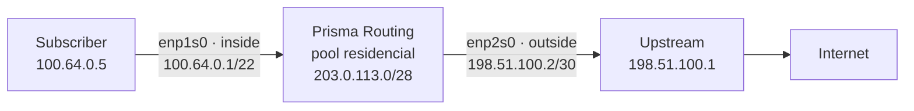
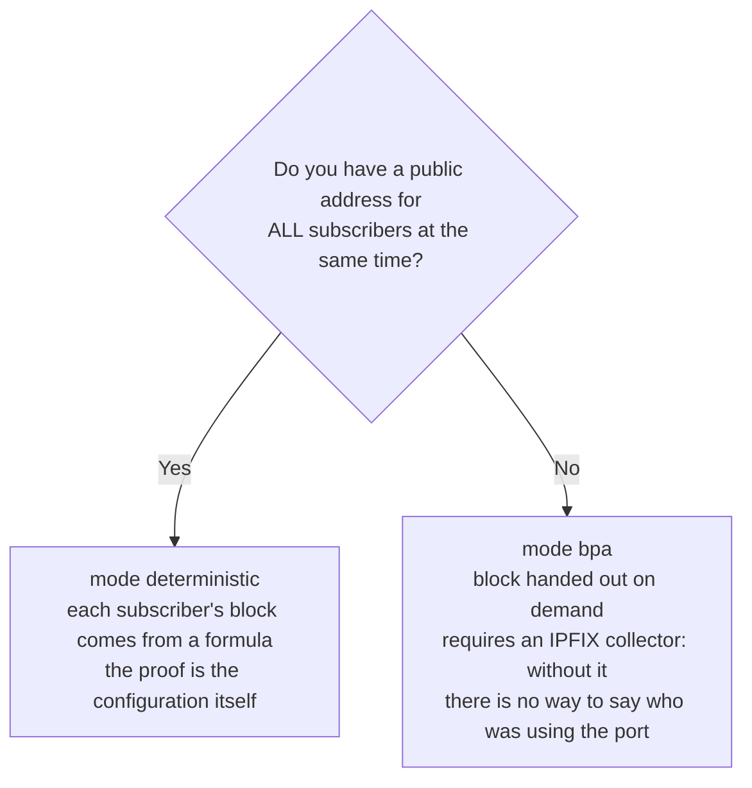

# Configure CGNAT step by step

From an installed box to the first subscriber browsing through translation, in an order you can follow at the console. Each step shows what to type, what the box answers, and how to know it worked before moving on to the next one. The screens on this page were taken from a box running this version, with a real subscriber behind it.

The example uses a small topology, which you swap for your own numbers:



| What | In the example | In your case |
|------|----------------|--------------|
| Subscriber network (behind the box) | `100.64.0.0/22` | whatever your BNG/OLT delivers; `100.64.0.0/10` is the space reserved for this |
| Pool public addresses | `203.0.113.0/28` | a prefix of yours that is **not** configured on any interface |
| Subscriber port | `enp1s0`       | the card facing the BNG |
| Egress port | `enp2s0`, with `198.51.100.2/30` | the card facing the upstream |

# Before you start: three decisions

**1. Deterministic or dynamic.** This is the decision that changes what you owe the courts later.



**2. How many ports each subscriber gets** (`block-size`, a power of two). 512 is a good start for residential. Less than that fills up with a game console and a TV turned on. More than that wastes public addresses.

**3. How many public addresses you need.** In deterministic mode, each public address serves `ports ÷ block-size` subscribers. With `ports 1024 65535` there are 64,512 ports: blocks of 512 give **126 subscribers per public address**. The example's `/28` has 16 addresses, so it holds 2,016 subscribers, and the `/22` inside network has 1,024. Plenty left.

| Subscribers | block-size | Public addresses | Prefix |
|-------------|------------|------------------|--------|
| 1,000       | 512        | 8                | `/29`  |
| 10,000      | 512        | 80               | `/25`  |
| 200,000     | 512        | 1,588            | `/21`  |


:::warning
**The management interface never takes part in CGNAT**, neither as `inside` nor as `outside`. If you manage the box over the network, write down now through which card, and do not use it in any step on this page.

:::

# 1. See the cards the dataplane has

```
prisma> show interface terse
```

```
  Interface                  Admin  Link   Proto  Local
  enp1s0                     down   up     -      -
  enp2s0                     down   up     -      -

  2 interface(s) on the dataplane can forward
```

`Link up` means the cable is connected. `Admin down` is only because nobody has configured the port yet. The next step takes care of that.

# 2. Address both ports and the egress route

```
prisma> configure
prisma# [edit] interface enp1s0
prisma# [edit interface enp1s0] description assinantes
prisma# [edit interface enp1s0] ipv4 address 100.64.0.1/22
prisma# [edit interface enp1s0] no shutdown
prisma# [edit interface enp1s0] exit
prisma# [edit] interface enp2s0
prisma# [edit interface enp2s0] description upstream
prisma# [edit interface enp2s0] ipv4 address 198.51.100.2/30
prisma# [edit interface enp2s0] no shutdown
prisma# [edit interface enp2s0] exit
prisma# [edit] router static
prisma# [edit router static] 0.0.0.0/0 next-hop 198.51.100.1 description upstream
prisma# [edit router static] exit
prisma# [edit] commit
```

| Line | What for |
|------|----------|
| `ipv4 address 100.64.0.1/22` on `enp1s0` | it is the gateway the subscribers use |
| `ipv4 address 198.51.100.2/30` on `enp2s0` | the link to the upstream |
| `0.0.0.0/0 next-hop 198.51.100.1` | the default route: where translated traffic leaves |

If the subscribers are **not** on a directly connected network, but behind a BNG that talks to the box over a link, also add the return route to them, in the same block: `100.64.0.0/10 next-hop <BNG-address>`.

**Check before moving on:**

```
prisma# [edit] exit
prisma> show interface terse
```

```
  Interface                  Admin  Link   Proto  Local
  enp1s0                     up     up     inet   100.64.0.1/22
  enp2s0                     up     up     inet   198.51.100.2/30

  2 interface(s) on the dataplane can forward
```

And the upstream answers:

```
prisma> ping 198.51.100.1 count 2
```

```
2 packets transmitted, 2 received, 0% packet loss, time 1001ms
```

If the ping does not come back, stop here: CGNAT cannot work over a link that does not work.

# 3. Create the pool

All CGNAT configuration lives inside `nat` and, within it, inside `cgnat`. Enter both levels and create the pool:

```
prisma> configure
prisma# [edit] nat
prisma# [edit nat] cgnat
prisma# [edit nat / cgnat] pool residencial
prisma# [edit nat / cgnat / pool residencial] prefix-inside 100.64.0.0/22
prisma# [edit nat / cgnat / pool residencial] prefix-outside 203.0.113.0/28
prisma# [edit nat / cgnat / pool residencial] block-size 512
prisma# [edit nat / cgnat / pool residencial] ports 1024 65535
prisma# [edit nat / cgnat / pool residencial] policy interleaved
prisma# [edit nat / cgnat / pool residencial] mode deterministic
prisma# [edit nat / cgnat / pool residencial] tcp-mss auto
prisma# [edit nat / cgnat / pool residencial] exit
```

The pool's `exit` goes back to `cgnat`, which is where the next step continues. The prompt always shows which level you are at, `top` goes straight back to `[edit]`, and `commit` also works from inside the pool, if you want to apply before leaving it.

| Line | What it decides |
|------|-----------------|
| `prefix-inside` | who gets translated: the subscribers' addresses |
| `prefix-outside` | which public addresses they leave with |
| `block-size 512` | how many ports each subscriber gets |
| `ports 1024 65535` | the usable range of each public address; below 1024 are the service ports |
| `policy interleaved` | neighboring subscribers leave through **different** public addresses, which dilutes a reputation block on a single IP |
| `mode deterministic` | each subscriber's block comes from a formula, with no allocation record |
| `tcp-mss auto` | avoids connections that open and then hang without any error when there is a tunnel or PPPoE in the path |

Don't remember what comes next? **TAB** completes and `?` lists what is valid at that point, with a description.

# 4. Say which port is inside and which is outside

The CGNAT side is a property of the interface, and it is typed in the interface's block:

```
prisma# [edit nat / cgnat] top
prisma# [edit] interface enp1s0
prisma# [edit interface enp1s0] cgnat inside
prisma# [edit interface enp1s0] exit
prisma# [edit] interface enp2s0
prisma# [edit interface enp2s0] cgnat outside
prisma# [edit interface enp2s0] exit
```

`inside` is the port where the subscribers come in. `outside` is the port where translated traffic leaves.

# 5. Check what is going to change, before changing it

```
prisma# [edit] show configuration compare
```

```
+nat
+ cgnat
+  pool residencial
+   prefix-inside 100.64.0.0/22
+   prefix-outside 203.0.113.0/28
+   block-size 512
+   ports 1024 65535
+   policy interleaved
+   mode deterministic
+   tcp-mss auto
+   exit
+  exit
+ exit
 interface enp1s0
  ipv4 address 100.64.0.1/22
+ cgnat inside
  exit
```

And, further down, the same `+ cgnat outside` line in the `enp2s0` block.

Everything with `+` is what goes in. Then ask the box to validate, without applying anything:

```
prisma# [edit] commit check
```

```
configuration check succeeds for CGNAT and the box's own configuration
  routing statements are checked for structure only; FRR validates them at
  commit, and can still refuse one
```

The second line appears because the default route from step 2 is routing configuration: the VTY checks its shape, and what actually validates it is routing, at `commit`.

`commit check` refuses here whatever would not work, and says why. The refusal that shows up most with a new pool is a public address that is also on one of the box's interfaces:

```
error: pool 'errado': public address 198.51.100.2 is configured on enp2s0
    interface enp2s0 / ipv4 address 198.51.100.2/30
    nat / cgnat / pool errado / prefix-outside 198.51.100.0/30
    cgnat would translate the box's own control-plane traffic on that address:
    bpa-out2in runs before the box decides a packet is for itself, so the BGP
    session or OSPF adjacency on it drops for no apparent reason
    take the address off the interface, or narrow the pool's public range so
    that it does not contain it
```

It exists because CGNAT looks at the packet before the box decides whether it is for the box itself: a link address inside the pool makes that link's BGP session drop for no apparent reason. Fix `prefix-outside` to a prefix that is not on any interface.

# 6. Apply

```
prisma# [edit] commit comment "pool residencial inicial"
```

```
commit complete
```

The comment stays in the configuration trail, together with the pool definition, and it is what you will read a year from now, when someone asks since when the mapping has been this one.


:::info
**Working remotely?** `commit confirmed 5` applies now and undoes itself in five minutes if you do not type `commit` again. If the change cuts off your access, the box goes back to what it was.

:::

# 7. Let the internet know how to get back to the pool

Traffic leaves with source `203.0.113.x`. For the reply to come back, the internet needs to know that `203.0.113.0/28` is reached through this box. There are two ways:

| Way | When to use |
|-----|-------------|
| The upstream points a static route to the pool, with next hop `198.51.100.2` | link to a single provider that agrees to configure the route |
| The box itself announces the prefix in BGP | the normal way in an ISP with its own AS |

To announce from here, the prefix needs to exist in the routing table (the `blackhole` route does that) and be declared in BGP:

```
configure
 router static
  203.0.113.0/28 next-hop blackhole description pool residencial
  exit
 router bgp 65000
  bgp router-id 198.51.100.2
  neighbor 198.51.100.1 remote-as 64500
  neighbor 198.51.100.1 maximum-prefix 10000
  address-family ipv4 unicast
   network 203.0.113.0/28
  exit-address-family
  exit
 commit
```

From `router bgp` inward the syntax is the routing one (FRR), and the VTY hands these lines to it as they were typed.

The `blackhole` route does not trap any subscriber traffic: CGNAT handles the packet before the route lookup. It only gives BGP something to announce.

If you forget this part and the box has BGP, `commit check` warns you, and the warning already carries the two lines that fix it:

```
warning: pool 'dinamico': nothing here announces 203.0.113.16/28
    subscribers behind it would be translated to an address the internet cannot route back to
    announce it from another box, or originate it here with
    'ip route 203.0.113.16/28 blackhole' and 'network 203.0.113.16/28' under the BGP address family
```

The `ip route ... blackhole` line the warning suggests is also accepted, typed outside any block: it becomes the same route as in `router static`. This warning does not refuse the commit, because announcing the pool from another device is a valid design.

Without `maximum-prefix`, `commit` also warns, and rightly so: a neighbor that leaks the full table fills the box's memory.

```
warning: this eBGP session has no 'maximum-prefix': a peer that leaks a full
    table fills this box and nothing here stops it. 'neighbor 198.51.100.1
    maximum-prefix 10000' tears the session down instead of the box
    neighbor 198.51.100.1 remote-as 64500
```

# 8. Save

```
prisma# [edit] exit
prisma> save
```

```
configuration saved to /etc/prisma-routing/prisma-routing.conf
```

`commit` makes it take effect now. `save` writes it to disk. Without `save`, everything on this page is gone at the next boot.

# 9. Dynamic mode only: the IPFIX collector

In dynamic mode the box decides on the spot which block each subscriber gets, and the only proof of who had which port is the exported record. **Without a collector, a court order goes unanswered.** Configure it before putting subscribers in the pool:

```
prisma> configure
prisma# [edit] nat
prisma# [edit nat] cgnat
prisma# [edit nat / cgnat] logging udp <collector-ip> src 198.51.100.2
prisma# [edit nat / cgnat] logging enable
prisma# [edit nat / cgnat] commit
```

`src` is mandatory, and `enable` without a destination is refused. To avoid losing records when the collector goes down, there is also the TCP transport (`logging tcp <collector-ip>`, also inside `cgnat`), and for a collector that only understands syslog, `logging syslog <collector-ip> enterprise <n>`. [IPFIX logging and audit trail](/s/wiki-en/doc/ipfix-logging-and-audit-trail-mrQPyuvc8g) explains the difference between the three.

If you forget, `commit` does **not** warn you: a `bpa` pool with no export is accepted silently, because a pool built before the collector exists is a valid configuration. What says whether the box is exporting is `show cgnat logging` and the boot self-test, which warns when a pool runs in `bpa` mode and nothing is being exported.

In deterministic mode this step is optional: the formula answers on its own, as the last step shows. The exception is a deterministic pool with `reserve`, because the reserve blocks are outside the formula and also need the collector.

# 10. Check with a real subscriber

**The pool:**

```
prisma> show cgnat pool
```

```
pool residencial [deterministic / interleaved]
  inside       100.64.0.0+1024 (1024 addresses, 1 range(s))
  outside      203.0.113.0+16 (16 addresses, 1 range(s))
  ports        1024-65535 (64512 per IP)
  block        512 ports -> 126 blocks per public IP
  sharing      126:1
  per sub      512 ports (one block)
  capacity     2016 subscribers (usable 1024)
```

`capacity` is how many subscribers the public addresses can hold, and `usable` is how many the `prefix-inside` has. If `usable` is greater than `capacity`, you are short of public addresses.

**A subscriber, before they browse.** In deterministic mode the box already knows their address and ports:

```
prisma> show cgnat subscriber 100.64.0.5
```

```
subscriber 100.64.0.5   pool residencial, index 5, worker thread 0
  the formula gives it 203.0.113.5 ports 1024-1535
  no live state: this subscriber holds no block and has no sessions on this box
```

**The same subscriber, after opening a page:**

```
subscriber 100.64.0.5   pool residencial, index 5, worker thread 0
  the formula gives it 203.0.113.5 ports 1024-1535
  block 0  203.0.113.5  ports 1024-1535   3 of 512 in use (0%), 509 free
  sessions 3   refusals: ports 0, session cap 0, rate cap 0
```

`3 of 512 in use` are their connections at that moment. `refusals` at zero means nothing of theirs was refused for lack of ports.

The subscriber's traffic to the **box itself** — the `ping` to the gateway `100.64.0.1`, an `ssh` or a DNS query to it — is not translated and does not open a session: it reaches the box with the subscriber's address, and `show cgnat drops` counts it under `everything else it counted`, on the `packets to this box itself, left untranslated` line: it is not loss.

**Who is closest to filling their block**, and **what did not get through**:

```
prisma> show cgnat top
```

```
subscriber       pool               ports  full  blocks  refusals
100.64.0.5       residencial      3/512      0%       1         0
1 subscriber(s) holding blocks
```

```
prisma> show cgnat drops
```

```
bpa-in2out
  nothing dropped
  everything else it counted
            14  packets translated
             3  sessions created
```

**The question from a court order or an abuse report**: who was behind a public address and a port:

```
prisma> show cgnat translation 203.0.113.5 1029
```

```
203.0.113.5:1029  ->  100.64.0.5
  pool residencial, block 5, DETERMINISTIC
  from the FORMULA. It holds for any instant, past or present, as long as this pool's addresses and block size have not changed since. No allocation record is involved.
```

In deterministic mode this answer holds for any moment, past or present, as long as the pool's addresses and `block-size` do not change. That is why changing the mapping of a pool in use is not trivial.


:::warning
**Changing** `**prefix-inside**`**,** `**prefix-outside**`**,** `**block-size**`**,** `**ports**`**,** `**policy**` **or** `**mode**` **on a pool in use changes the address and ports of almost everyone, and drops every session in the pool.** The box does not let this happen by mistake: `commit` refuses, says how many subscribers change, and asks you to confirm by name.

```
error: this change re-maps subscribers that already have mappings
    1008 of 1024 subscribers change public address or port block; 0 hold live
    state right now
```

To grow without dropping anyone, the way is a **second pool**. See [Expanding capacity without dropping subscribers](/s/wiki-en/doc/expanding-capacity-without-dropping-subscribers-R1zYvsfLCT).

:::

# How to check

Before considering CGNAT ready:

- [ ] `show interface terse` shows both ports `up up`, with the right addresses
- [ ] the upstream answers the `ping`
- [ ] `commit check` passes with no error, and without the unannounced-prefix warning (or you know who announces it)
- [ ] the management port does **not** appear as an `interface` inside `nat` > `cgnat`
- [ ] `show cgnat pool` shows `usable` less than or equal to `capacity`
- [ ] `show cgnat subscriber <test-ip>` shows a block and sessions after the subscriber browses
- [ ] `show cgnat translation <public-ip> <port>` returns the subscriber
- [ ] in dynamic mode: `show cgnat logging` says `state enabled` and the collector is receiving
- [ ] `save` was run


:::success
With every item checked, the subscriber goes out to the internet with the pool's public address, and any port they use can be traced back to them.

:::

# See also

* [Pool configuration](/s/wiki-en/doc/pool-configuration-wkJ1DcmG2Y) — every pool field, field by field
* [CGNAT configuration](/s/wiki-en/doc/cgnat-configuration-MXpSfxcJsb) — interfaces, global timeouts and logging
* [Day-to-day recipes](/s/wiki-en/doc/day-to-day-recipes-KCc5cOuBip) — open a port, limit a subscriber, expand the pool
* [Operations and troubleshooting](/s/wiki-en/doc/operations-and-troubleshooting-kql3GmIqmX) — when something does not work
