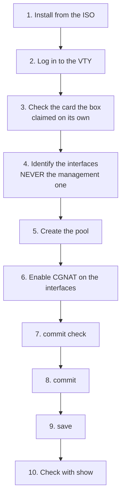
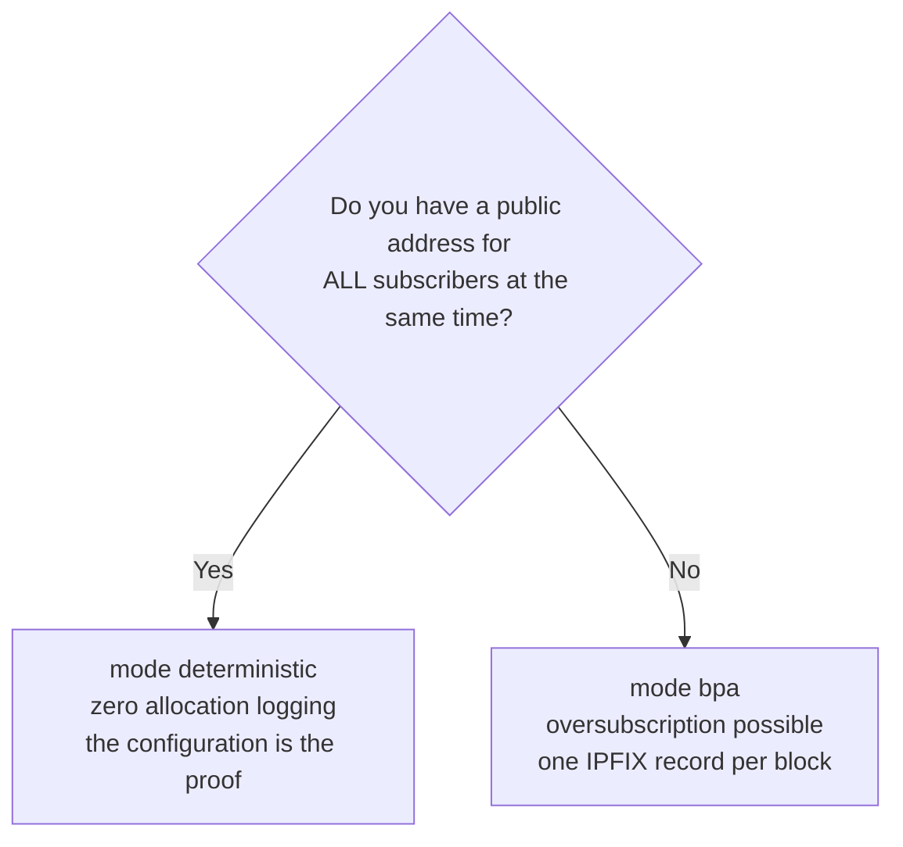

# Getting started

From an empty disk to subscribers browsing. Each step says **what to type** and **how to know it worked**.



## Before you start, decide two things

**1. Whether any card needs to stay with Linux.** On a box with several cards, the dataplane takes all of them except the one recorded as the management network at installation. If you want to keep another one — management VLAN, backup path, storage —, it is `interface <subscriber-card>` under `system` > `dataplane`, which makes the box claim that one and only that one. On a single-card box there is nothing to decide: it goes to the dataplane and the address goes with it.

**2. Deterministic or dynamic.**



Quick math for deterministic: `subscribers × block-size ÷ 64512` = how many public addresses you need. 200 thousand subscribers with 512-port blocks come to about 1,588 addresses — a `/21`.

## 1. Install

Boot from the ISO and type `install`. It asks for disk, hostname, time zone, log volume size, management network and root password **before** writing a single byte, and the boot disk never appears in the target list. The details, and unattended installation, are in [Appliance installation](/s/wiki-en/doc/appliance-installation-gliHrNahhB).

## 2. Log in

Console or SSH land directly in the VTY:

```
prisma>
```

Three things that apply from the very first command:

| What | How it works |
|------|--------------|
| Long output | any `show` longer than the screen stops at `--More--`: space shows the next screen, Enter the next line, `q` or Ctrl-C stop the output and not the session. `\| no-more` at the end of the command shows everything at once |
| Ctrl-C | erases the line being typed, or interrupts the running command, and returns to the prompt. It does not end the session. During `commit`, `rollback` and the loading of a configuration it is ignored |
| Shell | `start shell` opens a shell on the system, and `exit` returns to the VTY. Only for `root` and `prisma-admin` accounts — see [Access, login and roles](/s/wiki-en/doc/access-login-and-roles-uVm2WUy5xB) |

The VTY runs in its own container, the management plane, with your account and your role. That changes nothing about what you type; it is explained on the access page.


:::info
**On first boot the console stays quiet for a while, and that is on purpose.** The box only offers the login prompt after the dataplane is up. If VPP takes a while, the prompt takes a while too — the box has not hung, it is waiting.

The reason is practical: a VTY opened before the dataplane responds cannot read the box's configuration, and a `configure` typed there would build an incomplete candidate. Meanwhile, the self-test writes the boot report to the same console; the prompt appears after it, whole.

If you still log in at a moment when the dataplane has not yet responded, `configure` refuses and says so, instead of letting you work on top of an empty read.

:::

## 3. The dataplane card, which the box chooses on its own

**A freshly installed box already forwards.** You do not need to tell it which card to use: the dataplane claims the cards on its own, by a rule that fits in one sentence and that you can predict without looking anything up.


:::info
**The dataplane claims every PCI card this box has, except one reserved for Linux, and never the last one.**

:::

The reserve **is not a new setting**. It is the management network the installer already asked for, read back from the file it wrote itself. Whoever actually wants a card kept for Linux says so at installation, and nowhere else afterwards.

The "never the last one" is the part that decides the most common case there is — the single-card virtual machine. There the reserve is ignored and the dataplane takes the card; otherwise the box would be installed, correct and forwarding nothing, which is exactly the state this rule exists to end.

A card whose address, MAC and gateway the box **cannot read in full** is not claimed. An address it cannot read is an address it could not give back, and handing over the card in that state would be a handover with no way back.

### Checking what it chose, and why

```
show hardware
```

Besides listing the cards, the screen explains the decision. On a single-card box:

```
The dataplane claims it. It is the only card this box has, and a reserve
never takes the last card.
```

On a box with several and one reserved at installation:

```
Reserved for Linux:
```

followed by the card's name and the sentence saying it is the management network the box was installed with. The name is always the one Linux gave the card (`ens19`, `enp2s0`): the box keeps that name for the cards the dataplane claims, and that is the name they appear with in `show interface` and in the `[edit interface ens19]` prompt. The boot self-test says the same thing on the console, for whoever is looking at the screen and has not typed anything yet.

A box that silently ate a card would be worse than one that asks; and one that silently spared a card would leave the operator with no explanation for a missing card. That is why both halves are stated.

### When you want to choose: `system` > `dataplane`

The command still exists, and it changed role: it used to be a mandatory step, now it is an **override**. It is **exclusive** — naming a card makes the box claim that one and **no other**:

```
prisma> configure
prisma# [edit] system
prisma# [edit system] dataplane
prisma# [edit system / dataplane] interface enp2s0
prisma# [edit system / dataplane] commit
```

That is how you keep a card for Linux on a box with several: name the one that carries the subscribers, and all the others stay. `no interface`, at the same level, hands the choice back to the box.

The name is the one **Linux** gives the card. **TAB** and `?` list the ones the box has and mark which one carries the default route:

```
prisma# [edit system / dataplane] interface ?

  enp1s0  carries the default route: its address moves with it
  enp2s0  card
  <nic>
```

Only cards that **have a PCI address** make the list — the only ones the dataplane can receive. `lo`, a bridge, a *bond* and a *veth* do not appear: offering a name the box would then refuse is the opposite of what this list is for.

### A refusal as you type, and a warning at commit

**On a box that has another card, the one carrying the default route is accepted**, if that is the one you name. It used to be refused, and the refusal said which the other card was. That went away because a new box is configured at the console, and a refusal that protects the card the box is reached through protects a step nobody takes over the network. As you type, nothing is said. What changes is the `commit`: the paragraph about your session stops saying it is safe and says what the single-card box says, that it goes down with it:

```
    restarting it hands the card over and ends every session on this box,
    including this one, so it is not done for you
```

**A name the box does not have is also refused, and it says which ones it has:**

```
prisma# [edit system / dataplane] interface eth9
error: dataplane interface eth9: this box has no such interface
    the cards it has: enp1s0, enp2s0
    this is the name LINUX gives the card, which is what the dataplane is
    handed; 'show interface' lists what the dataplane already has, and on a box
    with no card that is nothing
```

In both cases nothing enters the candidate: the refusal is at the prompt, not after `commit`.

### `commit` stores and recomputes; the restart is what moves the card

Changing the override does not move any card right away. The handover takes the card from Linux and drops everything reaching the box through it, so `commit` stops exactly before that and says where the limit is:

```
prisma# [edit] commit
dataplane interface: enp2s0
    stored, and the boot tuning was recomputed for it
    NOT IN EFFECT YET: the dataplane claims its card when it starts, and this
    commit does not restart it
    restarting it hands the card over and ends whatever is reaching this box
    through enp2s0. The path this box is routed out of is 'enp1s0', which Linux
    keeps, so this session is not what it costs
    it is not done for you all the same: nothing here has measured what
    stopping the dataplane costs a box carrying traffic
    reboot the box in a window you have chosen, and it comes up forwarding on
    that card
commit complete
```

**The middle paragraph is about your box, and it changes with it.** On this one management is on `enp1s0`, which Linux keeps, so bringing down the dataplane does not bring down your session. On a single-card box the same screen says the session goes down with it:

```
    restarting it hands the card over and ends every session on this box,
    including this one, so it is not done for you
```

There are four answers for four boxes, and the box picks its own by reading how it is reached. It is worth noticing which way it errs when it cannot read: it **warns**. A box warned about a session that was never going to drop spends a maintenance window it did not need; a box that was told the session was safe, when it was not, is a box nobody can reach.

## 3b. The single-card box

On a virtual machine with one virtual card — which is how most people know this product — there is no second card. The rule already handles it: **the card goes to the dataplane and the management address goes with it**, without you typing anything.

How this works: the dataplane takes the port and keeps, on the Linux side, an interface paired with it. The management address moves to that interface. The box stops being reached *beside* the dataplane and starts being reached *through* it. The card keeps the same MAC through the crossing, so nothing on the other side of the cable needs to relearn anything.

The way back — address, MAC and gateway — is **computed at boot**, read from the card in the window when it is still readable, and does not survive the boot that computed it. A record written at a `commit` would describe the box as of the day it was written; this one has no way to be stale. The default route is restored in Linux along with the address, which is what keeps the box reachable outside its own subnet.


:::warning
If the box comes up with the card handed over and **nothing** on the other side took it, it warns on the console instead of coming up silently:

```
error: the card this box is reached on was handed over and nothing took it
    this box has no address and cannot be reached over the network until that
    is repaired from here
    'show hardware' says what the dataplane holds; 'no interface' under
    'system' > 'dataplane' gives the card back at the next start
```

:::

## 4. Identify the interfaces

```
show interface
show interface terse
```

Note which one is the subscriber side (*inside*) and which is the upstream (*outside*). Confirm the management one is not among them.

`show interface terse` gives one line per interface with two state columns — `Admin`, which is what is configured, and `Link`, which is what the cable is doing. Before configuring anything, it is the fastest way to see whether the two ports you are going to use are really connected.

## 5. Create the pool

This step and the three that follow are covered, with every screen the box shows and the routing part missing here, in [Configure CGNAT step by step](/s/wiki-en/doc/configure-cgnat-step-by-step-jU9hEJYMch).

```
configure
 nat
  cgnat
   pool residencial
    prefix-inside 100.64.0.0/10
    prefix-outside 203.0.113.0/24
    block-size 512
    ports 1024 65535
    policy interleaved
    mode deterministic
    tcp-mss auto
    exit
   exit
  exit
```

What each line decides:

| Line | Decision |
|------|----------|
| `inside` | whose traffic gets translated |
| `outside` | which public addresses it leaves with |
| `block-size` | how many ports each subscriber gets (power of two) |
| `ports` | usable port range of the public address |
| `policy interleaved` | neighbors on different public IPs, which dilutes reputation blocking |
| `mode deterministic` | block by formula, no allocation logging |
| `tcp-mss auto` | avoids connections that hang with no error message |

Not sure what to type? **TAB** completes and `**?**` lists the valid options with a description, at any point in the line.

## 6. Enable on the interfaces

The CGNAT side is typed in each interface's block:

```
interface ens18
 cgnat inside
 exit
interface ens19
 cgnat outside
 exit
```

## 7. See what will happen, before it happens

```
show configuration compare
commit check
```

`commit check` validates without applying and without touching the equipment. On a new pool that is all there is to check. On a pool that already exists it says more: if the change re-maps subscribers, the count comes out here, before applying.

On a pool that **already exists**, the question that matters is a different one — how many people will drop —, and the one that answers it is the plain `commit`: it refuses the mapping change and prints the exact count before asking for `commit remap`.

## 8. Apply

```
commit comment "pool residencial inicial"
```

Working remotely? Use the safety net:

```
commit confirmed 5
```

It applies now and undoes itself in 5 minutes if you do not confirm. If the change cuts your own access, the machine recovers.

## 9. Save

```
exit
save
```

`**commit**` **makes it take effect now;** `**save**` **writes it to disk.** Without `save`, the configuration disappears at the next boot. They are two distinct decisions, which is why they are two commands.

## 10. Check

```
show cgnat pool
show cgnat subscriber 100.64.0.5
```

`show cgnat subscriber` answers with the **public address**, the **port range** of that subscriber and how many sessions it has open (`sessions N`).

If the address does not belong to any pool, it says `not inside any configured pool`. That is an answer, not an error: it means no `inside` covers that address.

With traffic flowing:

```
show cgnat top       who is closest to filling the block
show cgnat drops     what did not get through, and why
```

## What about routing?

It is configured in the same VTY, in the same session and with the same `commit`: static routes in `router static`, BGP in `router bgp`, and routing policy in `policy-options`. The minimum for CGNAT to work — the default route and the pool announcement — is in [Configure CGNAT step by step](/s/wiki-en/doc/configure-cgnat-step-by-step-jU9hEJYMch); full BGP, in [BGP configuration](/s/wiki-en/doc/bgp-configuration-ykey7SaE44).


:::warning
**Watch out for MTU.** An interface without `mtu`, and its Linux pair, start at 1500, the box default since 0.152.1 (on a card that cannot reach 1500, at the card's maximum). A neighbor on a different MTU leaves the OSPF adjacency stuck in Exchange, with no error message. Adjust it with `mtu` inside the `interface` block. On a box installed before 0.152.1 the interfaces stay at 9000: the upgrade wrote `mtu 9000` on them.

:::

# How to check

Before considering the machine ready:

- [ ] `show hardware` shows the cards the dataplane claimed, and the management one is not among them (or, on a single-card box, the box is still reachable after the restart)
- [ ] The management interface is **not** in CGNAT
- [ ] `show cgnat pool` lists the pool
- [ ] `show cgnat subscriber <test-ip>` returns a public address and port range
- [ ] Test traffic goes out and comes back
- [ ] `save` was run
- [ ] If in dynamic mode: IPFIX collector configured and `show cgnat logging` confirms

# See also

* [Day-to-day recipes](/s/wiki-en/doc/day-to-day-recipes-KCc5cOuBip) — the tasks that come after it is live
* [Pool configuration](/s/wiki-en/doc/pool-configuration-wkJ1DcmG2Y) — every pool field, field by field
* [Operations and troubleshooting](/s/wiki-en/doc/operations-and-troubleshooting-kql3GmIqmX) — when something does not work
