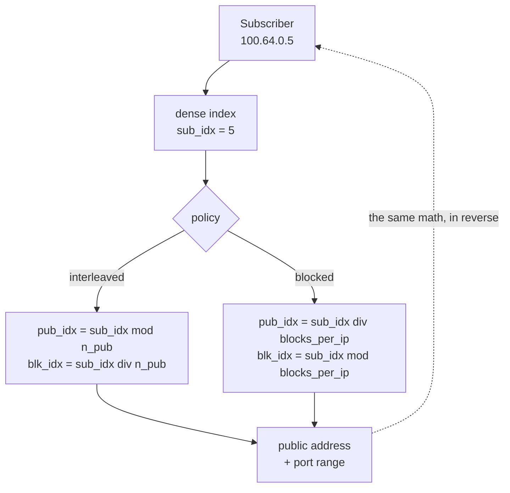

# Deterministic and BPA — concepts and mapping

How a subscriber's port block is decided in each of the two pool modes, and the practical consequences of that. Read before choosing a pool's mode or touching any mapping field.

# Deterministic and BPA: two forms of block-based CGNAT

Both give each subscriber a **contiguous block of ports**, instead of one record per flow. What changes is how the block is assigned, and with it what needs to be logged:

* **Deterministic** — the block comes from a **formula** over the pool configuration. To find who was using an IP and a port, the math is enough, with no allocation log at all. It is `mode deterministic`.
* **BPA** — *Bulk Port Allocation* — blocks are **allocated dynamically**, on demand: the subscriber receives a first allocation and gets more blocks in steps, as they fill the ones they have. Each allocation and each release becomes a record, and those records are what answer who was using the port. It is `mode bpa`, with `block-size` as the step, `max-blocks` as the ceiling and, if you want a first allocation larger than the step, `initial-allocation`.

BPA is **only** the dynamic mode. Deterministic is not a kind of BPA: the umbrella for both is *port-block CGNAT*, and the choice is between deterministic and BPA.

The dataplane module that does both is called `bpa`, and that name appears in counters and internal identifiers for both modes. It stays that way so as not to break scripts and installed boxes, but it does not mean a deterministic pool is BPA. In the VTY, the commands are `show cgnat ...`.

|     | Deterministic (`mode deterministic`) | BPA (`mode bpa`) |
|-----|------------------------------------|----------------|
| How the block is assigned | by formula                         | on demand      |
| Allocation log | **none** — except the `reserve` blocks, logged one by one | one IPFIX record per block allocated and per block released |
| Public addresses needed | all subscribers must fit           | oversubscription possible |
| Evidence for an authority | algorithm + configuration in effect (trail), plus the records of the reserve blocks | the IPFIX records |
| Extra block for whoever fills theirs | only with `reserve` configured     | yes, up to `max-blocks` |

200 thousand subscribers in deterministic mode with 512-port blocks require a public `/21`. In BPA with oversubscription, much less.

:::info
**A BPA pool without export is a pool nobody can answer for.** In BPA the exported record is the only evidence of who was behind a public port. `commit check` and `commit` warn, naming the pool, when a dynamic pool — or a deterministic one with `reserve` — has no collector configured. It is a warning and not a refusal, because a pool built before the collector existed is a correct configuration.

:::

# How the deterministic mapping works

A pool defines two **address sets** and a block size. Each set is a list of prefixes, possibly non-contiguous, presented as a dense index space `[0, count)`. In deterministic mode, the subscriber's block is this calculation:

In BPA there is no such calculation for the subscriber: the block comes from a list of free blocks, and only the exported record links the block to whoever received it.

## Rules the mapping imposes

* **Prefixes within a set cannot overlap.** Overlap breaks the address↔index bijection, and a broken bijection means **one subscriber logged as another** — a legal compliance failure, not just a bug. Overlapping prefixes are refused in the configuration.
* A `/0` prefix is refused: "all addresses" is not a pool.
* `block-size` **must be a power of two.**
* A pool's capacity cannot exceed 2^28 subscribers.

## Why `interleaved` is the default

With `interleaved`, consecutive subscribers land on **different** public addresses. If a public address gets blacklisted, the damage spreads thin instead of taking down a whole neighborhood behind an OLT.

With `blocked`, neighbors stay on the same public address — useful when you want to concentrate, but it also concentrates the reputation risk.

## The reserve: deterministic's only exception

In deterministic mode, the formula hands **all** blocks to some subscriber, so there is no block left for whoever fills theirs: with nothing else, the packet is dropped. `reserve <n>` sets aside **n blocks from each public address** of the formula and hands them to subscribers who filled their own block.

These blocks are exactly the ones the algorithm does **not** produce, so the configuration does not answer for them: each one is exported as an allocation, just like a BPA block. And `reserve` is part of the pool definition — changing it remaps the subscribers, because it takes capacity away from the formula.

# The consequence that brings down networks most often

:::warning
**The deterministic mapping is arithmetic, not a table.** There is no allocation record to look up — and that means **changing the pool definition changes the function**.

:::

Having no table is the whole point of deterministic mode: it is what eliminates the allocation log and, along with that, what lets both traffic directions be sliced among workers without any lock.

Adding a public prefix moves **all** subscribers at that instant and ends all sessions of the pool. Nothing is corrupted, past answers remain resolvable, but:

* all customers drop at the same time;
* the machine reports nothing abnormal, because nothing abnormal happened.

That is why `commit` refuses changes like this until they are asked for by name, with `commit remap`. And that is why the count — how many subscribers move, and where some of them go — comes out in `commit check`, before anything happens, and again in the `commit` refusal.

# Sharding: why the handoff exists

The session state and the per-subscriber port map are **per worker and lock-free**. That is only safe if **both directions of a subscriber reach the same worker** — and the card's RSS does not give that guarantee: outbound hashes on the private address, inbound on the public one.

The equipment solves this by forwarding the packet to the worker that owns the subscriber, before translating — and this is verified on real packets, not on counters. The owner is computed **from the packet itself, by arithmetic**: on the return path, from the public address and the port. That is what eliminates a table shared between workers.

With `cgnat-workers <n>`, under `system` > `cpu`, only the last `n` workers own subscribers and translate; the others only receive packets from the card and hand them to the owner. Without this setting, every worker does both. The page [Sizing and requirements](/s/wiki-en/doc/sizing-and-requirements-IHPnUSMSom) says how to choose.

## In BPA, the pool is sliced per worker

Allocating blocks would be state shared between workers. Instead, the blocks of a dynamic pool are **divided among the workers**, and each worker only hands a subscriber blocks from its own slice. A subscriber's worker is fixed by their address, not by a counter — so nothing balances the slices.

The practical consequence: **oversubscription is measured per worker, not across the whole pool.** One slice can run out while another still has free blocks, and a subscriber can be refused with blocks to spare right next door.

That is why `show cgnat pool` shows, below the capacity, the number the pool **guarantees** for any set of subscribers, when that number is lower than the capacity. **That floor is what you size a BPA pool against.** The loss is zero when inside addresses are handed out in sequence from the start of the range — a DHCP pool filling from the bottom up — and it is large in small pools with many workers.

:::info
There is a mechanism that lends a free block from one worker to another, in the one-second cycle in which the box already expires idle blocks. It works, but **it ships off**: in the lab, every tuning that serves the refused subscriber also lends away a block the next subscriber of the worker itself wanted. Until this is measured with real traffic, size by the floor.

:::

In deterministic mode there is no slice to lose: the block is the math, and the floor equals the capacity.

# Traffic that is not translated

`bypass` makes a prefix go out without translation — and, what matters just as much, **without allocating anything**.

The second half is the one usually missing in other equipment: a bypass applied *after* allocation goes out untranslated, but has already consumed a port from the block of a subscriber who never needed it. Here both properties are verified on the packet.

Traffic from a subscriber destined **to the box itself** — the gateway, the uplink address, its SSH or DNS — also passes without translation and without a session.

# What changes without rebuilding the pool

See the pool configuration page. The rule: **changes the mapping → rebuilds; does not change it → applied in place**. Mapping is prefix, `block-size`, `ports`, `policy`, `mode`, `vrf`, `outside-vrf` and `reserve`; the rest — timeouts, ALGs, limits, MSS, bypass, port forwards, `max-blocks`, `initial-allocation` — is applied on a pool with traffic.

This is not optimization, it is correctness. Dropping the whole subscriber base to turn off an ALG, limit an infected machine or give a customer an inbound port is not a change anyone would ask for.

# See also

* [Pool configuration](/s/wiki-en/doc/pool-configuration-wkJ1DcmG2Y) — where the theory becomes a configurable field
* [IPFIX logging and audit trail](/s/wiki-en/doc/ipfix-logging-and-audit-trail-mrQPyuvc8g) — the legal consequence of the chosen mode
* [When a subscriber's block fills up](/s/wiki-en/doc/when-a-subscribers-block-fills-up-NvSSgpWda1) — `max-blocks`, `reserve` and what the operator sees
* [High availability](/s/wiki-en/doc/high-availability-cMUVBBTFgL) — why the formula needs no synchronization, and why BPA has no such guarantee
