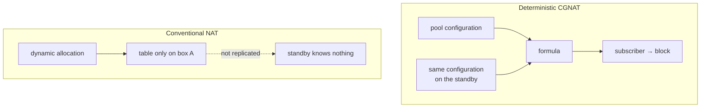

# High availability

What happens when this box goes down, how to build the active/standby pair, what the failover preserves and what it drops. For anyone designing redundancy.


:::info
**Active/standby is implemented.** Two boxes hold a service address between them with VRRP (RFC 5798) **on the dataplane interface**, and the acceptance check — two instances, three ways of losing the active one — passes in full.

**What still does not exist is session synchronization.** Connections in progress drop on failover, as they drop in any NAT. What does not change is the subscriber's public address and port block.

:::

# What deterministic mode gives you for free

In a conventional CGNAT the subscriber → (public IP, port) mapping is the result of dynamic allocation: it exists **only** in the table of the box that created it. A standby knows nothing, and a failover changes everyone's public address.



| After failover | Conventional NAT | Deterministic CGNAT |
|----------------|------------------|---------------------|
| Subscriber's public IP | changes          | **does not change** |
| Port block     | changes          | **does not change** |
| Connections in progress | drop             | drop                |
| New connections | need a new allocation | work immediately    |
| State to synchronize for the above | the whole table  | **none**            |

The line that matters: connections in progress drop in both cases, but in deterministic mode they are re-established **on the same public address**. For the subscriber, the difference between "it dropped and came back" and "it dropped, came back and now my IP is different" is large — the second breaks everything that depended on the address.

This is not HA. It is the floor HA starts from, and it is already higher than usual.

**This applies to deterministic pools.** A BPA pool (`mode bpa`) allocates blocks on demand, and the box that takes over does not know what the other allocated: there, the failover behaves like the conventional NAT column — the subscriber comes back with another block, and possibly another public address.

# What is still missing

Preserving connections in progress requires synchronizing the session table, because the return path needs the **private port** — and no formula produces that.

| Design | Cost | What it preserves |
|--------|------|-------------------|
| Active/standby without synchronization | \~zero | public address and block; connections drop |
| Session synchronization over multicast | high: every session creation and removal becomes a message | connections in progress |
| Active/active with subscriber partitioning | medium | half the traffic unaffected by a failure |

Session synchronization is the only one that preserves connections and the most expensive: on a box with 200 thousand subscribers with hundreds of sessions each, replicating every creation and removal is a control plane stream comparable to the log itself.

**Dynamic mode (BPA)** adds a requirement: block allocation would have to be coordinated, or the two boxes would allocate different blocks to the same subscriber. None of this exists today.

# How to build the pair

Active/standby with VRRP on both sides — public and inside —, **without** session synchronization. It is honest about what it delivers: it does not preserve connections, it preserves addresses.

On each box, one virtual router per side, with the same `vrid` on both boxes and a different priority:

```
interface enp1s0
 ipv4 address 100.64.3.252/22
 cgnat inside
 vrrp 1 address 100.64.3.254
 vrrp 1 priority 200
 vrrp 1 track enp2s0 decrement 150
 exit
interface enp2s0
 ipv4 address 200.150.0.11/24
 cgnat outside
 vrrp 2 address 200.150.0.254
 vrrp 2 priority 200
 vrrp 2 track enp1s0 decrement 150
 exit
```

On the other box, its own addresses and a lower priority (100, for example). Subscribers point to `100.64.3.254` and transit sends the pool to `200.150.0.254` — addresses that **neither of the two** owns as its own address.

**Where the virtual router runs, and why that is the whole decision.** FRR ships VRRP and `keepalived` was the other alternative; both run in Linux, which on this box is the `linux_cp` pair. The pair is not where the packets go through — the dataplane interface is. A pair built that way would move an address in Linux and leave the FIB and the CGNAT on the box that died. The dataplane already had the answer: VPP's own VRRP plugin, loaded on every box, with no virtual router at all because nothing asked for one.

**The virtual MAC is what lets the CPE not need to know anything.** Whoever takes over the address takes over the MAC `00:00:5e:00:01:<vrid>` with it and sends a gratuitous ARP; the CPE keeps sending to the same MAC and the frame starts arriving at the other box.

**IPv6, and a NAT64 pool in the pair.** An IPv6 address under the same `vrrp <vrid>` — a link-local first, then the global one — builds that id's IPv6 virtual router beside the IPv4 one, with the same priority, the same `track` and the same preempt. That is what makes a NAT64 pool fail over: the IPv6 subscribers' gateway follows the box that holds the public addresses. The IPv6 virtual MAC is `00:00:5e:00:02:<vrid>`. `commit check` refuses an IPv6 router with no link-local, and warns when a pair has a NAT64 pool and no IPv6 router.

`**track**` **is the failure the rest does not cover.** A box with its uplink pulled stays alive and keeps advertising: it holds the gateway address and reaches nothing. With `track`, the priority drops by the decrement and the peer takes over. Choose the decrement so that the drop takes the priority **below** the other one's. A router sees a tracked interface as up only when it has an address of the router's family: for the IPv6 router the box enables IPv6 on the tracked interface by itself; for IPv4, the tracked interface needs an IPv4 address, and `commit check` warns when it has none.

**The virtual address does not answer ping.** Whoever does not own the address does not answer ICMP for it — that is the RFC 5798 default (section 6.4.3). Monitoring should ping each box's **own** address, which is what tells you whether that box is alive; the virtual address only tells you which of the two holds it. Forwarding **through** it works normally.

The advertisement interval is not configurable: it is the RFC's one-second default, which puts a failover at around three and a half seconds. It must be equal on both boxes, and a per-box setting is a per-box way to get it wrong.

**The configured priority decides, and preemption is on.** A box that comes back resumes service: the pair ends where the configuration says, not where the last failure left it.

**Changing a virtual router is a failover, not a tweak.** A virtual router is not edited in place: any field changed on a router that already exists makes the box stop advertising while it is rebuilt, the peer takes over the address and preemption returns it — two elections, a few seconds apart, and connections in progress drop in both. `commit` says so before applying. Creating a new router costs nothing, because there is no address to lose.

`**commit check**` **refuses what** `**commit**` **could not apply**: a virtual router without an address, and a `track` or a `vrrp` on an interface the dataplane does not have.

# What the acceptance check measures

The acceptance check was written **before** the implementation, so that the implementation would be judged against the requirement and not the other way around. All 22 of its checks pass:

| What was measured | Result |
|-------------------|--------|
| The subscriber's translated traffic through the service address, before any failure | Works, and the outside sees the address and block the formula gives |
| **Uplink pulled**, with the box alive and holding the subscriber's address | Survives: `track` brings the priority down and the peer takes over, on the same public address and a port from the same block |
| **Dataplane stopped** the way the service itself stops it | Survives, in around four seconds |
| **Dataplane killed** with SIGKILL | Survives, in around three seconds |
| A TCP connection in progress during the failover | **Drops**, and a new one from the same subscriber gets the same address and the same block |

With a NAT64 pool and an IPv6-only subscriber, the same three failures were measured: the service comes back in about 3 to 4 seconds, on the same public address and the same block, and connections in progress drop the same way.

The table's last line is this page's promise stated in reverse: nobody should read a green run as "the connections survived".

What was **not** measured here: whether the real network card reports that the cable came out. The lab interface does not, so the lab brings the port down in the dataplane too — which is the state a card with the cable out reports in hardware.


:::warning
Configuration equality cannot be skipped. In deterministic mode, two boxes with different configuration fail **silently**: the failover starts mapping subscribers to wrong blocks with no visible error, and the logs of both boxes look perfectly healthy. Configuration equality is a requirement, not a convenience.

:::

# Checking that the two boxes agree

There is only one question: would a box failover leave each subscriber on the same public address and the same port block? `show cgnat ha` answers that and nothing beyond that.

For the box to compare, it needs to have the other one's configuration. **VRRP carries no configuration at all** — the RFC advertises a priority and an address, and nothing else —, so the peer's configuration arrives as a file: run `save` on the other box and copy the file it writes, `/etc/prisma-routing/prisma-routing.conf`, to `/etc/prisma-routing/peer.conf` on this one.

**On a box that is part of a pair,** `**commit**` **refuses a change that would diverge.** With `vrrp` on some interface and a readable `peer.conf`, a candidate that would map subscribers differently from the peer is refused by pool name, and `commit diverge` is the word of someone who knows what they are doing — because two boxes are not committed at the same instant, and every correct expansion diverges the pair between the first commit and the second. The *commit, rollback and save* page describes the whole refusal.

**The screen reads the virtual routers of both boxes, and not only the mapping.** The peer's file is the configuration it saved, so it carries its `vrrp` lines too — and two boxes that map every subscriber the same can still be a pair that never fails over:

```
  the pair
    every virtual router this box carries has one on the peer with the same id,
    the same address and a different priority
```

Two findings, and both are configuration errors with no symptom until the day it matters:

* **the same priority on both boxes.** RFC 5798 breaks the tie by the higher source address, so the pair works and who keeps the service is decided by something nobody wrote. The first failover lands wherever the addressing puts it.
* **a** `**vrid**` **that only one of the boxes holds.** There is no standby for that address: the box that holds it is alone. A different virtual address under the same `vrid` is this same finding twice, once for each box.

The comparison is by `**vrid**` **and by address**, never by interface name: the two boxes hold an address under a `vrid`, and what the port is called on each side is each one's business — `enp1s0` here may be `enp2s0` there and the pair is right.

When the two diverge:

```
prisma> show cgnat ha
  this box
    mapping fingerprint  50e2b92f23c2707c
    pools                residencial

  role
    enp1s0 vrrp 1   master, holding the address
      address(es)        100.64.3.254
      virtual mac        00:00:5e:00:01:01
      priority           200

  peer, from /etc/prisma-routing/peer.conf
    mapping fingerprint  9e7394fc505d2eff
    pools                residencial
    copied               2026-09-12 09:14:31

  the pair
    every virtual router this box carries has one on the peer with the same id,
    the same address and a different priority

warning: pool 'residencial' does not map subscribers the same way on the two
    boxes, so a failover moves them to other public addresses and port
    blocks, and neither box logs anything
    this box: block-size 2048
    the peer: block-size 1024
```

The box says **which pool** differs and **which lines** differ, not just that the numbers match or do not match. When they agree, the last part becomes a single sentence:

```
  the two boxes map every subscriber to the same public address and the same
  port block
```

The same comparison runs in `commit check` and in `commit`: a change that pulls the pair apart shows up at the moment it is made, and not at the moment the other box is needed.


:::info
**On a box that is not part of a pair, this is a warning and never a refusal**, and that is on purpose: without `vrrp` on any interface, a `peer.conf` there is comparison material, and a file in `/etc` does not create a relationship the configuration does not declare.

**On a box that is part of a pair, it is a refusal — with a word that overrides it.** The two boxes cannot be changed at the same instant: every legitimate capacity expansion pulls the pair apart between the first commit and the second. A refusal with no way out would fire on every correct procedure, and the way to escape it would become to stop copying the peer's configuration — which removes the check, not the divergence. That is why `commit diverge` exists.

:::

## Which fields must be equal

The ones that change the **mapping**. In deterministic mode the subscriber's public address and port block are a function of the pool definition, so what must match is exactly what changes that calculation — and it is the same list of fields that, when changed, drops the pool's sessions.

| Must be equal on both boxes | May differ |
|-----------------------------|------------|
| `prefix-inside`, `prefix-outside`, or what `prefix-list-inside` and `prefix-list-outside` resolve to | `timeout ...` |
| `block-size`, `ports`       | `alg` for each protocol, `tcp-mss` |
| `policy`, `mode`            | `bypass source`, `bypass destination` |
| `reserve`                   | `max-sessions`, `max-session-rate` |
| `vrf`, `outside-vrf`        | `forward ...`, `block-stride`, `max-blocks`, `utilisation-alarm` |
| `subscriber-length`, `nat64-prefix` (NAT64 pool) | `initial-allocation`, `filter` |

The dataplane changes the right-hand column on a pool that is passing traffic, and none of these settings moves any subscriber. Two boxes that differ only there are correct, and warning about them would teach the operator to ignore the warning that matters.

## What the check never does

It can say "they differ", it can say "they agree" and it can say "I don't know" — and the third answer never becomes the second.

| Situation | What the box says |
|-----------|-------------------|
| There is no peer file | That there is none, and that this is not an agreement |
| The file is empty, truncated or has no pool at all | The reason, never "equal" |
| The file has a line this VTY cannot read | Which line, because the compared pool would not be the one the peer has |
| The dataplane does not respond | That it stopped there: without it this box does not know what it maps itself |


:::warning
The peer's file is a **copy**, and a copy has an age. That is why the report shows the date next to the fingerprint: a fingerprint that matches a configuration the other box stopped using last week is the same false agreement the check exists to remove. Copy it again whenever you change the peer.

:::

# Operating the pair

* Keep the configuration of the two boxes identical and versioned, and **copy the** `**peer.conf**` **again whenever you change the peer** — the `commit` refusal only sees what the file says, and the file has an age.
* Check with `show cgnat ha` after every change: it tells you the role of each virtual router, the virtual MAC, the priority the box is **advertising** — which is not the configured one when something tracked is down — and whether the two map the same. A box advertising less than it was configured with has a cable out, not a VRRP problem.
* Looking at a single port, `show interface <name>` tells you whether that port is holding the service address or waiting.
* At boot, the console self-test says whether the virtual routers in the saved file are actually in the dataplane, and how many are holding an address and how many are on standby. A `vrrp` the dataplane refused does not show up in `show running-config`, and without that line the peer would be alone without anyone knowing.
* To take the box that holds the service down for maintenance, follow the recipe *Maintaining a box that is part of a pair*: lower the priority, check on both boxes, do the work, restore.
* Treat a failover as a window: subscribers come back on the same addresses, but connections in progress drop.
* Monitor each box's **own** address, not the virtual one.
* If you run BPA (dynamic mode), remember that the block is **not** reproducible by formula: there the failover really does change the subscriber's block.

# See also

* [Setting up an active/standby pair](/s/wiki-en/doc/setting-up-an-activestandby-pair-YclNlmh15V) — the steps, in order, with what to check at each one
* [Deterministic and BPA — concepts and mapping](/s/wiki-en/doc/deterministic-and-bpa-concepts-and-mapping-NMOHVImQiU) — why the formula makes synchronization unnecessary
* [Expanding capacity without dropping subscribers](/s/wiki-en/doc/expanding-capacity-without-dropping-subscribers-R1zYvsfLCT) — the other place where identical configuration matters
* [Day-to-day recipes](/s/wiki-en/doc/day-to-day-recipes-KCc5cOuBip) — *Maintaining a box that is part of a pair*
* [commit, rollback and save](/s/wiki-en/doc/commit-rollback-and-save-HVsz5GElE1) — the `commit diverge` refusal in full
* [Prisma Routing — overview](/s/wiki-en/doc/prisma-routing-overview-GRVBysg8Mo) — the status of each component
