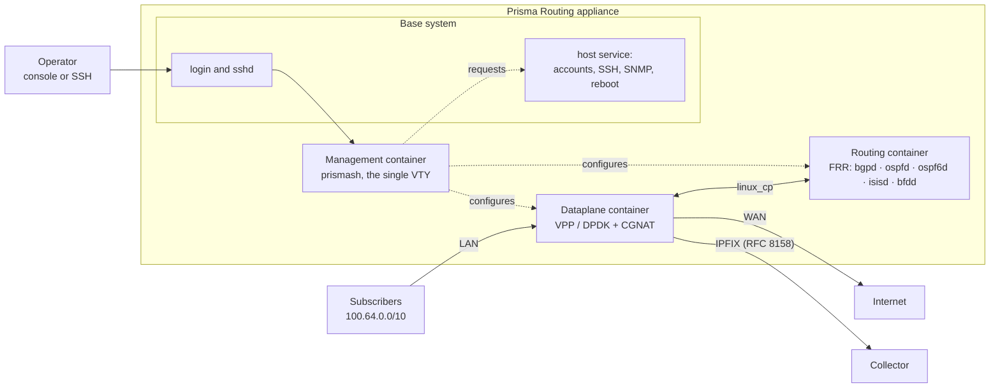

# Prisma Routing — overview

Software router with built-in CGNAT, built on **VPP/DPDK** in the dataplane and **FRR** in the control plane, delivered as a Debian appliance installable from an ISO. This page says what the product is, what it is made of and what it deliberately does not do — for whoever is evaluating it or needs to explain the box to someone.

The differentiator is **port-block CGNAT**: instead of logging every NAT flow, the equipment gives each subscriber a **contiguous block of ports**. That reduces the log from terabytes to one record per block with **BPA** (*Bulk Port Allocation*, blocks allocated on demand), or to **zero** with **deterministic** (block calculated by formula).

## Why port blocks

The Marco Civil (Brazil's Law 12.965/2014; retention requirements differ by country) requires one year of retention of connection records. Per-flow logging in CGNAT generates an impractical volume. This box **exports** the records and keeps none — the collector is what keeps them for the year. The two forms, chosen per pool:

* **Deterministic** (`mode deterministic`) — the public address and the port block are *calculated* from the pool definition. There is no allocation event, so there is nothing to export. The evidence handed to an authority is *"the algorithm, plus the configuration in effect at that instant"*, and that is why the box keeps a dated configuration trail. The only exception are the blocks of a `reserve`, which the formula does not produce and are therefore exported one by one.
* **BPA** (`mode bpa`) — blocks are allocated dynamically, on demand and in steps, with one IPFIX record per allocation and per release (RFC 8158), not per flow.

BPA is only the dynamic mode: deterministic is not a kind of BPA. The two together are *port-block CGNAT*.

## Architecture

On an installed box, the dataplane, routing and management each run in their own container, on a Debian 12 base system with its own kernel.

* **The dataplane** does the forwarding and the translation. The cards it uses leave Linux and become its own.
* **Routing** is FRR, which sees each dataplane interface through a pair in Linux (`linux_cp`) and installs routes in the dataplane's forwarding table.
* **Management** is where `prismash` runs: the single VTY, which configures CGNAT, interfaces, routing and the system through the same interface. Each login enters it with its own account and its own role.
* **The base system** keeps what the management container cannot do on its own — accounts, SSH, SNMP, resolvers, restart and shutdown. The VTY **requests** these changes from a host service, which only accepts a closed list of commands. `start shell`, restricted to administrators, opens a shell **on the base system**, not in the container.
* **The records** of blocks that go to the collector over TCP, and usually the UDP IPFIX too, leave from a container of their own, with limited memory, so that a slow collector or the replay of a spill file costs the dataplane no packets. With that container down, the dataplane sends them itself again within about a second.
* **PPPoE**, when configured, runs in a fifth container with its own memory limits: a failure there takes neither forwarding, routing nor the VTY with it. A box without PPPoE does not start it.

Every change to the dataplane goes through its binary API, over a connection opened at the start of each VTY session and kept while it lasts — not through the dataplane's text command line, which exits with code zero even when it fails.

Besides IPv4 CGNAT, the same box does [**NAT64**](/s/wiki-en/doc/nat64-ipv6-only-subscribers-in-the-same-public-space-ryyEIrqWdV) (IPv6-only subscribers leaving through the same public space, in the same port blocks) and can **terminate PPPoE subscribers**, authenticated by RADIUS and translated by the CGNAT. Monitoring is over SNMP, and a [gRPC management API](/s/wiki-en/doc/management-api-grpc-for-integrators-I09RqhUqBn), off by default, lets an external system configure and read the box by the same rules as the VTY.

:::info
If the management container is not up, login falls into the base system's own VTY, as before. A box with that container stopped remains accessible.

:::

## Sizing

200 thousand subscribers in deterministic mode with 512-port blocks require a public IPv4 `/21`. BPA with oversubscription needs much less.

The minimum is **6 GB of RAM** (8 recommended) and a CPU with **SSE4.2**. Below 6 GB the box comes up and forwards nothing. The memory the CGNAT gets for sessions is a number you define.

## Status per component

| Component | Status |
|-----------|--------|
| Deterministic mapping core | Verified against the Python reference model, mapping by mapping, the whole pool |
| Dataplane (translation, handoff, BPA mode, fragments, ICMP errors, TCP state) | Verified with injected and real traffic |
| Routing (BGP, OSPF, IS-IS, BFD, routing policy) | Verified — routes reach the VPP FIB |
| IPFIX logging (UDP and TCP) | Verified with a decoding collector |
| VTY (`prismash`) | Candidate, `commit`, `rollback`, roles; each line is refused where it is typed, including routing ones |
| Appliance (ISO, kernel, containers, tuning) | Every version that publishes an ISO is installed on a disk and rebooted from it before release, also on a virtual machine without 1 GB pages; the self-test reports ready |
| **High availability** | **Active/standby implemented**: VRRP on the dataplane interface, over IPv4 and IPv6 (a NAT64 pool fails over too); the acceptance test (uplink pulled, dataplane stopped, dataplane killed) passes, with every subscriber keeping their public address and block. Sessions are **not** synchronized: connections in progress drop |
| **Throughput** | **Bits per second NOT measured** — that requires a card DPDK drives natively. The per-packet cost in CPU cycles in the translation nodes is measured |

The project stays at `0.x.x` until it is declared production-ready. Incompatible changes are allowed and are announced.

:::info
**Numbers measured on a virtual machine are not capacity.** With a virtio card, what you measure is the hypervisor, not the box. No throughput number is claimed until it is measured on a real card.

:::

## Deliberate absences

These are not gaps — they are recorded decisions:

* **Session synchronization between the boxes of a pair** — does not exist, and the cost is the reason: on a 200-thousand-subscriber box, replicating every session creation and removal is a stream comparable to the log itself. Active/standby exists and preserves address and block; connections in progress drop.
* **Throughput numbers** — nothing is claimed without measurement on hardware.
* **Per-flow logging** — refused. It is exactly what the port block exists to avoid.
* **NPTv6 and DPI** beyond what an ALG needs to rewrite — out of scope.
* **Graceful pool migration** — it would give a subscriber two mappings, and the reverse arithmetic could not tell them apart.

# See also

* [Deterministic and BPA — concepts and mapping](/s/wiki-en/doc/deterministic-and-bpa-concepts-and-mapping-NMOHVImQiU) — the arithmetic behind it
* [High availability](/s/wiki-en/doc/high-availability-cMUVBBTFgL) — the pair, what the switchover preserves and what it drops
* [Sizing and requirements](/s/wiki-en/doc/sizing-and-requirements-IHPnUSMSom) — RAM, CPU and public addresses for your case
* [Getting started](/s/wiki-en/doc/getting-started-WksYlCtcGd) — where this becomes a machine on the air
